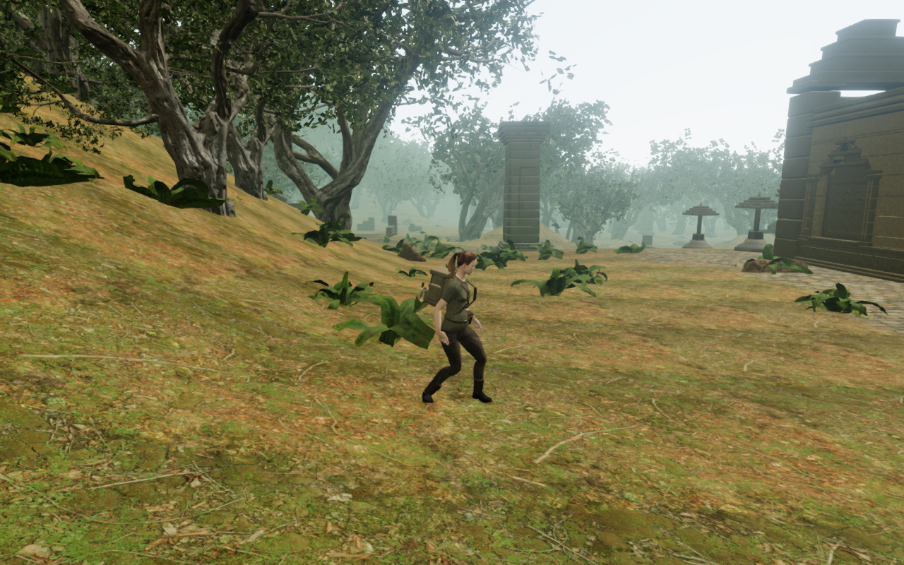
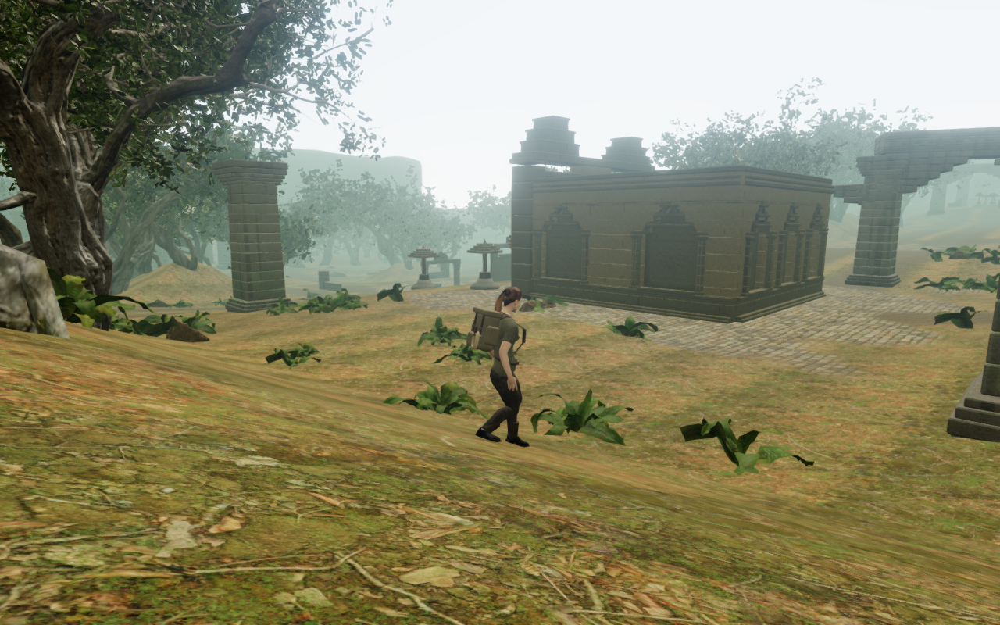
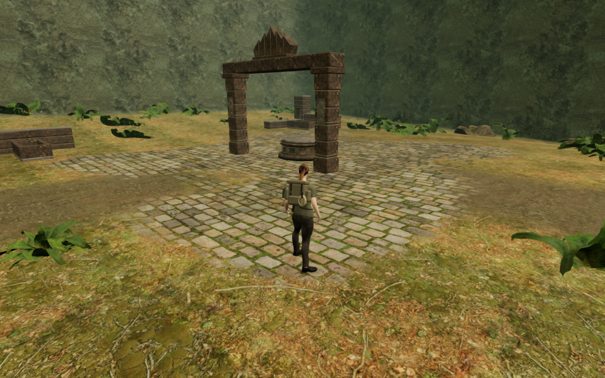

# Jungle forest floor

Visible grass beside the jungle entrance previously continued past an invisible
walking-grid boundary. The same ordinary controller move from x = 372 m,
z = 49 m now reaches x = 379.50 m rather than stopping at x = 374.00 m.
Exploration follows the main forest terrain, with trunks, rocks, structures,
water and steep slopes retaining their physical clearance checks.

The valley now ends at a wooded escarpment formed from the terrain itself.
Broad seeded variation moves its toe and height, and rounded corners avoid four
straight retaining-wall silhouettes. The existing slope material supplies the
rock faces. The distant forest floor follows the raised edge; that outer scenery
remains beyond the walking domain.

The preceding High view ends at the old mask. The revised High view below
follows the same outward controller input onto the forest floor. The endpoint,
pose and camera differ because the explorer now travels farther; these are
movement comparisons, not identical-camera image differences.

## Terrain and movement

Only the outer 28 m of the jungle heightfield changes. The complete existing
walking footprint, its terrain-cell collar, reservoir footprints and buffered
beds remain unchanged. Regression digests preserve all 33,280 walking vertices,
1,573 water-footprint vertices and 45,369 interior vertices from published
69a8484. These sets overlap. The rim changes 8,442 outer vertices.

The explored chart gains 1,374 coarse forest cells that pass its local terrain
grade check. This describes chart coverage; individual trunks, rocks, buildings
and slopes still determine where the explorer can stand. It is not a claim that
every point inside a chart cell is reachable.

Falling feet now meet an uphill terrain step before moving across it. At steep
jungle faces, a descending body tries physically clear sideways displacements
before accepting support. It tries short ordinary directions first and refines
them only when a confined contact has no coarse exit. Candidates must clear
both the actual terrain and existing object collision queries. The recorded
west contact exposed a narrow exit between coarse directions; its regression
and live route now settle instead of retaining a midair height.

The full browser level plants 728 interior trees using the two existing shared
trunk kernels. The bare unit fixture plants 729 because it lacks the full
level's structure reservations. Its preceding count was 752; the new steep
outer faces reject former planting seats. No tree model or texture changes.

## Verification

All 71 selected tests pass across jungle terrain, root seating, tree and rock
solids, fringe geometry, interior banks, gates, navigation, mantling and forge
movement. They include an old-mask negative control at the grass boundary,
outward and return movement, exploration/save normalization, repeated jumps at
valley faces and two narrow-exit regressions. The tree fixture retains all
2,079 sampled old path centers across 51,978 standing samples; its one blocked
edge sample still has an independently inspected bark-vertex witness.

The live browser exercises six valley approaches and three tree approaches over
7,650 controller updates, including jumps and resting periods. Every update
checks body legality and feet against the rendered terrain height; all nine
routes settle grounded. Eight unopened gate fronts retain their blockers, and
the selected gate tests retain regional construction and restored passages
across all 69 chapter gates. These local checks do not constitute a complete
forest or objective playthrough.

All eighteen revised development captures are reviewed: seventeen use the
actual High preset with shadows enabled, and one portrait view uses Performance.
Every captured position is legal. Their 865,710 posed explorer-vertex observations
clear independently sampled terrain triangles at the 15 mm inspection tolerance,
with no missing or invalid samples. Those observations concern terrain, not
continuous whole-body clearance against every tree, rock or building. Shaders
link and sampled HDR output is finite. Both preceding High flank views are also
reviewed. Source hashes match the checked application.

The production build passes with its existing bundle-size advisory. The
actual Performance release passes keyboard/landscape and portrait-touch inputs:
their first outward moves cover 2.765 m and 3.600 m, followed by crouching,
jumping, map opening and two complete-store reload comparisons each. Both
restored positions remain beyond the previous grid limit. All four comparisons
exclude only play timestamps; the newly explored cell is also checked against
its expected map color. All ten release captures are reviewed. Served bundle
names match the build, with no application error or warning. These prepared movement cases
mark guardians defeated and do not establish combat or subjective audio quality.

The release review also finds apparent lower-leg concealment by the rising
foreground soil in the immediate portrait reload view at x = 377.40 m,
z = 49 m. Its controller position and saved height restore exactly, but the
settled diagnostic poses above do not inspect this immediate native pose.
Successful save comparisons did not close that rendered-contact observation.
The subsequent [explorer arrival repair](explorer-arrival.md) measures the
119.213 mm overlap and fits the rig before the paused first view.

The three documentation images preserve their source pixels and dimensions in
lossless WebP. The CPU-budget helper's three thread/child, nesting and exit-status
checks pass. The verification workloads share the locked five-of-sixteen CPU
allowance, use at most two test workers and one browser, and run expensive checks
sequentially.
The owned development and release previews, workers and browser descendants
close after their checks.

## Remaining review

VA-161's reproduced grass boundary is repaired. Wider world composition remains
under review, including VA-163's pale lower-trunk strips in the west view and
possible masonry-base/soil gaps exposed by forest-side approaches. Those
observations still need independent geometry or material checks. VA-162's
portrait text contrast and VA-165's raised root stance remain open. VA-164's
immediate reload overlap has the separate arrival repair above.
Other chapters' visible-ground boundaries, continuous moving contact,
subjective audio quality and device performance also need
broader acceptance. This milestone does not establish a finished visual audit
or AAA graphics.
