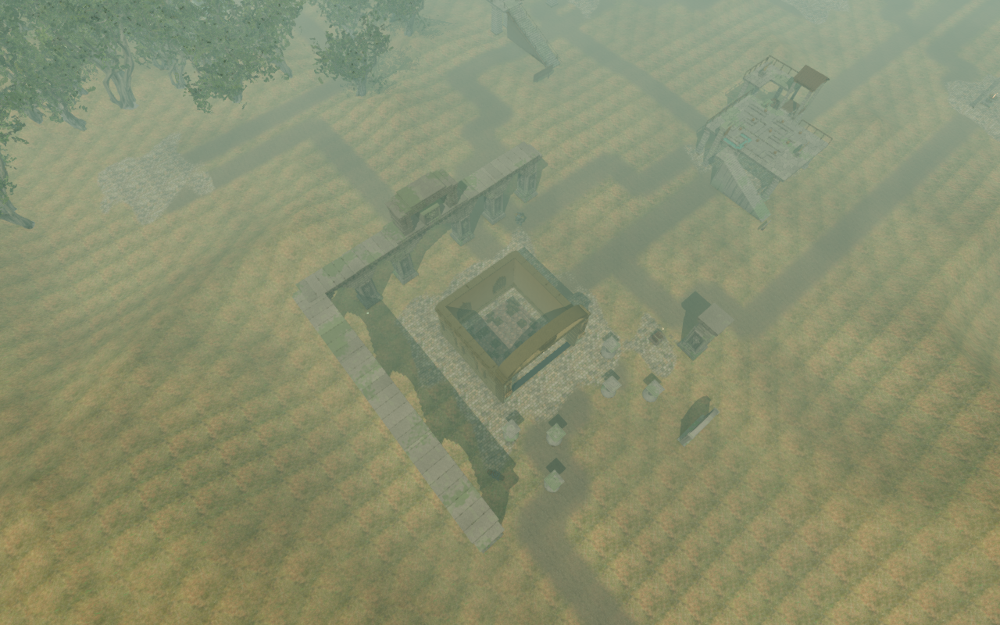
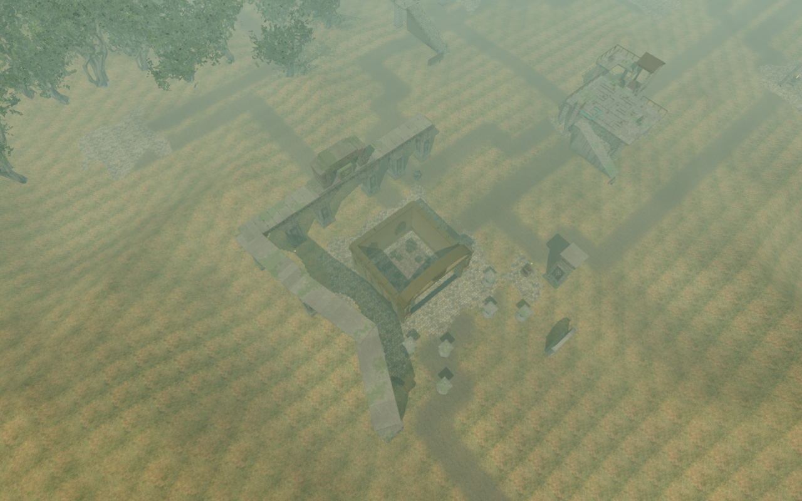
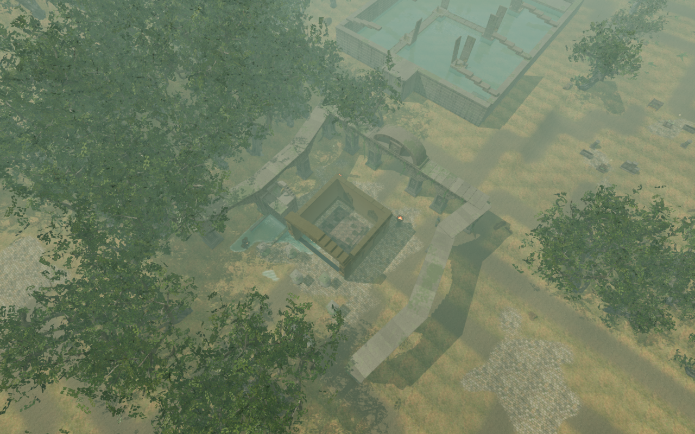
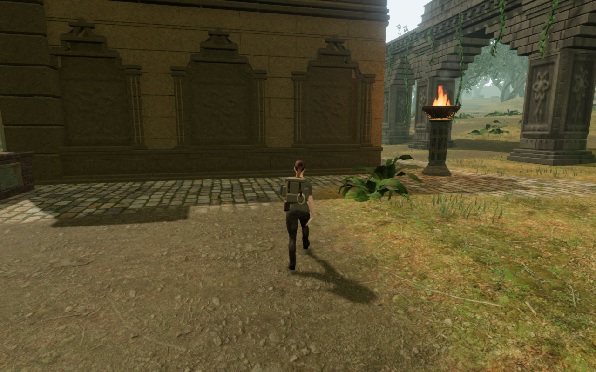
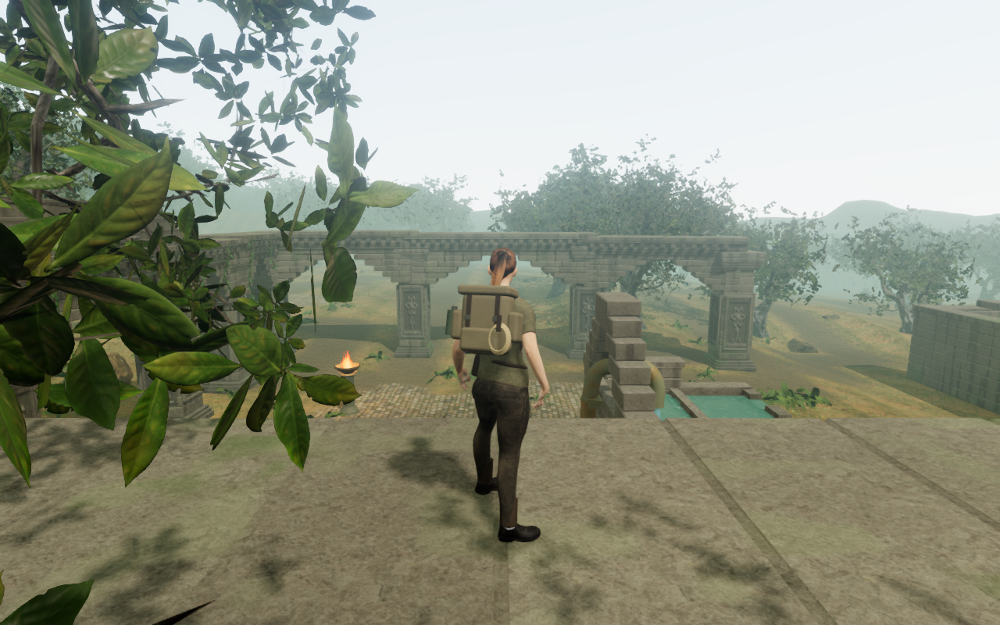
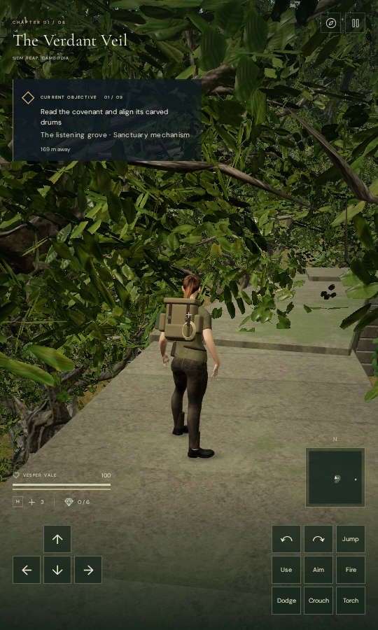

# Jungle galleries with distinct footprints

The nine larger jungle temples now have different side-gallery footprints.
Their former wings used the same two intermediate pier positions and straight
roofs. The new bearings turn the galleries inward, flare them outward, or form
unequal doglegs around the existing courts.

| Court | Gallery layout |
| --- | --- |
| Arrival | Two flared wings |
| Keeper’s First Covenant | An inward eastern gallery |
| Rootbound Promise | A western dogleg widening toward its forward pier |
| Rainkeeper’s Order | An inset western gallery and an unequal eastern wing |
| Reservoir Covenant | A tapered eastern gallery |
| Eastern Witnesses | Opposing tapers around the court |
| Moonlit Procession | A western bend narrowing toward the court |
| Inner Sanctuary’s Oath | An eastern dogleg opening toward its forward pier |
| Heart’s Final Covenant | Broad unequal wings |

Twenty-six intermediate piers move with their facings and attached roots.
The six north-facade anchors, two forward bird-perch piers, central crown
bearings, mechanisms and discovery identifiers retain their positions. All
new footprints fit the existing carved walking courts.

Gallery collision retains the union of closed construction pieces after
material batching, including foundations, shafts, facing backs, woody roots,
roof courses and the adjoining facade roof at shared corners. The thirteen
broad gallery bounds only select candidates; they do not fill the open bays.
Point queries retain real supports, and raw physical rays serve sight and
sound. Open decorative relief does not become a body landing.

Recessed continuous stone closes dressed roof joints and seats each gallery
course into the corbels or course beneath it. These cores sit just below the
visible faces and preserve their dressed edges. Gallery camera surfaces use the
closed pieces’ primitive bounds, captured before batching. Each temple root
still renders as one stone mesh.

The earlier whole-arcade/navigation hash assertion applied to the preceding
crown-only milestones. Lower gallery placement and navigation now deliberately
change. Current regressions independently compare rendered cap and joint
support, measure all central crown bearings, and check fixed facade/perch
anchors, empty bays, physical contact and save recovery.

The preceding moon court from an elevated construction camera:

The narrowed western bend, from the same camera, player state and lighting:

A normal ground crossing beside the reservoir court:

Assisted standing support on the arrival gallery:

Native portrait touch movement and reload on that elevated landing, at Low:

## Verification

- The full suite passes 964 of 967 tests, including all 21 focused temple,
  foundation and bird checks. Two court-pool tests and the crystal working-core
  terrain digest fail. The same three failures reproduce on the preceding
  `8ad729a` source; their assertions were not changed. They remain open work.
- Current regressions compare 52 rendered pier caps and 34 roofed bay supports,
  leave all 39 walking bays open to bodies, camera rays, sight and sound, and
  recover all 26 deliberately occupied saved positions within 3.75 m. Existing
  crown checks retain 162 rendered bearings, 792 backing probes and 135 cap
  comparisons. The old whole-arcade hash fixture records the earlier milestone.
- Normal-controller ground checks cross all 39 bays over 192.63 m, retain full
  health and legal grounded positions, complete the jungle climbing loop, and
  preserve 50 cipher-control approaches, 42 drum-source rays and 16 drive-source
  listening approaches. These checks use prepared progress and disabled enemy
  simulation. Their ground geometry is unchanged by the final roof-cap and
  support-query refinements; the full regressions and final raised/release
  checks cover those refinements.
- Forward-pressure and crouch checks cover all 26 moved piers, with 104 posed
  rendered bodies. Independently measured closed stone and terrain show no
  penetration. One initial inner approach was skipped; its separate outer
  approach supplies the missing four poses. All 26 resulting captures were
  reviewed. This coverage does not establish every possible animation contact.
- Thirteen final assisted roof poses, one per gallery, settle through the normal
  controller with legal, healthy grounded roots and clear structural camera
  space. Rendered stone puts the lowest sampled boot surface about 6 mm above
  its support. Another 19,616 roof-top comparisons find no recessed backing
  protruding above dressed faces. All 13 roof captures and nine additional
  diagnostic overviews were reviewed.
- Nine matched construction comparisons recreate the preceding and current
  worlds with identical cameras, targets, lighting, player positions, yaw and
  pitch. All eighteen views and all 39 ground crossing captures were reviewed.
  HDR input is finite and programs link. These elevated comparisons expose the
  layout; they are not reachable-player traversal checks. Some ground and roof
  views remain crowded by foliage, including one very close walking camera.
- The production build passes with the existing bundle-size advisory. Native
  keyboard High and portrait touch Low checks use the built interface without
  development hooks. They cover ground movement, a 2.10 m walk that stays on
  the elevated roof, and an older occupied save that recovers 2.25 m nearby.
  Six paused whole-store reload comparisons preserve saved values except visit
  timestamps, with no camera adjustments, page overflow, browser/HTTP errors or
  warnings. Twelve production captures, including an earlier roof-edge descent,
  were reviewed. These prepared muted checks do not establish earned roof
  access, real-device performance or subjective audio quality.

Each temple still batches its root stone into one mesh. Total delivered root
triangles increase from 435,628 to 440,180; the 4,552 added triangles include
136 continuous gallery cores. Existing rooted-pier artwork remains present.
A support-query height bound avoids querying construction entirely above an
eligible landing. Neither triangle counts nor this rejection establish a
consumer frame rate.

The gameplay verification above ran under the earlier shared nine-of-sixteen
CPU allowance. The owner subsequently reduced future verification to 5/16
(31.25%); the shared launcher, contributor instructions and guard checks now
use that limit. Child/thread, nesting and exit-status checks pass under the
five-CPU allowance. Browsers, workers and temporary servers are closed after
verification. Staging, raw saves, profiles and logs remain under ignored
`local/staging/`; only intentional captures are published.

Broader court and chamber composition, sparse surroundings, complete campaign
routes and discoveries, moving/underwater and wider posed-body coverage,
listening evaluation and device performance remain open. This local layout
pass does not establish whole-campaign visual acceptance or AAA parity.
