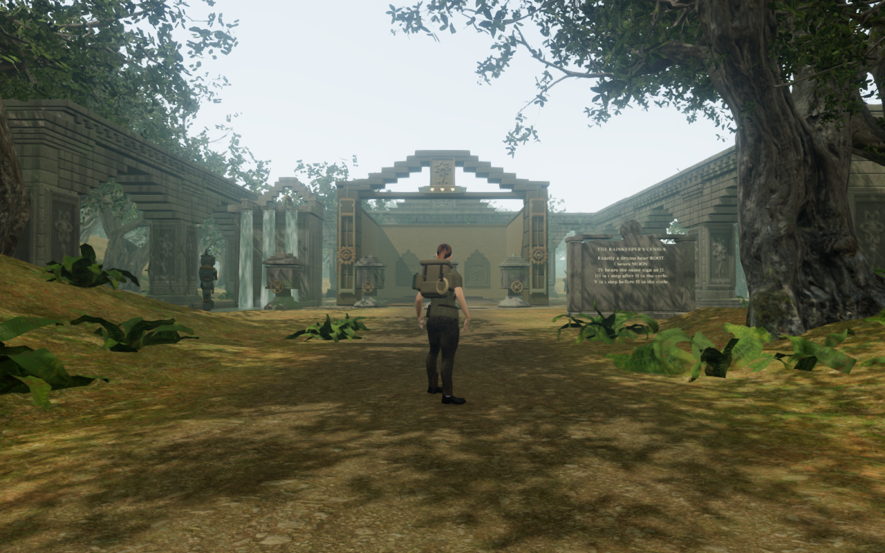
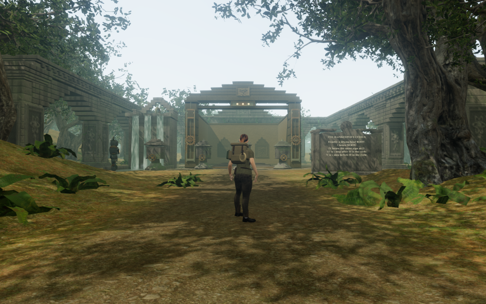
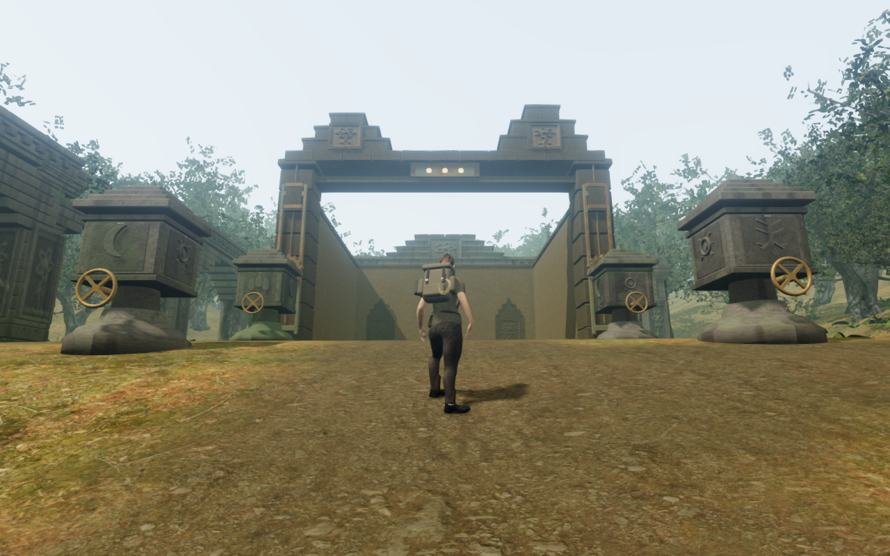
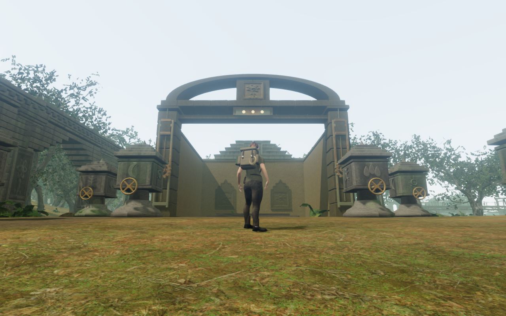
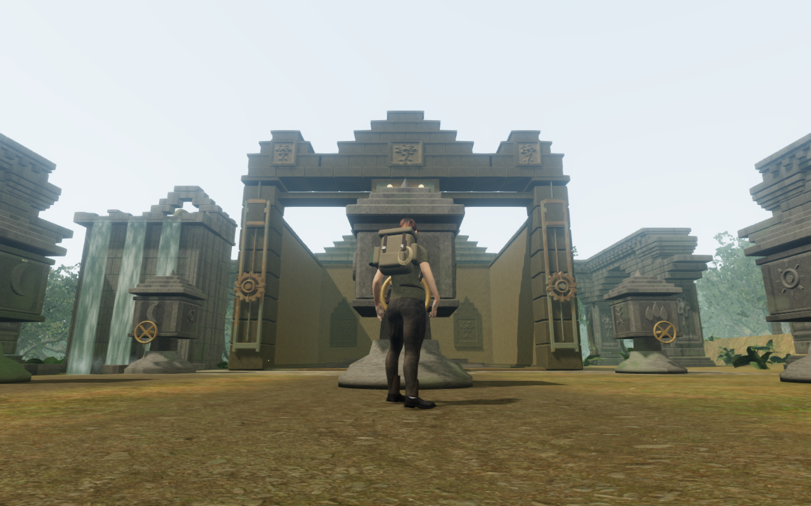
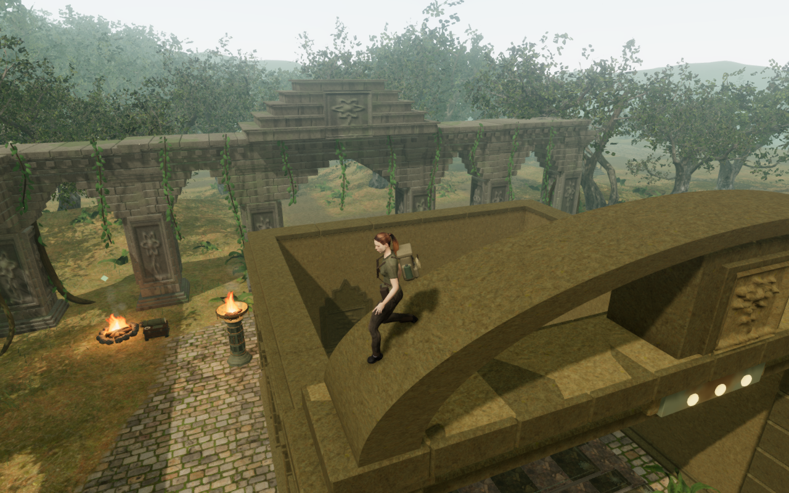

# Jungle gateway crowns

The foreground gateways previously repeated one open corbelled frame. Wider
court views showed that this frame dominated the approach while much of the
rear temple crown stayed hidden. The eight gateways now have different upper
profiles associated with their covenants.

The rainkeeper's court before:

The same recorded player position, camera, look and chapter lighting after:

| Covenant | Gateway crown |
| --- | --- |
| Keeper's First Covenant | Low sun lintel with broad stepped shoulders |
| Rootbound Promise | Two separately capped root towers |
| Rainkeeper's Order | Five-course rain pediment |
| Reservoir Covenant | Garden shoulders around a lower central register |
| Eastern Witnesses | Unequal west and east witness towers |
| Moonlit Procession | Seventeen closed voussoirs around a broad moon arch |
| Inner Sanctuary's Oath | Tall four-course oath gable |
| Heart's Final Covenant | Three crowned registers around the taller central temple |

## Construction and physical contact

The dressed lintel overlaps both existing jamb caps. Recessed continuous cores
seal the dressed joints and support the next courses. Closed plaque backings
bridge the projecting cornices, keeping each botanical face attached through
its full height. The original restoration-seal bar keeps its visible bronze
face and receives a stone backing connected to the lintel.

Static pieces use the existing wall and trim materials and material batching.
The eight crowns contain 406 constructed parts and 41,304 triangles, compared
with 112 parts and 35,296 triangles in the preceding crowns. The additional
6,008 triangles are an explicit geometry cost; these figures do not establish
consumer frame rates. No new texture, external model, recording, score or
dependency is introduced. Existing [asset credits](asset-credits.md) apply.

The old crown's thirteen block seeds are retained in the caller's sequence.
The replacement uses its own seeds, preserving the subsequent moving shutter
and fitting geometry. A retained baseline checks the original 32 navigation
obstacles, all drive-source records and delivered shutter geometry by hash.
Clues, drum layouts, field identifiers, chamber walls and save fields stay intact.

A raised-body probe exposed a prototype defect: all eight lintels allowed a
body to occupy their visible stone. Each now owns one physical query over the
union of its closed pieces. Keeping separate placements avoids cancelling
inside tests where the core and facing overlap. CPU triangles remain valid
after batching releases the original render geometry. Fourteen carved faces
retain contact probes without becoming tiny body landings.

Support uses the actual finite point footprint. Layered support retains a lower
lintel beneath the moon arch. Only that curved roof supplies slope clearance;
its lower beam cannot erase a real overhead or neighbouring arch collision.
The original ground thresholds remain clear after restoration.

## Recorded verification

- Nine preceding and nine updated High court views match player positions,
  camera positions, yaw and pitch exactly. All were reviewed.
- Twenty-five construction views cover those nine contexts, all eight close
  fronts, first/final side observers and first/final Medium and Low settings.
  One west observer initially cropped the final crown behind a nearby pier;
  a separate wider legal observation frames its complete bounds and clears
  external camera surfaces. All twenty-six construction captures were reviewed.
  High/Medium HDR samples are finite; Low uses its ordinary path with bloom
  disabled. Captured programs link, GL errors are zero, and standing observers
  are legal, grounded, healthy and have clear registered body targets.
- All twenty gate tests pass after the final collision repair. They include
  the three new regressions, all 69 campaign thresholds, 180 chamber walls,
  moving camera bounds, restored saves, partial seals and drive activity.
  New checks retain the previous obstacle/source/shutter hashes, test both
  rendered jamb bearings and backed carvings, preserve batched ray distances
  and triangle counts, and verify once-only render-geometry disposal.
- The raised collision regression compares 168 support samples with rays
  against delivered masonry. Bodies cannot occupy the lintels or crouch inside
  the moon pillar. Both outer walkable arch positions remain legal, while the
  lower beam still rejects overhead and neighbouring arch intersections.
- Four final High raised poses cover two first-roof headings and both outer
  moon slopes. Each has legal grounded support, full health and clear camera
  space, with finite HDR and linked programs. All four images were reviewed.
  The lowest sampled outsole point of every boot is approximately 6 mm above
  the masonry; curved toe/recovery points have larger expected clearances.
- All sixteen local gateway crossing/return legs pass after the repair, with
  sixteen reviewed route captures. All fifty drum/tablet approaches, forty-two
  drum-source sight lines and sixteen drive-source listening approaches remain
  clear. The complete jungle climbing loop passes. These are assisted checks
  with enemy simulation disabled, rather than earned chapter progression.
- Before the collision addition, keyboard/High at the first reader and
  emulated portrait touch/Low at the last reader pass reading, inspection,
  reversible turns, reset, return, manual look, walking and two paused whole-store
  reload comparisons each. Their ten captures were reviewed. The final repaired
  release repeats the last touch/Low case, including both reload comparisons
  and five reviewed captures. All six comparisons ignore only visit timestamps;
  saved camera angles are retained. Every case checks release assets, absence
  of the development hook, no failed requests or application browser errors,
  and no horizontal page overflow. These muted checks do not prove listening
  quality or physical-phone performance.
- The final production build passes with the existing bundle-size advisory.
  Its game bundle is `game-DUBkFM4O.js`. The six documentation captures use
  lossless WebP, with decoded pixel and dimension parity checked against PNGs.

Construction comparisons precede the final collision addition, which leaves
render geometry and camera shapes unchanged. Raised poses, twenty tests,
repeated crossings/climbing and the final Low release check cover the repaired
version. Verification uses the shared locked nine-of-sixteen CPU allowance,
at most two test workers and one browser. Owned wrappers close their browser
and server and stop watchers on completion or failure. Raw saves, profiles,
scripts and results remain in ignored workspace staging.

## Remaining world work

Larger rear temple crowns, galleries and chamber footprints still repeat.
Sparse spaces, complete discoveries, moving/underwater routes, broader posed-body
contact and listening/device review remain open. These local gateway changes
do not establish whole-campaign visual acceptance or AAA parity.
