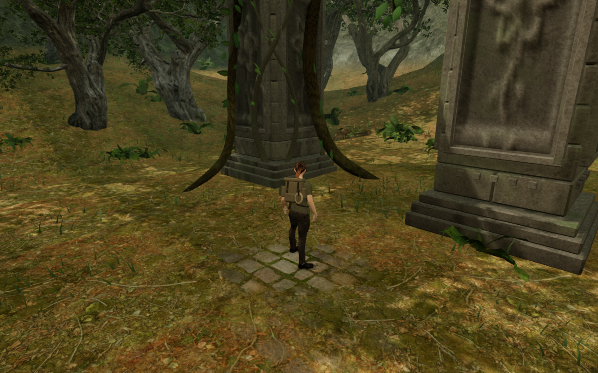

# Jungle pier bases and soil contact

VA-163 included suspected masonry/soil gaps in the newly accessible north and
northwest forest-side views. Inspection of the delivered scene does not
reproduce detached pillars there. The lower base mouldings project beyond
their recessed footing courses; their dark lower edges alone do not establish
an open ground connection. No masonry change is required for these observations.

This is an actual prepared High-preset canvas capture at 1280 × 800. Guardians
are hidden for inspection. The lossless WebP export retains source pixels and
dimensions without cropping or retouching.

## Evidence

Screen rays through the suspected lines in the north, northwest and south
views identify visible stone faces or rendered terrain. All three current
views are reviewed, with linked shaders and finite sampled HDR output.

The independent [pier contact observer](../scripts/inspect-jungle-pier-contact-browser.js)
copies delivered batched triangle positions and reads actual rendered terrain
triangles. It does not use the foundation planner or its height bounds as its
contact verdict. Projected triangle bounds retain every face crossing a query
column; clipping triangles to a shallow height range would incorrectly open
otherwise closed stones.

The observer examines a 9 × 9 grid inside the central 88% of each base width,
excluding the intentionally projecting outer moulding. Ordered upward ray hits
form occupied stone intervals. Those intervals must connect terrain to a point
6 cm above the base's terrain-center height, with a 3 mm gap tolerance.

All 98 piers across the nine jungle courts pass all 7,938 sections, with no
missing samples and zero measured open gap. Seventy-four have added footing
courses; the remaining 24 use their existing buried base caps. The nearest
sampled underside remains 1.17 mm below terrain. A separate control lifts only
the copied masonry five metres: all 7,938 sections then report an open gap.
The delivered observer is repeated after formatting, with the same results.
Temporary query geometry and materials are disposed after use.

Verification uses one browser at a time under the shared locked
five-of-sixteen CPU allowance. Thread-affinity checks pass, and the owned
previews, workers and browser descendants close after each run. The first
shallow-crop diagnostic was invalid and is excluded from these results.

## Remaining review

Together with the [tree-base repair](jungle-tree-bases.md), this resolves the
recorded VA-163 observations: the pale scan patches are repaired and the
suspected pier separation is not reproduced by the delivered-surface checks.
The section grid does not inspect every point of every moulding, all masonry
elsewhere or moving body contact. Broader world composition, traversal and
listening/device acceptance remain incomplete.
