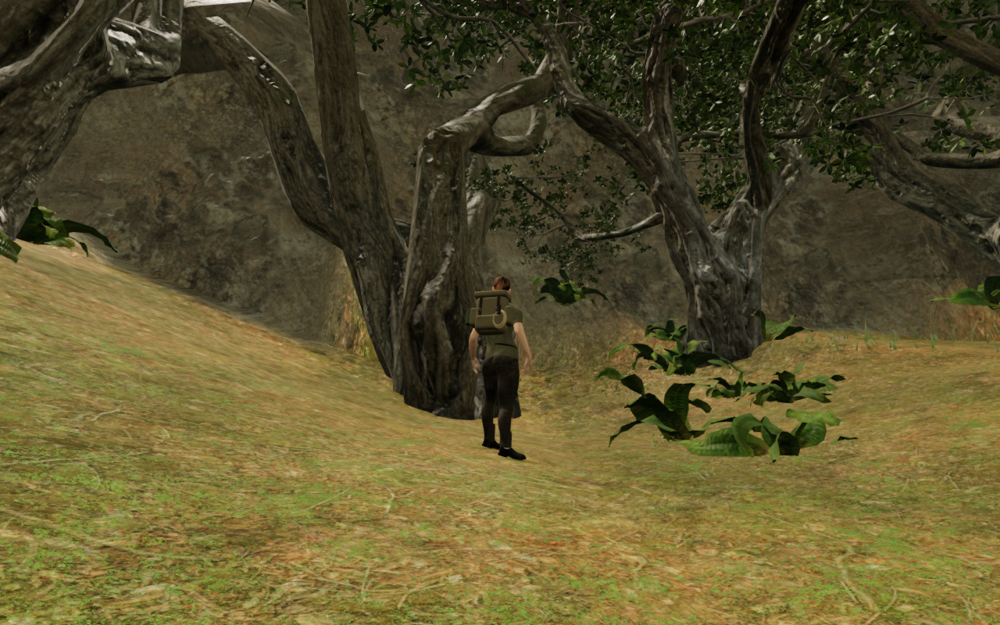
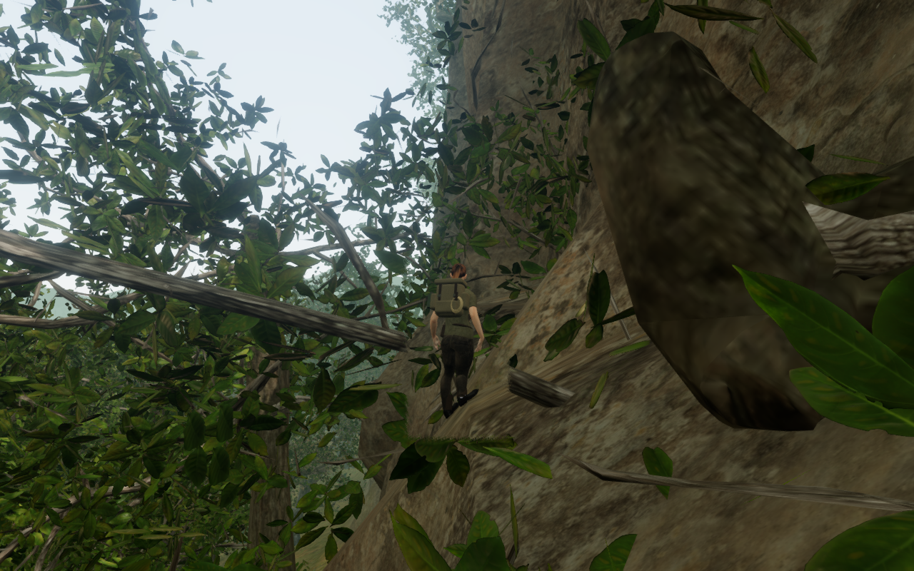

# Jungle rim channels and natural footing

The valley's base cliffs retained broad smooth faces because the old tree
collars protected whole columns around every seed, including cliff seeds that
could not actually carry a tree. The terrain now plans smaller planting
pockets from the delivered roots and apron hulls, leaving more of the ground
between wooded shoulders available for eroded channels. Final tree placement
still checks the completed terrain against the actual scans.

The planning bounds are small runtime data derived from all three delivered
tiers of Island Tree 01 and 02. Their regeneration command is
`node scripts/build-jungle-planting-bounds.mjs`. The grounding tests verify
the radii and hulls against the delivered geometry, retain deterministic
placement and require at least 95% of the planned forest density.

Channels can create enclosed terrain hollows. A drainage pass fills these to
their spill, following the six actual mesh edges rather than inventing a drain
across the other cell diagonal. A second pass deposits soil in sharp troughs
whose opposing sides leave too little space for the character. It solves
against the delivered triangle weights and shared body-clearance samples.
One-sided steep planes retain their heights. This creates a visible floor;
it does not add an invisible standing platform.

The drainage skips authored walking cells, their immediate collar, water
margins, the outer join and interior ground. Against published source
`26fc318`, 5,039 jungle coarse vertices
change; the largest decrease is 23.418 m and the largest increase is 25.961 m.
All 33,280 walking, 1,573 water-margin, 45,369 interior and 1,944 edge probes
retain their values. All other chapters' terrain heights, and all eight
chapters' water, bridge and court data, retain their values.

The rock relief uses narrower complete buttresses at 68% of the candidate
width, with a 45% retry where needed. Every accepted site keeps all four closed
layers, burial checks and route/object reservations. Failed trial geometry is
disposed before any physical or camera registration. More shoulders can fit
after erosion, so construction retains the existing limit of fewer than
120,000 cliff triangles rather than growing without a bound.

## Contact and foreground repairs

A landing disk could touch a high natural cap beside the body while its centre
had no tread. One observed boot then stood more than two metres over its real
floor. High natural beds now require an upward tread under the body centre;
point queries, low steps and authored caps retain their existing behavior.
An independent closed-piece control checks the rejected remote cap, genuine
centred support, falling to the floor and retained side collision.

A recovered diagonal bank also left a boot about 18 cm above its surface. The
existing bounded foothold search now includes lateral directions and permits
a step within 24 cm, subject to leg reach and foot separation. It changes the
visual stance without moving the physical root. The strict bank fixtures keep
both-sole contact, ankle separation, legal roots and terrain/stone clearance
checks at all recorded facings.

Historical ordinary-bank and scanned-branch regressions now retain small
published terrain patches alongside their original support geometry. This
preserves the surfaces that reproduced those posture defects as the live
landscape changes. Current-world arrival and controller checks remain separate.
The recorded hollow drop still has to land on actual legal support; its start
is raised when the old altitude lies inside newly deposited soil.

Separate fine-branch materials now participate in the existing view-dependent
foliage opening. Main bark/trunks and their physical and camera geometry remain
solid. The material tests retain existing wind and LOD inputs, geometry buffers
and depth materials.

These are complete, unretouched High game captures from assisted local checks.
The western view uses a prepared stance; the occupied-bank view uses normal
saved-game startup followed by sixty idle controller/animation updates.
Scene time is fixed and audio muted for this inspection.

## Recorded checks

All 245 selected tests across 35 files, the production build and three CPU
budget checks pass. The existing build chunk-size advisory remains. The checks
include drainage controls, actual planting hulls and roots, reservations,
cliff render/physical/camera queries, changed stances and support, shared terrain
factories, audio, camera and foliage behavior.

Six assisted approach/jump/stop sequences complete 6,300 controller updates
with 84 independent moving-body inspections against terrain and closed stone.
All six stopped roots are legal and grounded; both soles retain approximately
6 mm minimum gaps and at least ten contact records per foot.

The actual world contains 82 accepted sites and 328 closed rock pieces with
97,696 triangles. All 321,232 back/perimeter probes find supported, buried
joins. Render, physical and camera queries agree across 1,906 sampled rays,
including 1,001 supported ledges. All 749,856 delivered lighting corners have
finite, correctly oriented normals, and reversed controls detect every corner.

The 701 woodland and 1,023 fringe trees pass 1,040,095 root/apron support
samples. All 134 sound origins clear the cliff volume. The eighteen discovery
approaches retain legal, reachable, camera-clear stances nearest to their own
collectible.

Production keyboard movement at High and portrait touch movement at Performance
preserve stage 0 and health 100. A published occupied-bank save recovers
6.75 m horizontally onto the revised terrain while retaining field and journal
progress. All three cases pass two complete-store reload comparisons each,
omitting only `lastPlayed`. Release script/style names match the build, the
development hook is absent and the portrait viewport has no horizontal overflow.

The moved older-save position receives a separate normal-startup repeat.
Both boots retain approximately 6 mm minimum gaps at startup and after sixty
idle updates, without moving the restored root. The thirteen final High views
and nine production views are reviewed. All 449 runtime source hashes match
the verified source. No failed asset, console error or application warning is
reported; Chromium GPU-readback notices are recorded separately. All work uses
the shared five-of-sixteen CPU allowance, and owned browsers/previews close.

Closed-volume body readers are applied only to closed geometry. The nearby
scanned trunks at the older save arrival contain open components, so they are
excluded from that winding test; their rendered triangles remain in the sole
reader, and gameplay's tree collision remains active. Treating those open scans
as closed volumes produces invalid inside results. The root, footing and
closed-stone observations do not certify full skin clearance against every
open twig or bark surface.

## Remaining work

Some base cliff faces remain broad, and foreground trunks still dominate
several approach compositions. Wider cliff/court composition, sparse spaces,
continuous route/water/contact coverage and the all-eight visual audit remain
open. Listening and consumer-device acceptance are unfinished. This local
milestone does not establish AAA graphics, subjective audio quality or consumer
hardware performance.
