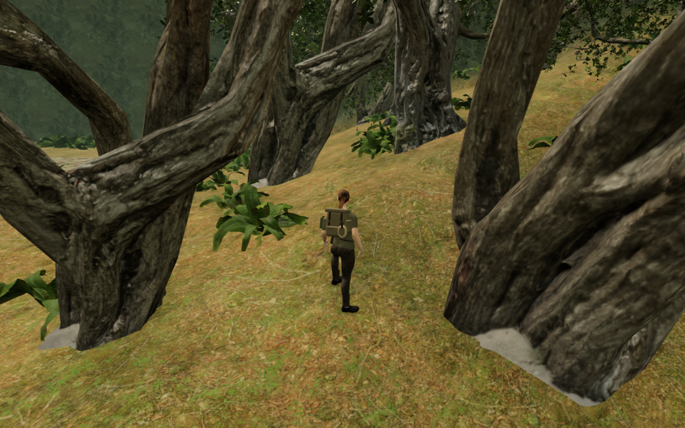
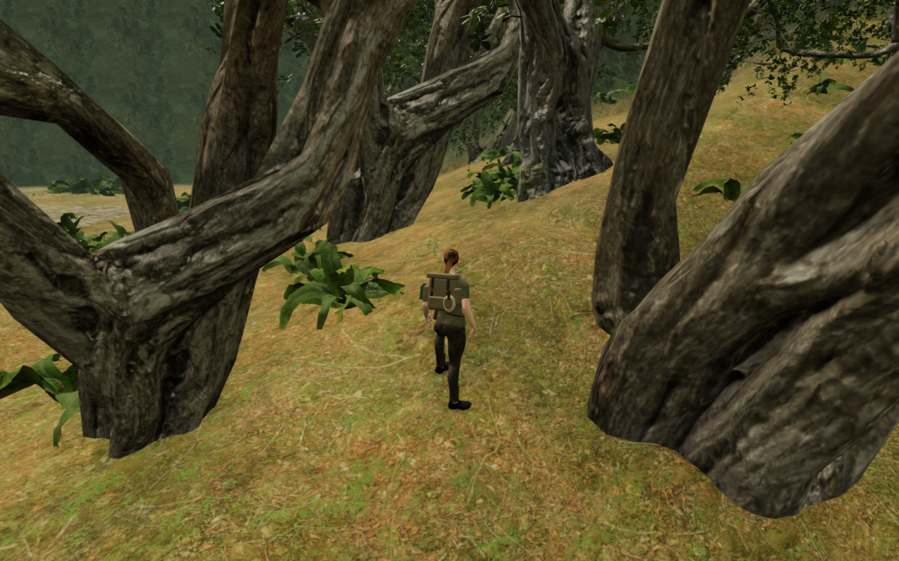

# Jungle scan bases and exposed footholds

The pale strips in VA-163's west forest view came from photographed ground
included in the tree scans. Independent screen rays hit upward-facing Tree02
triangles whose source albedo was gray. Seven pale sample points stood about
2.8–8.4 cm above the rendered terrain. The previous lowest-25-cm footprint did
not include the higher interior of that captured ground.

Tree seating now includes those complete low ground islands, with samples
through their triangle interiors. Position/UV connectivity separates them from
the tall bark charts. All three distance tiers contribute to one footprint;
the trunk origin, scale and original root radius remain unchanged. The whole
specimen moves together, including foliage and physical wood. Runtime assets,
UVs, textures and attribution remain unchanged.

These are actual prepared High-preset canvas captures at 1280 × 800. Both use
the same player, camera and world time, without HUD panels. Lossless WebP
exports preserve their decoded pixels and dimensions, without cropping or
retouching.

## Evidence

All 1,771 trees remain at their original horizontal positions, rotations and
scales: 728 interior specimens and 1,043 outer specimens. Seating lowers 464
interior trees by at most 38.86 cm and 805 outer trees by at most 62.84 cm;
none rise. No tree is removed. A separate observer uses fixed, independently
recorded ground-island face IDs, actual Float32 instance matrices and rendered
terrain triangles. Across 850,612 triangle instances and 8,469,190 sampled
points, no ground-patch point is exposed or missing terrain. The highest
sample is 7.41 cm below soil. The final development run confirms every live
placement and the relevant source files still match that audit after the
foot-only correction described below.

The repeat tree approaches caught a foot-fitting regression in the intermediate
planting-only revision: a nearby bank covered the selected scan tread, leaving
216 shoe records under soil, at most 48.94 mm deep. Resting foothold selection
now rejects candidates beneath terrain and continues searching other faces;
cached targets receive the same check. The repeated bank-side pose clears
terrain by approximately 6 mm. Genuine exposed root treads remain available;
the narrow root case retains its independently measured 7.454 mm sole-triangle
gap and no inspected shoe vertices inside the selected supporting wood.

All 117 selected tests pass, including delivered scan patches, transformed
tree solids, exposed-face selection, the buried-tread regression, frozen
arrivals, terrain fitting, camps, field stations, landings, mantling and
swimming. A retained independent 30,960-point base regression changes from
18.17 cm maximum exposure to at least 8 cm burial.

The six High forest-side views and three tree approaches are reviewed, with
linked shaders and finite sampled HDR output. Three approaches and six valley
routes cover 7,650 legal controller updates and grounded final rests. All
45 sampled moving poses clear independent terrain triangles; the lowest
sampled vertex gap is 5.92 mm. These are sampled terrain and selected supporting
shoe/wood observations, not continuous whole-body checks against every solid.

Two older valid raised saves pass actual first-view and repeat-reload checks;
all four captures are reviewed. The unchanged perch retains its exact height
of 0.847442 m above terrain. The affected perch adjusts from 0.152377 m to
0.111396 m at the same horizontal position, then remains exact on reload.
Other complete-store fields are preserved, excluding play timestamps.

The production build passes with its existing bundle-size advisory. Native
keyboard/High and portrait-touch/Performance cases exercise movement, crouch,
jump and repeated reloads. The keyboard case starts from the older affected
raised save and receives only its expected physical height correction; the
touch case starts at the west forest observer. All four subsequent complete-store
reload comparisons pass, excluding only play timestamps. First retreat
distances are 1.185 m and 1.800 m. All ten release captures are reviewed, with
no horizontal layout overflow. Served bundle names match the build, and there
are no application errors or warnings.

Verification uses the shared locked five-of-sixteen CPU allowance, at most two
test workers and one browser, with expensive jobs run sequentially. Thread
affinity audits pass, and owned previews, workers and browser descendants close
after their checks.

## Remaining review

This repairs VA-163's reproduced pale tree-base strips. The subsequent
[pier contact review](jungle-pier-contact.md) does not reproduce detached
masonry in the recorded views, and the [remaining HUD label pass](hud-secondary.md)
addresses VA-166's faint health/supply labels. Wider world composition and
moving contact remain open. Prepared cases here mark guardians defeated;
they do not establish combat or a complete objective playthrough. Muted browser
checks do not establish subjective sound quality or consumer-device performance.
The whole-world visual audit and listening/device acceptance remain incomplete.
