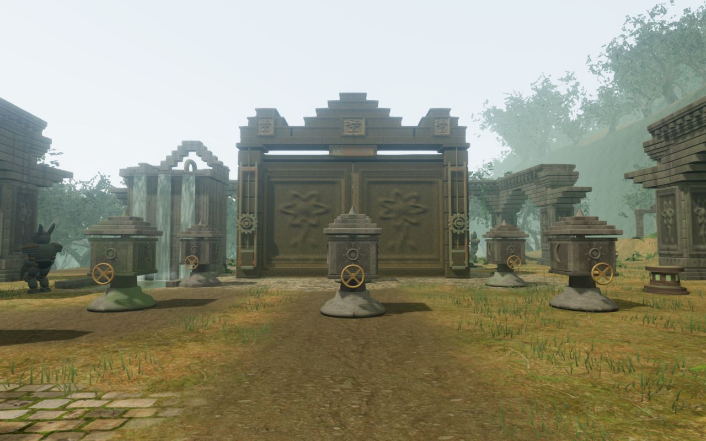
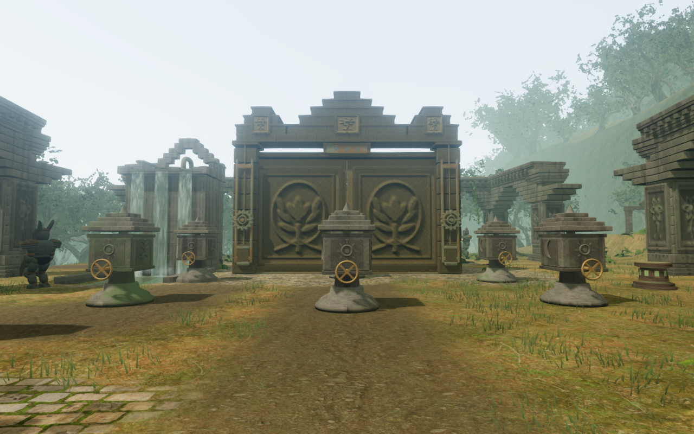
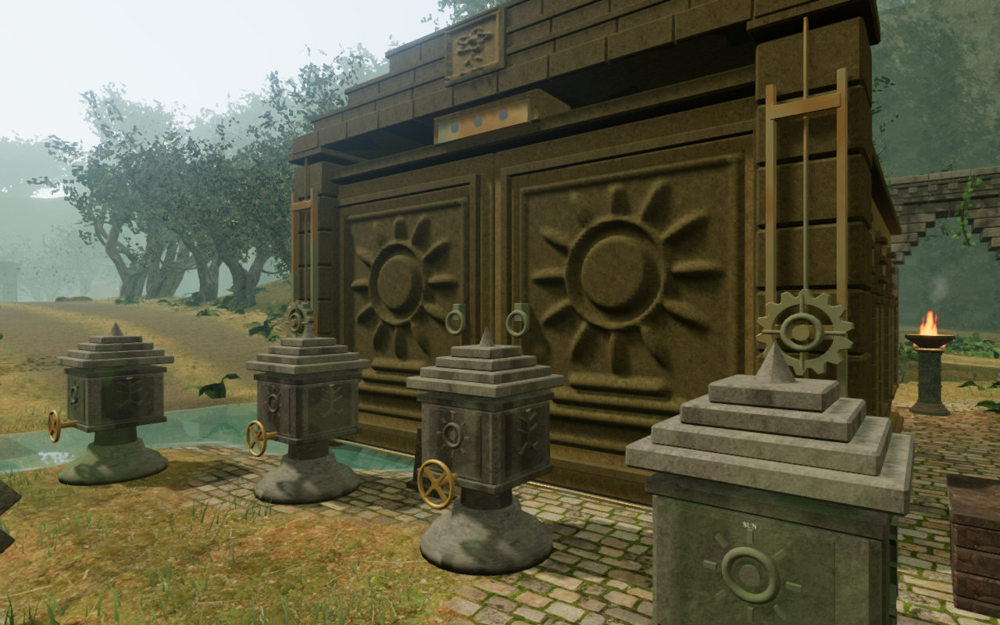

# Jungle trial reliefs

The eight jungle gates now carry different carved records of their trials.
The paired leaves mirror each composition, using the existing stone material
and sinking mechanism. The carvings accompany the objectives; they introduce
no extra puzzle code.

These paired High images retain the same observer position, target and scene
time. Lossless WebP exports preserve every RGB pixel of the 1280 × 800 captures.

| Trial | Carved composition |
| --- | --- |
| Outer sanctuary | A rising sun above stepped sanctuary courses |
| Rootbound gate | A branching tree with spreading roots |
| Rain channels | Cloud scrolls, falling rain and flowing channels |
| Keeper's dial | A lunar dial with a crescent and radial marks |
| Eastern altar | A lotus offering above a bowl and stepped plinth |
| Sun bridge | An arched bridge beneath the sun, with water below |
| Inner sanctum | A tiered sanctuary surrounding a light |
| Temple heart | A living central flower enclosed by roots and leaves |

Each panel has a sculpted front, closed edge returns and a rear embedded in
its stone leaf. The moving camera envelope includes the relief, border and
handle throughout the descent. The surrounding crowns, leaf backing, drive
emitters and navigation obstacles retain their existing construction.

The focused run passes 27 checks, including all regional gate opening and
passage cases. New regressions check closed, oriented relief surfaces,
substantially different sculpted profiles, mirrored paired figures and moving
camera containment. All twelve candidate images are reviewed: eight gate
fronts, a follow view, a closer side view and intermediate/open descent views.
The first front remains partly hidden by its foreground tree. Shaders link,
sampled HDR buffers remain finite, and no application warnings or errors are
recorded. The production build passes with the existing chunk-size advisory.

The production keyboard/High and portrait touch/Performance checks both
restore a measured clear stance near the first gate without arrival recovery.
They move 0.22 m and 0.90 m respectively at full health, retain stage zero and
pass complete-store reload comparisons apart from per-level timestamps. All
six release images are reviewed. Loaded JavaScript/CSS names match the current
build and the development hook is absent. These short prepared approaches do
not establish an earned route or complete chapter playthrough. Both browsers
and their temporary previews close after verification.

The final full suite passes all 1,227 tests, with no failures, cancellations or
skips. All three CPU-budget regressions pass. The 424 runtime source hashes
match the captured candidate and staged publication content. These checks
preserve the existing functional and audio regressions; they do not establish
subjective listening quality or consumer-hardware frame rates.

## Current overview coverage

Before this change, a frozen survey at `2ceb341` captured and reviewed 186 High
views: four entrance headings in each chapter and front/rear observers at all
77 main courts. That is 22 jungle, 24 desert, 22 snow, 24 coastal, 22 forge,
24 sky, 22 cavern and 26 final-chapter views. All requested stances were
captured. Runtime source hashes matched at the end; no application warnings,
failed requests or WebGL errors were recorded. Browsers closed after each
chapter, and the temporary preview closed at the end.

These are static fresh-progress overviews. Near trees, stairs, columns and
terrain hide parts of some courts. In particular, the final chapter's rear
views face nearby rotunda bases rather than complete gate backs. Several
snow and cavern views have terrain or stairs in the foreground. A captured
stance does not establish complete construction or route coverage.

The images retain distinct chapter atmospheres, but show repeated large
gate/equipment arrangements in the jungle, desert, coast, forge and sky.
Wide margins in several chapters remain sparse. Steep flat-faced banks need
location-specific diagnosis before changing their construction. The jungle
leaf compositions address one part of this repetition; broader scenery and
the [playable-world audit](visual-audit.md) remain unfinished.

Verification tools share the locked five-of-sixteen CPU allowance. Installed
dependencies, captures, browser profiles, fixture saves and staging files stay
outside publication.
