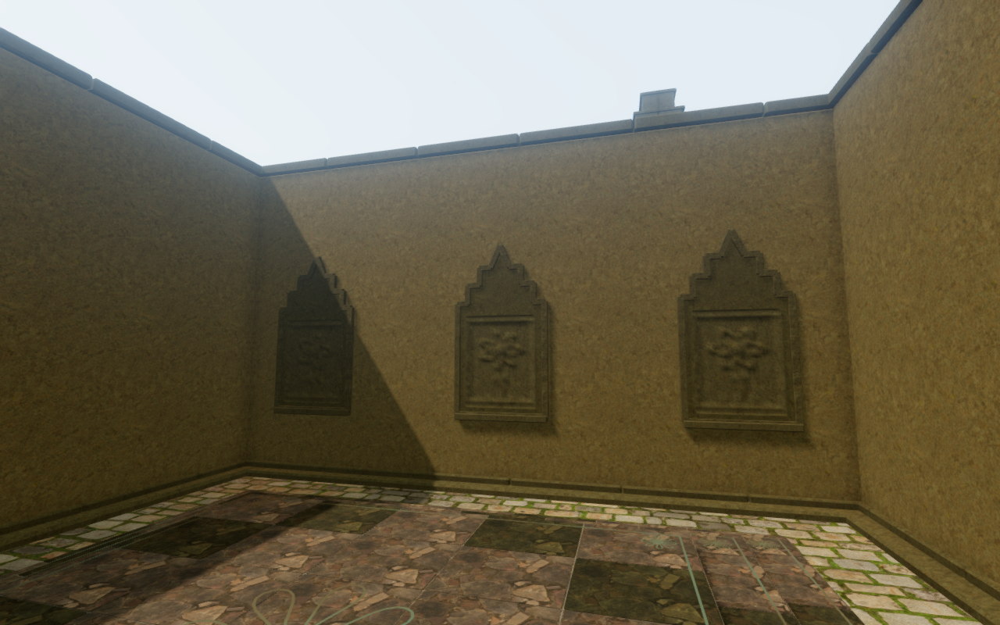
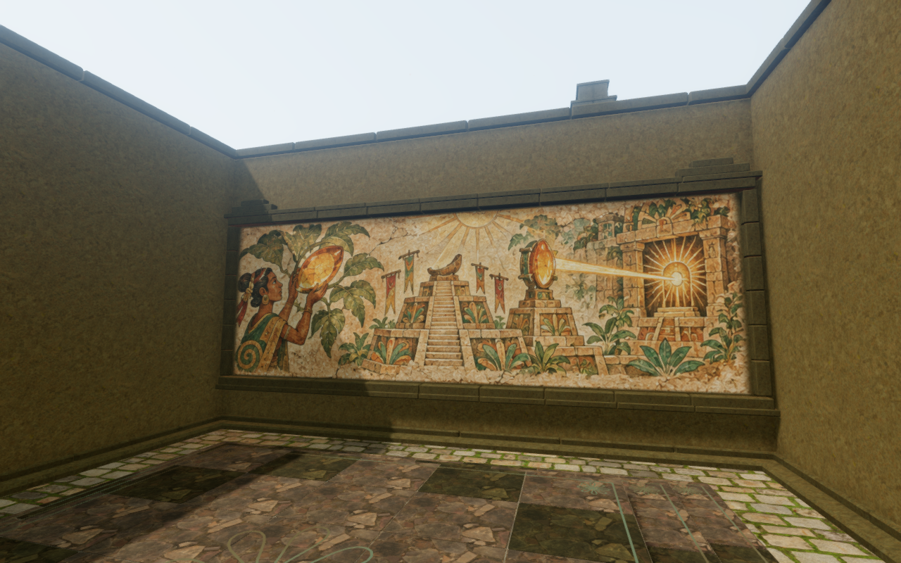
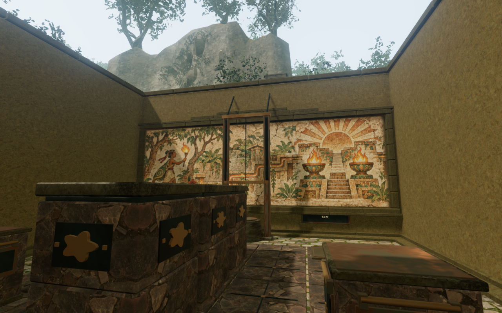
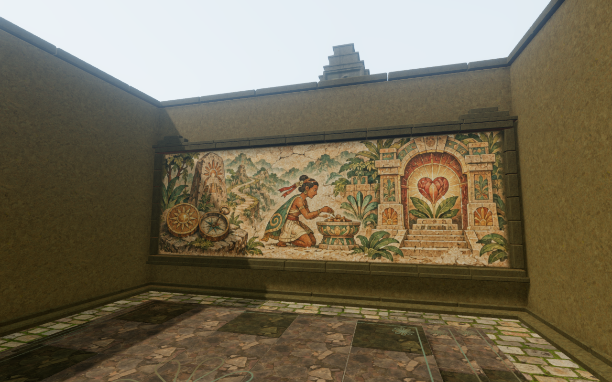

# Painted records in the jungle sanctuaries

The jungle chambers' inner rear walls repeated small botanical reliefs across
large plain backings. Each of the eight chambers now carries a broad painted
stone record of its existing trial, held by joined masonry frames. The scenes
follow dawn beacons, the root gatehouse, rain channels, the keeper's vigil,
the eastern lens, hanging crossings, the beacon chain and the final heart seal.
They are decorative histories rather than additional puzzle instructions.

The matched pair retains identical player/camera positions, clock and High
settings. All four figures preserve the complete 1280 × 800 capture pixels
through lossless WebP conversion.

The paintings are original generated project artwork. They share a consistent
mineral-pigment palette, worn plaster and fictional temple culture. The [exact
prompt](art-prompts.md#jungle-fresco-atlas), source/delivery hashes and atlas
layout are retained in `asset-sources/jungle-records/sources.json`. No external
reference image was supplied, and the scenes are not historical documentation.

## Construction

Each rear wall retains its existing continuous backing. A closed stone/plaster
slab enters that backing, with a lightly uneven front and unpainted edge returns.
The wide image keeps its 3:1 aspect ratio. Dressed side stones and four joined
horizontal courses surround it; three small cap arrangements vary the silhouette.
The frame backs also enter the existing wall core, including the projecting
upper moulding. All new construction stays inside the old wall reservation.

One shared painted material uses the existing temple stone normal and roughness
maps at their physical scale. An independent coordinate attribute selects the
appropriate scene from a shared atlas, with restrained mixing at its edges.
The source's 1536 × 1024 pixels are packed into a 1568 × 1088 lossless WebP.
All eight painted cell buffers remain identical; only copied eight-pixel gutters
and format encoding are added. Ordinary mip filtering remains an approximation
at very small projected sizes.

The former inner relief bars consumed seeded stone variations. Their seed
steps are retained, so later exterior chips do not change when the old inner
records are removed. The new framing has its own seed stream. The existing
doors, exterior carvings, working equipment, maps, audio origins and save schema
keep their construction paths. The shared atlas and painted batches change
the rendering workload; these observations do not establish consumer device
frame rates.

## Current verification

The 57 selected tests across eight files pass, together with three CPU-guard
checks. Coverage includes closed outward slabs, finite attributes, front-only
painting, frame/back embedding, the existing wall reservation, shared atlas
ownership, gutter isolation with a damaged-edge control, gate operation,
campaign persistence, original shutter geometry, rendering settings, audio and
chapter startup.

A geometry-only comparison with `de8d248` retains 105,648 exterior triangle
records across the eight rear walls. Position, normal and UV values are
quantized at 10⁻⁵, then sorted with material names before comparison. This
checks the retained exterior zone; it is not a full-body continuous contact
audit. The three rendered draft rooms show the dawn, eastern-lens and heart
paintings under the actual game lighting, with linked shaders and finite HDR.

Sixteen final High/preset/controller views pass linked-shader and finite-buffer
checks with no recorded errors or warnings. All eight chamber observers have
identical player/camera coordinates and clock values to their preceding views.
Medium and Low repeat the final painting; normal follow, a 3.6 m controller walk
and a standing/crouched/standing-return sequence inspect the first room. The walk
retains full health, legal body/camera positions and an opaque avatar. These are
sampled local observations, with enemies unstepped during the assisted walk.

An initial nominal crouch frame remains standing because the observer keeps
simulation paused. The corrected sequence enables controller simulation before
requesting crouch, checks its actual flag and animation blend, then restores
standing. The recorded blend reaches 0.999775 and returns below 0.000225;
all three states remain grounded, legal and fully opaque.

Changing to the desert chapter disposes all eight painted geometries, their
shared material and the atlas exactly once each. The replacement world retains
none of those tracked resources. The temporary browser and preview close after
the check. The production build passes with its existing large-bundle advisory.

Production keyboard and touch cases move 1.5 m and 2.1 m in the first chamber,
retain full health and pass one complete-store reload comparison each, excluding
only per-chapter `lastPlayed`. The disposable fixture marks the first field
tasks complete to admit the observer; those tasks are not earned by this check.
Both cases use Low at a 360 × 600 CSS viewport and 0.5 pixel density. All four
served JS/CSS response hashes match the build; the development hook is absent,
and requests/console report no errors or warnings. The entry/game chunks are
`index-CgUeD0zK.js` and `game-DErpVIzy.js`. All four native images are reviewed;
the separate full-resolution figures provide the graphics comparison.

## Broader survey and remaining work

A fresh survey expands beyond the prior court fronts to route points and
middle-chamber views across the eight chapters. The first run captures fourteen
views but fails its no-warning gate on an ANGLE graphics-driver performance
notice; its captured buffers remain finite and its application-error list is
empty. Its nominal snow interior is actually on roof support, and its sky route
view is on the ravine floor. Those two views do not establish intended interior
or bridge-route coverage.

The corrected observer limits chamber support to the floor region and uses a
sky bridge approach. It captures eleven follow-up views, including preceding
views of all eight jungle rear walls, valid volcano/crystal interiors and the
bridge approach. Its shader, finite-buffer and no-warning checks pass. The snow
middle interior still has no clear stance in that search and remains unobserved.
These are assisted point observations, rather than continuous route playthroughs.

The full playable-world requirement remains open: sparse margins, broad terrain
and court forms, repeated installations, unseen interiors and continuous surface
contact still need wider review. Subjective listening quality, consumer-device
performance and AAA graphics are not established by this local wall revision.
