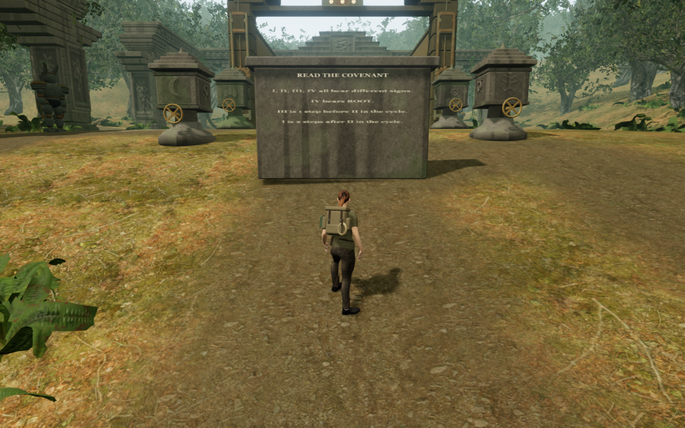
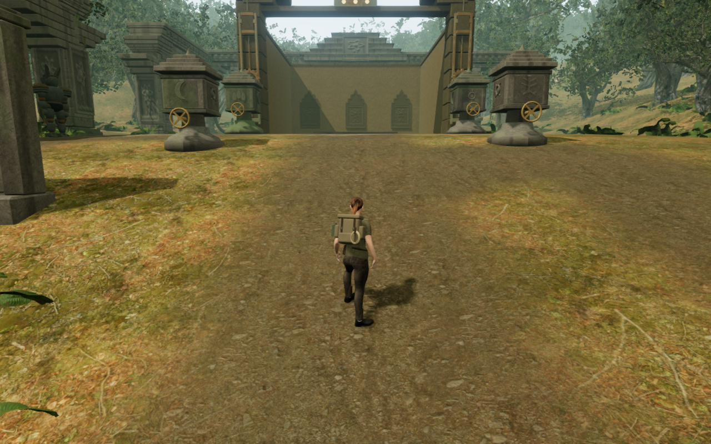
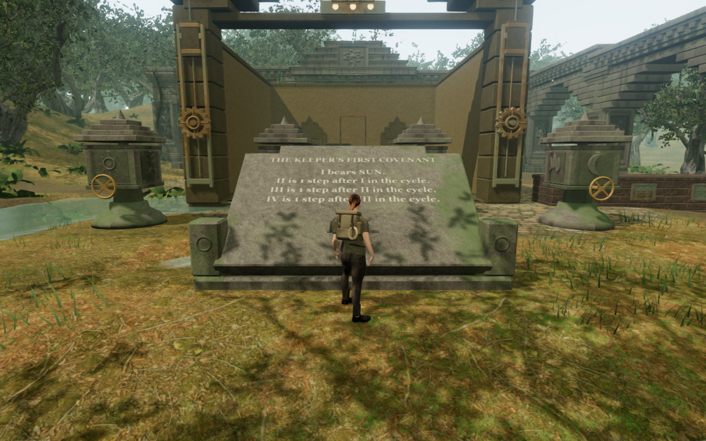
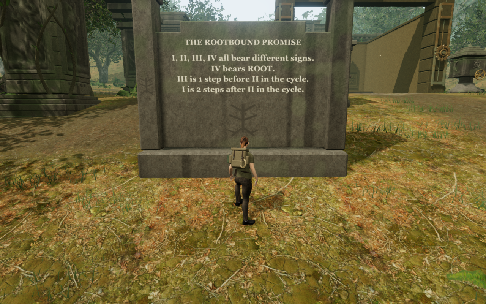
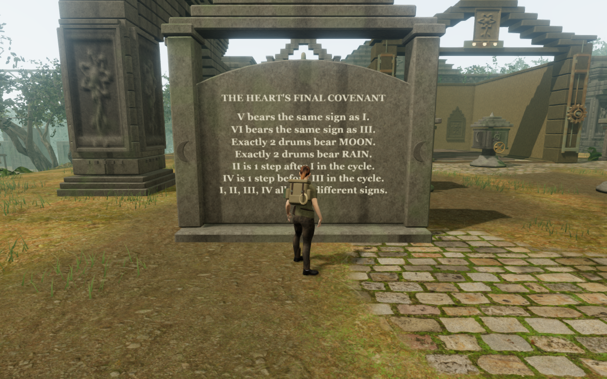
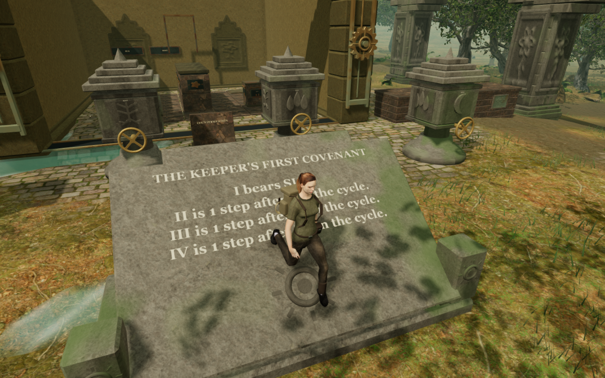

# Jungle keeper shrines

The eight jungle covenants previously shared a large upright reading slab on
the court's centre line. That slab concealed the different drum layouts from
several normal approaches. Seven readers now occupy surveyed side pockets;
the first keeps its entrance location with a lower inclined lectern. Each has
an authored stone profile, title and crest associated with its covenant.

The second court before:

The same recorded player position, camera, look and chapter lighting after:

These court comparisons precede the final render-only batching. The reader and
descent images below use the batched construction.

| Covenant | Reading structure | Placement |
| --- | --- | --- |
| Keeper's First Covenant | Low sun lectern with closed side cheeks | Central entrance |
| Rootbound Promise | Root portal with stepped crown and mounted seal | Left pocket |
| Rainkeeper's Order | Wave-headed register with rain seal | Right pocket |
| Reservoir Covenant | Inclined garden altar with corner posts | Right pocket |
| Eastern Witnesses | Witness screen with four mounted signs | Left pocket |
| Moonlit Procession | Curved canopy, connected hanging moon seal | Right pocket |
| Inner Sanctuary's Oath | Pediment with root crest | Right pocket |
| Heart's Final Covenant | Arched tablet under a three-tier crown | Left pocket |

## Construction and contact

Closed extruded panels, chipped plinths, posts and carved signs use the existing
stone-block and relief generators and credited temple material maps. Static
stone is merged by material. Finished parts move into the existing batcher's
direct-child layer with their world transforms preserved; camera shapes are
captured after that move. The eight isolated shrine assemblies reduce from
153 meshes to 24, three per shrine, while retaining all 13,590 triangles.
Their geometry arrays grow from 1,291,180 to 1,304,640 bytes because the batcher
expands indexed triangles. The construction audit checks once-only disposal of
153 original and 24 merged geometries and a maximum world-matrix change below
3 × 10⁻¹⁴. These counts do not establish consumer frame rates.

Titles and clues share the existing single canvas atlas; the title rows enlarge
that atlas rather than introducing a texture per
shrine. Reading text uses the atlas's native aspect ratio. Shorter covenants
receive a mounted lower seal to fill their larger blank space.
The printed lettering's transparent planes do not cast rectangular shadows.

Each foundation extends below its complete covering terrain cells and places
its cap above the sampled uphill corners. Vegetation reservations include the
new footprints and reading approaches. Existing clue meanings, drum layouts,
control identifiers and save fields remain intact.

Physical support and obstruction use copied triangles from the actual stone.
Pitched panels are baked into world coordinates before the upright triangle
kernel reads them. Finite bases support a root within their real footprint.
The walkable first lectern supports the root at the inclined surface height;
pose fitting follows that continuous face and its small reliefs. Nearby-edge
clearance allows departure before falling clear of the slab. Decorative seals
retain exact boot/contact surfaces without creating tiny body footholds.
Walking clearance for the inclined floor's seal follows its supporting face.
When an exact floor ends above a short lower step, movement clears the edge at
the old height before settling on the new surface, avoiding a descent snag.
The steeper garden reading panel keeps the existing walkable-slope limit.

The prototype exposed two real contact defects: a former first-reader position
rose about half a metre when its body disk reached the distant altar, and one
boot hovered above the incline when the disk's uphill edge set the root height.
The point-footprint support and slope contact changes repair those cases.
The normal arrival recovery also relocates a prepared position occupied by the
new stone while preserving its progress.

## Recorded verification

- All sixteen construction High court/reader views were captured and visually reviewed.
  The eight court views match the preceding recorded player, camera, yaw and
  pitch exactly. Every recorded view retains a legal grounded root, full health,
  clear camera space and registered body-target visibility, finite HDR and
  linked shaders. There are no missing views or browser errors in that capture.
- Sixteen batched views cover all eight High readers, the first/final readers
  at Medium and Low, and four raised first-altar poses. All were reviewed. High
  and Medium have finite HDR and no GL error; Performance mode disables bloom
  and uses its ordinary render path. Every captured program links.
- Four retained keeper regressions compare 200 physical support samples with
  rays against rendered masonry, check all reader pads and the older first
  stance on soil, and exercise raised-footing departure, occupied arrival and
  downhill walking across the floor seal.
- All 58 assisted local route legs and 42 forward/reverse drum operations pass;
  all 66 route images were reviewed. All 50 control approaches are clear and
  reached by the controller, and all 42 sound-source sight lines remain open.
  Eight occupied shrine-centre arrivals recover to clear positions without
  changing progress. These circuits precede the final raised-descent repair;
  the geometry, camera shapes and working control positions are unchanged by it.
- The final normal-controller descent has 90 recorded updates and seven reviewed
  images. It crosses the seal, briefly becomes airborne, and lands on soil at
  full health. The lowest sampled outsole clearance is 5.997 mm; the largest
  horizontal displacement in one update is 10 cm. Moving recovery feet and
  airborne feet are expected to lift above the surface.
- All 43 distinct focused cipher, jungle, temple and station checks passed
  during this pass. The 34 affected cipher and motion tests passed again after
  the final inclined-floor correction;
  the eight jungle/temple geometry checks cover unchanged code after that repair.
  The seven selected geometry/camera cases are verified after batching, including
  all 50 standing and crouched control orbits. The four keeper cases and all
  fifteen shared station/foothold cases pass after the final descent repair.
- Four production checks cover the first and final reader with keyboard input
  at High and emulated portrait touch input at Low. They exercise reading,
  inspection, forward/reverse turns, reset, return, manual look and walking.
  Each passes two paused whole-store reload comparisons, ignoring only the
  visit timestamp; none requires a saved-camera adjustment. All twenty native
  captures were reviewed. Every case loads the current release assets with
  the development hook absent, no failed assets or application browser errors,
  and no horizontal page overflow. An initial 30-second headless click timeout
  at the final High reader was retried with a 120-second action timeout; both
  final-reader cases then completed. These muted checks do not cover listening
  or a physical phone.
- The production build succeeds with the existing bundle-size advisory.
- The six documentation images are actual game captures encoded losslessly as
  WebP, with identical decoded pixels and dimensions checked against their PNGs.

Temporary verification runs use the shared locked CPU allowance of 9 of 16
available CPUs, two test workers at most, and one browser at a time. Browser and
preview-server wrappers close their owned descendants on completion or failure.
Private scripts, prepared saves, screenshots and results remain in ignored
workspace staging.

## Remaining scope

This is a local jungle reader and shrine pass. The wider temple/gate massing
still repeats, and sparse surroundings, complete discoveries, moving and
underwater traversal, broader posed-body contact and listening/device review
remain open. A projected court centre does not prove that the entire court or
nearby crown is visible. Assisted progress, muted captures and headless graphics
checks do not establish an earned full chapter playthrough, subjective audio
quality, consumer frame rates or AAA parity.
