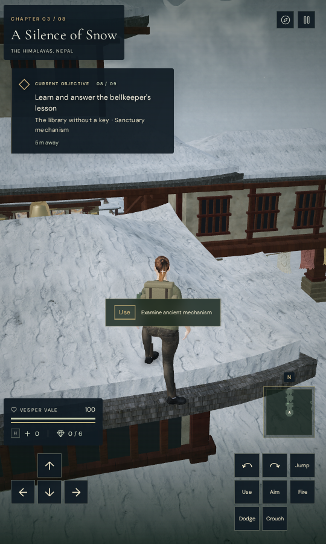
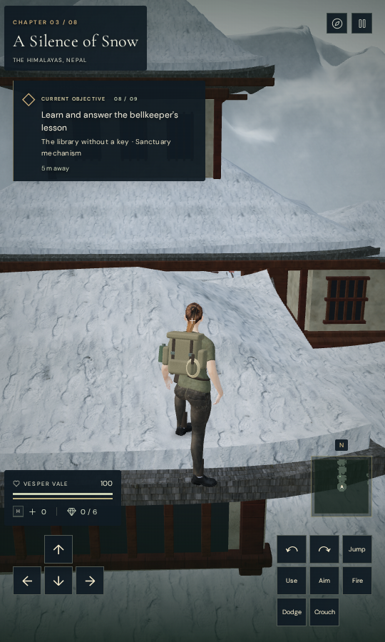

# Reach mechanisms from their platforms

On published `215cc72`, the portrait archive-roof view offered “Examine ancient
mechanism.” Native Use opened the bell lesson while the explorer stood on the
roof above its instrument. The production reproduction confirms both the prompt
and the remote activation.

Generic mechanism prompts now compare the explorer's feet with the feature
group's authored standing height, allowing a difference of at most 0.8 m. Raised
monastery and cloud-city platforms retain their height; the terrain below them
does not become an interaction floor. The preceding horizontal ranges remain
5 m for ordinary mechanisms and 2.4 m around the solved counterweight console,
whose centre is 5 m behind the board.

The closest-object selection uses the shared reach check. Use rechecks that
reach before opening a generic mechanism, so a target retained from an earlier
frame cannot activate after moving above, below or out of range. Existing field
work, counterweight readiness and current-stage checks still apply. Physical
bell ropes and other dedicated controls retain their separate reach rules.
Within the new reach bound, the existing lower-ledge gate still gives climbing
guidance when approaching a raised control from more than half a metre below
its platform.

All 39 focused regressions pass, including selection and activation for the
69 authored mechanisms across eight chapters and all 15 raised monastery and
cloud-city platforms. Regressions also reject stale targets above, below and
outside their horizontal reach, retain small platform steps, and select another
eligible raised field station when the mechanism below is out of reach.

In the actual constructed snow and sky chapters, all 17 mechanisms retain a
clear supported interaction stance. Each opens its expected puzzle; selection
and stale-target activation fail from positions 2 m below and 5 m above its
standing datum. These are assisted local placements, not complete chapter
playthroughs. All 407 runtime source hashes match the recorded application,
and no application errors or warnings occur.

Another 65 related regressions pass, covering wind controls, authored field
work, puzzles, chapter startup, discovery settings and traversal. The production
build succeeds with its existing large-chunk advisory.

Seven production Chromium scenarios pass with native keyboard input at
1280 × 800 High and touch input at 540 × 900 Performance. Three roof cases
offer no remote prompt or puzzle, including the exact stored portrait position
that reproduced the preceding bug. The other four cases pull physical ropes,
retain partial answers, reset/replay the tablet phrase and advance from stage 1
to stage 2. All nine complete-store reload comparisons pass, excluding only
per-chapter `lastPlayed` timestamps. Loaded bundles match the build, the
development interface is absent and no application errors or warnings occur.
Both layouts run in a touch-capable browser from prepared progress; consumer
device acceptance and unassisted chapter playthroughs remain open.
All thirteen production captures are reviewed.

The two documentation figures preserve the dimensions and decoded pixels of
their native portrait game captures through lossless WebP conversion. They use
the same stored roof position and view settings on the preceding and revised
builds; the follow camera and live weather continue to update. Existing
[asset credits](asset-credits.md) remain applicable; this repair adds no new
external asset or dependency.

Verification uses the shared locked five-of-sixteen CPU allowance, at most two
test workers and one browser at a time. Temporary browsers, workers and preview
servers close after each check. Broader interaction and continuous route
coverage, world composition, roof lining, consumer hardware performance and
subjective soundscape review remain open in the [visual audit](visual-audit.md).
