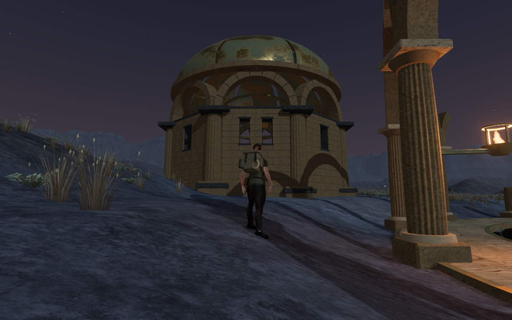
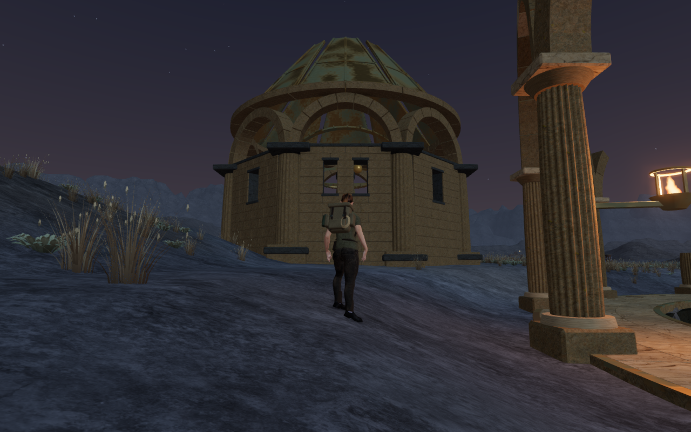
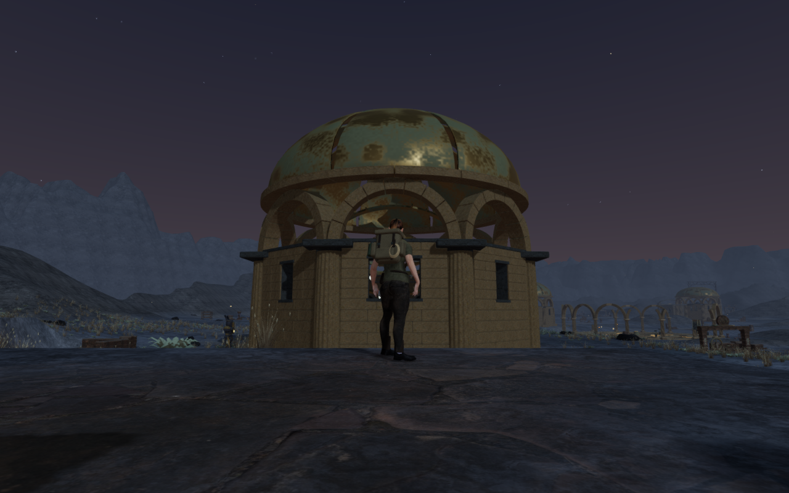
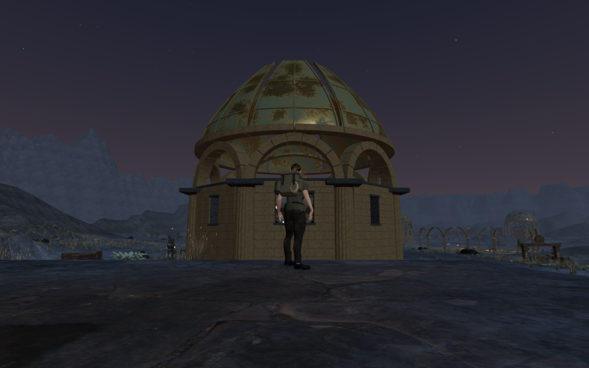
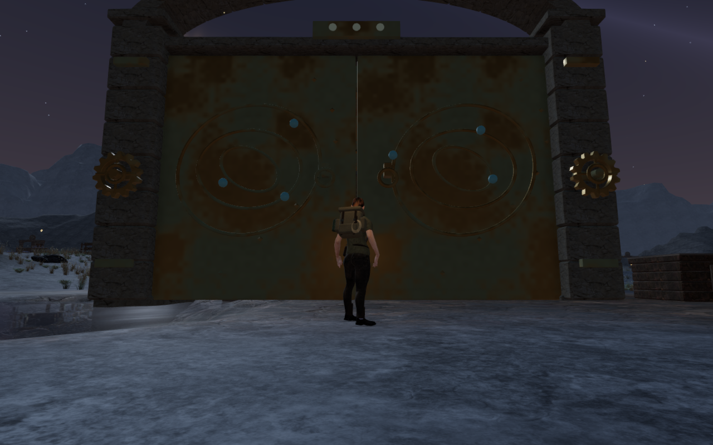
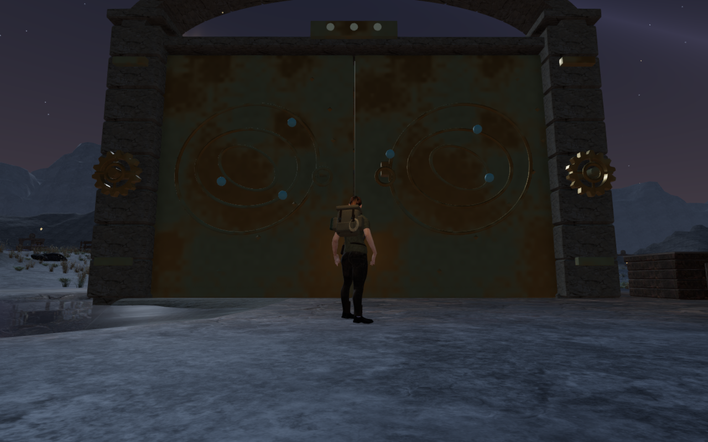

# Varied Meridian crowns and seated thresholds

The Last Meridian's eleven observatories now have individual roof profiles:
low canopies, pointed crowns, shouldered collars and taller lanterns. Each
moving bronze panel carries three raised straps, two curved bands and six
hexagonal fasteners. The panels retain their open central oculus, hinge
positions and saved restoration behavior. Their closed inner skins remain
18 cm from the outer surface along the local normal, including the flatter
eaves.

The review also found unsupported ground beneath five closed gates. Actual
visible-floor probes in the central opening measured gaps up to 0.484 m.
These gates now have closed stone thresholds with level sills, smooth approaches
and buried outer beds. Their rendered triangles provide physical support and
camera collision. The stone stays below the existing leaf edge and leaves the
neighboring counterweight board usable.

Older saves on the original soil lift onto a clear new threshold while retaining
their horizontal position. Arrival correction updates that saved height before
the generic traversal and asynchronous asset-arrival passes inspect it. Higher
recorded arrivals keep their existing restoration path.

All 60 selected tests pass. They cover closed roof components and positive
volume, real oculus and inner-skin rays, 18 cm plate thickness, moving camera
bounds, restoration state, sound emitters, all 69 chapter gates, counterweights
and the five new thresholds. The threshold tests include more than 600 actual
leaf/floor rays, 15 continuous approach-and-return pairs totaling 12,600 movement
ticks, closed-gate rejection and older/earned arrival restoration.

Twenty-two baseline follow-camera views cover every observatory front and rear,
with a boundary flank replacing the unavailable rear stance at court eight.
The 39 final High views repeat those poses, inspect all five repaired doorways
and show four roofs closed, partly open and fully open with their instruments
present. All are reviewed. The twelve elevated roof views are diagnostic cameras,
rather than grounded gameplay views. Large closed gates obscure much of the
roof from the normal front approaches.

Across six opening states, 809,088 revised roof-vertex checks and 92,880 checks
against the exact preceding roof geometry find no contained point in the sampled
gate meshes or other field-station solids. A deliberately occupied leaf point
confirms that the observer detects containment. Revised vertices remain at least
6.87 m above the finite terrain; at full opening, 52 lie beyond that terrain's
boundary, compared with 18 in the earlier geometry. These unreachable edge
overhangs are excluded from terrain-clearance measurements. Vertex sampling
does not establish exhaustive triangle-intersection coverage.

Actual final doorway probes find at most 3.1 mm between the five new stone sills
and their leaf bottoms. All 22 observatory sound anchors remain registered and
the new thresholds bury no source point. On an official chapter change, the
86 roof geometries, five threshold geometries and two shared materials each
dispose exactly once. Owned previews and browsers close after verification;
their threads remain within the shared five-of-sixteen CPU allowance.

Production keyboard/High and portrait touch/Performance checks each exercise
ring coupling, reset, a stage 2-to-3 solve and a 9.0–9.6 m return with 100 health.
Their four complete-save reload comparisons pass, excluding only the
`lastPlayed` timestamps. A separate production older-soil save rises 0.549 m
without changing its horizontal position, passes a fifth complete-save reload
comparison and permits a 6.47 m keyboard return with 100 health. The production
asset lists match the built bundles and the development interface is absent.
All eight release captures are reviewed. These prepared progress states do not
establish a complete chapter playthrough or listening/device acceptance.

The production build passes with its existing chunk-size advisory. This adds
geometry: each of the 86 moving roof panels now has 2,776 triangles. Details
remain in that panel's mesh and reuse the existing bronze material; the five
thresholds reuse existing stone. No new external asset, texture, material or
dependency is introduced. These checks do not establish consumer hardware
performance.

The six comparison exports retain actual 1280 × 800 High source pixels at
matching prepared player positions, follow cameras and zero elapsed simulation
time. The roof baselines match published `4564870`. The doorway baseline is the
interim roof-only revision, before adding thresholds. Revised captures match
the final application. Lossless WebP conversion preserves decoded pixels
without cropping or retouching. Existing [asset attribution](asset-credits.md)
is retained.

The [world audit](visual-audit.md) remains open. Large gate fronts still repeat
strongly in these approach views; broader route composition, continuous moving
body contact and listening/device acceptance still need work.
