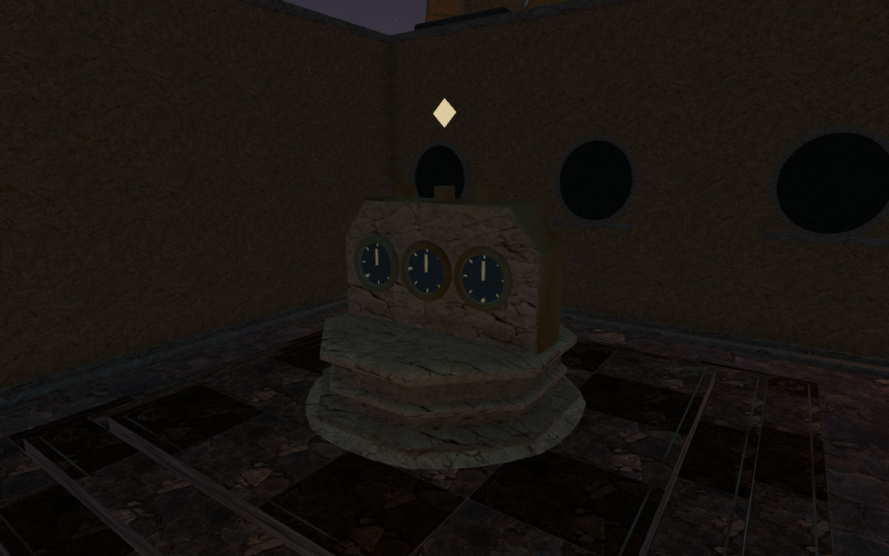
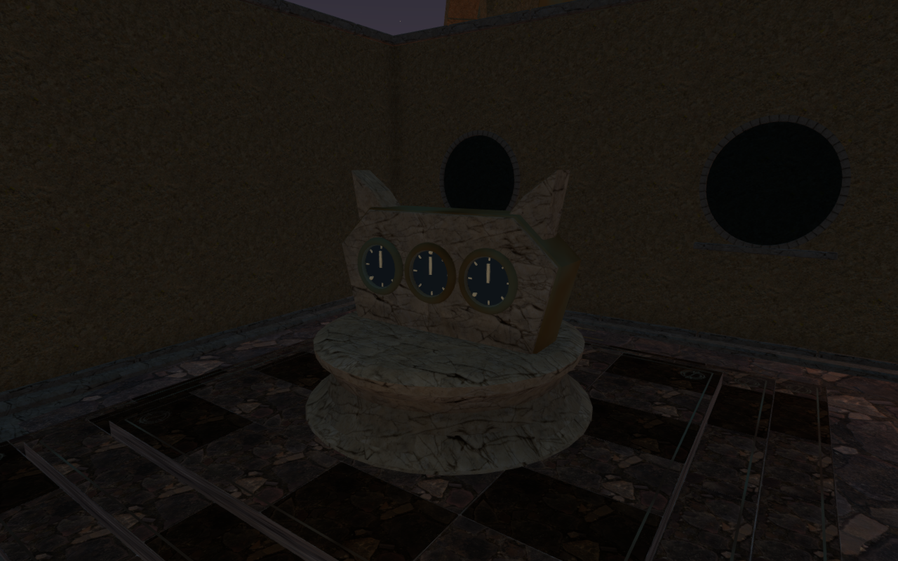
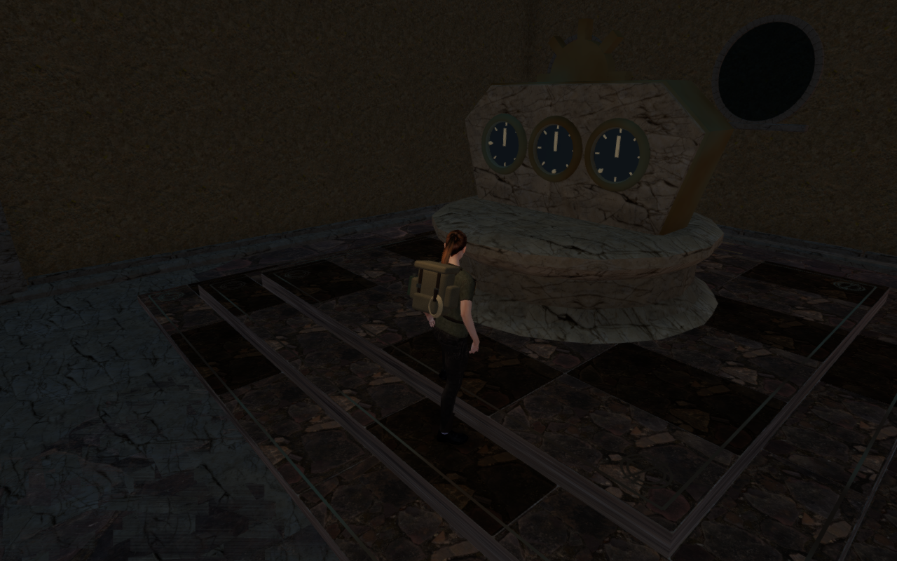
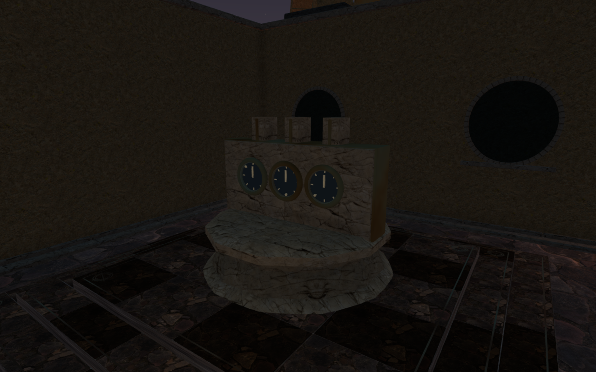
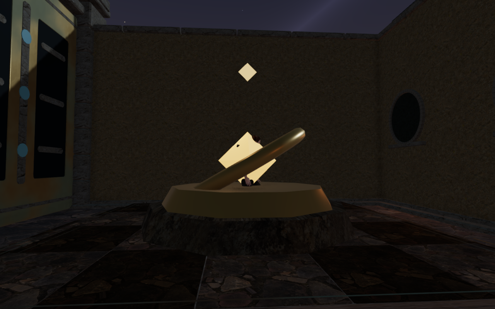
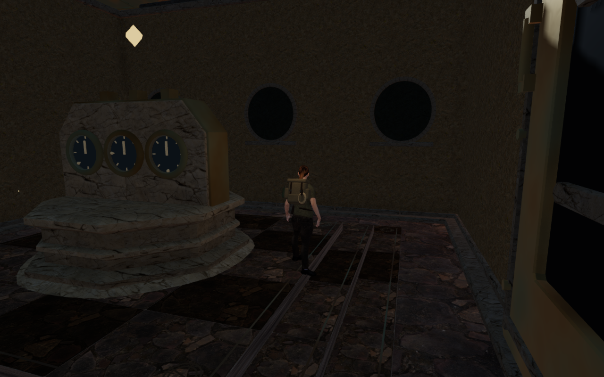

# Nine consoles for the Meridian sanctuaries

The nine later Meridian mechanisms now have individual stone consoles with
bronze borders and three protected dial faces. Earth-axis registers, lunar
shoulders, seven archive stelae, a solar crown, a broad western horizon, an
astral crest, linked circuit marks, layered strata and three final meridians
replace the repeated gold rings and floating crystals.

Each console shares the architectural profile of its larger observatory.
The stone maps are shared with the existing observatory material, and ivory
hands remain readable under the original lighting. The world dials display
saved intermediate ring positions and the restored targets after completion.
The decorative work stays behind physical glass covers. Unchanged displays
retain their pointer transforms instead of rebuilding them every frame.

The preceding stands had no body surfaces. All nine centres accepted a
standing explorer on their raised floors; the recorded first console view
showed the body crossing the stone, metal and crystal.

The two arrival figures show different player and camera positions because the
occupied position is rejected by the new geometry. They are actual renders
from prepared states.

The new feet enter the existing paving, with their construction datum on the
0.515 m raised floor. Closed triangle kernels retain the 146 structural pieces
after batching. Convex camera envelopes follow those parts, including the
glass covers; the small feet use conservative outer hulls around their
mouldings. A narrow support footprint lets the explorer leave upper shoulders
before descending clear of the wider stone. Objective markers clear the
crowns, and hum origins sit outside the front faces. Source counts remain
unchanged and no existing sound anchor enters a new console.

All 95 selected tests pass. The new checks cover closed edges and positive
volume, nine distinct physical silhouettes, 2,592 independent render/physics
ray pairs, 2,025 support comparisons, camera coverage, raised-floor contact,
sustained approaches and returns, occupied arrivals, and drops followed by
departures. Pointer checks restore intermediate saves and completed targets.
The other seven chapters retain their existing control builders. The selected
regressions also cover counterweight routes, field stations, observatory body
surfaces, camera following, the larger pedestal profiles and sound behavior.

Nineteen final development views are reviewed: nine High front approaches,
three detail cameras, three Performance views, two dial-progress states, and
two landing/departure views. All captured shaders link and HDR buffers remain
finite, with no application errors or warnings. Nine prepared routes pass
72 legs around the consoles and across their opened sanctuary gates, using
the delivered scene's collision and movement code. These assisted routes do
not establish a complete chapter playthrough or continuous motion acceptance.

All 81 tracked console geometries and materials dispose exactly once on an
inspected scene replacement. The three stone maps share the observatory's
existing texture objects. The build passes with its existing chunk-size
advisory. Checks run under the shared locked five-of-sixteen CPU allowance;
owned browsers, workers and temporary previews close after verification.

The final production bundle passes keyboard/High and portrait touch/Performance
checks from prepared stage-1 field progress. Both cases exercise coupled ring
turns, reset, alignment and a stage 1-to-2 submission. Five complete-save reload
comparisons pass across partial progress, completed progress and an older
occupied arrival, excluding only per-level `lastPlayed` timestamps. The two
return movements cover 9.0 m and 9.6 m with health at 100. The older arrival
moves 3.0 m beside the console, retains its 0.515 m raised floor and saved look,
and permits a 9.0 m return with health at 100. All eight release captures are
reviewed. Loaded assets match the built bundles, the development interface is
absent, and the keyboard/touch cases retain horizontal page fit. No application
errors or warnings occur.

The six 1280 × 800 High documentation exports preserve decoded source pixels
through lossless WebP conversion, without cropping or retouching. Baseline
runtime source hashes match published `c02fba7`; the final views and fresh
arrival share 397 hashes matching the revised application.

No new external model, bitmap, recording or dependency is added. Existing
[asset attribution](asset-credits.md) is retained. Broader room composition,
repeated upper instruments, continuous body contact, subjective listening
quality and consumer hardware performance remain open in the
[world audit](visual-audit.md).
