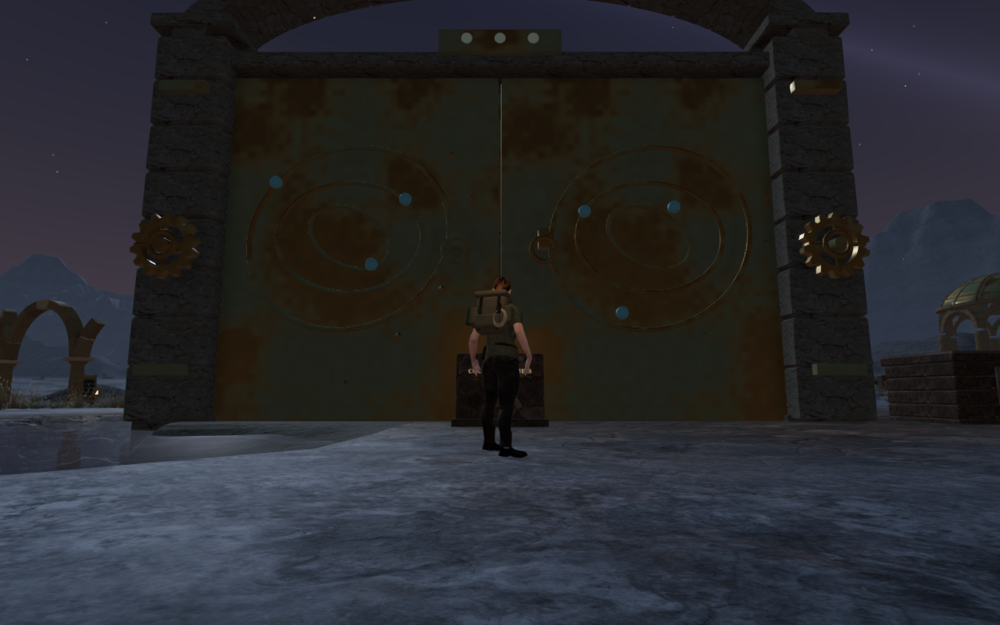
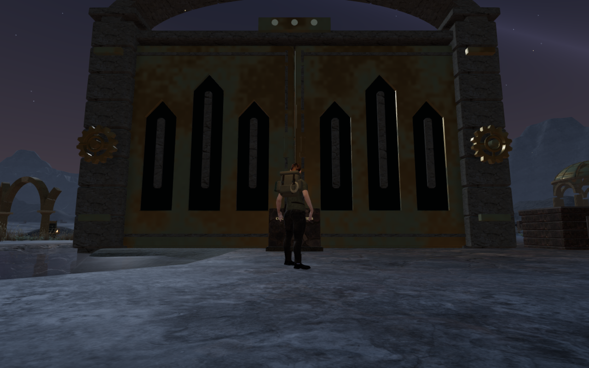
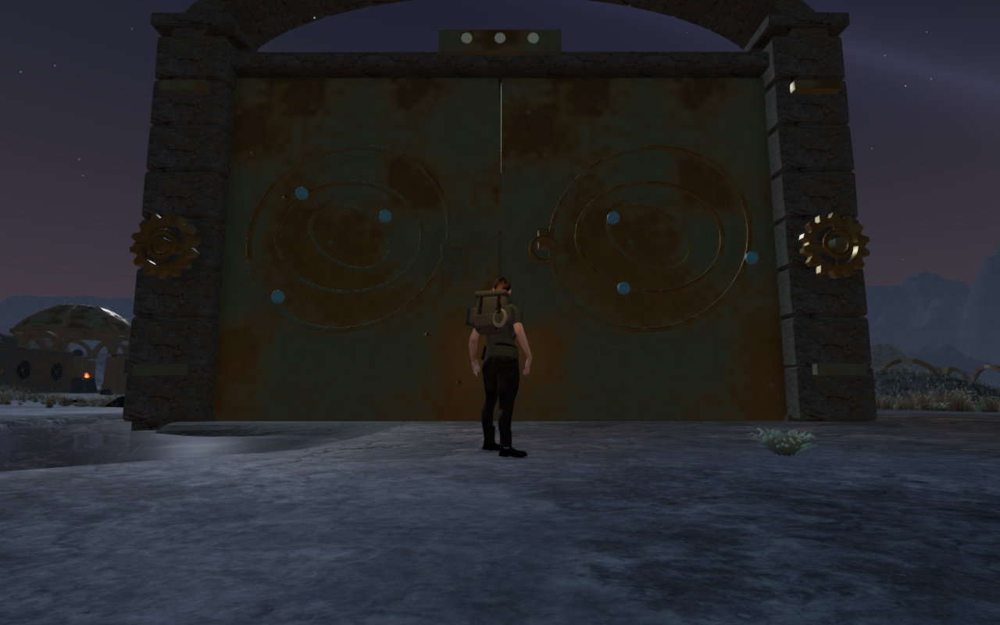
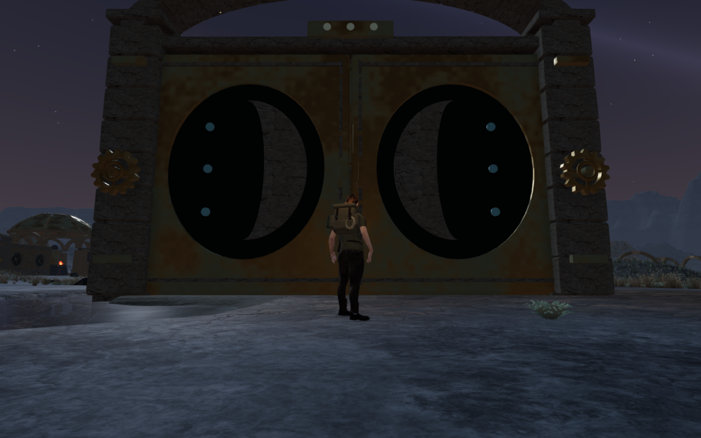
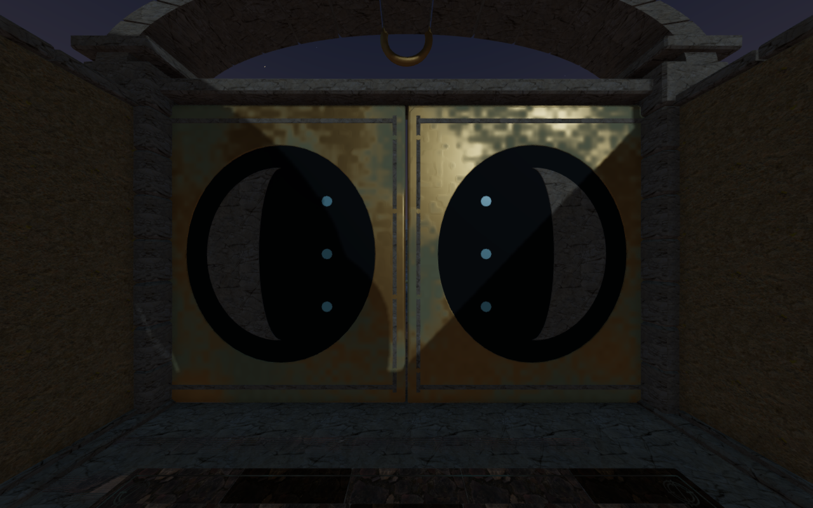
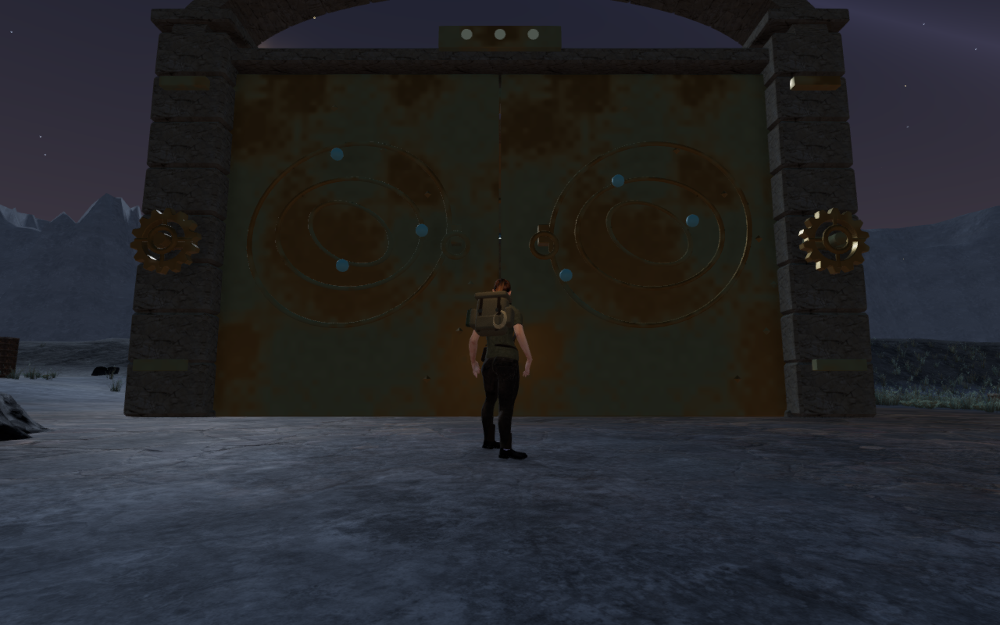
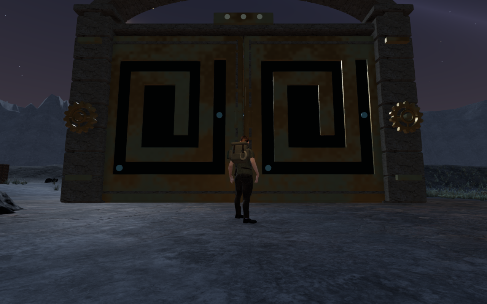

# Celestial records on the Meridian doors

The later [bronze highlight repair](bronze-highlights.md) addresses the material
finding recorded here. [Individual gate crowns](meridian-gate-crowns.md) also
replace the repeated shallow arches above these moving leaves.

The Last Meridian's ten gate pairs now carry individual bronze and stone
compositions. Portal niches, Earth-axis registers, opposing lunar crescents,
seven archive flutes, a solar fan, a western horizon, an astral chart, a celestial
circuit, hollow-earth strata and an Atlas meridian replace the repeated orbital
rings. These are architectural records alongside the existing coupled-ring
puzzles; they introduce no additional combination to memorize.

All twenty moving leaves have recessed face plates, closed dark backs, seated
stone emblems, fitted borders, fasteners and pull handles. The rear faces carry
the same records at a shallower depth so the doors fit their existing folded
pockets behind the exterior blind bays. Texture projection follows the fitted
geometry, keeping a consistent physical scale on the short returns.

The moving camera envelopes include the deeper front relief, shallow rear
fittings and small original chips at the slab edges. Hinges, passage dimensions,
field-action requirements and saved ring progress keep their existing behavior.

All 63 selected tests pass. New checks inspect the actual geometry of every leaf:
closed surface coverage, positive volume, finite attributes, real front/rear
recesses, distinct ray-depth signatures for all ten records and consistent
texture scale. A missing-triangle control confirms that the closure observer
rejects an open mesh. Collinear cap edges are subdivided at rendered vertices
when comparing their coverage with the shorter return edges.

Independent rays verify that the stone emblems enter their actual supporting
plates or recess backs. Material batching preserves both face-depth grids.
More than 100,000 delivered vertex checks across five hinge states remain within
the moving camera bounds. The selected regressions also cover all 69 chapter
gates, deep blind bays, exterior wall shielding, counterweights, observatory
roofs, threshold crossings and older/earned saved arrivals.

The production build passes with its existing chunk-size advisory. The reliefs
reuse existing credited bronze, stone, dark backing and inlay materials. No
external model, bitmap, recording, material or dependency is added. This pass
does not establish consumer hardware performance.

All 28 final High views are reviewed: ten matching published approaches, ten
rear diagnostic cameras and eight opening views across four gate pairs. The
rear cameras inspect the carved faces from inside the chambers and are distinct
from the ordinary follow-camera comparisons. Thirty actual open centre-passage
positions remain clear, all ten closed centre passages reject entry, and none
of the twenty drive sound anchors falls inside a leaf bound across six opening
states. These are sampled checks, rather than a complete moving-body or audio
acceptance pass.

On an official chapter change, 98 tracked leaf geometries, four shared materials
and three shared textures each dispose exactly once. Owned browsers and previews
close after verification, with their threads confined to the shared
five-of-sixteen CPU allowance.

Production keyboard/High and portrait touch/Performance checks each exercise
ring coupling, reset, a stage 2-to-3 solve and a 9.0–9.6 m return with 100 health.
Their four complete-save reload comparisons pass, excluding only `lastPlayed`
timestamps. A separate production older-soil arrival retains its horizontal
position, restores the 0.549 m threshold elevation, passes a fifth complete-save
reload comparison and permits a 6.47 m keyboard return with 100 health. Actual
asset lists match the built bundles and the development interface is absent.
All eight release captures are reviewed. These prepared progress states do not
establish a complete chapter playthrough or listening/device acceptance.

The six comparison exports retain actual 1280 × 800 High source pixels at
matching prepared player positions, follow cameras and zero elapsed simulation
time. Their baseline runtime source hashes match published `e68c603`; revised
hashes match the final application. The additional rear diagnostic export records
the fitted reverse face and its remaining material finding. Lossless WebP
conversion preserves decoded source pixels and dimensions without cropping or
retouching. Existing [asset attribution](asset-credits.md) is retained.

The [world audit](visual-audit.md) remains open. Large gate surrounds and many
instruments still repeat. The rear diagnostic views also show conspicuous square
mottling in bronze highlights; material and lighting review remains open.
Broader route composition, continuous moving body contact and listening/device
acceptance need further work.
