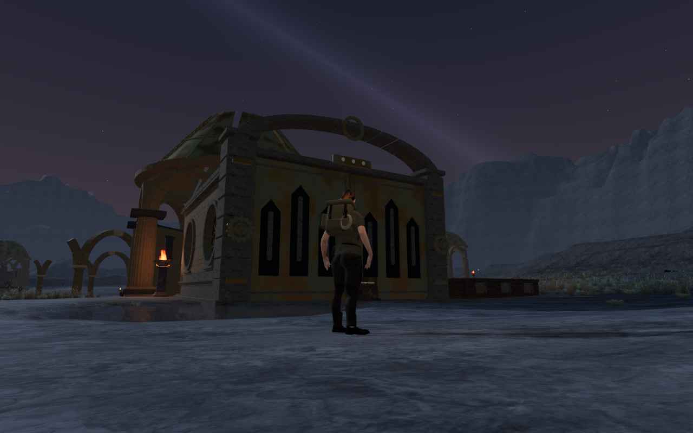
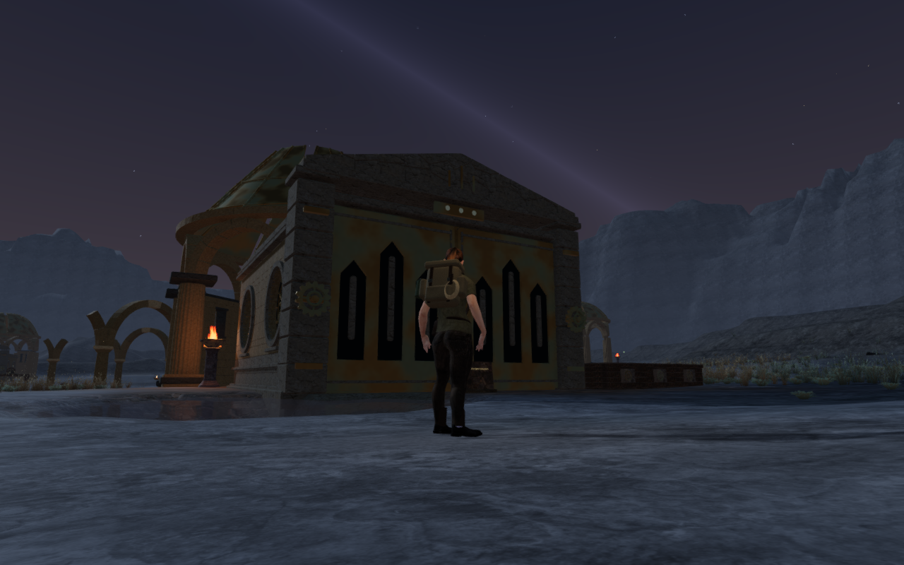
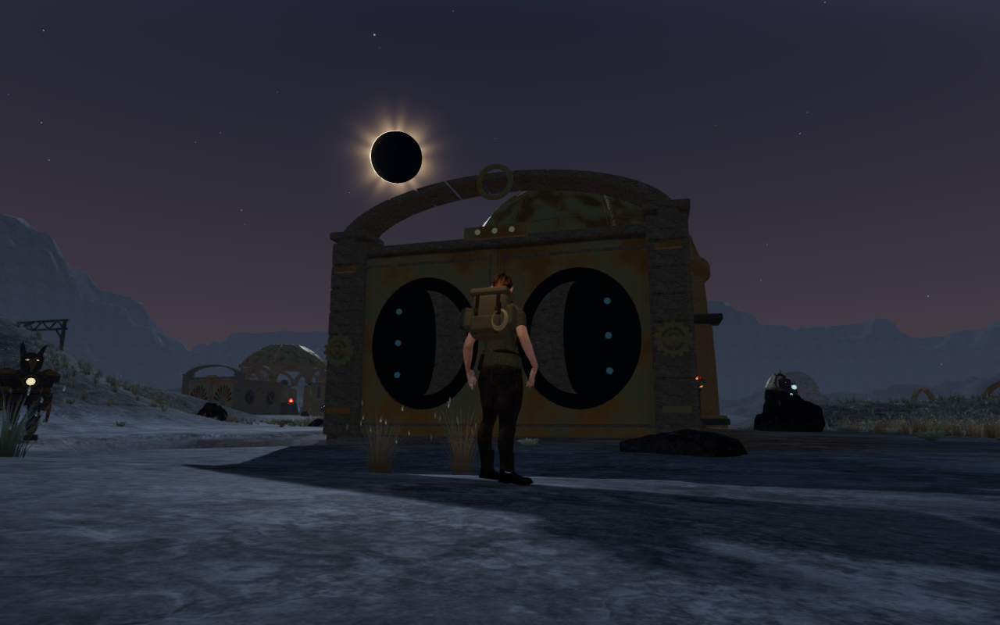
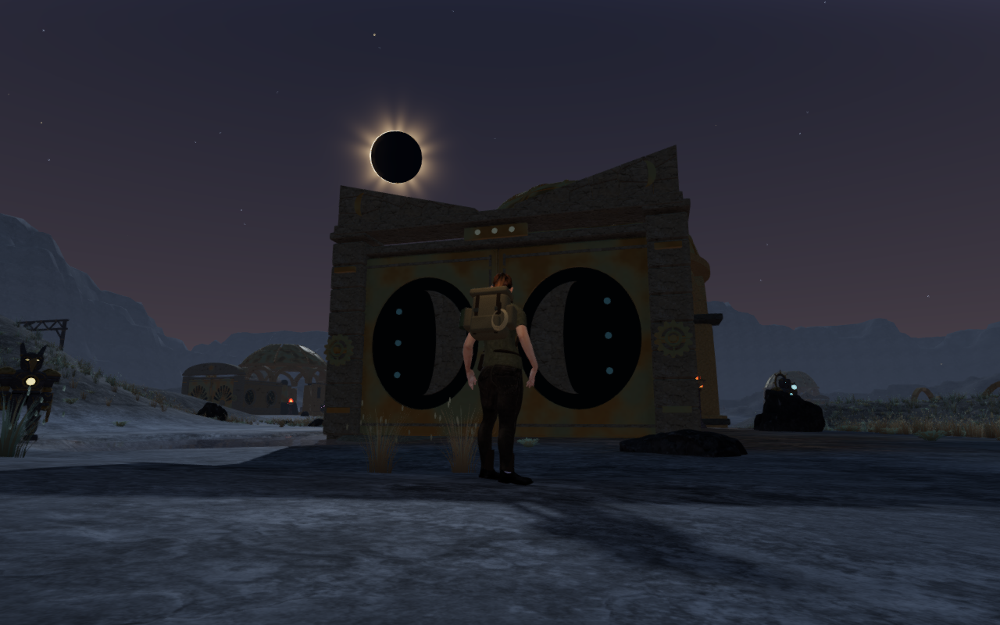
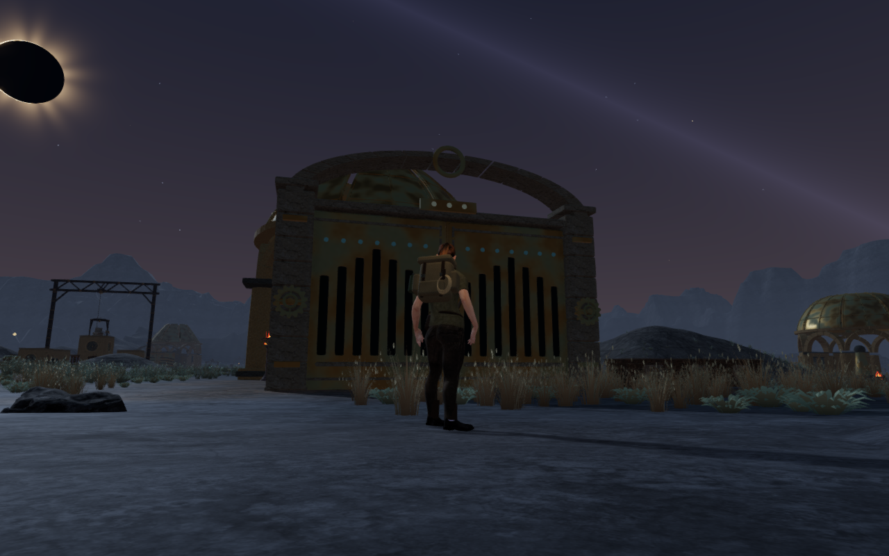
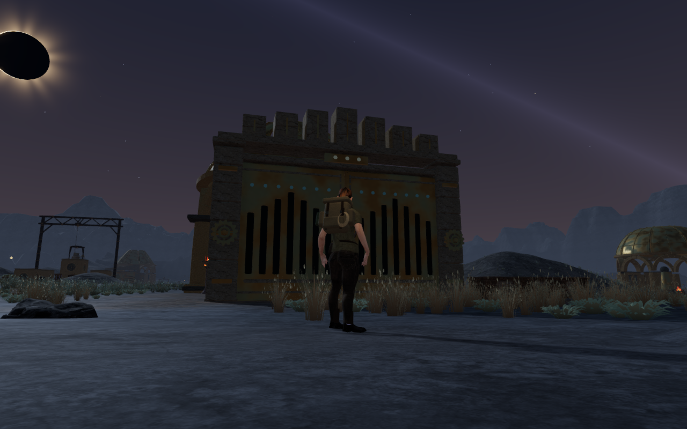
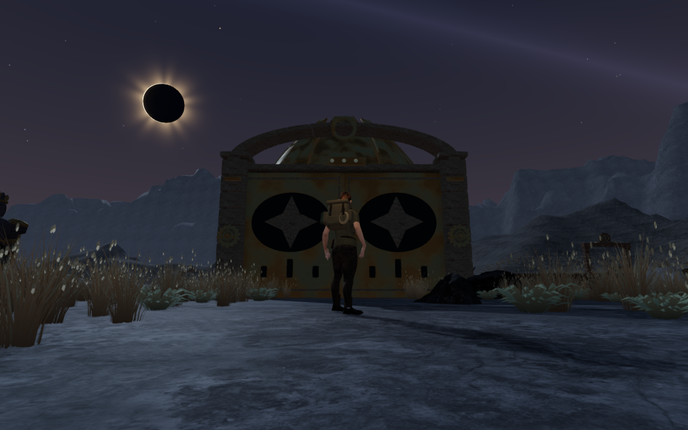
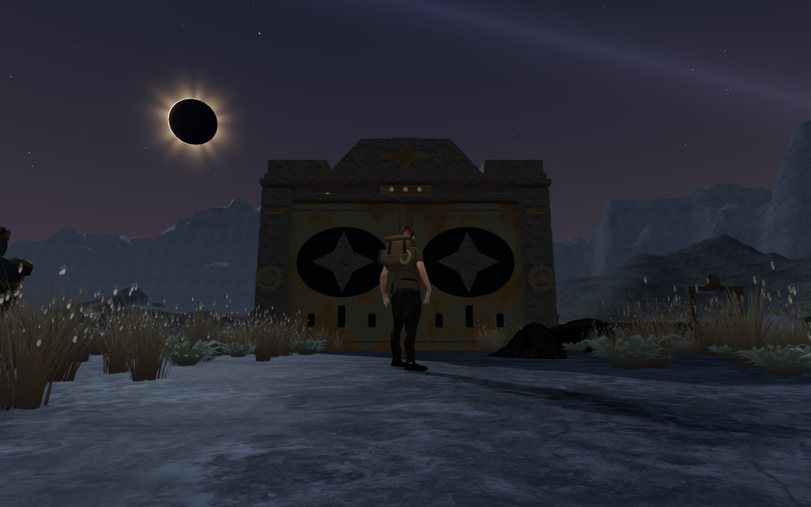

# Celestial silhouettes above the Meridian gates

The Last Meridian's ten gate heads now carry individual stone silhouettes.
A pointed meridian pediment, twin Earth-axis pylons, opposing lunar horns,
seven archive stelae, a solar tympanum, rising horizon terraces, an astral
pediment, a circuit bridge, three strata gables and an Atlas trapezoid replace
the repeated shallow arch. Their bronze records complement the existing door
reliefs and coupled-ring mechanisms.

Each crown bears on the existing jamb caps through a continuous stone beam.
Closed backing stones support individually dressed faces on both sides, with
recessed joints and bronze marks. The moving leaves, drive wheels, passage,
thresholds and saved combinations retain their existing construction and rules.

The construction checks inspect all 641 closed components for paired triangle
edges, noncollapsed triangles and outward positive volume. After material
batching, 2,130 actual rendered support probes match the physical triangle
surfaces. Fields meet the continuous bearing rather than floating above it;
the elevated construction creates no invisible column down to the ground.

Camera sections follow the profiles in intervals that limit diagonal overreach
to 18 cm. The lunar notch and the empty upper corners beside the gables remain
clear. Physical movement, sight and sound use the union of the separate closed
pieces after batching. The backing and facing overlaps retain their physical
union rather than cancelling in a combined parity query.

The 65 selected regressions and an additional continuous sweep check pass,
covering the crowns, all 69 chapter gates, moving door reliefs, blind-bay
shielding, counterweights, observatory behavior,
threshold crossings and older saved arrivals. The production build passes with
its existing chunk-size advisory.

Nineteen revised rendered views are reviewed: all ten High front approaches,
three Performance approaches and six front/rear detail inspections. The ten
main comparisons retain matching grounded gameplay follow cameras and player
positions from the published baseline. The elevated detail cameras inspect
the construction separately. Two baseline rear follow views are substantially
obscured by the observatories and do not establish crown-face coverage.
All captured shaders link and HDR buffers remain finite, with no application
errors or warnings.

Across six observed roof-opening states, the 86 actual roof-mesh bounds stay
disjoint from every crown. All 913,824 observed leaf vertices retain at least
0.942 m vertical separation from their crowns. None of the twenty gate drives
or twenty-two observatory sound anchors is buried by the new stone. These
checks do not establish continuous body contact or listening acceptance.

The continuous sweep check also derives conservative world-space rotation
envelopes from all 134,848 roof vertices. Their endpoint and derivative-root
extrema bound every triangle throughout 2,752 rotation intervals across all
86 panels. All interval bounds stay disjoint from the ten crowns. Independent
Three.js rotation samples confirm the coordinate calculation. This establishes
roof/crown clearance throughout the authored opening range, beyond the six
render-observer states; it does not extend to unrelated structures or body poses.

Production keyboard/High and portrait touch/Performance checks exercise coupled
ring turns, reset, alignment and a stage 2-to-3 submission from prepared progress.
Five full-store reload comparisons pass across partial progress, completed
progress and an older soil-height arrival, excluding only per-level `lastPlayed`
timestamps. Native return movement covers 9.0 m and 9.6 m with health retained
at 100. The older arrival preserves its horizontal position, restores the
0.549 m threshold support and permits a 6.47 m return with health retained.
The actual asset lists match the built bundles and the development interface
is absent. All eight release captures are reviewed, with no application errors,
warnings or horizontal overflow. These prepared checks do not establish a
complete chapter playthrough, moving-body visual acceptance or listening review.

The crowns contain 25,168 triangles in total and batch into three meshes per
gate. On each inspected official chapter change, all 30 tracked crown
geometries and three shared materials dispose exactly once. Owned verification
browsers and previews close afterward. Their threads stay within the shared
five-of-sixteen CPU allowance. Consumer hardware performance remains unverified.

The eight comparison exports preserve actual 1280 × 800 High source pixels,
dimensions, prepared standing positions, follow cameras and zero elapsed
simulation time. Baseline runtime source hashes match published `32a9d76`;
revised hashes match the new application. Lossless WebP conversion introduces
no cropping or retouching. Existing [asset attribution](asset-credits.md) is
retained, with no external model, bitmap, recording or dependency added.

The [world audit](visual-audit.md) remains open. Other repeated instruments and
large structures, broader route composition, continuous body contact, consumer
device performance and listening acceptance still need work.
