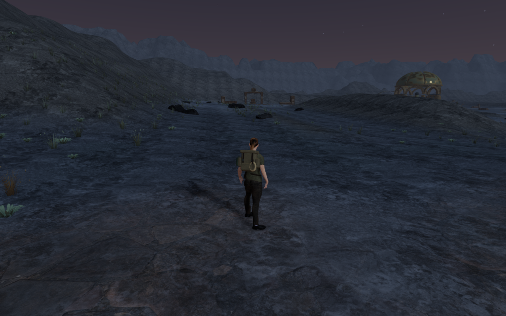
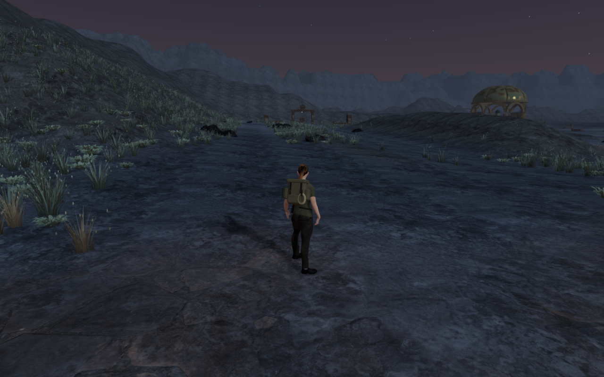
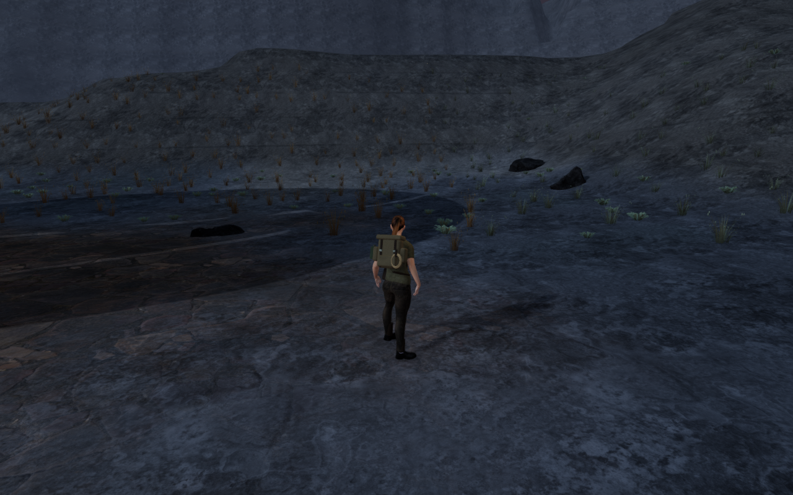
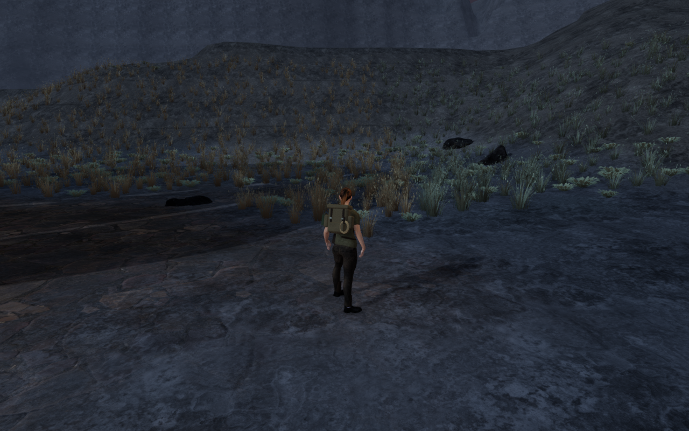
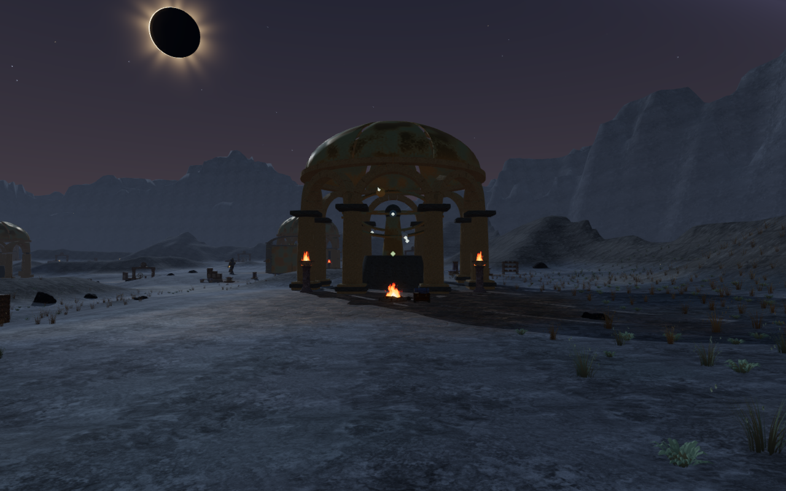
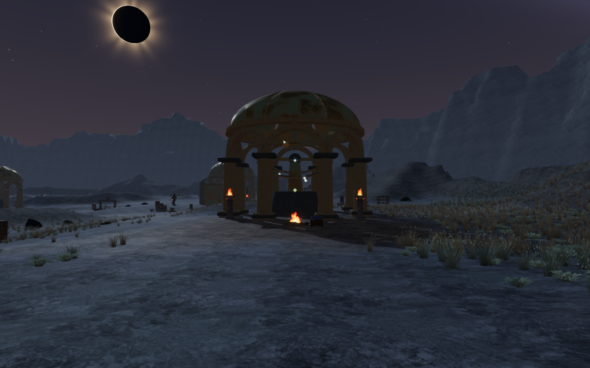

# Meridian planting

The Last Meridian now has fuller colonies of silver bunchgrass, dry flowering
stems and broad low cushions. Dense cores alternate with mineral gaps and
occasional outlying plants. Larger specimens and paler tips give the moonlit
ground more nearby detail, while the existing trail and working-space
reservations retain clear routes.

These are actual High-preset game captures. Every revised view retains the
preceding player position, camera position and simulation time. The six
1280 × 800 lossless WebP exports preserve their source pixels and dimensions,
without cropping, retouching or added artwork.

## Distribution and review

The chapter contains 53,077 plants: 22,826 silver bunchgrasses, 19,066 dry stems
and 11,185 cushions, replacing the preceding pass's 15,056 smaller specimens.
There are 461 spatial patches, each with three existing detail tiers and quality
ranges. The distribution consumes candidate randomness before reservations.
Planting retains the existing exclusions around trails, climbing courses,
machinery, discoveries, gate motion, water, domes and scanned-rock bounds.

The density field now forms continuous colonies with occasional isolated tufts.
The broader grass and cushion forms use more of the project's original folded
leaves. These are soft plants with fixed buried roots and small wind movement.
Terrain heights, machinery, objective IDs and save structure are unchanged.

The preceding survey refreshed all 20 volcanic/final-chapter courts from front
and rear, plus four entrance headings in each chapter: 48 High views in total.
All are reviewed in diagnostic sheets with selected full views. The final
chapter's 26 revised views are also reviewed; their recorded player, camera and
simulation time match the controls exactly. Shaders link and sampled HDR output
is finite in all captured views. Some rear observers stand close to the
enclosures and show only part of the external silhouette.

The planting improves the reviewed surroundings. Broad volcanic paving and ash
remain sparse, and repeated large court installations remain composition work.
This pass does not close the [whole-world visual audit](visual-audit.md).

The subsequent [foundry floor pass](forge-floors.md) adds distinct worn courses
to the nine volcanic work aprons. Broad ash fields and repeated installations
remain open in that refreshed review.

## Grounding, access and cleanup

An independent observer reads delivered terrain triangles and rounds plant
transforms to the float32 values used by the render attributes. All 19,459,116
tested root points across 53,077 plants find ground, with no exposed roots or
reservation failures. The highest root is 19.613 mm below the surface; the
deepest is 374.738 mm below it on a slope. A deliberately raised plant is
rejected. A separate altered render-matrix control produces packing mismatches;
restoring it clears them.

Authored plant-transform hashes stay identical across High, Medium and
Performance. All inspected active render matrices match their expected float32
transforms. The initial-camera range selections contain 7,030, 4,807 and 2,635
instances respectively. These are range-selection totals, including chunks
outside the view, rather than frame-rate measurements.

All 63 feature approaches have a legal supported stance with a matching
rendered floor within 15 mm. The observer includes raised pedestal support,
rather than assuming every approach stands at terrain height. All 22
observatory sound-source fronts remain clear. Thirty controller-assisted local
ground legs arrive, covering 16,105 physics updates. These checks do not establish
full-body contact with every solid, combat balance or complete climbing routes.

Changing to the flooded chapter dispatches one disposal event for each of the
1,383 tracked instance meshes, 1,383 patch geometries and 1,384 materials,
including depth materials. None remain under the current scene and the chapter's
groundcover reference clears. The test retains the outgoing scene only to
observe its disposal; its old parent pointers are outside the active scene.

The final integrity run retains the successful root, negative-control, quality
and local-route observations on identical application source hashes. A
supplemental check uses supported approach heights and traces retirement against
the current scene. Earlier fixture failures are excluded from accepted results.

## Release verification

All 24 focused groundcover, meadow, instance-LOD and observatory tests pass.
The production build passes with its existing chunk-size warning. Native
keyboard/High at 1280 × 800 and portrait touch/Performance at 540 × 900 exercise
movement, crouch/stand, map and pause. They move 1.136 m and 1.8 m respectively,
retain health 100 and pass four complete-store reload comparisons, excluding
only per-chapter `lastPlayed` timestamps. The fixture includes the normal arrival
checkpoint and camera. All fourteen release captures are reviewed. There are no
page errors, unexpected console warnings or horizontal overflow; the release
exposes no development hook and its loaded bundles match the build.

Verification uses the shared locked five-of-sixteen CPU allowance, at most two
test workers and one browser, with expensive workloads run sequentially.
Temporary previews, workers and browsers close after their checks. Broader
landscape composition, continuous moving contact and listening/device acceptance
remain open. No external asset, recording or dependency is added.
