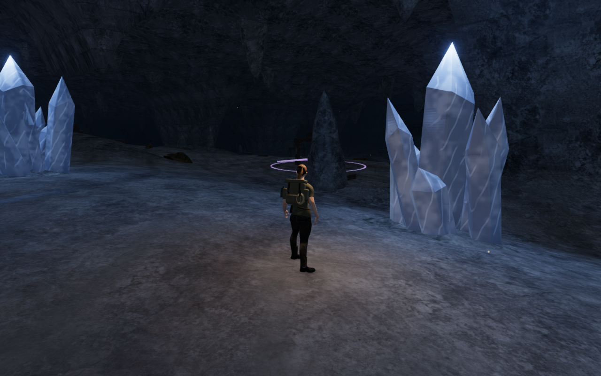
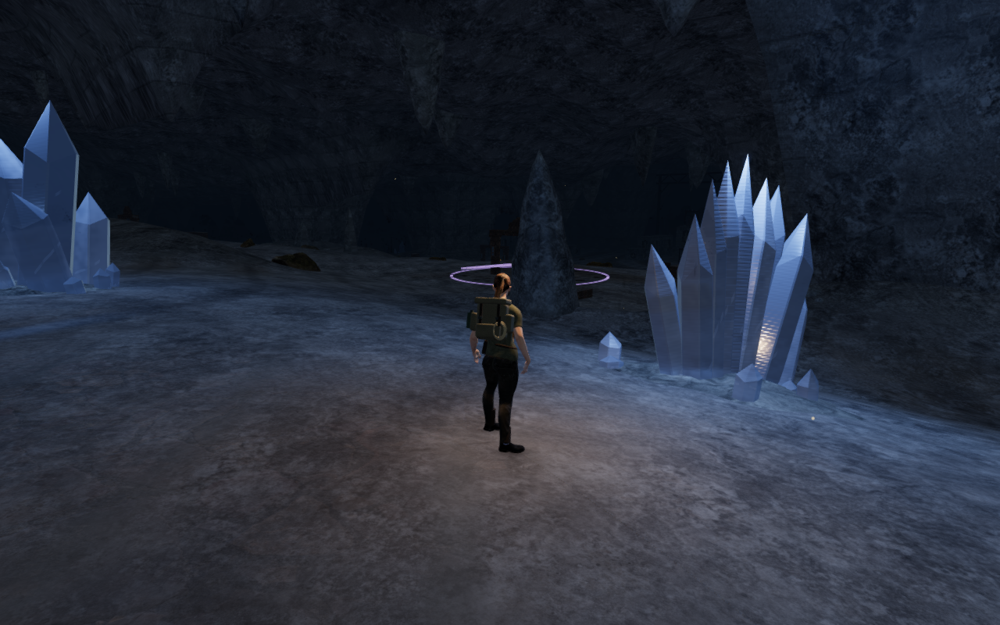
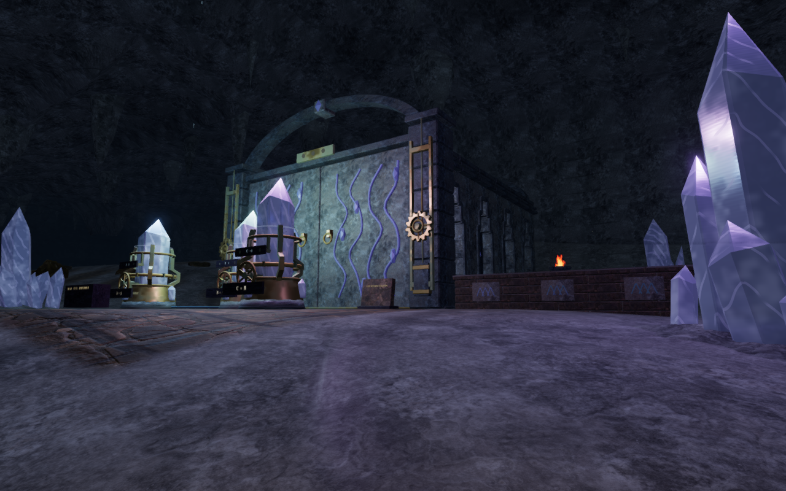
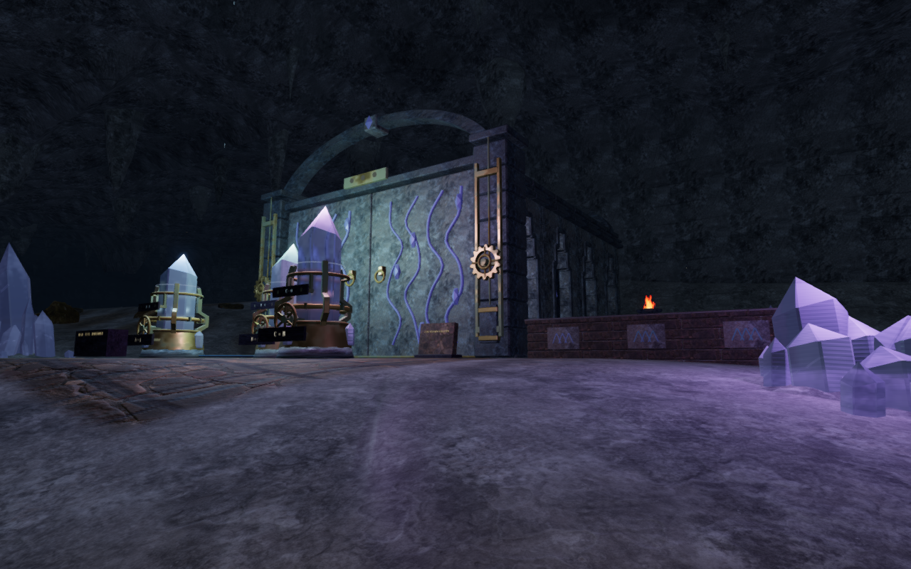
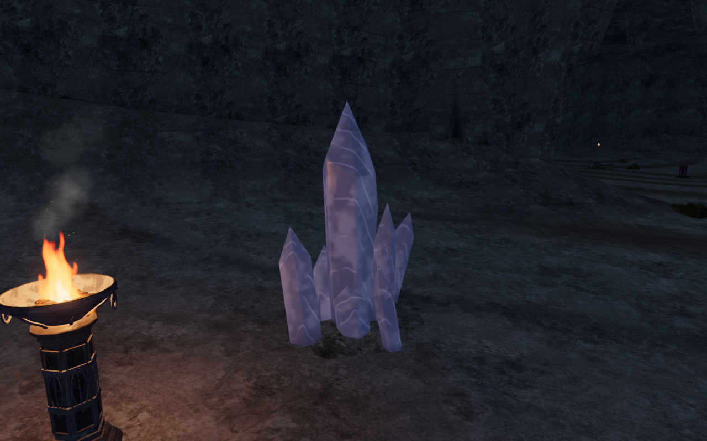
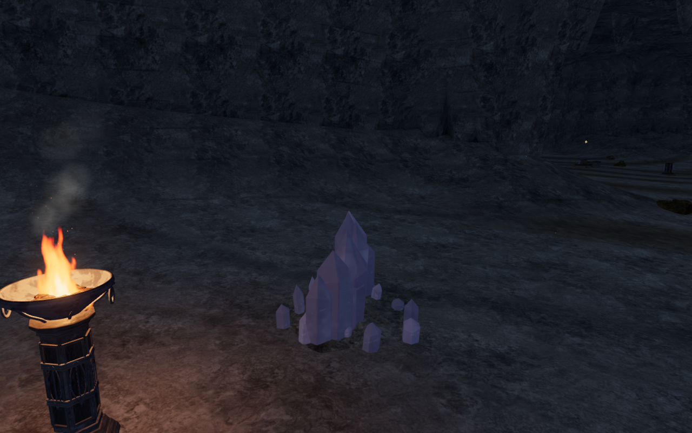

# Cavern mineral fields

The natural quartz formations in The Night Below now have six profiles:
crowns, twin spires, fans, ridges, needle sprays and low druse. The 33 formations
contain 693 crystals, including smaller growth around each core. Different
heights, lean and bearings replace the repeated tall central silhouette.
The shared quartz material has broader cloudy inclusions, a sparse internal
cleavage and quieter edge emission in place of the bright repeating fracture
bands. Fine growth striations and the existing faceted geometry remain.

Each leaned crystal is seated against the delivered terrain. Its lower heel
enters the lowest ground beneath its footprint, with 55 mm of cover. Physical
contact now follows the real crystal and bed triangles rather than the old
central box. Hum emitters sit beyond the actual formation bounds on their
existing approach sides; their gain, range, pitch and restoration behavior stay
the same. Formation centers and 353 non-mineral mesh geometries and transforms
match the preceding build, including the cavern ceilings.

## Actual comparison views

These six 1280 × 800 High-preset captures compare published commit `c5d57ec`
with the revised application. Each pair shares its player position, camera and
zero elapsed simulation time. Lossless WebP exports retain the decoded source
pixels and dimensions, without cropping or retouching.

Entrance, using the explorer's follow camera, before and after:

First tuning court, using the same prepared ground observer, before and after:

Formation detail, using the same fixed art inspection camera, before and after:

## Verification

The 29 distinct selected cavern, mineral-art, resonance and resonance-terrain
tests pass. Independent queries sample rendered heel triangles against terrain
and compare 198 rays through batched formations with the physical triangle
kernels, including real gaps between crystals. Surface agreement is within
1 mm, allowing for world-coordinate Float32 batching.

The reviewed development coverage contains 69 accepted views: four entrance
headings, eighteen court fronts/backs, all 33 formations at High, two fixed
details and six profiles each at Performance and Balanced. Nine formation
views were replaced after inspection stances were corrected to dry ground
with the complete formation framed. Four old fixed-camera slots that missed
their subjects are excluded. Drawn shaders link, sampled High HDR values are
finite, and all presets report no GL error. Source hashes match across the
final render, route, audio and cleanup observations.

All 54 sampled feature approaches, 41 tuning controls, 66 tuning-tone fronts
and 33 natural hum fronts remain clear. Forty-one assisted tuning-area walking
legs and 33 mineral approach/return pairs pass through the actual character
controller. The verification helpers now target real tuning controls instead
of retired map centers inside closed gates, and leave the route planner's
extra corner margin in front of wheel castings. These are local scripted
checks on prepared progress, not an unassisted chapter playthrough.

Live Web Audio state agrees with the current linear attenuation formula:
the inspected hum has target gain 0.128 at 2.777 m and 0.098805 at 10.071 m,
and retires beyond its 34 m range. The 32/80/75 music/ambience/effects mix
persists. This checks behavior, not subjective listening quality. Chapter
change disposes the 149 tracked quartz geometries, 50 mineral materials and
one observed transmission target, with no old mineral obstacles left behind.

The production build passes with the existing large-chunk advisory. Native
keyboard/High and portrait touch/Performance checks each exercise thirteen
tuning turns, reset, stage completion and 5.7 m of return movement at 100 health.
Four complete-store reload comparisons pass, excluding only `lastPlayed`.
A separate older ground save resolves onto the actual bed at the same x/z,
51.652 mm higher, retaining 91 health, two medkits and stage zero; its additional
complete-store reload comparison passes. All ten final release images are
reviewed, including the older-save pause/reload screens.

Checks share the locked five-of-sixteen CPU allowance. Owned browsers, workers
and preview servers close afterward. Broad cave-floor composition, repeated
large buildings, continuous body/solid contact, full routes, consumer hardware
performance and listening/device acceptance remain open in the
[production status](production-status.md).
