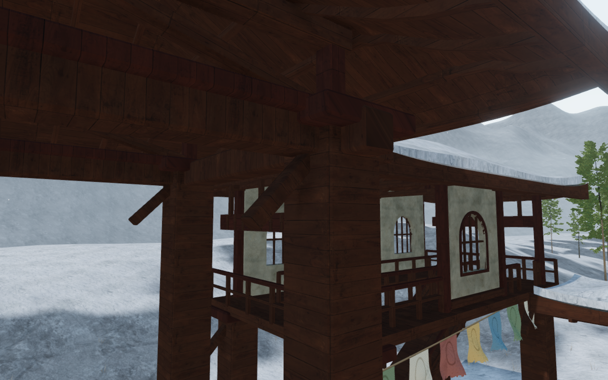
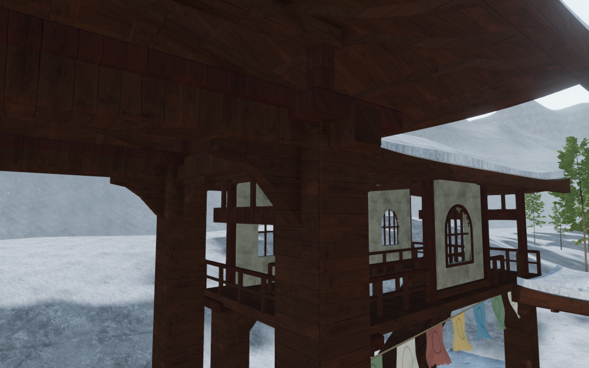
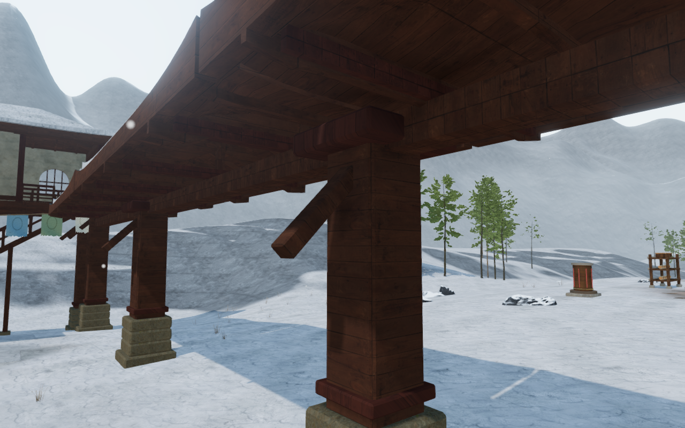
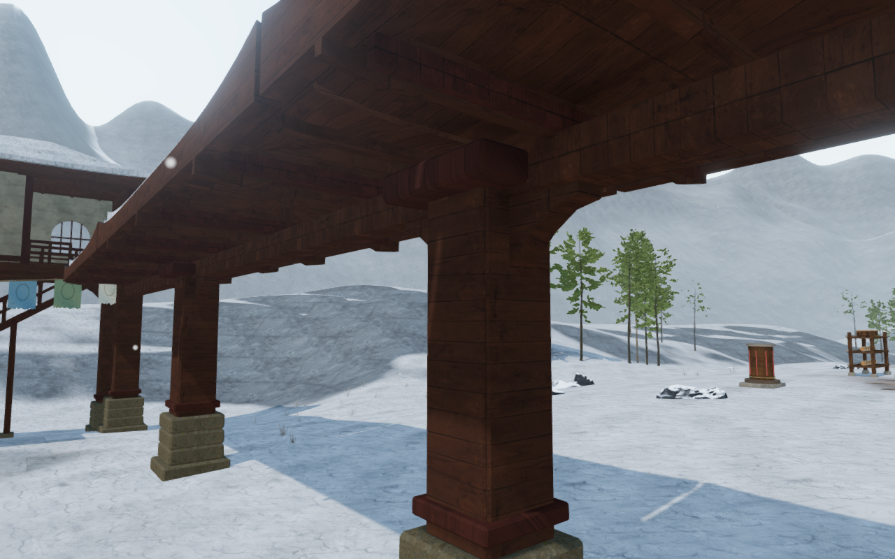

# Fitted monastery post brackets

Close views beneath the winter halls and cloisters exposed diagonal struts
whose lower ends pointed into empty space. All 147 of those struts are replaced
with 209 fitted brackets across the nine courts. The main posts carry brackets
on both beam axes; lodge brackets carry their floor joists; cloister brackets
follow the longitudinal beams instead of pointing sideways beneath the roofs.

| Previous hall struts | Fitted hall brackets |
| --- | --- |
|  |  |

| Previous cloister strut | Fitted cloister brackets |
| --- | --- |
|  |  |

Nine profiles vary reach, depth, drop and the shape of the lower shoulder.
The upper faces come from clipped triangles of the actual beam undersides,
including their small chipped variations. Five profile intervals shape the
lower faces while retaining closed solids. The tops seat 6 mm into their
bearers, and the back faces enter the existing posts. The original credited
timber material remains shared with the surrounding frame.

The new geometry participates in finite physical, sight, sound and camera
queries. Separate camera cells retain empty space beneath the shoulders and
above/below each bracket. The camera index gains one assembly per court.
The narrow members block contact without becoming body landing platforms.
Unrendered joist copies used during fitting are disposed immediately afterward;
temporary proxy geometry is also released.

All 69 selected checks across seventeen files pass, as do the three CPU-budget
checks and the build. The build retains its existing bundle-size advisory.
Coverage includes closed profiles and removed-face controls, finite camera/body
queries, delivered joint displacement controls, thirteen lodge return routes,
23 covered-roof jumps, seventeen pavilion landings and earlier rooftop arrivals.

The delivered-buffer reader checks all 209 brackets after material batching.
All 12,280 beam-seat probes pass within the 3–9 mm acceptance range; measured
seats remain within 0.006 ± 0.000001 m. All 490 back-face centroids lie inside
the delivered post cores. Lowering the brackets 25 cm detects all 12,280 missing
beam contacts. Translating them 2.8 m away from their posts detects all 490
detached back contacts. Each control restores the exact original buffer bytes.

A frozen published-source comparison retains all nine court plans,
foundations, coarse post solids, house/lodge joinery and wind origins. Remaining
root positions, normals, UVs and colors match after excluding the retired
struts and new brackets. All 72 roof records, 116 roof/snow fixtures and 2,444
sampled ground movement results match. The isolated monastery camera index
grows from 508 to 517 entries as the brackets gain finite clearance.

Twenty-six final-source game views are reviewed: twelve close construction
views, nine court overviews, an opposite stair-court view and four prepared
ground stances beside the frames. The opposite stair view supplies additional
coverage. Construction views use free cameras and a hidden player anchor at the
court centre; the ground stances use legal positions and the normal follow
camera. The views come from serial
passes of the same unchanged source.

Independent render inspection finds 24,560 closed triangles in 209 components,
with no open components. All 209 interior witnesses register more than 63 mm
inside the delivered brackets. Four sampled player poses clear 192,380 rendered
character vertices at the 15 mm threshold, with legal player and camera
positions. All 77 sound-source origins remain outside the new geometry.
These sampled checks do not establish continuous moving-body acceptance.

Production keyboard/High at 1280 × 800 and actual portrait touch/Performance at
540 × 900 both crouch and walk 6.0–6.6 m beside the gallery frame at full health.
Four complete-store reload comparisons pass apart from chapter timestamps.
Saved elevation remains on the ground, loaded JS/CSS names match the build,
the development hook is absent and there is no horizontal overflow. The prepared
save has guardians defeated and audio muted. All six release captures are
reviewed, with no page errors, missing resources or unexpected console warnings.

The paired High views retain player/camera framing and scene time. All four
1280 × 800 documentation images preserve source RGB pixels through lossless
WebP conversion. All 435 runtime hashes match the tested and rendered source.
Final HDR inputs remain finite, shaders link and GL errors remain zero. No page
errors, missing resources or unexpected console warnings are recorded. Checks
use the shared locked five-of-sixteen CPU set at lower priority, at most two
test workers and one browser. Owned helpers close after their checks.

This repairs the recorded strut orientation and attachment defect while varying
the bearing details. Broad court arrangements and sparse connecting paths,
wider discovery/traversal/water coverage and continuous body contact remain
open. Surface-specific footsteps, listening review and consumer-device
performance also remain unfinished. The game goal remains active.
