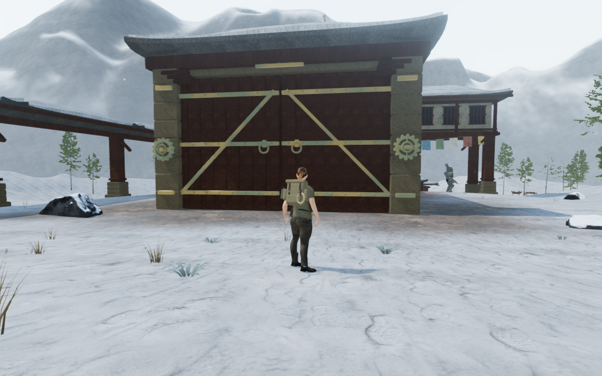
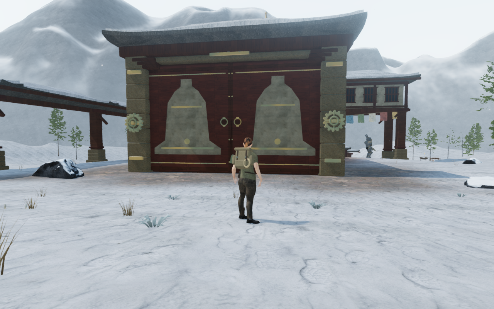
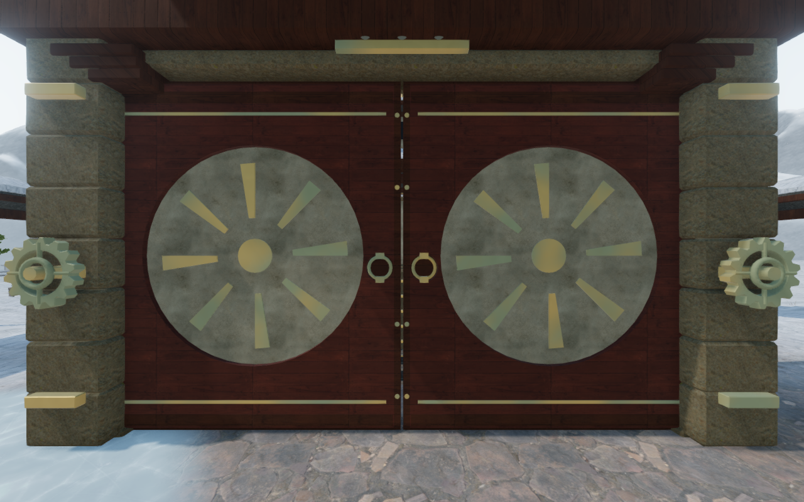
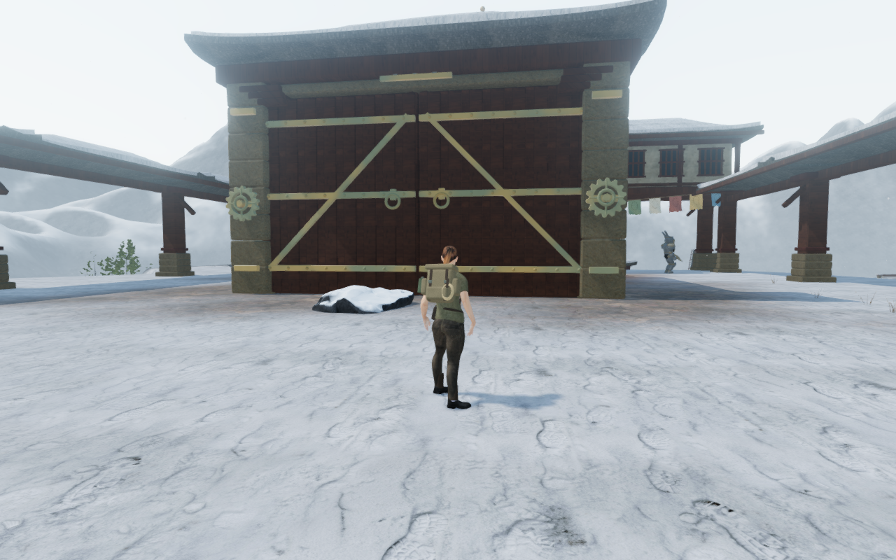
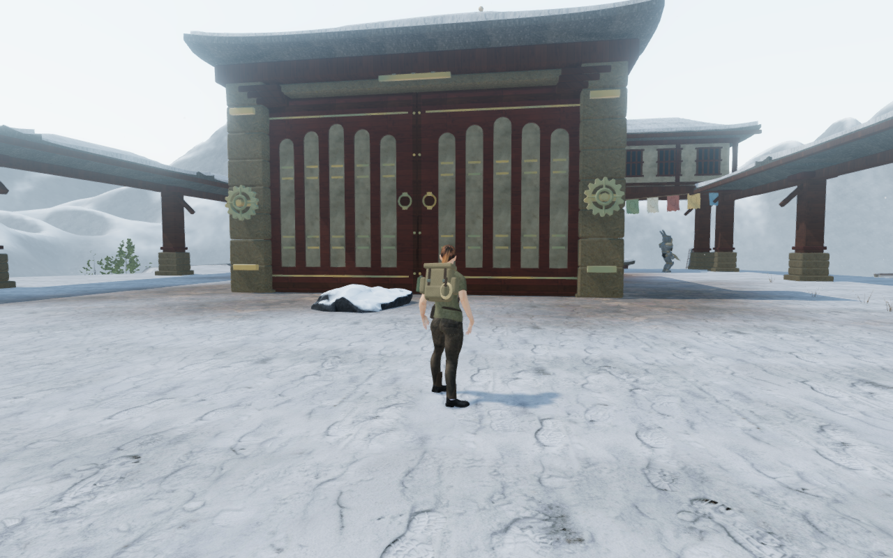
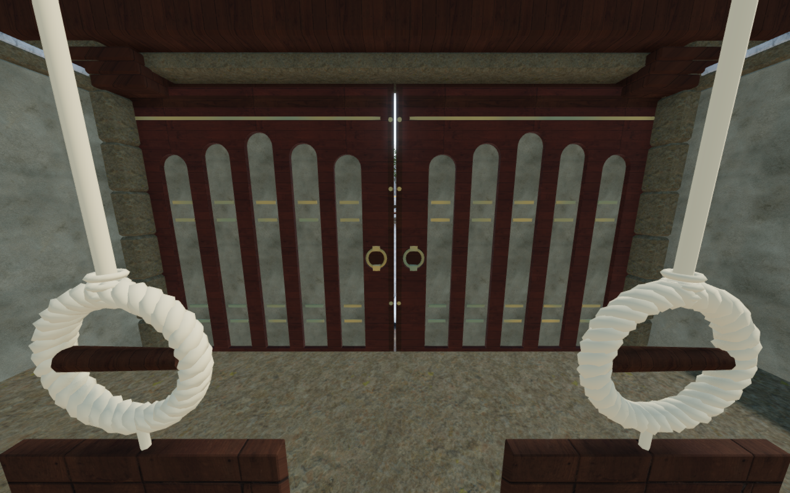

# Eight painted monastery door pairs

The snow chapter's eight main gate pairs now have individual recessed timber
compositions. Pilgrim arches, valley bells, prayer records, stair flutes, memory
wheels, woven wind panels, summit rays and library bays replace one repeated
crossed-brace design. Red ochre framing and pale inset panels connect them to the
monastery's existing timber galleries and whitewashed walls.

Both faces have closed timber cores, recessed backing, bronze records and
fitted ring pulls. The pulls sit over actual circular finger recesses; their
bearings enter the timber and join the ring. Front and rear pulls align beside
the meeting edge. The leaves fit inside the existing 0.6 m camera and hinge
depth, with all delivered geometry within 0.3 m of each leaf's centre plane.
These decorative records introduce no additional bell sequence to memorize.

The new construction reuses existing wood, plaster and bronze textures and
materials. One shared red-paint material clones the existing timber maps.
Material batching retains separate closed pieces and a real recess behind each
pull. The surrounding masonry, roofs, drive hardware and sixteen drive sound
origins match the preceding builder's recorded buffers, transforms and material
colors. Hinges, field requirements, controls and saved bell progress keep their
existing behavior.

All four new geometry tests pass. They inspect 1,044 closed pieces with a
missing-triangle negative control, distinct front/rear depth signatures for all
eight records, stable depths after batching and bronze-to-backing contact.
Independent rays require more than 6 cm of finger space behind each sampled
pull rim; a filled-recess control is rejected. Actual ring vertices enter both
bearing volumes, whose backs enter the rendered timber. The moving-camera
survey checks 1,085,040 delivered vertices across sixteen leaves and six hinge
states. Open centre passages remain available.

All 22 final views are reviewed: eight matching High approaches, two front
construction cameras, three reverse construction cameras, six opening states
and three Performance approaches. Banks and architecture partly obscure the
normal approaches to the memory and summit gates; their close construction
views provide the face inspection. Shaders link and sampled HDR output remains
finite, with no application errors or warnings.

Thirty-two legal standing and crouching poses inspect 1,539,040 delivered body
records against the new leaves. None exceed the observer's 15 mm overlap
tolerance. Eight prepared open-passage approach/return pairs complete sixteen
normal-controller legs, all ending grounded, legal and at 100 health. These
follow a clear aisle beside the interior installations; they are local passage
checks, not full chapter routes. All sixteen drive sound origins remain outside
the leaves across six hinge states. On an inspected chapter replacement, all
80 tracked leaf geometries, four shared materials and six shared textures
dispose exactly once.

All 90 selected regressions pass. They cover the new construction, all 69
regional gates, exterior shielding during opening, bell controls and lessons,
monastery architecture, complete counterweight routes, puzzle persistence and
audio behavior. The production build passes with its existing large-chunk
advisory. Verification uses the shared locked five-of-sixteen CPU allowance,
at most two test workers and one browser at a time; owned previews, workers and
browsers close after their checks.

Final production checks use native keyboard controls at 1280 × 800 High and
touch controls at 540 × 900 Performance, starting from prepared progress at the
valley bell tablet. Both retain a partial answer through reload, reset, play the
phrase, enter the answer and advance from stage 1 to stage 2. Their local
returns cover 8.76 m and 9.32 m respectively with health at 100. All four
complete-store reload comparisons pass, excluding only per-chapter `lastPlayed`
timestamps. Loaded bundles match the build, the development interface is absent,
layouts fit both widths, and no application errors or warnings occur. All eight
production captures are reviewed. These checks cover local interactions from
prepared states, rather than an unassisted chapter playthrough.

The six documentation exports preserve actual 1280 × 800 High source pixels
and dimensions through lossless WebP conversion, without cropping or retouching.
The two before/after approaches share their prepared player and follow-camera
positions. The memory and reverse figures use construction cameras. Baseline
runtime hashes match published `fcf6358`; revised figures match the delivered
application. Existing [asset attribution](asset-credits.md) remains applicable;
no external model, bitmap, recording or dependency is added.

This varies the monastery's moving gate faces. Repeated roofs, broad snowfields,
surrounding court composition, continuous campaign contact and listening/device
acceptance remain open in the [visual audit](visual-audit.md).
