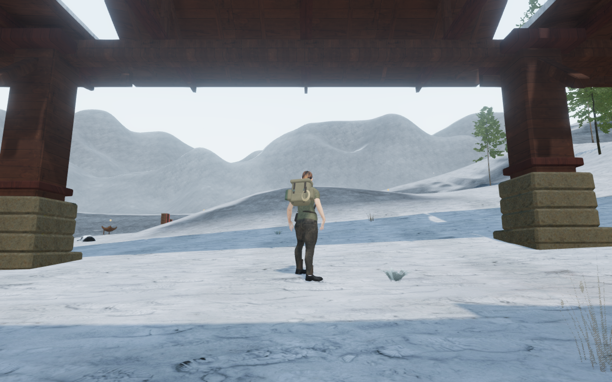
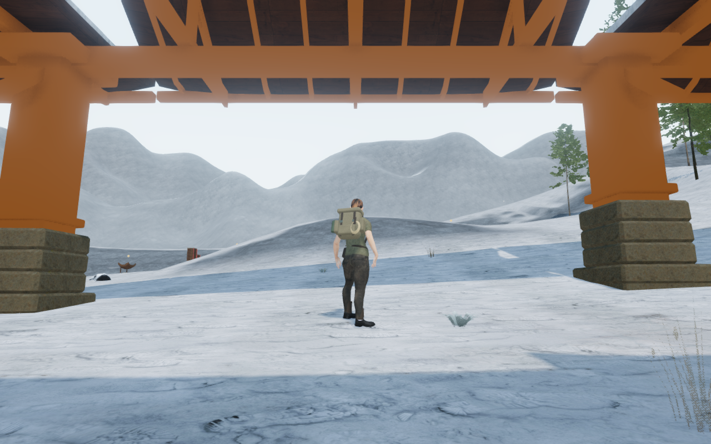
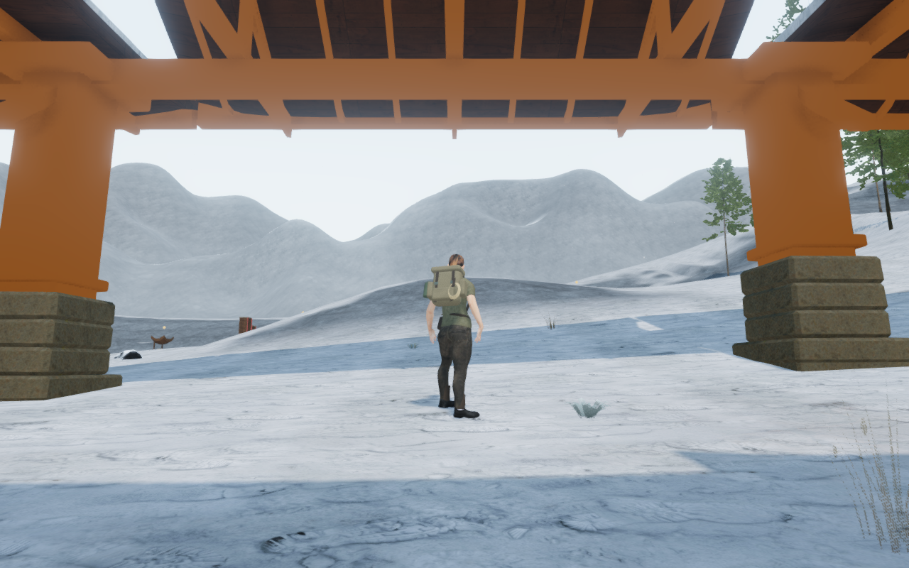

# Fitted monastery eaves

The bright angular openings beneath the monastery eaves are repaired. Straight
fascia boards previously stopped below the lifted roof corners. Boards fitted
to the actual slate underside now close that separation on all 72 monastery
roofs, including the galleries, lodges and bell pavilions.

| Published stair-court eaves | Fitted eaves |
| --- | --- |
|  |  |

The High captures share player/camera coordinates and scene time. Other
animation can differ. All four documentation images retain their source RGB
pixels and 1280 × 800 dimensions through lossless WebP conversion. Existing
[asset attribution](asset-credits.md) applies; no external asset is added.

The diagnosis separates geometry from shading. The gaps persist with unlit
timber and with back faces visible. Removing the new truss frames retains the
gaps; removing the old trim removes their sharp outline. Two rays through the
recorded bright points miss the published structure. The repaired view places
real timber across those rays.

| Published unlit timber | Fitted unlit timber |
| --- | --- |
|  |  |

Each roof has two closed edge bands clipped from its delivered underside
triangles. Their tops follow hips, lifted corners and damaged cells, seated
4 mm into the slate to accommodate rounding. The lower edge retains the
preceding fascia height. The boards remain inside the roof footprint, and
intentional gaps between separate gallery bays remain open. Finite support
and camera kernels follow the new boards; no roof-wide blocking box is added.
Loaded wood textures and the existing material batches are reused.

## Verification

- All 57 focused checks pass, covering monastery construction, lofts, roof
  shells, gardens, sanctuaries, frozen ground and winter groundcover. Three
  CPU-budget checks and the production build pass. The build retains its
  existing bundle-size advisory.
- The delivered-geometry observer reads all 72 fitted roofs after batching.
  All 45,360 contact probes on 11,340 upper faces pass. Measured seating
  ranges from 3.998 to 4.002 mm. Dropping the actual board buffers by 25 cm
  makes all 45,360 probes fail; their exact bytes are restored afterward.
- Independent factory checks cover hipped, gabled and pavilion roofs with all
  three damage variants: 4,644 rendered skirt contacts and lowered-board
  controls. Closed-edge balance, positive volume, finite coordinates and a
  removed-cap control pass. Camera and support checks retain empty space
  between the two edge bands.
- Thirteen lodge-to-gallery return routes and 23 covered-roof jumps retain
  their 2,080 / 1,770 moving controller updates. All 26 sampled older rooftop
  arrivals remain legal and supported, preserving progress. Their 21 nearby
  safe relocations are unchanged from the preceding gallery construction.
- All nine courts retain their plans, foundations, fitted main buildings,
  core roof options, post solids and wind origins. All 116 preceding roof/snow
  fixtures retain identical geometry and metadata. All 2,444 sampled ground
  movement results match. The isolated monastery camera index grows from
  465 to 500 entries as the main-building edge boards gain finite clearance.

Thirty-three final High development views are reviewed: the existing court,
entrance, rooftop and nearby-stance set, plus its unlit stair-court comparison.
An opposite fourth-court view supplies coverage where the first overview is
tree-obscured. HDR inputs remain finite, shaders link and GL errors remain zero.
The unlit comparison releases its temporary materials and returns to the
starting renderer geometry/texture counts after warmup.

The eighteen stopped character poses retain legal player and camera positions.
The gallery observer and the separate changed-board observer clear their
865,710 rendered character vertices at the 15 mm threshold. Interior witnesses
exercise the changed-board reader on all 72 roofs. All 77 sound-source origins
remain outside the changed construction. These are sampled contact checks;
they do not close continuous moving-body or whole-world acceptance.

Production keyboard/High at 1280 × 800 and actual portrait touch/Performance
at 540 × 900 crouch and walk on the echo-court gallery roof at full health.
Four complete-store reload comparisons pass, apart from chapter timestamps.
Ten saved/restored heights agree with delivered roof faces within 15 mm.
All six release images are reviewed. Loaded JS/CSS names match the current
build, the development hook is absent and there is no horizontal overflow.
No page errors, missing resources or unexpected console warnings are recorded.
The prepared rooftop save has guardians defeated and audio muted.

All 431 runtime hashes match the final reviewed source. The six diagnosis
views match the 430 sources in published `56f89e0`; the matching scene captures
retain prepared player/camera coordinates and time. Owned browsers and preview
servers close after checks. Verification uses the shared locked five-of-sixteen
CPU set at lower priority, with at most two test workers and one browser.

## Remaining work

This resolves the recorded eave openings. Shared main-pavilion massing, sparse
surroundings, wider discovery/traversal coverage and continuous body contact
remain open. Sound falloff and adaptive music code are unchanged; the fitted
boards participate in the existing occlusion queries. Listening review,
consumer-device performance, a complete human playthrough and AAA parity
remain unverified.
