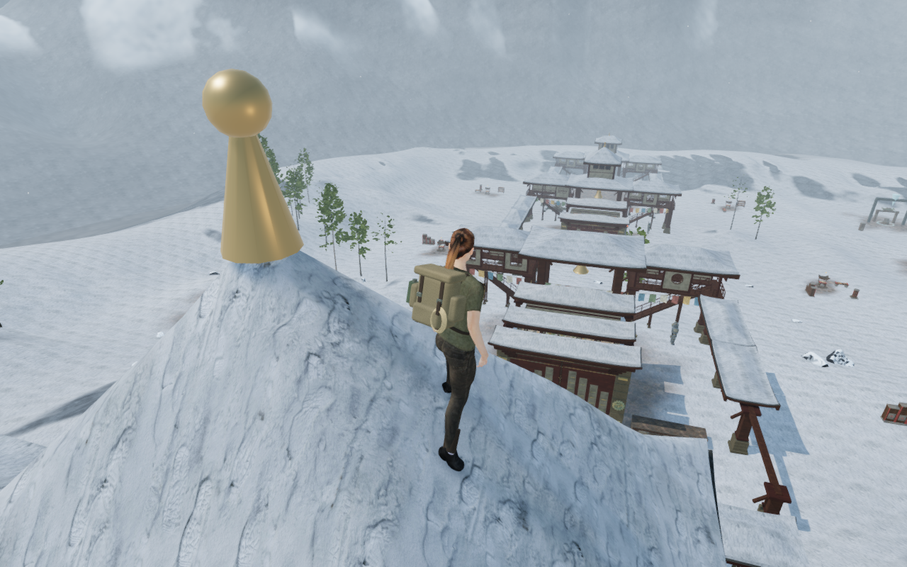
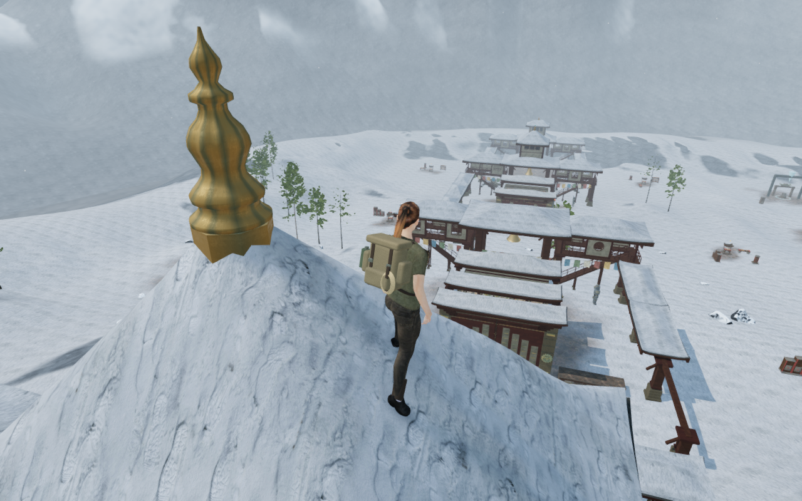
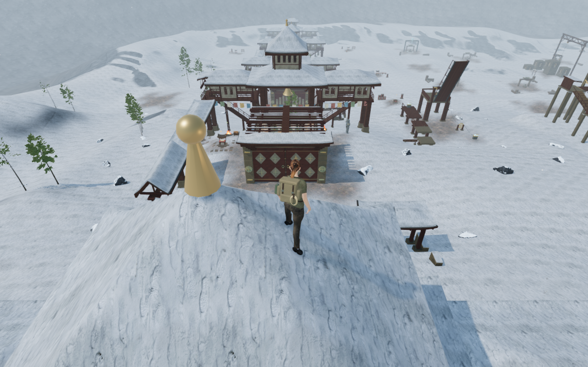
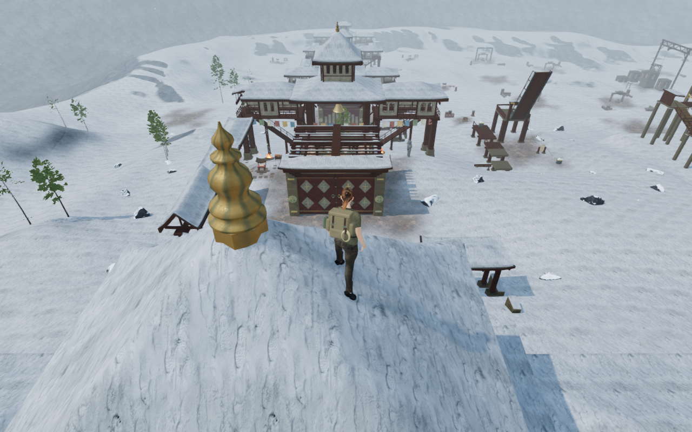

# Cast monastery finials

The eight enclosed winter pavilions now carry shaped bronze finials with molded
collars, fluted bodies and pointed crowns. Height, width, flute count and twist
vary between courts. The memory pavilion remains open. The smooth cone-and-ball
forms recorded in the preceding review are replaced.

| Preceding summit finial | Cast summit finial |
| --- | --- |
|  |  |

| Preceding observatory finial | Cast observatory finial |
| --- | --- |
|  |  |

The paired High views retain prepared player/camera framing and scene time;
animation can differ. All four 1280 × 800 documentation images preserve their
source RGB pixels through lossless WebP conversion.

Each octagonal mounting boss is clipped from the delivered slate triangles.
Its underside seats 6 mm into the slate. The casting seats 4 mm into the boss,
and its lowest flange clears the highest snow beneath it by at least 21 mm.
This establishes a metal bearing beneath the snow rather than supporting the
ornament on the snow layer. The roofs, snow, ceiling timbers and fitted houses
retain their preceding geometry.

Authored vertex colors supply warm bronze, exposed edges and cooler patina in
the flutes. The project’s existing credited metal normal and roughness maps add
fine surface variation. The casting uses periodic circumferential coordinates
and planar cap coordinates. The standard material is shared by all eight
finials; no new external asset or shader patch is introduced.

The new metalwork participates in finite physical, sight, sound and camera
queries. Physical queries follow the rendered triangles. Camera sections follow
the mounting boss and successive short casting frustums; their hulls are
conservative across shallow flutes while retaining the narrowed necks. Their
bounds do not create columns above or below the ornament.
The narrow crowns block contact without becoming body landing surfaces.

An earlier save at the centre of a steep cap can now restore beside the new
metalwork while retaining that roof. Arrival still prefers the saved elevation.
Before falling back to ground, it may descend within three metres onto the
same supporting roof at a walkable grade. Other supports and mismatched saved
heights retain the existing fallback behavior.

## Verification

- All 245 selected checks across 39 files pass, covering monastery construction,
  roofs, winter ground and every existing arrival caller, including the new
  sloping-roof cases. Three CPU-budget checks and the build pass. The build
  retains its existing bundle-size advisory.
- All eight finials have closed outward solids, finite attributes and varied
  proportions: 30,244 triangles in total. Shading normals face outward, metal
  UV triangles retain area and the periodic maps close at the casting seam.
  A removed-face control fails the closure check.
- The delivered-buffer observer reads all eight mounts after batching.
  All 576 slate-seating probes and 2,048 casting-bearing probes pass. Raising
  the mounts detects all 576 displaced contacts; detaching the castings
  detects all 2,048 bearings. Exact buffer bytes are restored afterward.
- Controller approaches stop at the new finials and retreat on all eight
  caps over 1,200 updates. Eight earlier centre-roof saves restore to the same
  delivered upper caps and preserve progress through 1,440 settling updates.
  Existing 17 pavilion landings, earlier roof saves,
  thirteen lodge return routes and 23 covered-roof jumps pass. Current camera
  and body checks retain empty space beside necks and above/below the casting.
- A frozen published-source comparison retains all nine court plans,
  foundations, fitted house/lodge joinery, wind origins and post solids.
  All 72 roof records and 116 roof/snow fixtures match. All 2,444 sampled
  ground-movement results match. The isolated monastery camera index grows
  from 500 to 508 entries as the eight ornaments gain finite clearance.

Twenty-three views of the final source are reviewed: two matching rooftop
comparisons, eight stopped approaches, eight close details and five court views.
The close details temporarily hide the avatar to expose the complete casting.
An opposite stair-court view supplies coverage where the first overview was
tree-obscured. HDR inputs remain finite, shaders link and GL errors remain zero.

The ten captured stopped poses clear 480,950 character vertices at the 15 mm
threshold, with legal player and camera positions. The additional native-save
fixture also passes. Sixteen interior controls exercise the changed-geometry
reader on every mount and casting. All 77 sound-source origins remain outside
the new metalwork. These are sampled checks; continuous moving-body acceptance
remains open.

Production keyboard/High at 1280 × 800 uses a regular echo-roof save. Actual
portrait touch/Performance at 540 × 900 loads an earlier occupied summit-roof
centre save, retains earned progress and restores beside the casting on the
same cap. Both crouch and walk away from the finial at full health.
Four complete-store reload comparisons pass apart from chapter
timestamps. Ten saved/restored heights agree with delivered roof faces within
15 mm. All six release images are reviewed. Loaded JS/CSS names match the build,
the development hook is absent and there is no horizontal overflow. No page
errors, missing resources or unexpected console warnings are recorded. The
prepared rooftop save has guardians defeated and audio muted.

All 433 runtime hashes match the final source. Owned browsers and preview
servers close after checks. Verification uses the shared locked five-of-sixteen
CPU set at lower priority, with at most two test workers and one browser.
Existing [asset attribution](asset-credits.md) is retained and records the
reused surface maps.

## Remaining work

This addresses the recorded finial form and attachment finding. Shared bearing
frames and broad court arrangements, sparse surroundings, wider discovery and
traversal coverage, water interiors and continuous body contact remain open.
Distance falloff and adaptive music code are unchanged. Listening review,
consumer-device performance and full playable-surface acceptance remain
unverified; the game goal remains active.
