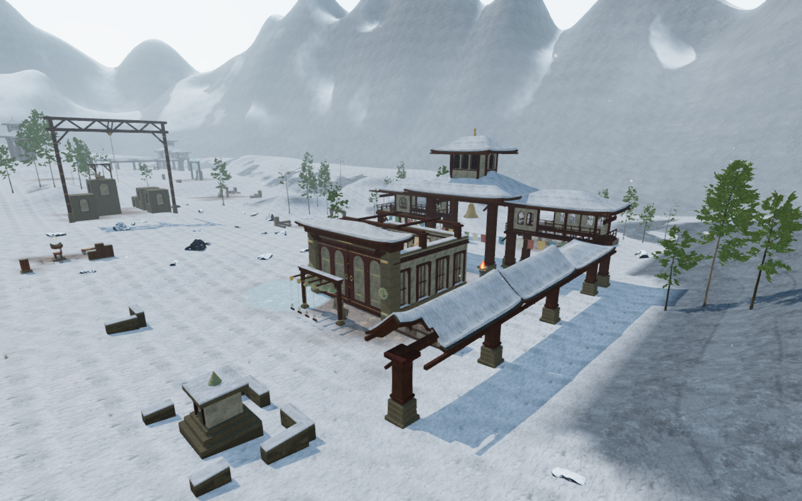
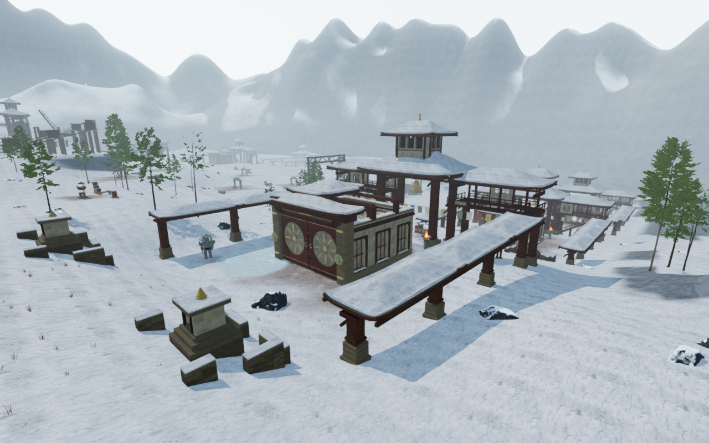
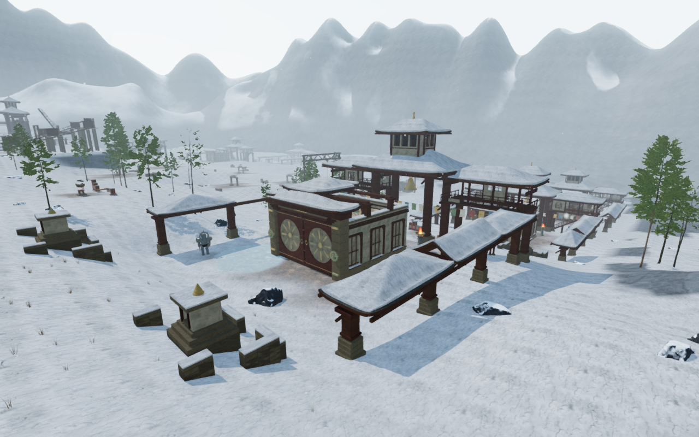
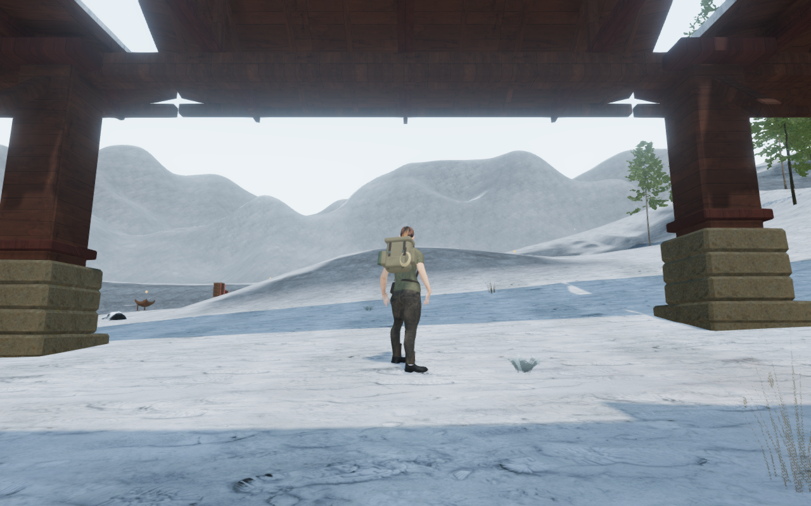

# Varied monastery galleries

The winter courts now have different covered walks: tall echo gables, low
shelters, pavilion roofs, rising end bays and selected open ruin bays. The
previous galleries repeated the same low roof along every side. Fitted timber
frames give the revised roofs visible bearing while retaining the lodge routes.

| Published echo court | Revised echo court |
| --- | --- |
|  |  |

These High game captures share prepared player/camera coordinates and scene
time. Other animation can differ. The five documentation images preserve their
decoded source RGB pixels and 1280 × 800 dimensions through lossless WebP
conversion. Existing [asset attribution](asset-credits.md) remains applicable;
the construction reuses loaded materials and adds no external asset.

| Court composition | Outer gallery treatment |
| --- | --- |
| Pilgrim cloisters | Paired low hipped walks. |
| Echo gables | Two tall open-ended gables. |
| Listening pavilions | Separate pyramidal caps. |
| Stair of roofs | A gable followed by a higher pavilion. |
| Broken memory walk | A low shelter and an unroofed final bay. |
| Woven sky | Unequal gables and pavilions, with an open western middle bay. |
| Summit shelter | A low approach and tall terminal gable. |
| Archive cloister | A gabled middle bay and low end canopy. |
| Bell procession | Pavilion bays followed by high ceremonial gables. |

All thirteen first bays retain the established roof dimensions, heights and
lodge-door connections. The outer caps have intentional 12 cm drainage joints.
The longitudinal beams meet end to end instead of overlapping their upper
faces. Roof-fitted rafters, cross ties and kingposts carry the caps. The rafter
tops follow actual underside triangles and the existing batten bottoms,
including triangle-diagonal breaks. Real finite geometry supplies movement,
support and camera clearance; spaces between timbers remain open.

| Published woven court | Revised woven court |
| --- | --- |
|  |  |

## Verification

- All 54 focused checks pass, including monastery construction, lofts,
  sanctuaries, gardens, roofs, frozen ground and winter groundcover. The three
  CPU-budget checks and production build pass; the build retains its existing
  bundle-size advisory. Closure checks include hipped, gabled and pavilion
  roof/snow shells with all three damage variants.
- An independent reader checks the delivered material batches across all nine
  courts and 39 bays, including two unroofed bays. All 1,866 sampled timber
  bearings pass, with maximum open gap below 0.001 mm. All 104 beam-joint
  queries retain one upper face. The overlapping prototype produced two faces
  at those locations; the frame-lift control produces 1,962 failed queries.
- In the isolated monastery construction, the controller completes all thirteen
  lodge-to-gallery out-and-back routes
  in 2,080 updates, retaining supported, legal positions and saved arrival.
  All 23 joints between adjacent covered bays permit jumps and supported
  landings in a further 1,770 moving updates. The open ruin bays are excluded
  from those adjacent-roof crossings.
- All 26 sampled older outer-roof saves reach legal supported positions without
  changing objective progress. Twenty-one use nearby safe arrivals where the
  revised roof obstructs the saved position. This check uses the isolated
  monastery construction; current production-save reloads are checked below.
- All 118 preceding roof fixtures retain identical position, normal, UV,
  index and metadata bytes under the default profile. All nine courts retain
  their plans, foundations, fitted main buildings, core roofs, post solids
  and wind origins. All 2,444 sampled ground movement results match the
  published builder. The isolated monastery construction uses 465 camera
  entries, down from 471.
- Thirty-two final High development views are reviewed: nine court overviews,
  four entrance headings, an opposite fourth-court view, thirteen rooftop
  landings and five nearby supported stances. The original fourth-court
  overview is tree-obscured; its opposite view supplies that coverage. HDR
  inputs remain finite, shaders link and GL errors remain zero.
- The thirteen rooftop landings and five nearby stances retain legal player
  and camera positions. Their delivered character vertices clear the revised
  gallery solids at the 15 mm threshold. All 77 sound-source origins remain
  outside the new construction.

Production keyboard/High at 1280 × 800 and actual portrait touch/Performance
at 540 × 900 crouch and walk on the echo court's tall gallery roof. Both retain
full health and pass four complete-store reload comparisons in total, apart
from chapter timestamps. All six release images are reviewed. Loaded JS/CSS
names match the current build, the development hook is absent and there is
no horizontal overflow. No page errors, missing resources or unexpected console
warnings are recorded. These checks use a prepared rooftop save with guardians
defeated and audio muted.

All 430 runtime hashes match the final reviewed source. Fourteen ground/court
comparison views match published `7368d78`, including the opposite fourth-court
view, with matching prepared player/camera coordinates and scene times. Owned
browsers and preview servers close after checks. Work stays within the shared
locked five-of-sixteen CPU set at lower priority, with at most two test workers
and one browser.

## Remaining work

The gallery silhouettes and local construction have more variety, but the main
bell pavilions and much of the larger court massing still repeat. Sparse trails
and surrounding spaces, broader discovery/traversal coverage and continuous
body contact remain open. This review also recorded bright angular openings
at some eave/frame junctions. The subsequent [fitted-eave repair](monastery-eaves.md)
resolves that finding; the image below retains the preceding construction.

Existing sound falloff and adaptive music are
unchanged; the new solids participate in existing occlusion queries. Listening
review, consumer-device performance, a complete human playthrough and AAA
parity are not established by these checks.
