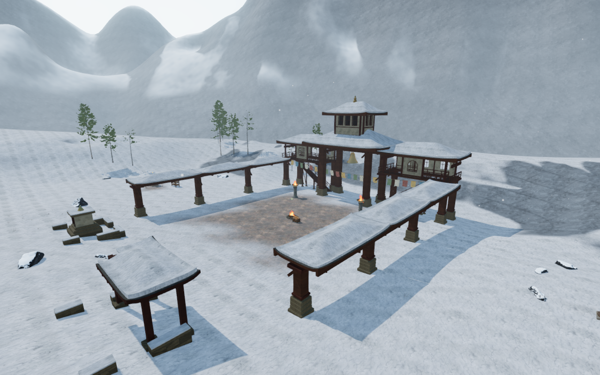
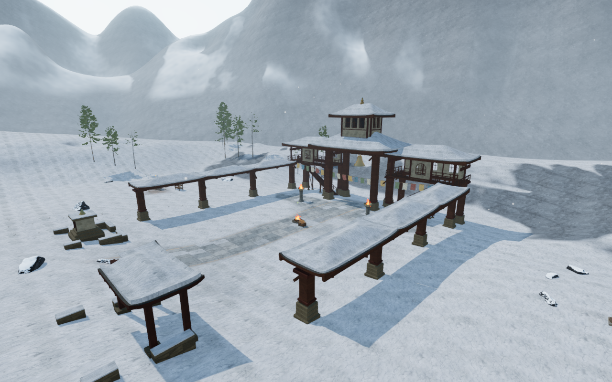
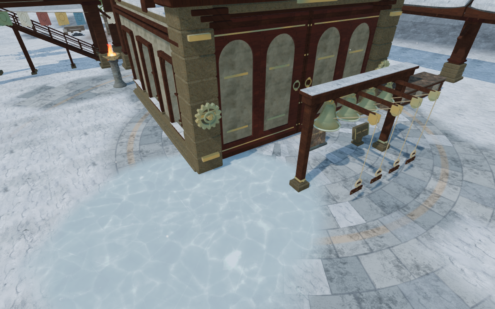
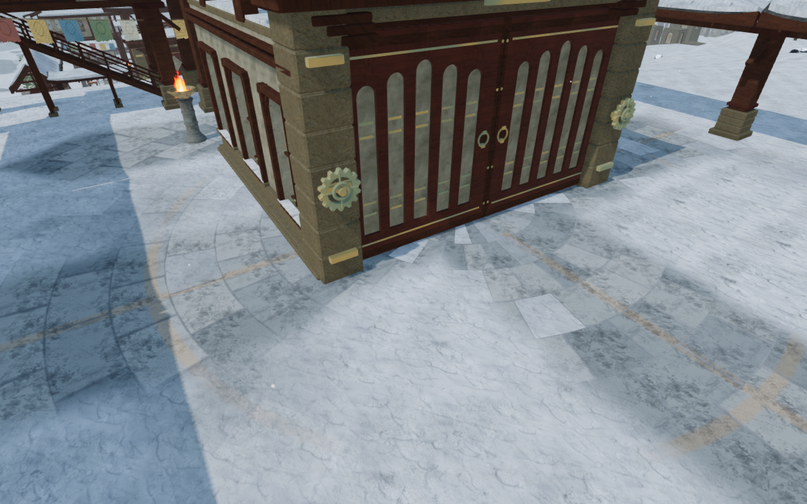

# Snow-worn monastery courts

The nine winter courts now have their own slate courses, inset bands and worn
walking lines. Stone emerges along the approaches and beneath the bell, while
sheltered patches and joints retain snow. The former faint central paving
patch no longer supplies the same ground layout to every court.

| Previous pilgrim court | Snow-worn causeway |
| --- | --- |
|  |  |

| Echo court | Observatory court |
| --- | --- |
|  |  |

| Court | Ground composition |
| --- | --- |
| Pilgrim | Long causeway with two inset edge bands |
| Valley echo | Radial courses and worn circular circulation |
| Prayer stones | Broad cross courses and paired longitudinal panels |
| Stair of voices | Narrow landing courses with transverse bands |
| Memory | Diagonal slabs and a square memorial border |
| Woven wind | Oblique courses with sheltered snow patches |
| Summit | Long slabs and paired approach runners |
| Archive | Square courses and nested inset fields |
| Observatory | Compass courses with an outer ring and crossing axes |

The material adds neutral slate variation, existing rock-grain maps and
restrained warm insets. Narrow, irregular joints and derivative filtering keep
the courses readable at different distances. Integral radial sector counts
close the angular stone grids. Broad weathering fields break up snow cover;
steep banks and exposed geology suppress the court layer. The existing frozen
ground layer continues to render above the underlying terrain material.

All detail stays on the existing terrain triangles. There is no raised decal,
second ground surface, new collision shape, texture download or dependency.
The vertex shader, map/height data and texture requests match the published
material in all eight chapters. The three existing CPU-budget checks and the
build pass; the build retains its bundle-size advisory.

All 26 selected tests across nine files pass. They cover the material families,
court terrain corrections, winter ground continuity, frozen surfaces and the
binding of all nine actual court sites. Twenty-two final-source game views are
reviewed: nine court overviews, nine close floor views, two disabled-layer
comparisons, an opposite stair-court view and a prepared ground stance. The
first stair overview is tree-obscured; its opposite view supplies coverage.
The overview and close floor cameras are diagnostic views, with the avatar
hidden. The prepared ground stance uses the normal follow camera.

Independent GPU comparisons use the frozen published terrain-material factory.
All fourteen floor/bank fixtures across the other seven chapters retain
identical pixels. All nine winter floor fixtures change, and disabling the new
layer restores identical pixels in all nine. Two close radial-centre fixtures
remain finite. Every fixture contains 592,900 half-float channels. Temporary
GPU geometry and texture counts return to their starting values.

Production keyboard/High at 1280 × 800 and actual portrait touch/Performance at
540 × 900 both crouch and walk 6.0–6.6 m on the pilgrim court ground at full
health. Four complete-store reload comparisons pass apart from chapter
timestamps. Saved elevation remains on the ground, loaded JS/CSS names match
the build, the development hook is absent and there is no horizontal overflow.
The prepared save has guardians defeated and audio muted. All six release
captures are reviewed; no page errors, missing resources or unexpected console
warnings are recorded.

The paired pilgrim views retain player/camera framing and scene time. The four
1280 × 800 documentation figures preserve source RGB pixels through lossless
WebP conversion. All 434 runtime hashes match the final browser source. Final
views have finite HDR inputs, linked programs and no GL errors, missing
resources, page errors or unexpected console warnings. Verification uses the
shared locked five-of-sixteen CPU set at lower priority, at most two test
workers and one browser. Owned helpers close after their checks.

This improves court ground composition. Shared bearing frames and broad court
arrangements, sparse connecting paths, wider discovery/traversal/water coverage
and continuous body contact remain open. Footstep timbres remain chapter based;
surface-specific footsteps, listening review, consumer-device performance and
full playable-surface acceptance remain unfinished. Distance falloff and
adaptive music are unchanged. The game goal remains active.
