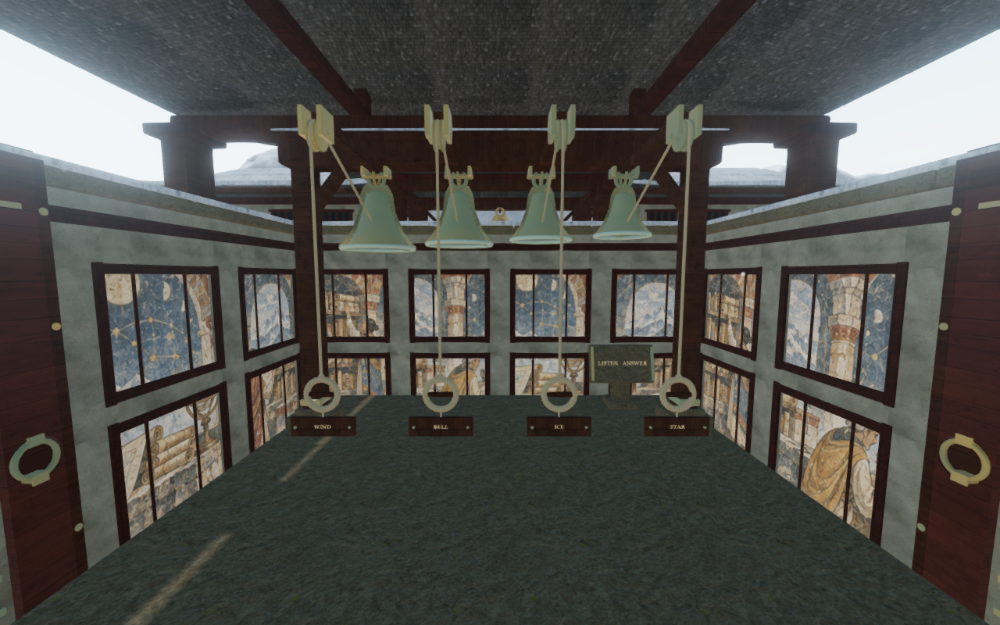
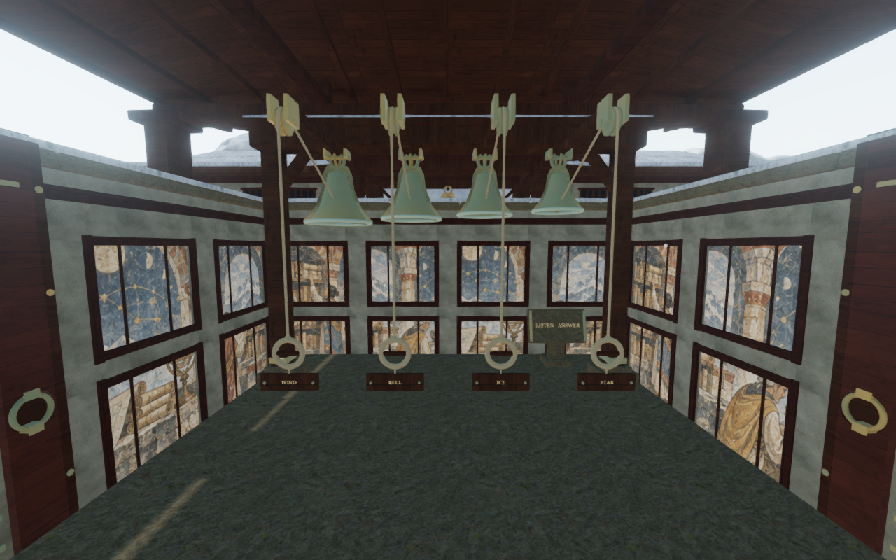
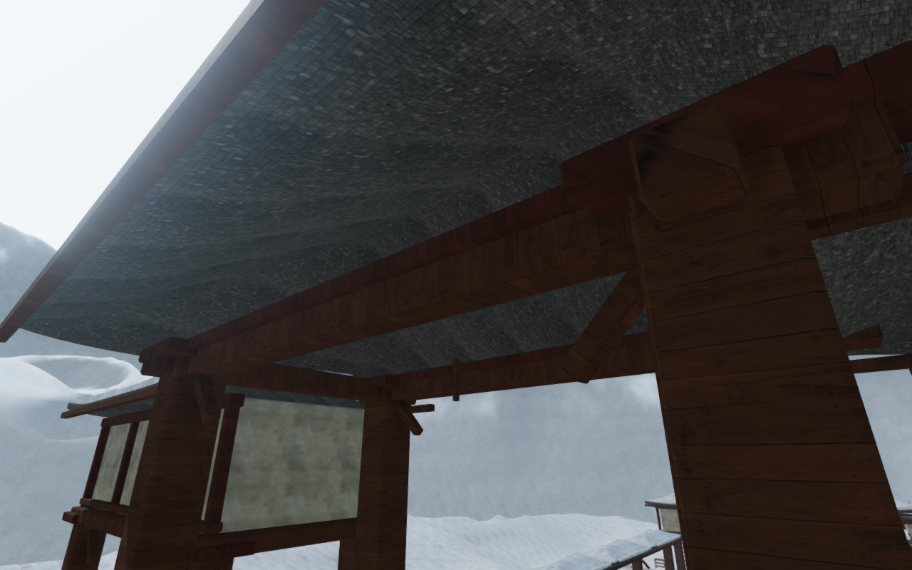
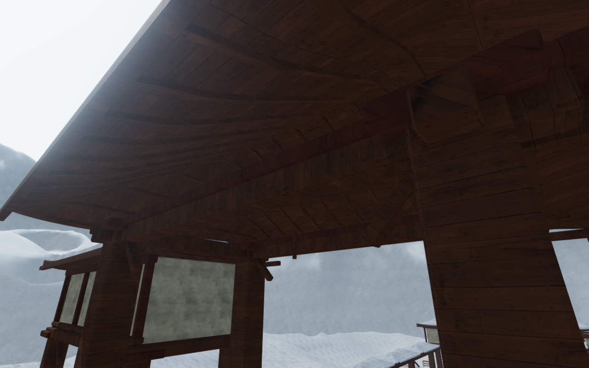
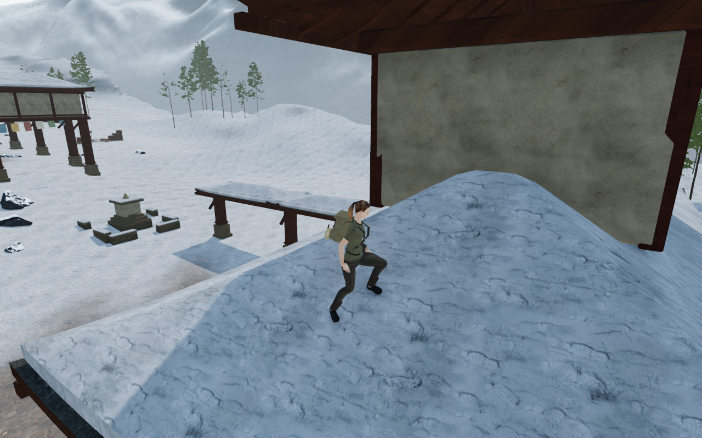

# Timber beneath the monastery roofs

The snow chapter's pitched roofs previously carried their slate texture across
the underside and cut edges. Timber boarding now lines those surfaces, with
fitted ceiling battens beneath the hips. The upper slate and snow retain their
preceding shell vertices, normals, UVs and topology.

The shared treatment covers 108 roofs in the recorded chapter:

| Construction | Roofs |
| --- | ---: |
| Pavilion, upper-room, wing and gallery roofs across nine courts | 74 |
| Bell chamber entrance awnings | 8 |
| Inner canopies and archive lantern | 9 |
| Garden galleries | 4 |
| Refuge bell canopy | 1 |
| Scripture shrines | 12 |

The lining uses the existing credited timber color, normal and roughness maps.
The material selects timber on the underside and fascia and slate on the upper
faces. Grain follows the boards; the narrow battens cross beneath them. This
adds no new runtime image or dependency. Texture handles join the existing
chapter teardown, and cloned roof materials receive their own timber bindings.

Batten strips are clipped from the delivered underside triangles and extend
0.13 m below them. Their upper surfaces meet the roof, including hip changes
and damaged boundaries. Shared internal sides cancel, leaving closed exposed
surfaces and empty spaces between strips. The recorded chapter adds 269,052
batten triangles. New pieces leave the older chamber timber seed sequence intact.

The roof, snow and batten camera surfaces use finite height-field cells. These
replace broad roof boxes that also occupied air beneath a hip. The new
structures use finite triangle collision and support; existing garden and room
solids retain their own construction paths. Opaque camera kernels can be set
while the world is being built and remain available after render batching.

All 135 selected regressions pass. The new construction cases include 2,826
actual underside contacts, closed and outward surfaces, a deliberately removed
triangle, damaged-corner negative controls, camera and support gaps, transformed
parents and unchanged source shell records. Related checks cover monastery
rooms, gardens, doors, bells, the refuge hoist, frozen stairs, discoveries,
camera behavior, chapter startup and audio.

All 32 baseline and 55 final development captures are reviewed. They include
the eight room interiors and entrances, nine pavilion undersides, the garden
galleries, two scripture shrines, the refuge canopy, roof stances/walks and
three Performance-preset interiors. The baseline garden cameras were occluded;
the final garden views were reframed for a clear ceiling inspection. All 408
runtime source hashes match the final application. Shaders link, sampled output
stays finite and no application errors or warnings occur.

Nineteen assisted chamber poses and short walks inspect 913,805 delivered body
records against the room construction, with no overlap beyond the observer's
15 mm tolerance. Nine pavilion landings and short walks also retain legal,
grounded, full-health states and actual bearing contact under both boots.
All recorded camera fades remain at 1. All forty bell-control positions,
sixteen local passage legs and 109 environmental/bell origins pass; the latter
are checked against 226 rendered roof and timber meshes.

Chapter replacement disposes all 256 tracked roof-related geometries, materials
and textures exactly once, including uniform-only timber maps. None of the 312
roof camera kernels remain in the next chapter's index, and the roof registry
resets. This is local assisted coverage; continuous campaign playthroughs and
consumer hardware acceptance remain open.

Seven production Chromium scenarios pass with native keyboard input at
1280 × 800 High and touch input at 540 × 900 Performance. The roof cases retain
movement and saves, including the prior archive-roof reach regression. The
instrument cases pull physical ropes, preserve partial answers, reset/replay
the tablet phrase and advance from stage 1 to stage 2. All nine complete-store
reload comparisons pass, excluding only per-chapter `lastPlayed` timestamps.
Loaded bundles match the build and the development interface is absent.
No application errors or warnings occur, and all thirteen production captures
are reviewed. Both layouts run in a touch-capable browser from prepared
progress. The build passes with its existing large-chunk advisory.

The five documentation figures are lossless WebP exports of actual 1280 × 800
game captures, with matching decoded pixels and dimensions. Both pairs use
matching fixed construction cameras on published `4274f21` and the revised
application. The fifth figure uses the follow camera after the controlled walk.
The wider survey includes native entrance cameras and fixed
construction views; an observer view does not establish a continuous player
route. Existing [asset attribution](asset-credits.md) remains applicable.

Verification uses the shared locked five-of-sixteen CPU allowance, at most two
test workers and one browser at a time. Owned browsers, workers and temporary
servers close afterward. Repeated box-like upper-room backs remain conspicuous
from the roof walks. Broader exterior massing and bearing details,
continuous campaign contact, consumer hardware performance and subjective
soundscape acceptance remain open in the [visual audit](visual-audit.md).
