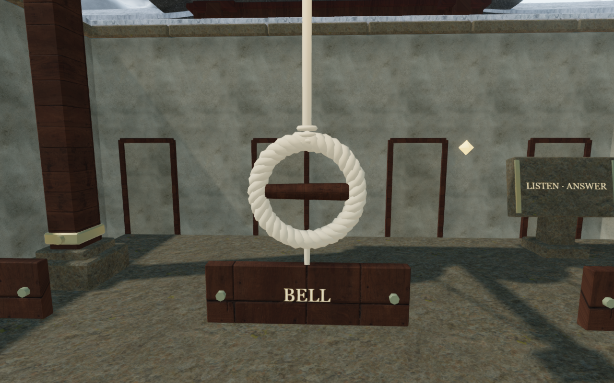
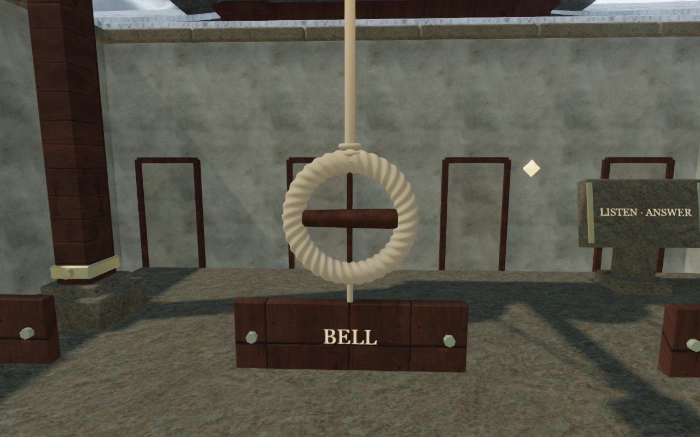

# Monastery bell ropes

The snow chapter's 32 bell hand loops now have a continuous three-ply surface,
smooth normals and warmer hemp shading. This replaces three overlapping,
five-sided strands that appeared as bright, lumpy rings in the lesson view.
Fine procedural fibers fade with their screen footprint. The bindings, running
cords and hand loops share the same rough hemp material.

All 32 loops share three immutable geometries, totaling 554,016 bytes of vertex
and index attributes. High uses the finest tier nearby, Balanced caps nearby
detail at the middle tier, and Performance uses a gentler coarse braid. Distance
thresholds have hysteresis to avoid switching during small camera movements.
All tiers stay attached to the scene so chapter replacement can release even
unused buffers. This storage measurement does not establish consumer frame rates.

Two new tests inspect the delivered triangles for closed seams, outward winding,
finite unit normals, the existing 0.2184 m outer envelope, and contact with both
ends of the timber hand bar. They also cover all 32 shared loops, quality changes,
distance hysteresis and discoverable cleanup resources. All 92 selected
regressions pass, including bell rules, world controls, moving rope endpoints,
spatial strike scheduling, all regional gates, counterweight routes and puzzle
persistence. The production build passes with its existing large-chunk advisory.

Eight final development views are reviewed: native High approach and lesson
focus, close construction views at all three quality settings, Balanced and
Performance approaches, and an assisted rope pull. Shaders link, sampled output
remains finite and no application errors or warnings occur. An actual chapter
replacement disposes the three shared geometries and hemp material exactly once.
The two figures preserve the actual 1280 × 800 High captures with lossless WebP
encoding, without cropping or retouching. The baseline application matches
published `146affc`; revised figures match the delivered source.

Production Chromium checks use keyboard controls at 1280 × 800 High and touch
controls at 540 × 900 Performance, starting from prepared valley-bell progress.
Both physical rope inputs retain their note through reload. Both tablet checks
retain a partial answer, reset, replay the phrase, enter its answer and advance
from stage 1 to stage 2. All six complete-store reload comparisons pass,
excluding only per-chapter `lastPlayed` timestamps. Four local departures cover
8.77–9.33 m with health at 100. All ten production captures are reviewed; loaded
bundles match the build, the development interface is absent, layouts fit both
widths and no application errors or warnings occur. Both layouts run in a
touch-capable browser; consumer device acceptance remains open.

Controls, hand targets, note rules, sound origins and saved progress retain their
existing coordinates and behavior. No external model, bitmap, sound or dependency
is introduced; existing [asset attribution](asset-credits.md) remains applicable.
Verification uses the shared locked five-of-sixteen CPU allowance, at most two
test workers and one browser at a time, with owned resources closed afterward.
All three CPU-guard checks also pass.

This improves the sampled bell fittings. Repeated surrounding architecture,
broader world composition, continuous campaign contact, consumer performance
and listening/device acceptance remain open in the [visual audit](visual-audit.md).
