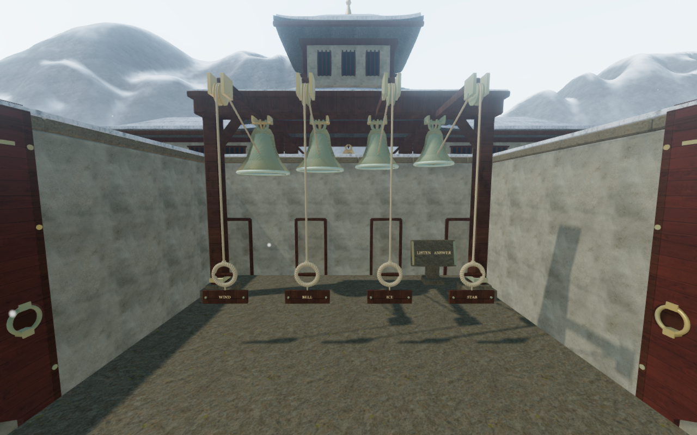
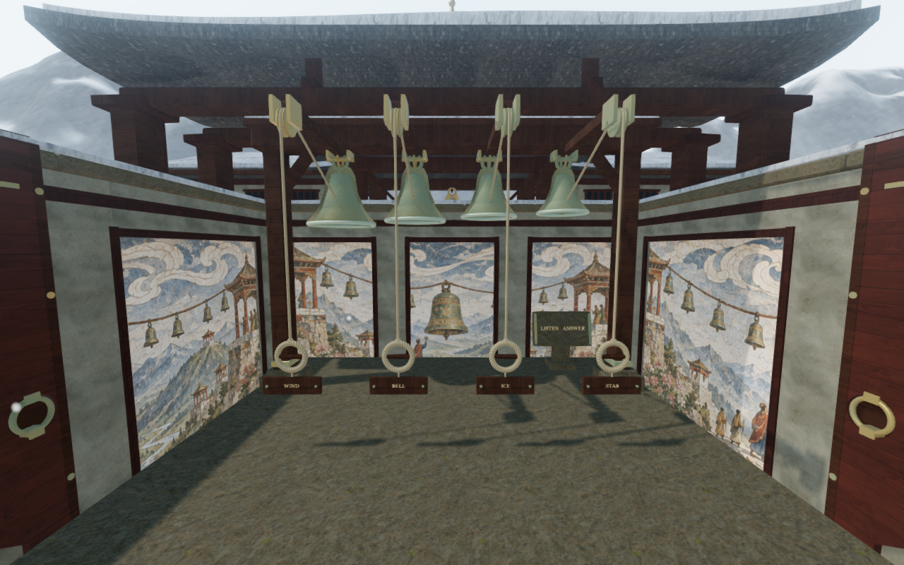
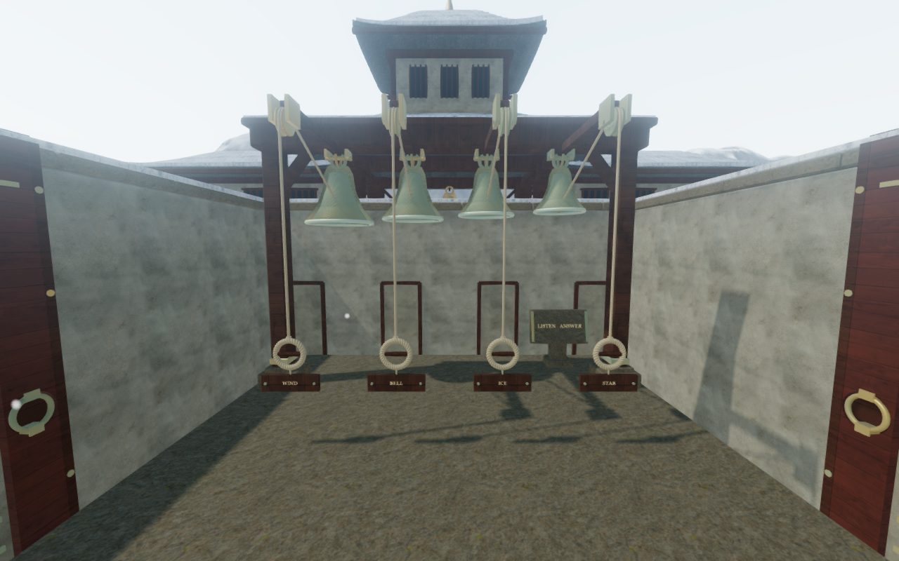
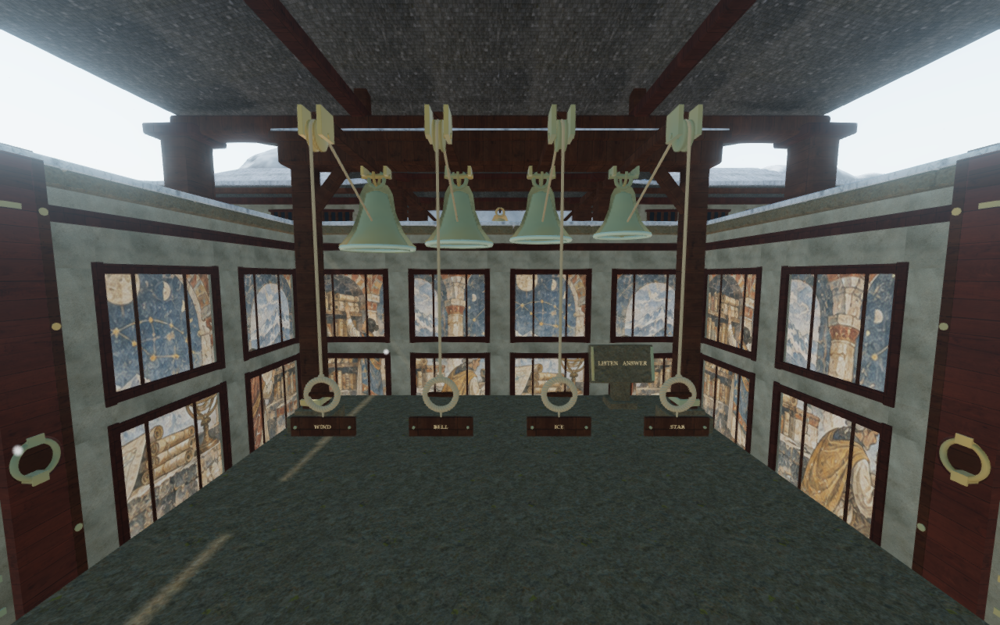
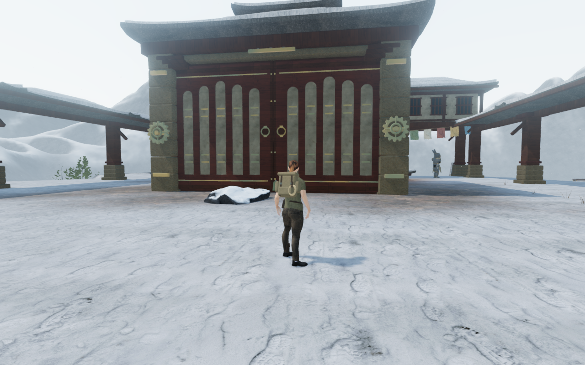
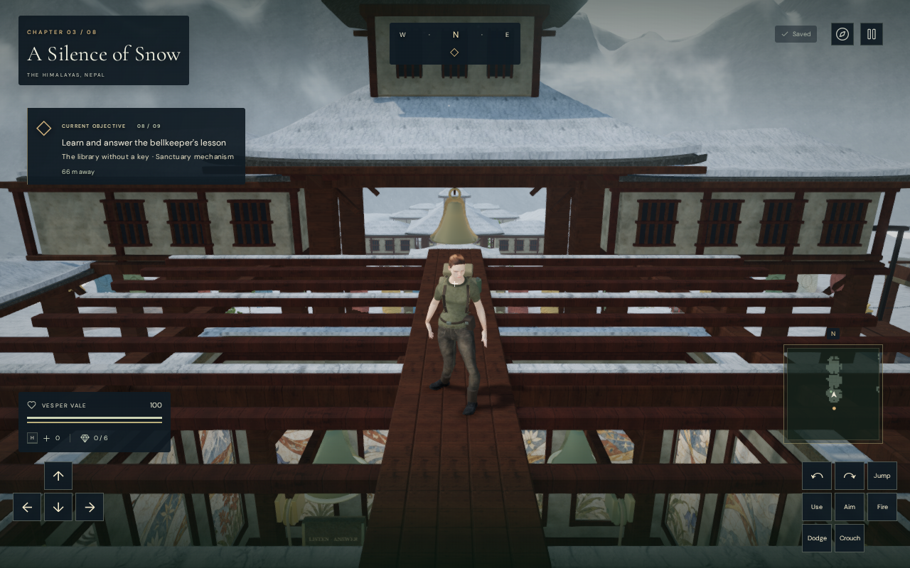

# Eight painted monastery halls

The snow chapter's eight bell chambers now have recessed painted interiors and
individual roof structures. Ninety framed bays across 24 inner walls reveal
eight original fresco panoramas, replacing plain side walls and repeated empty
rear panels. Timber rails and corner stiles sit ahead of the recessed plaster,
while staying behind the preceding inner wall envelope.

| Chamber | Painted story | Roof composition |
| --- | --- | --- |
| Pilgrim hall | A mountain pilgrimage | Open crossing beams |
| Valley echo | Bell keepers and echo clouds | Rear hip canopy |
| Listening gallery | Alpine trees, birds and wind ribbons | Paired canopies with an open central strip |
| Stair of voices | Travelers climbing a long mountain stair | Separated front and rear roofs |
| Memory court | A floral memory wheel and mountain gardens | Broken western canopy |
| Woven wind | Cloth, cranes and interwoven clouds | Open timber light screen |
| Summit vigil | A high refuge under a radiant sun | Raised northern canopy |
| Archive hall | Scroll shelves, keepers and star charts | A lantern above the lower hip roof |

The paintings were created with the built-in image generation tool, then packed
into one shared 1568 × 1088 atlas. All eight painted cell regions preserve their
generated pixels. Copied edge gutters isolate the cells during filtering, and
lossless WebP encoding produces the 2,921,882-byte delivery file. Existing plaster
normal and roughness maps remain active under the paintings. The [exact prompt](art-prompts.md#monastery-fresco-atlas)
and [source manifest](../asset-sources/monastery-records/sources.json) record the
artwork and repeatable packing command. These are original fictional paintings,
without claims of historical accuracy. Existing timber, stone, slate, snow,
character and audio [attribution](asset-credits.md) remains applicable.

The niches remove real plaster from the inner skin and retain a continuous
sealed backing. Roof bearings enter the existing coping on its outer half,
clear of the inward door sweep. Struts fit the roof profile; nine slate/snow
roof pairs and the timber structures have finite triangle collision and walking
support. Open screen gaps retain empty standing space; a supported plank service walk crosses the light screen. Sloped roof camera cells
come from the actual upper and lower triangles, leaving the air beneath each
hip and its damaged corners open. They retain near-plane clearance through
translated and rotated parents and survive render batching.

All 164 selected regressions pass. They cover the new construction and atlas,
startup/loading, camera behavior, existing doors and gates, bell controls,
counterweight routes, puzzles and audio. The construction observer checks
1,379 closed pieces, 180 recessed-panel depth/camera rays, 880 roof queries
(including 440 sloped surfaces and 356 open-sky rays), 38 rendered coping
contacts and 328 door-sweep poses. All eight controller roof landings pass. Another 150 two-boot bearing samples protect the service walk.
Broken atlas gutters, a lifted roof assembly and the falsely filled hip-roof
box provide explicit negative controls.

A comparison with published `a06cf6d` retains 259,096 legacy render triangles,
at the observer's 1e-5 coordinate precision, including normals and UVs, together with every gate-drive sound record.
The replaced inner panels are removed separately; exterior and moving-door
construction retains its preceding seeds.

All 43 final development views are reviewed: eight fixed interior construction
views, eight native fronts, eight native aisle views, three Performance interiors
and sixteen standing/crouching roof views. Terrain and entrance posts obscure
parts of some native approaches; the fixed construction views provide the clear
room inspection. Shaders link and sampled output stays finite, with no application
errors or warnings. All 406 runtime source hashes and the delivered atlas match
the recorded application.

Fifty-six legal posed-body checks inspect 2,693,320 delivered records against the
new construction. No sample exceeds the observer's 15 mm overlap tolerance.
The sixteen roof poses and eight short roof walks retain actual sole contact;
the light screen's first prototype left one boot unsupported, and its fitted
service walk repairs that stance. Independent triangle queries with conservative
column bounds compare against the original exact observer at actual face,
interior and exterior control points. All forty bell control positions, sixteen
local passage legs and 872 sound-origin queries pass. The latter include all
109 environmental and bell origins against each room's new construction.

On actual chapter replacement, all 66 tracked geometries, materials and textures
dispose exactly once, including the shared fresco atlas. None of the eighteen
roof camera kernels remain in the next chapter's camera index. Verification uses
the shared locked five-of-sixteen CPU allowance, at most two test workers and one
browser at a time. Owned browsers, workers and preview servers close afterward.

Production Chromium checks cover native keyboard input at 1280 × 800 High and
touch input at 540 × 900 Performance. Both layouts begin with prepared progress.
The roof cases use a controller-landed service-walk position and a sloped archive
roof position; native steps cover 0.60 m and 1.80 m with health at 100. The four
remaining scenarios pull physical ropes, retain partial answers, reset/replay
the tablet phrase and advance from stage 1 to stage 2. Their local departures
cover 8.76–9.33 m. All eight complete-store reload comparisons pass, excluding
only per-chapter `lastPlayed` timestamps. Loaded bundles match the build, the
development interface is absent, layouts fit both widths and no application
errors or warnings occur. Both layouts run in a touch-capable browser. Consumer hardware acceptance and
unassisted chapter playthroughs remain open.
All twelve production captures are reviewed.

The six documentation exports preserve actual 1280 × 800 source pixels through
lossless WebP conversion, without cropping or retouching. The valley and archive
pairs use matching fixed construction cameras; the entrance view uses the
normal follow camera, and the service-walk figure uses the production build's
native controls. The production build passes with its existing large-chunk
advisory. All three CPU-guard checks pass, and both preview ports are closed.

This changes eight rooms within the snow chapter. Surrounding pavilion massing,
broad snowfields, route composition and continuous campaign contact remain
under review. The subsequent [shared roof lining](monastery-roof-timber.md)
replaces the slate undersides with timber boarding and fitted battens; finer
primary framing and exterior massing remain under review. The portrait
production roof view also shows an ancient-mechanism prompt above the actual
instrument. The subsequent [mechanism reach repair](mechanism-reach.md) prevents
that roof prompt and remote activation. Consumer hardware
performance and subjective music/soundscape acceptance also remain open in the
[visual audit](visual-audit.md).
