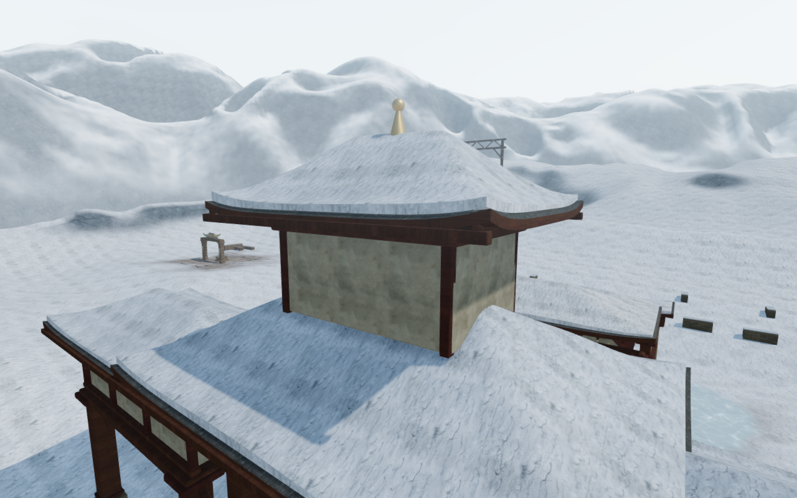
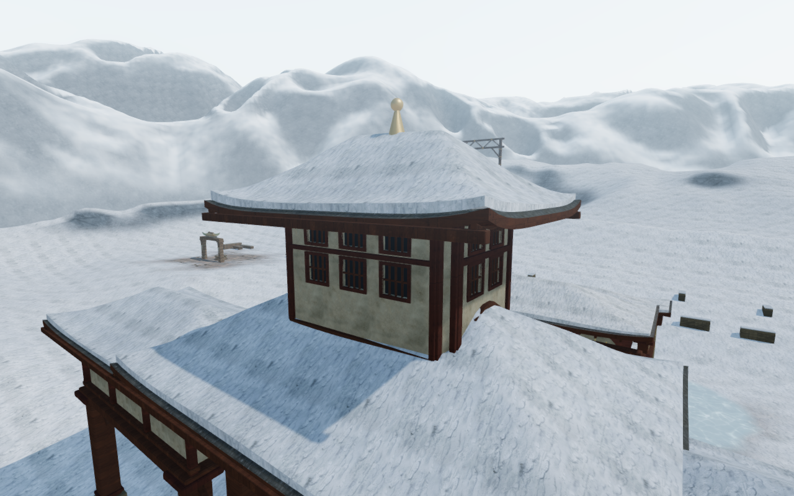
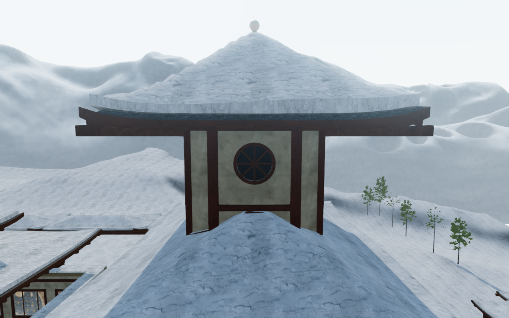
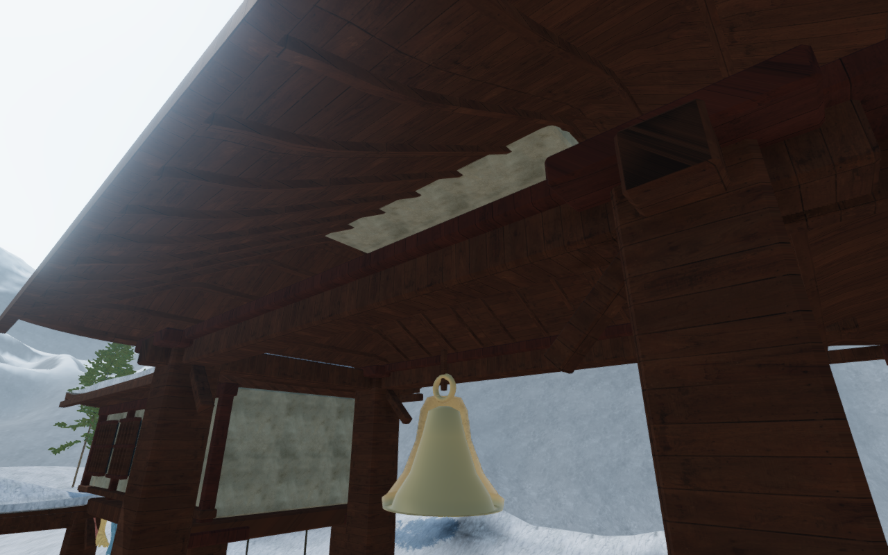
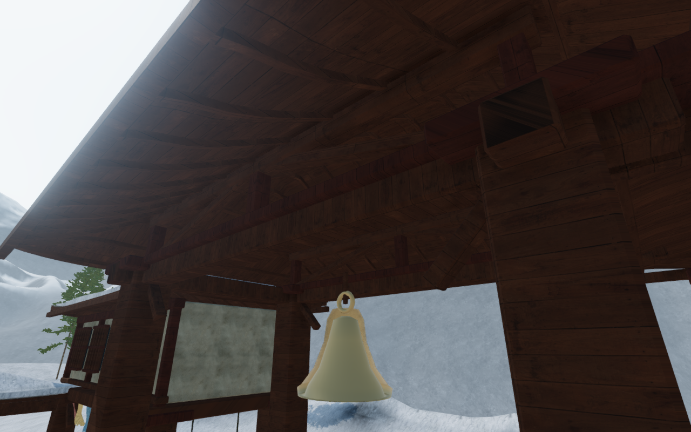
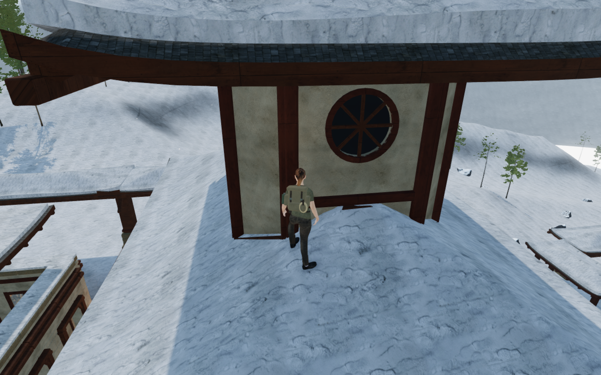

# Houses above the monastery courts

The eight upper houses previously repeated a rectangular plaster body with
windows only on its front. Their backs were conspicuous beside the explorer
on pavilion-roof walks. Each now has a different clipped footprint and window
rhythm, with recessed openings on all four elevations. Court 4 retains its
open bell pavilion.

| Court | Upper house         | Exterior treatment                                  |
| ----- | ------------------- | --------------------------------------------------- |
| 0     | Pilgrim lodge       | Tall rectangular shutters and small clipped corners |
| 1     | Echo lantern        | Broad arched reveals and deeper corner cuts         |
| 2     | Listening gallery   | Horizontal transoms and timber louvers              |
| 3     | Stair house         | Paired arches with staggered head heights           |
| 5     | House of woven wind | Crossed timber lattices                             |
| 6     | Summit watch        | Narrow slit windows and a stone sill                |
| 7     | Scripture archive   | Two tiers of recessed shutters                      |
| 8     | Bell observatory    | Round sunwheel grilles and broad corner cuts        |

These are fictional designs. They reuse the existing credited plaster, stone
and timber materials; the pass adds no runtime image or dependency. Existing
[asset attribution](asset-credits.md) remains applicable.

The 80 windows have actual plaster reveals, inset opaque backing, separate
surrounds and timber bars. They do not open into accessible interiors. Walls,
sills and cornices fit the delivered triangles of the two roofs, with small
intersections at their joints. A closed backing follows the same roof profiles.
The fitted lower backing also clears the white plaster patches that previously
protruded into the main ceiling views. The new assembly contains 76,768 rendered
triangles across the nine courts and batches into at most five material meshes
per court. The surrounding wings,
roof shells and finials retain their previous construction and seed sequence.

Two additional timber trusses per pavilion connect the existing red plates to
purlins beneath the ceiling battens. Camera queries retain one indexed assembly
per pavilion, then test its finite members. Perforated facades keep the real
window holes; the recessed core closes the space behind them. Large timber
members retain the same oriented-box camera convention as the older court
beams, enclosing their small bevels.

Body, sight and sound obstruction queries use the delivered closed triangle
pieces. The new wall and framing members
supply no extra walkable ledges; the existing roof shells provide roof support.

Construction regressions cover closed outward surfaces, collapsed triangles,
four recessed elevations, real exterior air, transformed camera assemblies,
window clearance, roof triangle heights and posts at the existing plate level.
All 155 selected Node regressions pass, along with three CPU-guard checks.
The hoist fixtures reproduce nine material-batching warnings also present in
the preceding milestone; the actual development browser reports no application
warnings or errors. The build passes with its existing large-chunk advisory.

Nine assisted roof landings and short walks approach the new facades, including
the open pavilion. All remain legal, grounded and at full health. Inspection of
432,855 delivered body records finds no overlap with the new construction beyond
the observer's 15 mm tolerance, with no invalid records. Both boots retain
bearing contact against the actual roof triangles, and all sampled camera fades
remain at 1. These are local controlled approaches, not continuous campaign
playthroughs or consumer hardware benchmarks.

All 36 baseline and 48 final development captures are reviewed, including three
Performance views. The 409 runtime source hashes remain fixed throughout the
final sweep. Shaders link, sampled output stays finite and GL queries succeed.
All forty bell-control positions and sixteen local passage legs remain usable.
None of the 109 environmental/bell origins is buried in the 35 new rendered
meshes. Chapter replacement disposes all 49 tracked resources once (35
geometries, five materials and nine shared textures), retires all nine pavilion
camera assemblies and clears the court registry in the next chapter.

Seven native production scenarios pass at 1280 × 800 High with keyboard input
and 540 × 900 Performance with touch input. The two new pavilion-roof cases
start from the verified lodge/archive approach saves; the previous archive-room
roof interaction regression is also retained. Physical bell pulls persist,
and tablet cases preserve partial answers, reset/replay the phrase and advance
from stage 1 to stage 2. All nine complete-store reload comparisons pass,
excluding only per-chapter `lastPlayed` timestamps. Loaded bundles match the
build, the development interface is absent, and there are no application errors
or warnings. All thirteen production captures are reviewed. Both layouts run
in touch-capable Chromium from prepared progress.

The six documentation figures are lossless WebP exports of actual 1280 × 800
game captures, with identical decoded pixels and dimensions. The archive and
ceiling pairs use matching fixed construction cameras on published `e08554b`
and the revised application; the roof-walk figure uses the follow camera after
the controlled approach. Fixed observer views do not establish a player route.

Verification shares the locked five-of-sixteen CPU allowance, with at most two
test workers and one browser. Owned browsers, workers and temporary servers
close afterward. Broader court massing, continuous campaign contact, consumer
hardware performance and subjective soundscape acceptance remain open in the
[visual audit](visual-audit.md). The full game acceptance target remains incomplete.
