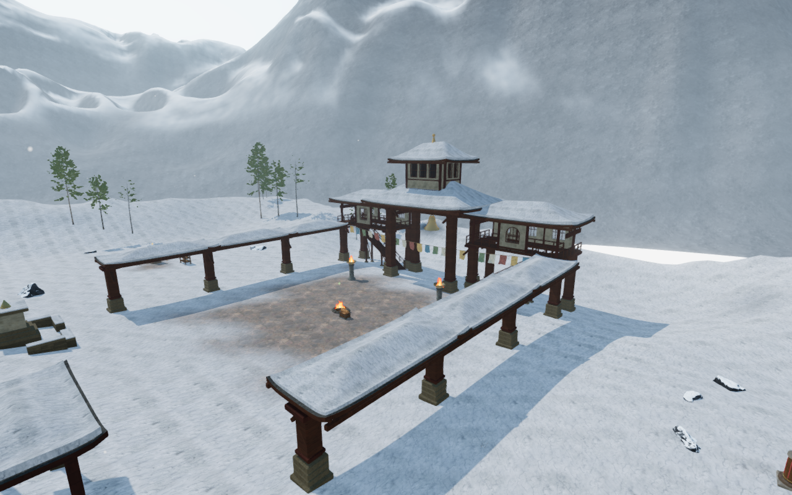
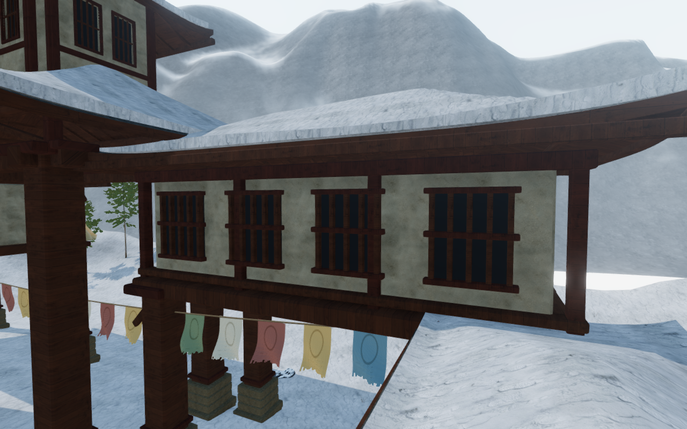
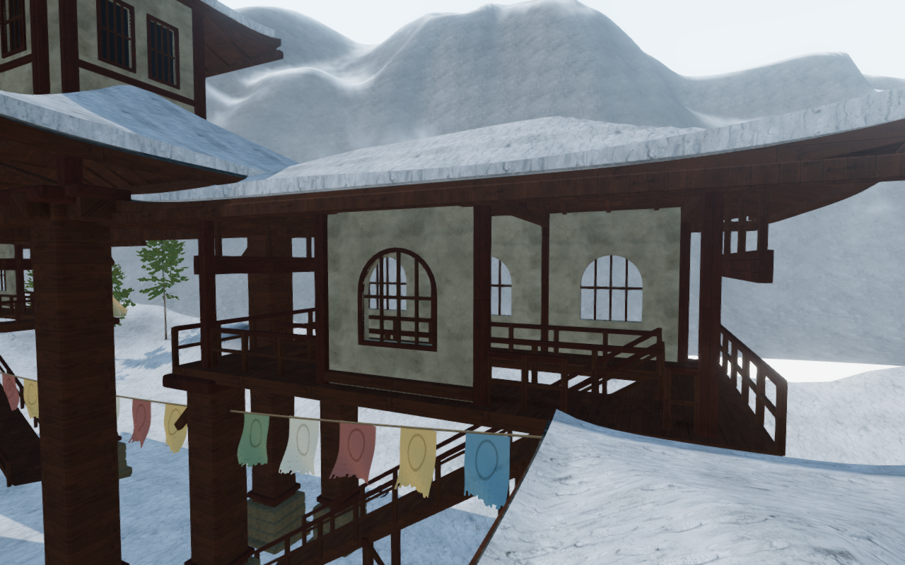
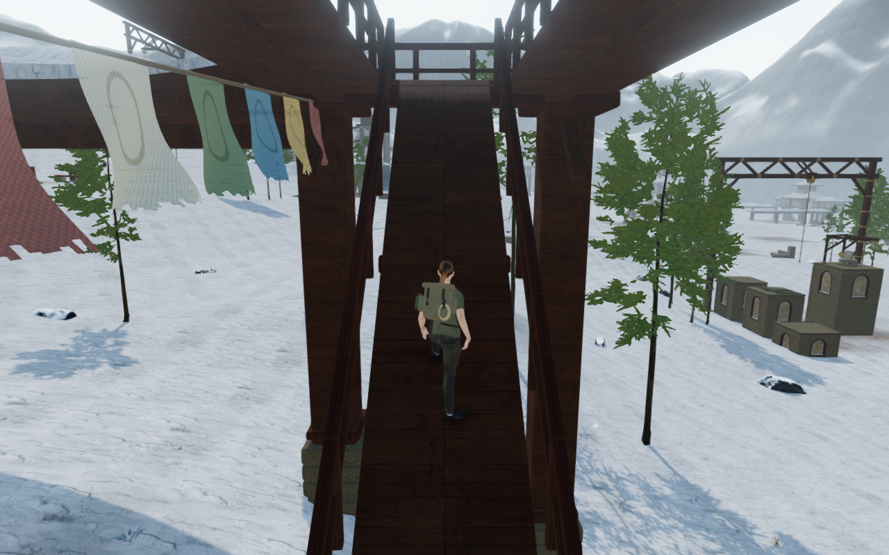
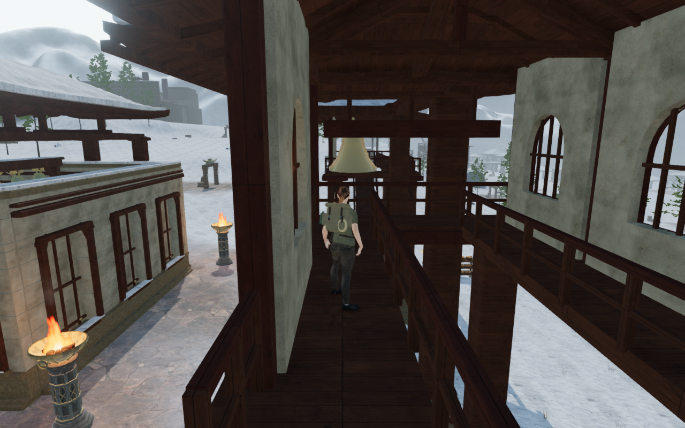

# Walkable monastery verandas

The eighteen side wings previously repeated sealed plaster boxes beneath their
pitched roofs. They now alternate recessed window bays and open rails, with
individual front/back patterns for lodges, archives, workshops and cloisters.
All eighteen are enterable from the snow by a timber ramp. Thirteen connect to
adjoining gallery roofs through a clear doorway.

The central floor opening exposes the ascending ramp. Front and rear walkways
join at both ends; handrails protect the flight and opening without crossing the
walking routes. Terrain-seated toes and trestle footings follow the actual ground.
Floor joists, opening headers, roof columns, chords, ridge purlins and fitted eave
bearers carry the visible decks and roof battens. Damaged roofs retain their
open corners and broken plaster fragments.

| Court | West wing            | East wing            |
| ----- | -------------------- | -------------------- |
| 0     | Pilgrim lodging      | Arrival veranda      |
| 1     | Echo cloister        | Valley record house  |
| 2     | Scroll gallery       | Listening veranda    |
| 3     | Stair lodge          | Voice gallery        |
| 4     | Broken western lodge | Memory cloister      |
| 5     | Weavers' gallery     | Wind workshop        |
| 6     | Summit shelter       | Watch gallery        |
| 7     | Scripture store      | Archive veranda      |
| 8     | Bell store           | Observatory cloister |

These are fictional architectural variations using the existing credited
plaster, timber and stone. No runtime image or dependency is added; existing
[asset attribution](asset-credits.md) applies. The 78 window openings are real
perforations with deep reveals and inset grilles. Wood decks select wood
footsteps through both the animated-foot and fallback movement paths.

The new construction uses 200,652 delivered triangles. Each court batches its
upper house and both wings by material into at most six meshes. Logical building
frames retain the three camera assemblies per court; perforated facades keep
finite camera openings. Dominant-axis UVs remove collapsed mappings on diagonal
reveals and timber endcaps. A position/normal regression preserves the preceding
nine upper-house constructions.

Decks and ramps supply support from actual triangles. Connected floor surfaces
relax the conservative side margin only while the body contacts their real
upper face, preserving ceilings below the loft. Gallery roof skirts stop at
the new veranda edge. An unsupported older saved arrival settles safely on
terrain rather than retaining a removed roof surface.

Construction checks inspect closed outward surfaces, noncollapsed texture
coordinates, actual floor openings, finite camera members and saved-height
recovery. Independent rays check 582 roof-batten bearings. Another 720 underside
probes compare the stone feet with delivered terrain triangles; lifting the
sampled feet deliberately exposes every point to that observer. The inclined
entry stone uses the lowest terrain cells across its entire footprint, carrying
the steep western corner into the snow.

All 38 focused Node regressions and three CPU-guard checks pass. The build
passes with its existing large-chunk advisory. A complete campaign test run
before the final footing repair finished with 1,191 of 1,194 cases passing.
Its failures were the footing witness, an obsolete cavern-texture ownership
assertion, and a coastal archive stance check. The first two are repaired and
retested in the 38-case cohort. The coastal check requires the archive stance's
hips to sit over its supporting boot; the identical failure reproduces on
published `064c8a9` and remains open as VA-201. The complete campaign suite has
not been repeated after the two repairs.

The final assembled-chapter sweep checks all eighteen ascents, front/back loft
loops, thirteen gallery links in both directions and returns to terrain across
24,438 controller frames. Every sampled root remains legal and grounded at full
health. Three posed stops per wing cover the opposite cross passage, central
ramp and front walkway. Independent inspection of 2,597,130 delivered body
records finds no embedded or invalid vertices. Both boots contact actual
rendered floor triangles within the 15 mm observation tolerance; their minimum
sole gaps are approximately 6 mm. All 54 sampled follow cameras retain full
avatar opacity. These are assisted local checks; continuous moving-body contact
and campaign playthrough coverage remain open.

An active-play callback records three wood footsteps on a veranda deck. All
forty bell-control positions and sixteen prepared local passage legs remain
usable. All 109 sound origins clear the fitted building meshes across 981
queries. Chapter replacement disposes the 68 tracked geometry, material and
texture resources once, and retires all 27 fitted-building camera assemblies.
The browser and temporary preview close after verification.

All 36 baseline and 85 final development captures are reviewed, including
three Performance views, the upper-house rear elevations and follow-camera
ramp/loft views. The 412 runtime source hashes remain fixed throughout the final
sweep. Sampled shader programs link, output stays finite and GL queries pass.
The six documentation figures retain the decoded pixels of their PNG sources
through lossless WebP conversion.

Eight production scenarios use keyboard input at 1280×800 and touch at 540×900
in touch-capable Chromium. They cover the steep ramp, archive veranda, the
previous archive-roof interaction regression, two bell-rope pulls, two complete
listening-puzzle flows, and an older arrival on the removed gallery skirt.
The latter safely settles on terrain while retaining non-spatial progress.
Partial and completed puzzle states, positions and settings survive ten
complete-store reload comparisons, excluding volatile `lastPlayed` timestamps.
All fourteen native captures are reviewed; production has no development hook,
loads the built JS/CSS assets and reports no application warnings or errors.
Its browser and preview server close after the checks. These are prepared
progress scenarios, not human campaign playthroughs or device benchmarks.

The wider world remains unfinished. In particular, the fixed court overview
shows a bright flat patch beyond the snow bank, alongside repetitive broad
mountain surfaces and sparse outdoor ground. These are recorded landscape
findings, separate from the sampled veranda construction and movement checks.
Continuous campaign contact, consumer performance, device/browser coverage and
subjective listening acceptance remain open.
