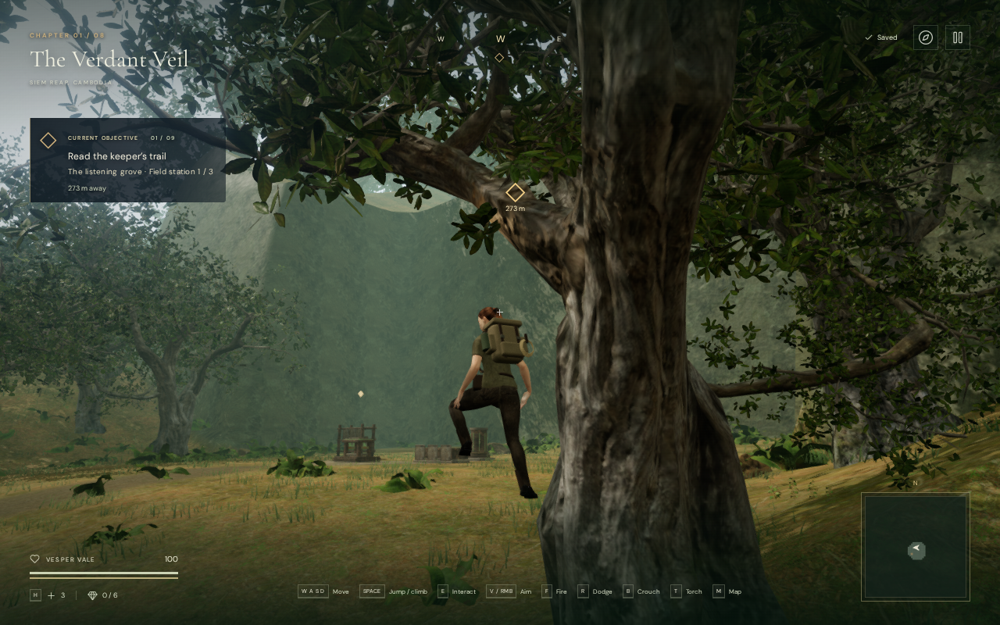
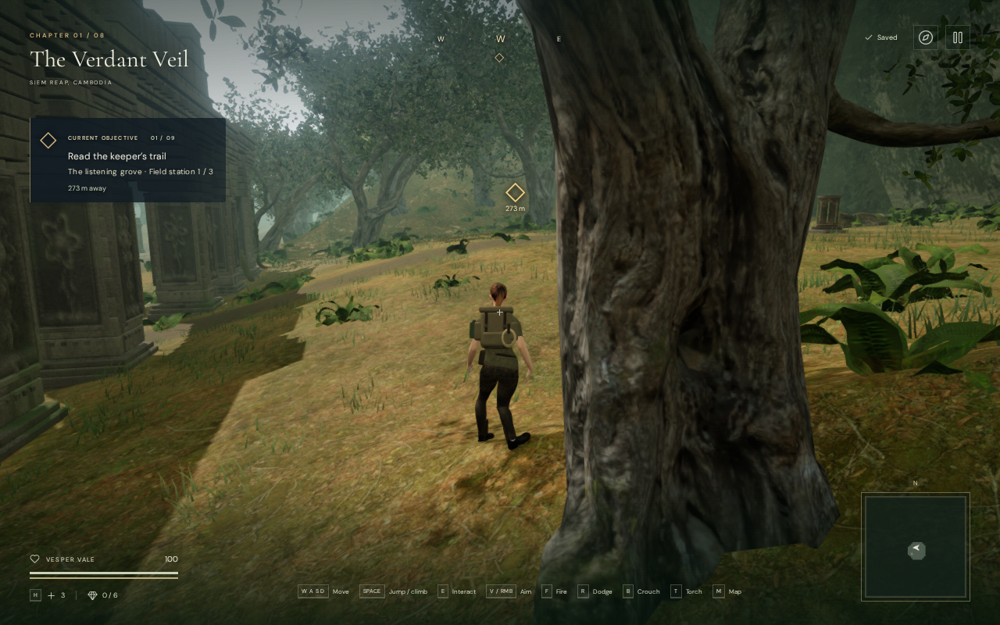
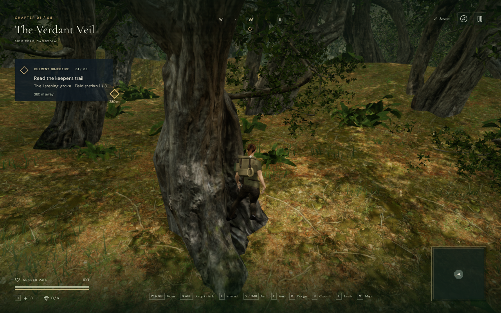

# Explorer contact on roots and scanned stone

The raised jungle rest near x = 370.5731 m, z = 35.3944 m had a legal
controller but no upward tread beneath its boots. The support query accepted
a steep bark face beside the body. A second recorded root rest had a similar
problem, and a genuine nearby tread exposed a separate foot-fitting defect.

Natural body support now requires an upward face with a world-space normal
whose vertical component is at least 0.65. Steep sides retain their collision
surface. A descending body clears those sides through bounded horizontal
projections checked against the rest of the world. It does not gain standing
support from a vertical wall.

The resting rig also recognizes the actual scan triangles as finite treads.
It plants a real outsole point, balances the visual hips, and refits the leg
after skinning. Small corrections against nearby triangle surfaces clear the
boot bevel without lifting the sole away from its tread. The controller body
radius remains 0.55 m; the delivered geometry and placements are unchanged.

## Evidence

Independent raycasts against the delivered wood, nearby rock/gravel and terrain
confirm the original contact gaps. At the first old position, all four sampled
facings have sole gaps of approximately 1.4–2.0 m. The 0.55 m body disk reaches
no upward wood face satisfying the new support criterion. At the second old
position, three facings have approximately 0.7–1.1 m gaps; the fourth reaches
the wood with one boot. Neither position has rock support.

The two unsupported older saves now recover onto clear soil within 0.75 m of
their recorded horizontal positions. Their invalid raised heights are not
retained. Genuine upward root and stone treads remain available.

These are actual High-preset paused arrival captures. Recovery changes the
physical position and the follow camera refits around that position; this is
not an identical-camera pose comparison. The dialog is hidden for the images.

All 104 selected tests pass. Coverage includes the actual first trunk's
450-update descent, the actual second trunk's narrow tread, transformed scan
separation, bounded boot corrections, raw and assembled finite footholds,
chipped caps, crouched knees, ledge departures, raised-save restoration,
mantling, swimmers and the preceding eight-terrain frozen arrival poses.

Three live approaches repeat the original walk/jump/rest inputs. Together with
six valley-rim routes they cover 7,650 controller updates, retaining legal
bodies, ground clearance and grounded final rests. Forty-five sampled moving
poses inspect all 48,095 delivered character vertices against independent
terrain triangles. None cross the observer's 15 mm overlap threshold; the
lowest sampled resting terrain gap is -7.959 mm. These are sampled terrain
observations, not continuous whole-body checks against every solid.

At the genuine narrow root rest, an independently raycast sole triangle lies
7.454 mm from its actual tread. None of the 1,790 delivered shoe vertices is
inside the selected supporting wood mesh. The contact lies within a sole
triangle, so testing only a sparse set of sole vertices would miss it. All
three final live-approach images are reviewed, with linked shaders and finite
sampled HDR output.

All eight actual High chapter starts, two newly earned root saves and the two
older unsupported saves pass first-render checks. Their 577,140 delivered
vertex observations clear independent terrain triangles at the same 15 mm
threshold. Both valid saves retain their exact elevations, 0.847442 m and
0.152377 m above local terrain. All twelve views are reviewed, with active
ground fitting, legal grounded controllers, linked shaders and finite sampled
HDR output. Those first-view terrain observations alone do not measure wood
contact; the independent sole/wood evidence above comes from the live approach.

The production build passes with its existing bundle-size advisory. Native
keyboard/High and portrait-touch/Performance cases exercise movement, crouch,
jump and reload. The keyboard case starts on the newly earned root; the touch
case starts from the older unsupported save. Initial complete-store comparisons
preserve every field except play timestamps and, for that invalid older save,
the required physical position correction. All four subsequent complete-store
reload comparisons pass, excluding only timestamps. First retreat distances
are 1.1389 m and 1.8000 m. All ten release captures are reviewed, with no
horizontal layout overflow. Served bundle names match the build and there are
no application errors or warnings. The prepared cases mark guardians defeated;
they do not verify combat or a complete objective playthrough.

All three documentation exports retain identical decoded pixels and dimensions
in lossless WebP. Verification uses the shared locked five-of-sixteen CPU
allowance, at most two test workers and one browser, with expensive jobs run
sequentially. Thread-affinity audits pass, and the owned previews, workers and
browser descendants close after their checks.

## Remaining review

This repairs VA-165's reproduced unsupported root stance and the associated
side-descent and sole-fitting failures. Broader moving body/solid contact,
confined descent fallbacks, tree-base strips, possible masonry/soil gaps,
portrait text contrast and world composition remain under review. Muted
rendering checks do not establish sound quality, a complete objective
playthrough or consumer-device performance. No external asset or recording is
added; the existing asset attribution remains applicable.
