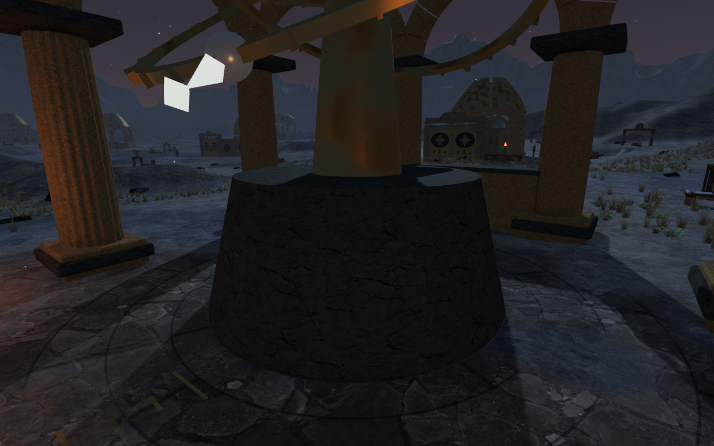
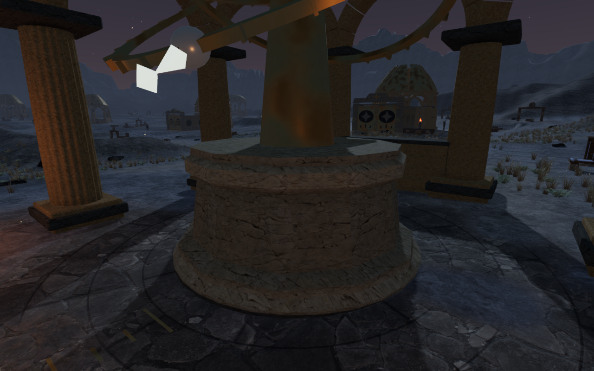
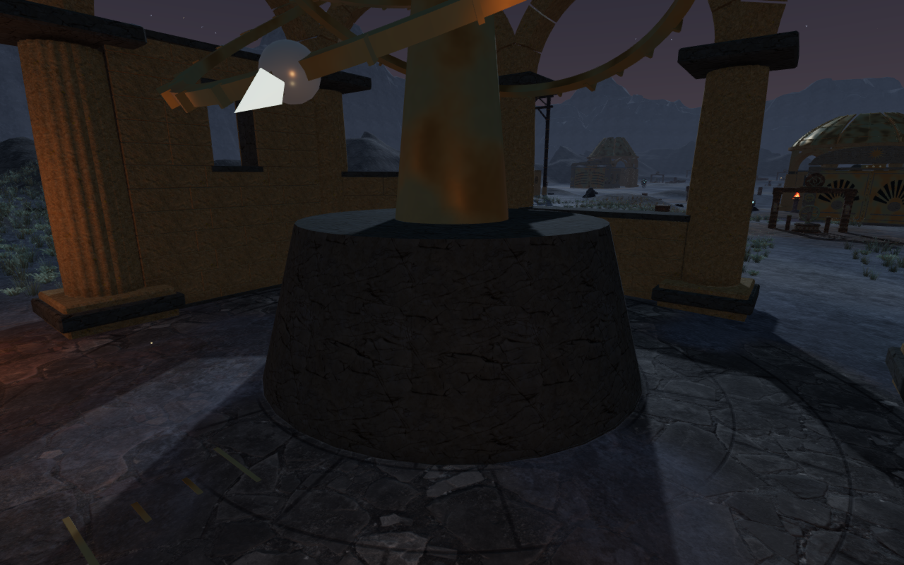
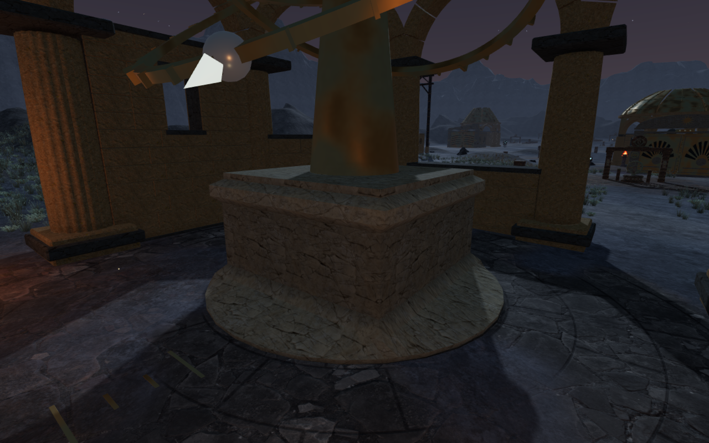
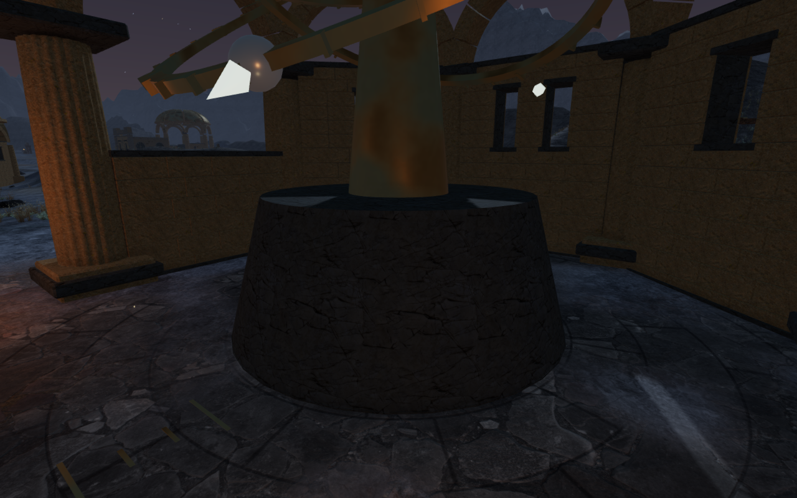
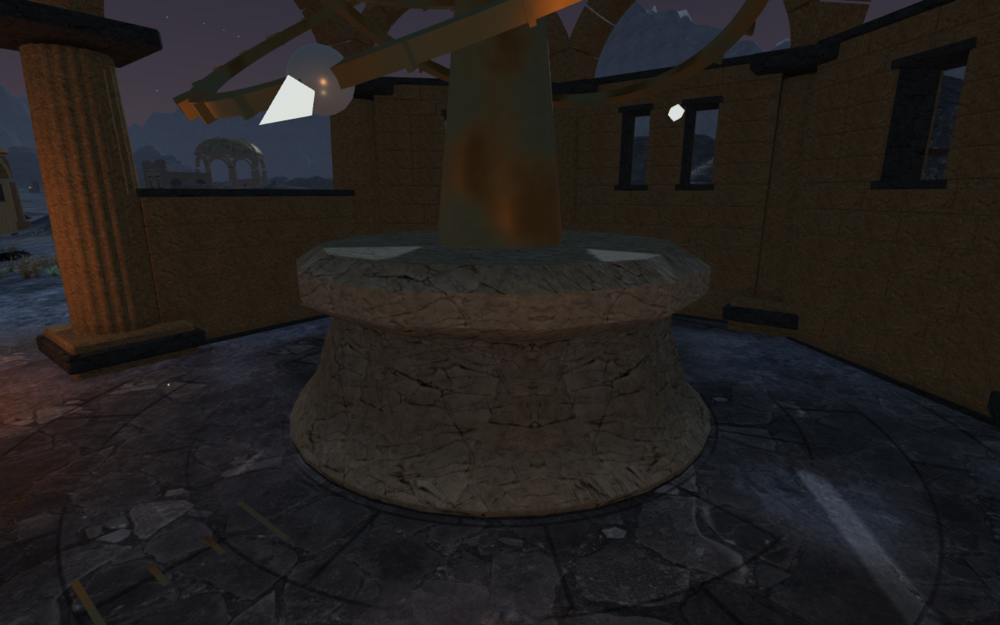

# Sculpted bases for the Meridian instruments

All eleven Meridian instruments now stand on individual stone profiles.
Circular shoulders, octagonal registers, a square archive body, a hexagonal
western base, a diamond circuit and layered strata replace the repeated plain
drums. Lighter stone and restrained course tones make the mouldings visible
under the existing observatory lighting. The surfaces reuse the existing stone
maps through one shared material.

Each closed body enters the original buried footing and ends at the existing
spindle seat. The three moving rings, roof hinges, mechanism targets and sound
origins retain their positions. The stone's actual triangles provide physical
support, body collision, sight and sound obstruction.

The lowermost radius is reduced by one centimetre where the footing overlaps
it. This keeps the differently shaded skins from competing at the same visible
depth while retaining their solid contact. A regression first reproduced the
shared surface; all 1,584 final paired radial probes separate the skins by more
than two millimetres in the sampled lower strip.

The camera uses 101 small convex envelopes along the courses instead of the
box around each complete base. That preserves the empty space beside narrower
upper sections and square corners. Face-plane margins are conservative at
edges, following the existing camera-margin convention. The ordinary box and
rounded-cylinder paths remain available to other scenery.

The geometry checks inspect every profile for paired closed edges, finite
attributes, noncollapsed triangles and outward positive volume. Eleven distinct
ray-depth signatures confirm the physical silhouette variation. Across 10,571
horizontal-entry and vertical-support probes, the triangle kernels agree with
the rendered stone. Another 1,056 footing probes confirm the lower contact.
All 3,696 sampled camera rays stop at or before the visible faces, with less
than 18 cm additional envelope reach in that sample. Camera margins preserve
the surface clearance and a clear pass beside the archive's upper corner.

All 113 selected test cases pass in the final run. The geometry observer reads
indices for unbatched footings as well as expanded render buffers. All 374
masonry kernels retain their independent 14,212 surface-ray comparisons and
489,312 vertex comparisons;
198 inlays also pass 8,316 height probes. Sustained movement passes 120
approaches; a recorded older occupied position also recovers. The regressions
include camera behavior, posed column landings, roof clearance, all 69 chapter
gates, counterweights, mechanisms, threshold crossings and saved arrivals.

The final production bundle passes keyboard/High and portrait touch/Performance
checks from prepared lunar progress. Both cases exercise coupled ring turns,
reset, alignment and a stage 2-to-3 submission. Five full-store reload comparisons
pass across partial progress, completed progress and an older soil-height arrival,
excluding only per-level `lastPlayed` timestamps. Return movement covers 9.0 m
and 9.6 m with health retained at 100. The older arrival retains its horizontal
position, restores the 0.549 m threshold support and permits a 6.47 m return.
The actual asset lists match the built bundles and the development interface
is absent. All eight release captures are reviewed, with no application errors,
warnings or horizontal page overflow. These prepared checks do not establish a
complete chapter playthrough, moving-body visual acceptance or listening review.

The fourteen High baseline captures and seventeen final captures are reviewed.
The final set repeats eleven prepared gameplay follow-camera poses and three
detail cameras, then checks three Performance views. A temporary visibility
mask confirms at least 5,806 exposed body pixels per final view on its
320 × 200 target. The mask omits non-mesh effects and identifies only the
body's middle height range; it supports sampled visibility rather than proving
complete coverage of every surface. Nearby columns still obscure parts of some
views. All captured shaders link and HDR buffers remain finite, with no
application errors or warnings.

The observatory roots, roof-panel counts and total source count match the
published baseline. None of the twenty-two observatory sound anchors is buried
by a new body. Listening acceptance remains open.

The eleven bodies contain 21,504 triangles in total. They add one shared
material using the existing stone maps. All eleven tracked body geometries
and that material dispose exactly once on each inspected chapter change.
Temporary mask materials and render targets are released before that change;
owned browsers and preview processes close afterward. Verification stays within
the shared five-of-sixteen CPU allowance. The build passes with its existing
chunk-size advisory. Consumer hardware performance remains unverified.

The six comparison exports preserve actual 1280 × 800 High pixels and
dimensions at matching prepared player positions, inspection cameras and zero
elapsed simulation time. Baseline runtime source hashes match published
`4266011`; final hashes match the revised application. Lossless WebP conversion
introduces no cropping or retouching. Existing [asset attribution](asset-credits.md)
is retained, with no new external model, bitmap, recording or dependency.

The [world audit](visual-audit.md) remains open. Repeated upper instrument
supports and rings, broader route composition, continuous body contact,
consumer device performance and listening acceptance still need work.
