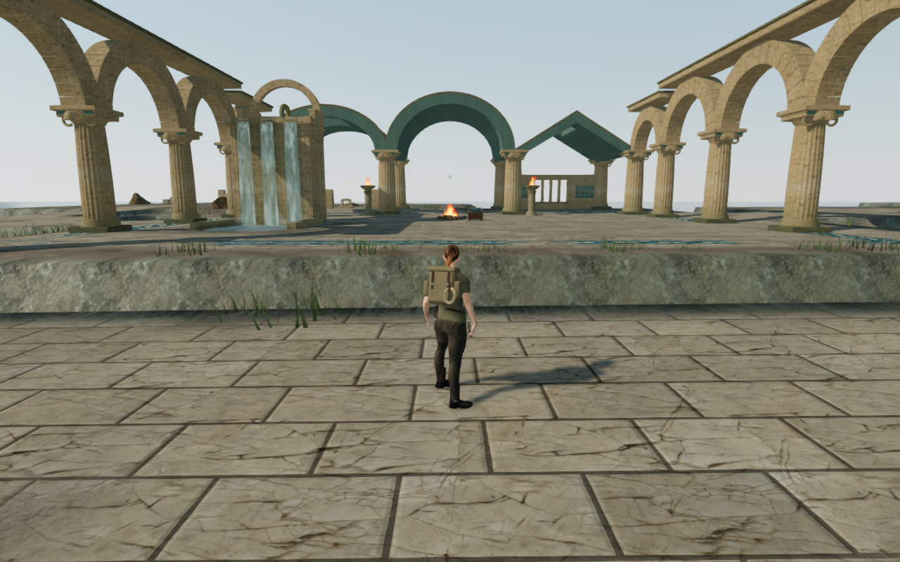
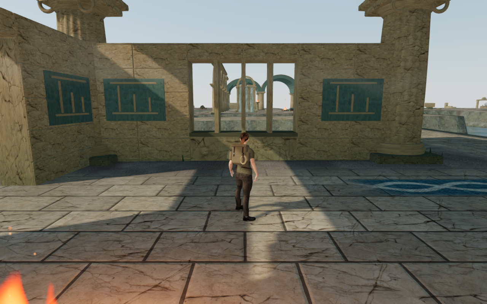
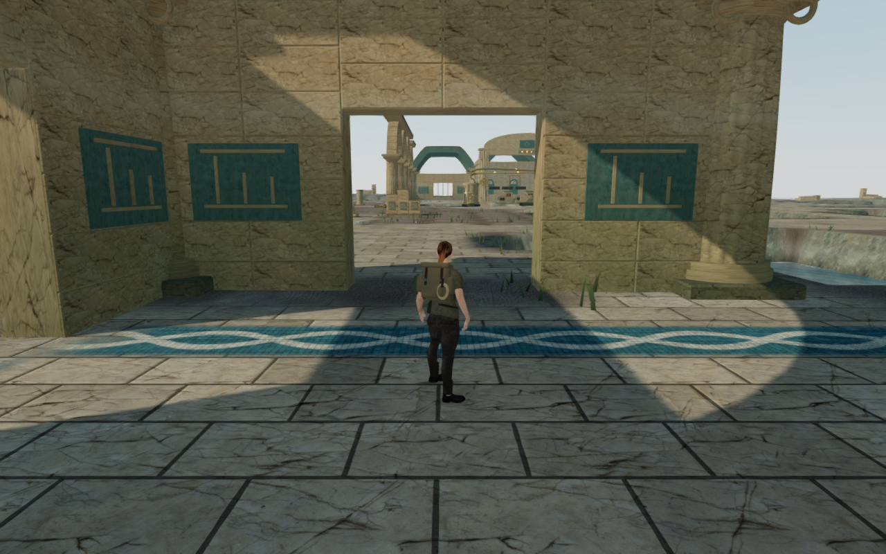
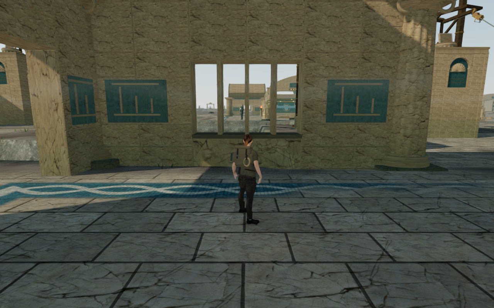
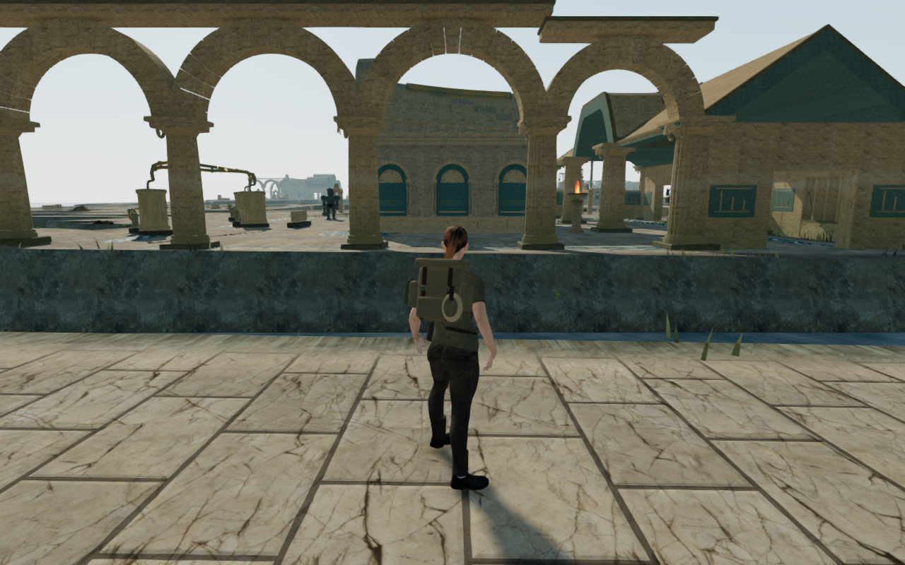
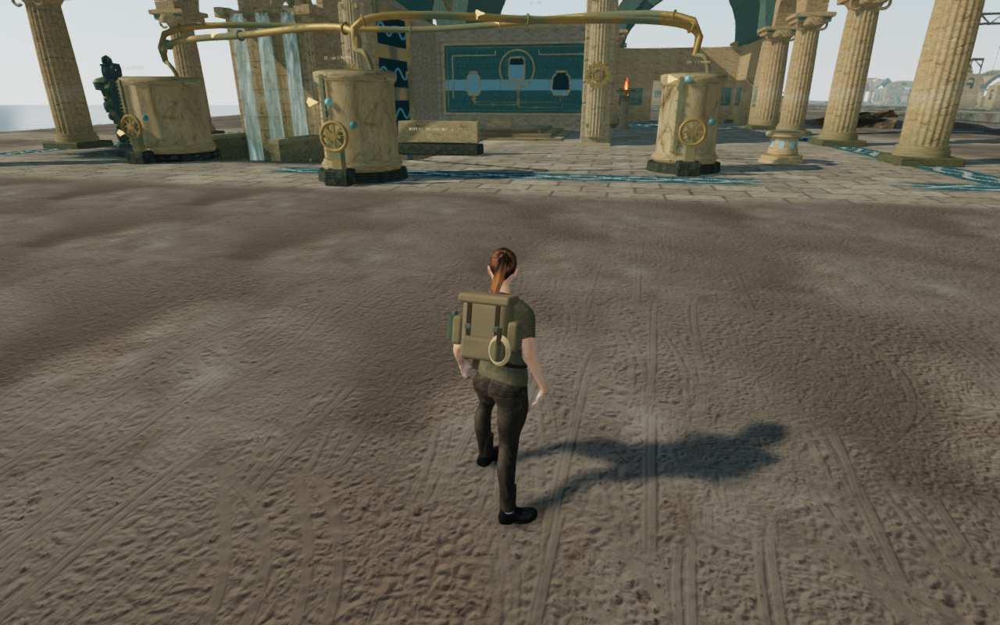

# Distinct coastal palace courts

Ten main coastal courts now replace the repeated three-vault layout with
different rear roof profiles and partial
side rooms. Their new walls frame the previously empty halls, while broad
doorways preserve passage and the central crossing aisle stays open. Three
carved measures on each blue panel use the associated cistern capacities.
The existing palace textures and column construction remain in use.

These are actual High-quality browser captures at 1280×800, with prepared
completed progress, hidden guardians and a muted mix. Player positions and
chosen looks match the preceding baseline. The six lossless WebP deliveries
retain the captured dimensions and exact decoded RGBA pixels.

| Court | Construction |
| --- | --- |
| Arrival quay | Low surviving walls, rounded halls and an eastern gable |
| Counterweight exchange | Flat side roofs and a higher central gable |
| Harbor counting house | A broad central roof, lower western loggia and enclosed eastern room |
| Coral pump workshops | Three different gable heights and two side workshops |
| Tidekeeper return gallery | A transverse western roof and asymmetric central wave vault |
| Isolated intake court | A taller middle vault and more open, broken side roofs |
| Counterflow crossing | A transverse central vault between gabled wings |
| Queen's circulation hall | A taller broad nave and lower roofs over both side rooms |
| Pressure reserve cloisters | Two transverse gables around a flat centre with a larger roof light |
| Abyssal lock basilica | A higher broad middle vault and asymmetric eastern roof |

The roof beds use closed strips along their flat direction, with individually
dressed stone cells above them. The inset skins sit on the actual core planes,
rather than reevaluating the curve between its mesh vertices. Their undersides
embed 25 mm into those planes. Roof lights pass through both layers. Perimeter
bands follow the curved grid; fully hidden skins below those bands are omitted.
The construction folds into the existing three material batches per court.

Movement and roof support use copied render triangles. Camera bounds coalesce
only contiguous strips along the flat direction, preserving the real holes.
New lower walls have buried continuous beds, dressed faces and mounted records.
Their fronts remain open beside the three existing west-hall camps.

The passage review found seven rear gaps facing deep banks with blocked
exterior centreline probes in both the current and preceding ground layout.
Those gaps are now shore windows with sills and three physical mullions.
The other 28 openings remain doorways, with supported walking space through both faces.
This gives the coastal edge a visible barrier instead of an apparent exit.

## Recorded column contact

The independent body observer found 154 boot vertex records inside the Queen
hall's original front column base, reaching 64.44 mm. The standing root at
X=227.75, Z=252.8 was legal under its old root-only box. All 132 palace columns
now have finite boxes around their foundations and widest capitals, reserving
a shared 0.65 m body margin. Column centres and visible construction retain
their placement. The collision bounds intentionally change; the guards have
no walking support surface.

The retained regression now rejects that occupied root and permits the nearby
supported X=227, Z=252.8 point. Eight actual High/Low standing/crouched poses in
both facings have zero embedding across 384,760 visible vertex records. All
twelve retained old boot witnesses remain inside the rendered base when read
independently, calibrating the correction.

The full column sweep now passes 532 supported poses: two facings and both
stances beside all 132 columns in High, plus four Low repetitions at the
recorded Queen base. It inspects 25,586,540 visible vertex records against
independently reconstructed closed render components, with zero embedding
beyond 15 mm. This samples one accessible approach per column. The original
40-minute supervisor deadline closed its owned resources after 435 poses;
the remaining poses resumed on unchanged source. All twelve original contact
witnesses still exceed the observer threshold. New-wall and moving/upper-body
coverage remain separate checks.

The final wall sweep also passes: 152 supported poses inspect 7,310,440 visible
body records with zero embedding beyond 15 mm. High covers the first inner
flank of all 35 new walls in both facings and stances; Low repeats the three
camp-side rear walls. These are static approaches, rather than coverage of
every face or moving and airborne contact.

## Verification

- All 20 selected palace, court-foundation and field-station-solid tests pass
  after the column repair. The integration fixture uses the real Adventure
  ground method and the rendered Float32 terrain surface. This catches the
  unbound terrain callback that the actual browser initially exposed.
- Roof-cell checks inspect sealed nondegenerate geometry and the actual skin
  undersides against independent render rays. Built checks compare sampled
  render heights with copied support, exercise finite roof thickness, verify
  real light openings, and check doors, windows, banks and bird supports.
- The final build after the column repair passes, with the existing large-chunk
  advisory. Full construction totals 489,548 triangles, compared with 491,072
  before this pass. This is a geometry count, not a device frame-rate claim.
- Forty current baseline walking views are reviewed. After the roof, panel,
  shore-window and column refinements, forty matching High views and ten Low
  hall views pass and are reviewed. The corresponding player positions and
  chosen looks remain exact, registered body targets remain clear and the fade uniform stays
  at 1. High HDR samples are finite; Low uses its direct RGBA8 framebuffer, with
  linked shaders, nonempty colour samples and no GL errors.
- Owned browsers and servers close after each finished check. Verification
  shares the locked five-CPU allowance and keeps staging under ignored local
  storage.
- All 76 assisted normal-controller legs pass: both directions through the
  28 doors and along ten central aisles, totalling 393.94 m and 5,910 updates.
  Every door leg records a crossing inside the actual opening. Health remains
  100, no route stalls, and the character-fade uniform stays at 1. All 114 route
  captures are reviewed. The arrival court's western-door return view is steep;
  clear body visibility does not establish comfortable framing. The routes use
  prepared complete progress and hidden guardians and do not constitute a
  continuous campaign playthrough.
- All 36 hydraulic control neighborhoods, 27 pump sight lines and 27 mounted
  wheel-anchor sets pass. Fifty-four ready/completed field-objective cases retain
  supported approaches; ready cases expose the correct ordinary interaction.
  Both coastal climbing loops pass the existing assisted mantle, jump, rope
  and return-cable physics check. All ten birds retain their seated feet and
  colocated emitters. All 139 previously available dry radial source ranges
  remain accessible across 72 pump, water and gate emitters. These probes are
  muted placement and falloff checks, rather than listening acceptance.
- The built keyboard/High and portrait touch/Low cases pass selected-source
  and earned-transfer reloads, crouch, movement, look, jump/landing and map
  controls. Two occupied-column cases recover 0.75 m from the original Queen
  root, preserving progress and saved yaw/pitch; both can walk away afterward.
  Twelve paused whole-save comparisons pass, excluding only `lastPlayed`.
  Sixteen native release captures are reviewed. All sixteen character-model
  responses match the delivered asset, and release bundles match the build.
  There are no recorded application warnings, errors or failed responses;
  driver readback diagnostics remain separate. The existing crowded keyboard
  landing view beside the harbor tablet remains open in the wider audit.

The runtime remains unchanged throughout the final browser checks. The shared
five-CPU guard applies to all verification descendants. Owned browsers,
workers and preview servers are closed, both preview ports are released, and
temporary profiles are removed. Staging and raw reports remain under ignored
`local/` storage. The public milestone includes original code, meaningful
construction regressions, attribution and six intentional scene captures.

The wider campaign visual audit remains active. Repeated side arcades, sparse
surroundings, continuous campaign routes, upper/moving/interacting body contact,
landing-camera framing and actual listening still need work. No full-world
graphics acceptance, human duration or commercial AAA quality is claimed here.

The later [coastal follow-camera refinement](coastal-camera-framing.md) lowers
the recorded doorway return and harbor-tablet landing views. Its matched
controller comparisons, wider local routes, chapter stances and built saves
pass; broader moving-view framing remains open.
