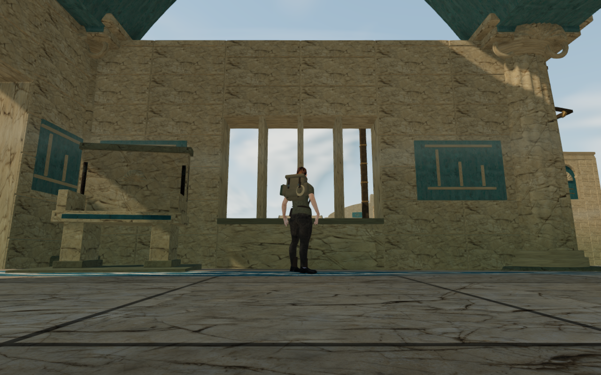
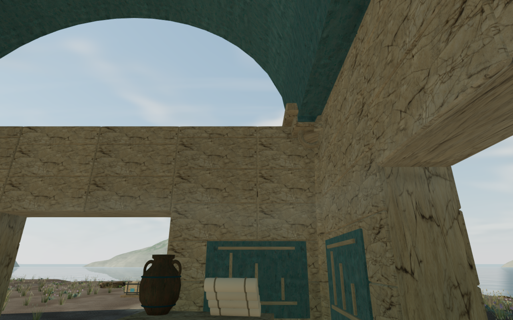

# Coastal hall windows

The coastal halls now have upper windows above their capacity records. The
previous tall marble flanks were blank. Ninety-two openings across twenty-eight
walls use six profiles: arches, narrow rectangles, round oculi, pointed heads,
clipped shoulders and diamonds. Their number and spacing adapt to each flank,
keeping the columns and door jambs separate.

Each opening cuts through both the continuous wall bed and its stone courses.
A blue reveal and beveled stone edges give it depth from inside and outside.
The wall, camera and physical sight geometry retain the same aperture; the
narrow upper lights remain blocked to the player's body. Deep reveals can hide
the sky at oblique angles, as they should for a window through a thick wall.

The existing lower doors, shore windows, capacity panels, roofs, columns,
furnishings and bird perches retain their layout. This is a local improvement to
the upper walls. Repeated court massing, sparse coastal surroundings, broader
moving contact, other browsers/devices and subjective listening still need
review. The overall game-polish goal remains incomplete.

All 1,203 campaign tests pass without failures or skips. Three CPU-guard checks
and the production build pass; the build retains its large-chunk advisory.
Verification shares five of sixteen CPUs with inherited, locked affinity,
at most two test workers and one browser. Expensive checks run sequentially.

The new geometry regressions cover all ninety-two profiles, closed cut courses
and frames, continuous backing under the stone edges, and actual batched render,
camera and physical sight rays through the apertures. The original opaque wall
blocks the same center rays as a negative control. Lower masonry remains solid,
and the player's standing envelope cannot pass through an upper light. The
three structural material batches per court are retained, with a bounded
additional triangle allowance for each window.

Independent before/after hashes preserve 132 column guards, 7,184 roof cells,
the original plans, twenty furnished settings and ten bird perches. All 784
frozen source, test, script and build inputs still match after the suite and
build. The 415 runtime source hashes match the refined browser views too.

All 36 hydraulic controls, 54 ready/completed field approaches and both coastal
climbing loops pass the assembled-world access check. The 72 water/gate
emitters retain all 139 dry radial listening positions recorded in the earlier
published access survey. These are muted position, sightline and distance-gain
probes, not a subjective sound review. Switching chapters disposes all 42
tracked court resources once (thirty geometries, three materials, nine textures)
and retains none of the 146 tracked camera kernels in the new chapter.

The ordinary player controller and follow camera pass 76 assisted route legs:
both directions through twenty-eight original doors and ten hall aisles. All
5,910 controller/camera updates retain full character opacity and health, over
393.94 m of simulated movement. Door routes must cross the actual doorway plane
inside its jamb margin. One old fixture endpoint overlapped the unchanged
archive throne's guard; shifting that route 35 cm along the same opening leaves
the crossing checks intact. These checks draw no intermediate route frames and
do not step combat or establish a continuous chapter playthrough.

The final visual survey contains 72 reviewed images: ten High follow views,
four Performance follow views, both faces of all twenty-eight affected walls,
and two additional views of an offset wing's occupied flank. The seventy-image
sweep is reviewed in labeled sheets, with selected hall images at full size;
the two additional views are reviewed at full size. The follow views retain
full character opacity. Every recorded player root is legal and retains full
health. Architectural inspections use an independent camera and hide the
avatar; their cameras are not claimed as player follow positions. HDR output
stays finite, shaders link, and no application errors or warnings are reported.
The browser and preview server close after each check.

The production build passes prepared keyboard/High chest and portrait
touch/Performance vessel cases. Native crouch, vertical jumps and supported
landings pass. The keyboard move covers 2.4 m; the constrained touch fixture
moves 10 cm beside the vessel, establishing short input response there. Six
complete-store reload comparisons preserve all saved data apart from
`lastPlayed` timestamps, including health, chapter stage and hydraulic progress.
Independent geometry rays confirm the retained raised supports. All ten native
captures are reviewed at full resolution. The release has no development hook,
loads the expected built JS/CSS assets, and matches the same 415 runtime source
hashes. No application errors or warnings are reported; thread and cleanup
audits pass, and the browser and preview server close. All 784 frozen inputs
still match after these checks.

The pairs below match the published `4894e66` baseline's roots, camera positions,
headings, animation phase and High settings. All four lossless WebP figures
decode to their source pixels. Deep openings and the preserved lower records
remain visible; broader sparse ground and repeated building forms remain open.

| View                              | Before                                                                                         | After                                                                                   |
| --------------------------------- | ---------------------------------------------------------------------------------------------- | --------------------------------------------------------------------------------------- |
| Court 7, player follow view       |                        |  |
| Court 2, architectural inspection |  |  |

The delivered assets, character, textures and dependency set are unchanged.
The windows use original procedural geometry and the chapter's existing
materials; existing [asset attribution](asset-credits.md) applies. Browser
fixtures use prepared progress and muted audio. These local checks do not
establish a continuous campaign playthrough, consumer performance or subjective
listening quality.
