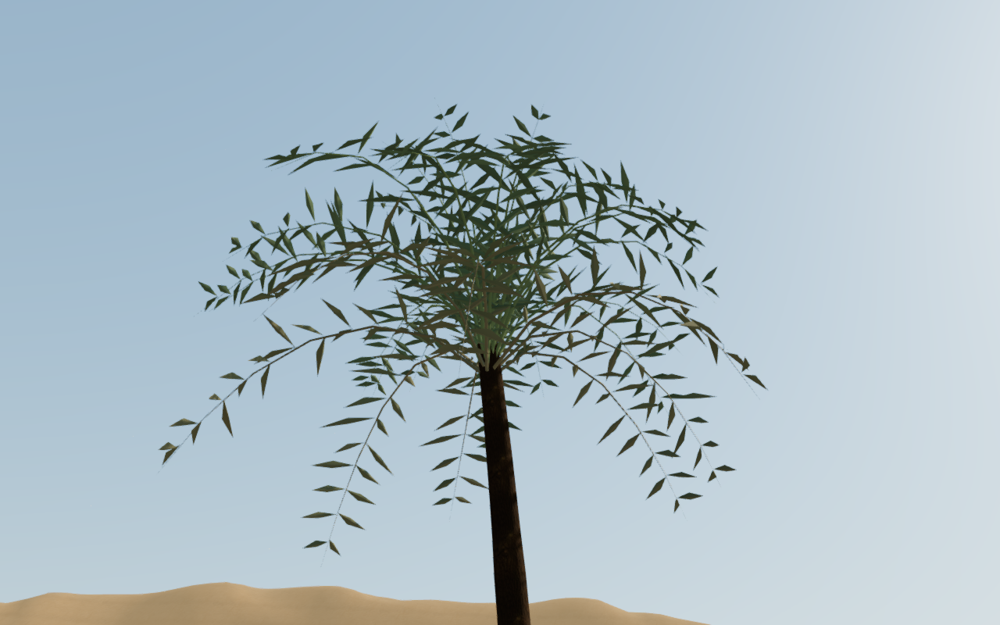
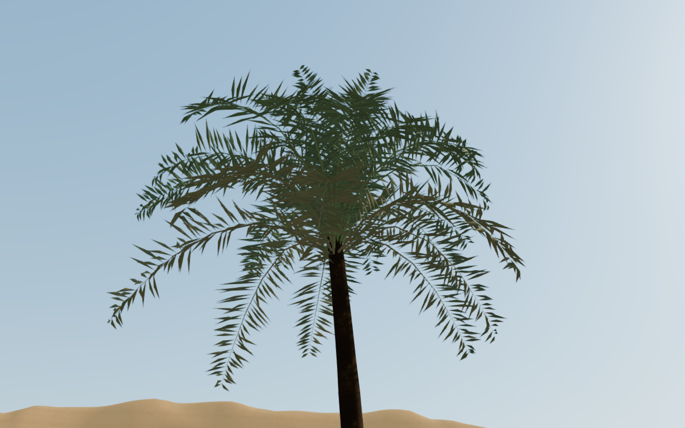

# Palm crowns through distance changes

The desert's coarse palm tiers dropped half and then three quarters of their
leaflets. Width compensation retained the broad outline but exposed much more
sky through each crown. This was visible in the ordinary landscape views as
thin, flat-looking distant trees.

All tiers now keep the same leaflet attachments and colors. Their folds and
curves use fewer triangles with distance. Each of the three crown variants is
compared from three fixed viewing directions under the same wind phase.
Unlit foliage masks previously retained 70.6–72.6% of the near crown at the
middle tier and 54.8–57.8% at the distant tier. The revised coarse tiers retain
91.1–95.2% in those sampled views. This measures silhouette coverage, rather
than subjective botanical or graphics quality.

Both complete 1280 × 800 High captures force the distant geometry at the same
close, legal ground-observer camera for inspection. The explorer is hidden.
They are direct, unretouched game captures; normal play selects detail by
distance and graphics setting. The near crown geometry and all trunk tiers
remain byte-identical. All seventy planting records and instance transforms
also retain their values.

## Cost and verification

| Detail tier | Previous triangles per palm | Current triangles per palm |
| --- | ---: | ---: |
| Near | 28,992 | 28,992 |
| Middle | 8,512 | 14,656 |
| Distant | 2,880 | 7,488 |

The increase applies to the existing instanced batches. At the inspected High
entrance, the distance selection contains 23 palms and 215,232 tree triangles,
up from the previous geometry's 100,032 at that selection. Performance selects
14 distant palms and 104,832 triangles, compared with 40,320 previously. These
are tree-geometry counts before additional rendering passes. Consumer-device
frame rate remains unverified.

All 74 selected tests across fourteen files, the build and three CPU guard
checks pass. The leaflet regression now requires equal attachment sets and
retained surface area at every tier. Existing checks cover nondegenerate
geometry, wind bounds, fixed frond bases, matching shadow deformation, detail
selection/crossfades, desert art, terrain, chapter startup and audio. The
production build retains its existing chunk-size advisory.

All nine preceding and nine revised controlled crown views are reviewed.
The normal-world review adds nine views across High, Balanced and Performance,
twelve continuous-route views and a coastal chapter-replacement view. Every
captured stance is legal. High/Balanced sampled HDR buffers are finite, shaders
link, and every view reports zero GL errors. Some close look-up views crop the
top of a crown; these do not replace the complete controlled crown views.

The assisted approach/return walk completes 243.881 m and 3,657 normal
controller/camera updates at full health, with prepared field progress and
combat suppressed. This is local route evidence. Changing chapters disposes
all 59 tracked palm resources exactly once: eighteen instance objects,
eighteen geometry wrappers, twenty materials including shadow materials and
three bark textures. The old palm placement and patch arrays clear.

The production build also passes normal keyboard input at 1280 × 800 High and
simulated touch input at 540 × 900 Performance near the interior palms. These
prepared chapter-two saves retain stage two and full health after 1.2 m and
1.8 m of movement respectively. Both complete localStorage reload comparisons
match except for the last-played timestamp. All four release views are reviewed;
the checks load the expected built assets, expose no development hook, report
no page or resource errors, and show no horizontal overflow. Owned browsers and
preview servers close after verification. Checks use the shared five-CPU limit.

All 451 runtime source hashes match the selected tests and revised browser
checks. The wider eight-world audit remains open for repeated installations,
sparse spaces, foreground framing, continuous body contact, listening and
device evaluation. This foliage revision does not establish AAA graphics.
