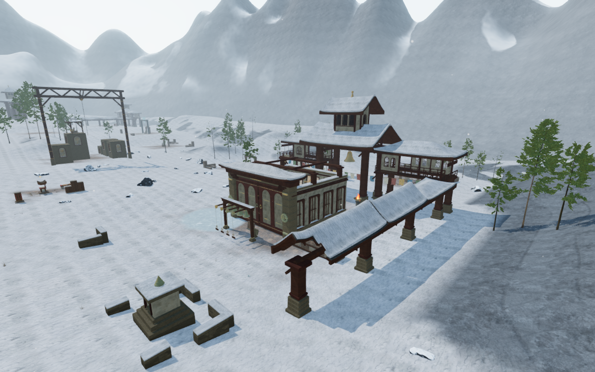
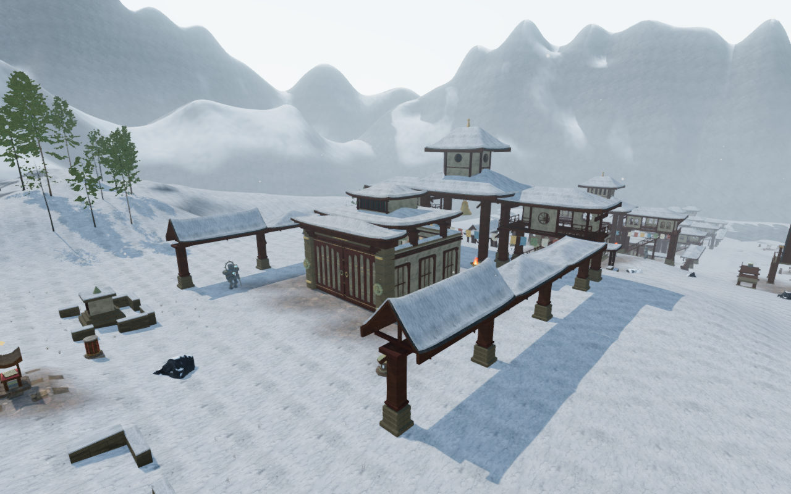

# Varied monastery pavilions

The nine courts in the Himalayan chapter now have different main-roof volumes.
Long gables, low hip roofs and taller pavilion caps break the preceding shared
skyline. The eight upper houses fit those new roofs; the memory court retains
its open bell pavilion. These are fictional buildings.

| Preceding echo-court roofs | Echo gables |
| --- | --- |
|  |  |

| Preceding observatory roofs | Observatory caps |
| --- | --- |
|  |  |

The paired High views use the same prepared player/camera coordinates and scene
time. Animation can differ. The four 1280 × 800 documentation images preserve
their source RGB pixels through lossless WebP conversion. Existing
[asset attribution](asset-credits.md) applies; no external asset is introduced.

| Court | Main roof | Upper roof |
| --- | --- | --- |
| Pilgrim hall | Lower hip | Low hip |
| Echo gable | High gable | Long gable |
| Listening lantern | Pavilion | Broad pavilion cap |
| Stair hall | Gable | Wide, shallow hip |
| Open memory pavilion | Low hip | Open |
| Woven-wind hall | Hip | Deep gable |
| Summit beacon | Pavilion | Narrow, tall cap |
| Archive longhouse | Low gable | Broad, low gable |
| Bell observatory | Tall pavilion | Wide pavilion cap |

The lower eave lines retain their existing bearings. Upper roof widths, depths,
profiles and pitches change the actual geometry. Fitted snow, ceiling timbers,
fascias, walls, sills and cornices follow it. Window designs and existing lodge
connections remain in place.

Wall sections now include intersections with the delivered roof triangles.
This fixes a small ridge separation exposed by the new gables: fixed wall
subdivisions could span across a roof break. The physical upper-room backing
also recognizes contact with its real roof. A standing collision cylinder no
longer pushes the explorer sideways through a buried uphill wall. That
exception requires roof contact and retains solid space below the cap.

## Verification

- All 59 focused monastery, roof and winter-ground checks pass, along with
  three CPU-budget checks and the production build. The build retains its
  existing bundle-size advisory.
- All nine volume variants build closed house geometry. All 642 sampled
  window-surround boundary points stay between the delivered roof joints.
  Existing window recess, room collision, finite camera and truss checks pass.
- The batched-geometry observer finds all 17 pavilion caps. All 444 wall-joint
  samples pass. Lowering the actual house buffers by 25 cm makes every joint
  fail; exact buffer bytes are restored afterward.
- All 72 monastery fascias retain their fitted seating. All 45,336 delivered
  probes pass and detect the lowered-board controls. Gallery bearings,
  thirteen lodge return routes and 23 covered-roof jumps pass.
- All 17 sampled controller falls land on the new caps. Seventeen earlier
  pavilion-roof saves restore to legal supported positions while preserving
  progress; seven use nearby safe relocations. The existing 26 outer-gallery
  save checks and their 21 relocations also pass. A regression control detects
  the buried-room collision when roof-contact recognition is removed, while
  a point below the roof remains blocked.
- A frozen published-source comparison preserves posts, foundations, gallery
  plans, lodge joinery and wind origins in all nine courts. The 55 other roof
  records and 82 corresponding roof/snow fixtures match. All 2,444 sampled
  ground-movement results match. The isolated camera index remains at 500
  entries; its finite shapes follow the revised construction.

Forty-one views of the final source are reviewed across construction and contact
passes: court overviews, close and rear elevations, all seventeen sampled cap
landings and three under-pavilion poses. An opposite stair-court view supplies
coverage where the first overview is tree-obscured. HDR inputs remain finite,
shaders link and GL errors remain zero.

The twenty stopped character poses clear 961,900 rendered vertices at the
15 mm threshold, with legal player and camera positions. Twenty-five interior
controls exercise the changed-geometry reader on all seventeen roofs and eight
houses. All 77 sound-source origins remain outside the changed construction.
These are sampled contacts, not continuous moving-body acceptance.

Production keyboard/High at 1280 × 800 and actual portrait touch/Performance at
540 × 900 crouch and walk on the echo pavilion roof at full health. Four
complete-store reload comparisons pass apart from chapter timestamps. Ten
saved/restored heights agree with the delivered roof within 15 mm. All six
release images are reviewed. Loaded JS/CSS names match the build, the development
hook is absent and there is no horizontal overflow. No page errors, missing
resources or unexpected console warnings are recorded. The prepared save has
guardians defeated and audio muted.

All 432 runtime hashes match the reviewed source. Owned browsers and preview
servers close after verification. All work uses the shared locked five-of-sixteen
CPU set at lower priority, with at most two test workers and one browser.

## Remaining work

Roof silhouettes now vary, while the large court arrangement and bearing frames
still share substantial structure. Sparse surroundings, wider discovery and
traversal coverage, water interiors and continuous body contact remain open.
The close rooftop views also exposed simple smooth cone-and-ball finials.
The subsequent [cast-finial work](monastery-finials.md) addresses their form,
surface detail and seated attachment.
Distance attenuation and adaptive music code are unchanged; listening review,
consumer-device performance and the full playable-surface acceptance remain
unverified. The game goal remains active.
