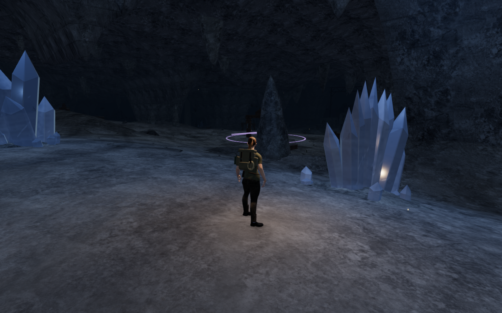
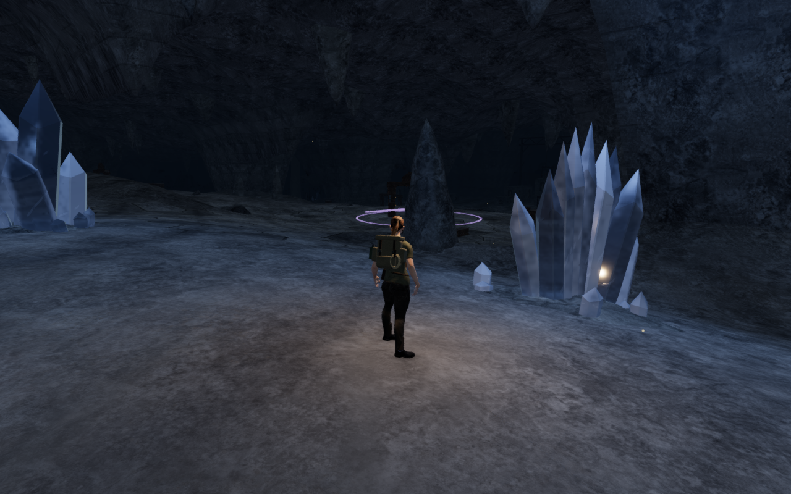

# Clear and clouded quartz

A fresh survey at `0307f85` captured 32 High views across all eight chapters:
the entrance and first, middle and last main-court fronts in each world. All
requested stances were captured and reviewed, with matching source hashes,
linked shaders and finite sampled HDR buffers. The views retain distinct
chapter atmospheres. Repeated gate/equipment arrangements, sparse margins and
broad terrain faces remain visible. These static views do not inspect all 77
courts, their interiors or complete walking routes.

The cavern views also showed large quartz faces reading as opaque colored
props. An actual-scene opacity control confirmed that transmission was working.
The shared mineral surface now contrasts clearer regions with broader cloudy
inclusions. Less saturated body color, lower base roughness and a stronger
reflection response retain the faceted outline while revealing more of the
background. Cloudier regions absorb more light; the multiplier stays positive
even at overlapping inclusion/base/cleavage extremes.

Fine transverse growth marks affect the surface normal in close views and
fade with pixel derivatives. The marks are weakened in clear regions to avoid
turning broad faces into bright, repeating stripes. Natural mineral emission
is quieter; the saved restoration uniform and the tuning controls' existing
glow, tones and progression remain in use.

These complete 1280 × 800 High captures use the same player and camera
positions and fixed scene time. They are direct, unretouched game captures.
No new image, model, recording, score or dependency is added to the playable
assets; the change is original material code.

## Verification

All 78 selected tests across fifteen files, the production build and three CPU
budget checks pass. Coverage includes mineral geometry/batching/target disposal,
caverns, resonance, the echo gallery and causeway, crystal enclosures/shutters/
vaults, rendering settings, audio, water sound and chapter startup. The existing
build chunk-size advisory remains.

A factory comparison with `0307f85` retains all 361 cavern meshes, their world
transforms and 6,443,216 geometry attribute values. All formation plans and
42 cavern sound-source records match. One hundred quartz parameter combinations
also retain their position, normal, UV and optical attributes. The geometry,
physical/camera surfaces, terrain and placement code are unchanged.

The final-source development inspection records 22 views: entrance and three
court fronts at High, then one example of each of the six formation profiles
at High, Balanced and Performance. All are reviewed; the formation stances
are dry, legal and frame the complete bounds. Shaders link, sampled HDR values
remain finite, and no GL error is reported.

All 54 sampled feature approaches, 41 tuning controls, 66 tuning-tone fronts
and 33 natural hum fronts remain clear. Forty-one assisted tuning-area routes
and 33 mineral approach/return pairs pass through the current controller.
These use prepared progress and do not establish an unassisted playthrough.

Live Web Audio reports gain 0.32 at 2.777 m and 0.247013 at 10.071 m for the
inspected active hum, matching the existing distance formula. Its voice retires
at 36.278 m, beyond the 34 m range. Active voice counts remain within the
twelve-loop limit. This is behavioral evidence, not subjective listening
acceptance. Switching chapters disposes all 149 tracked quartz geometries,
50 materials and two observed transmission targets, with no old mineral
obstacles or patches retained.

The production bundle passes a keyboard case at 1280 × 800 High and a
simulated touch case at 540 × 900 Performance, starting from prepared progress
at the descending-echo tablet. Each case exercises thirteen tuning actions,
reset and recovered-memory submission, reaches stage 2 at full health, and
walks 5.7 m back into the world. Four complete-store reload comparisons retain
every field except the changing `lastPlayed` timestamp. All eight release
captures are reviewed. The build assets match the checked bundle, the
development hook is absent, neither viewport overflows, and no application
error or warning is reported. These cases do not establish physical mobile
device performance. The owned browsers, workers and preview servers close
under the shared five-of-sixteen CPU limit.

## Remaining work

The eight-world visual audit remains open. Large installation layouts still
repeat, broad floors and connecting spaces need stronger composition, and
continuous route/prop/body contact needs wider coverage. The surface uses
screen-space transmission; it does not simulate all internal refractions or
caustics. Consumer-device performance and subjective listening acceptance
remain unverified. This material revision does not establish AAA graphics.
