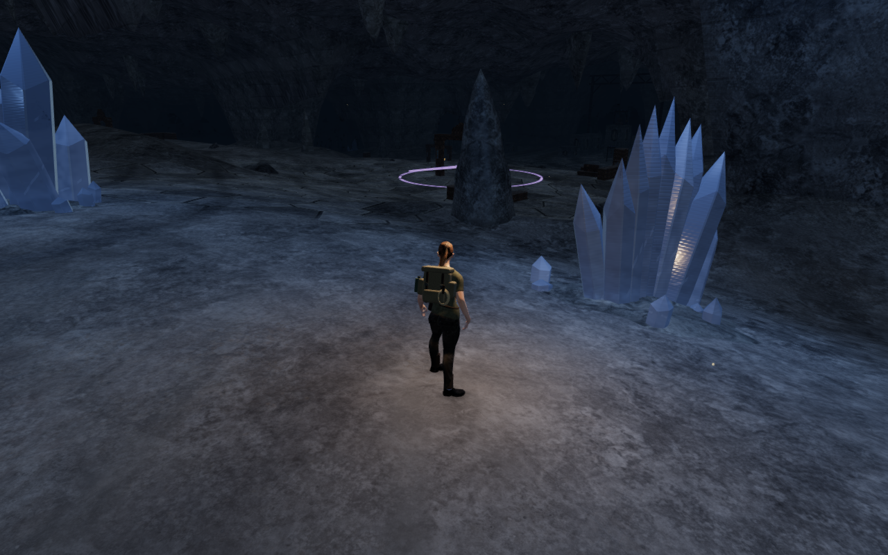
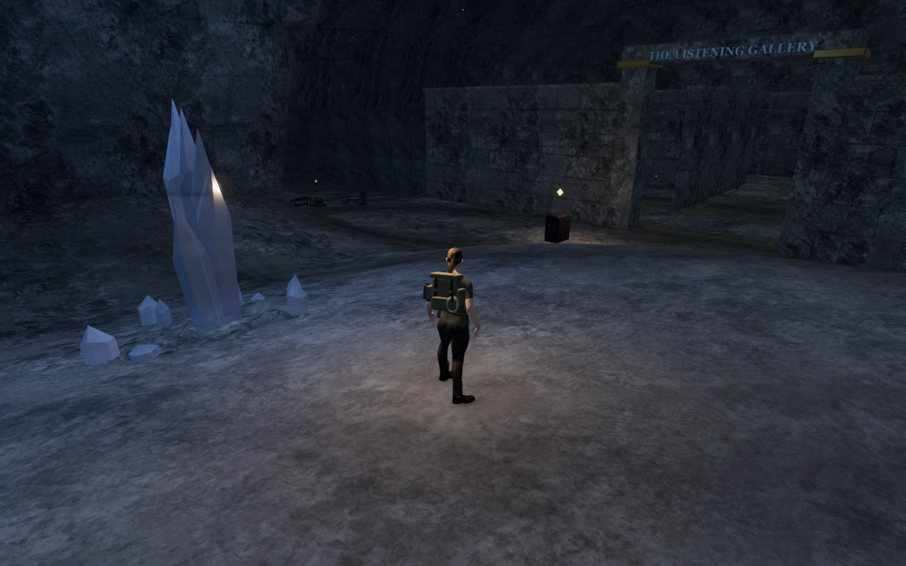

# Quartz facet shading

The cavern entrance crystals showed repeated horizontal ridges across otherwise
planar faces. The mineral surface shader now keeps sparse cleavage detail and
cloudy inclusions while removing the periodic etched wave and its matching color
modulation. Natural clusters, resonance instruments, gallery stones and causeway
relays share this material.

The comparison below uses the published `ab465c2` source and the revised source
at matching High entrance poses. Player position, camera, heading, pitch and
elapsed time match exactly. These are normal follow-camera views. The four
documentation images are lossless copies of the captured pixels.

| View | Published surface | Revised surface |
| --- | --- | --- |
| Entrance, first heading |  |  |
| Entrance, gallery heading |  |  |

## Cause and scope

Eight controlled browser images compare two headings with the original shader,
the periodic wave disabled, all etching disabled and transmission disabled.
Disabling the wave removes the repeated ridges while retaining transmission.
Disabling transmission retains the ridges. This isolates the observed defect to
the periodic surface treatment.

The shader change removes that wave from the normal perturbation and body color,
and advances its program cache key. Physical material settings, transmission,
attenuation, tint, restoration uniforms and vertex shaders match the preceding
version in twelve tint/restoration combinations. All geometry attribute bytes
match in 48 radius, height and phase combinations. There are no new runtime assets,
dependencies or attribution changes.

## Verification

- All 25 selected mineral, cavern, gallery and audio tests pass, as do the three
  CPU-budget checks and the production build. The build retains its existing
  large-chunk advisory.
- An isolated GPU comparison evaluates the actual old and new surface expressions
  over 393,216 half-float samples. Cloud, fracture and darker-base channels remain
  byte-identical. The old relief spans about −650 to 699 micrometers; the revised
  sparse relief spans 0 to 49.805 micrometers, with RMS values of 2.375 to 3.421
  micrometers across three phases. All samples are finite.
- The initial 34 development images cover two native entrance headings,
  representative natural formations in nine chambers, one instrument in each of
  eight arrays, five gallery stones, causeway viewpoints, two restored states,
  four Performance views and chapter replacement. All are reviewed. Two High
  relay views and the Performance relay view are occluded by causeway stonework;
  those images do not establish crystal-surface coverage.
- Four subsequent captures use nearer supported deck viewpoints with a longer
  visibility check: all three High relays and the first relay in Performance.
  All four show the crystals and are reviewed at full resolution. Their 419
  runtime hashes match the initial run, with no browser errors or warnings.
  The first private capture-helper attempt lacked its capture function; it
  closed cleanly, the helper was corrected, and the completed run above supplies
  this evidence. No game code changed for these inspection corrections.
- Replacing the chapter disposes all 149 tracked geometries, 50 materials and two
  transmission targets exactly once, and clears their old transmission samplers.
  The 419 runtime source hashes remain stable throughout the check.
- Two prepared production cases exercise keyboard input at 1280×800/High and
  touch input at 540×900/Performance. Native Use records gallery memories, crouch
  updates the control state, and jump/movement retain health 100. Travel is
  5.6352 m and 6.6 m respectively. Both complete stores survive reload, excluding
  only `lastPlayed` from comparison; memory counts remain one and three. The
  third-memory case still requires the return-tablet interaction. All ten
  screenshots are reviewed, the expected release assets load, the development
  hook is absent, and there are no failed requests, horizontal overflow, browser
  errors or application warnings. These are prepared local cases rather than a
  complete gallery or campaign playthrough.

All verification uses the shared five-of-sixteen CPU allowance, at most two test
workers and one browser. Temporary artifacts remain under ignored `local/`;
owning wrappers close browsers and preview servers when their checks end.

These are local material and playability checks. Representative inspection
cameras are independently positioned at supported legal locations, with the
explorer hidden, except for the stated native follow views. This pass does not
establish continuous campaign contact, complete scenery acceptance, consumer
hardware frame rates, subjective listening quality or commercial AAA parity.
Broader room composition, repeated architecture and sparse surrounding spaces
remain open in the [production status](production-status.md).
