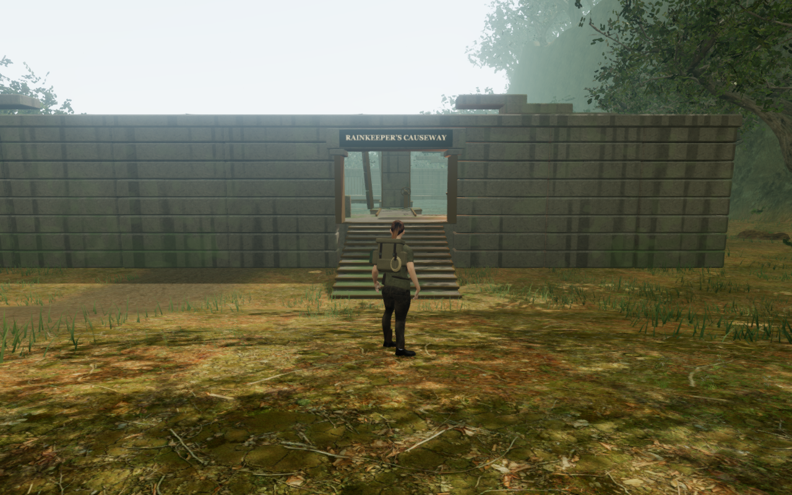
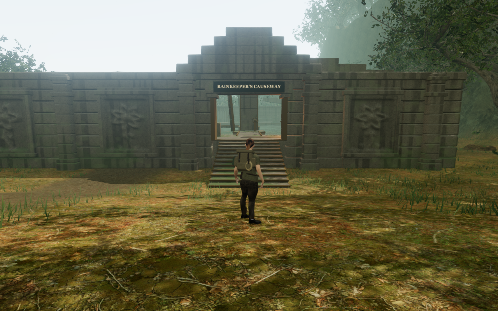
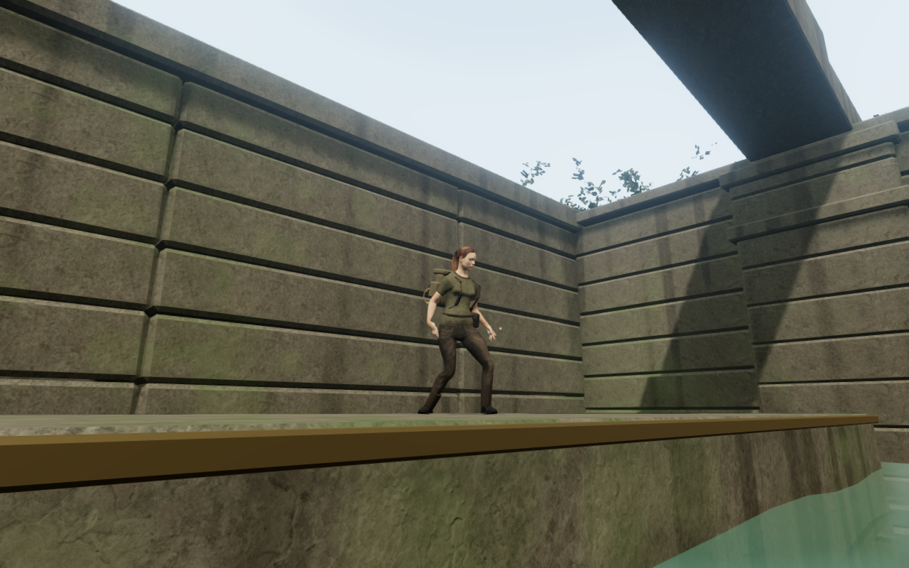
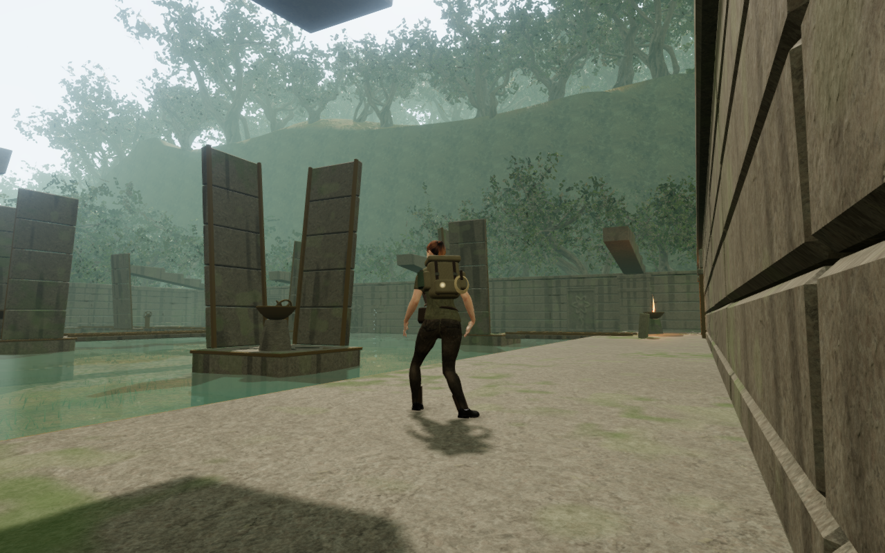

# Rainkeeper masonry and platform camera

The optional jungle causeway now has eight continuous stone corbels with unequal
surviving lengths, fourteen coursed piers, twelve exterior botanical reliefs and
a stepped entrance crown. The framed carvings give the long entrance wall a
recognizable facade. The corbels enter the chipped wall caps, and each pier's
plinth extends below the lowest terrain beneath its footprint.

Before this revision, the sampled roof bearings had small separations: 48 of 72
vertical probes found daylight between the wall cap and roof, up to 13.8 mm.
The other 24 were connected. This measurement concerned those sampled bearings;
it did not establish that every roof assembly was detached.

The comparison uses actual High-preset 1280 × 800 browser renders. The preceding
image is from `8a1b707`; both retain the same prepared player position, follow
camera heading and simulation time. The new geometry uses the existing temple
material, with physical triangle surfaces captured before material batching.
Decks and wheels retain their existing seeded stone shapes.

Looking steeply upward also exposed a separate camera defect: raised landings
were absent from the camera collision set, allowing the view into their stone.
Static banks, steps, wheel platforms and the archive landing now register their
visible stone bodies with camera collision. The steep upward follow-camera
fixture now stays clear of the landing.

## Verification

Eleven focused tests pass. They cover the existing wheel detents, cancellation,
lamp requirements, dry crossing, grille and save rules, plus the new masonry:
72 connected roof-bearing probes and 126 pier-footprint probes against the
batched render geometry in the actual jungle terrain. They also check closed
relief orientation, stone blocking, clear routes and camera rays through the
newly registered platforms.

Eighteen prepared follow-camera views across High and Performance render with
linked shader programs and no recorded rendering errors. The High views also
pass sampled HDR finiteness checks. A continuous assisted browser route starts
at the original chapter spawn, climbs the entry
stairs, swims to and mantles all six wheel platforms, configures the crossing,
carries fire to all three lamps, recovers the archive and returns to the jungle.
Native Space, E and T provide the discrete actions; movement directions and the
solution are supplied by the check. The dry route retains its flame and ends
at 100 health.

An isolated live audio fixture verifies the four fire-source positions, moving
wheel voice, pause silence and transition between lifting and brazier music
tasks. Changing to the desert disposes all 154 inspected tomb geometries and
12 materials and removes its emitters. Browser workers, previews and image
exports run sequentially within the shared five-of-sixteen CPU allowance;
owned browser and preview processes close after verification.

The production build passes with the existing large-chunk advisory. Native
release E/T input and isolated local-storage fixtures retain a completed turn,
partial lamp progress, a relit torch, the final lamp, archive recovery and its
journal entry through reload. Health stays at 93 in those fixtures; they do not
replace the continuous development-world route. The development hook is absent.
The checked release uses `index-C90EvSPf.js`, `game-SjiW86e_.js`,
`three-CHJWTcA_.js` and `index-B8Rg8Jto.css`. Completed browser checks report no
JavaScript errors, unexpected console warnings or failed asset responses.
The four documentation images are lossless WebP exports with identical decoded
pixels and dimensions to their browser captures.

This is a local art and camera improvement. Repeated court buildings, wider
world composition, continuous character contact and subjective listening remain
part of the ongoing campaign review. These checks do not establish AAA quality,
chapter duration or a consumer-hardware frame rate.
