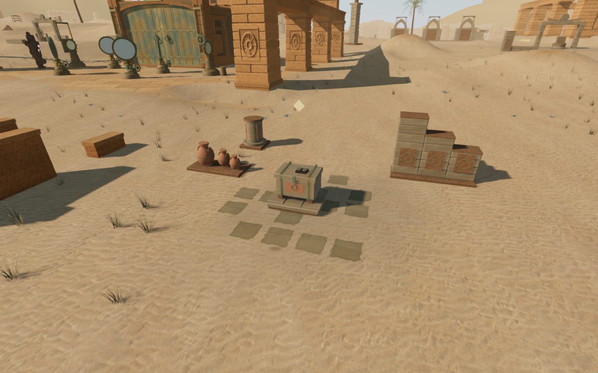
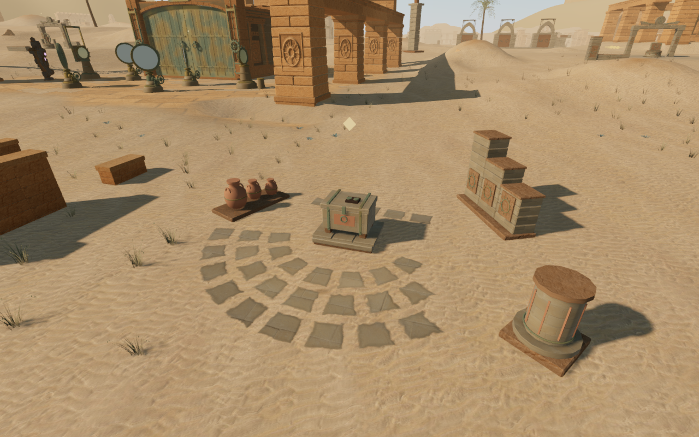
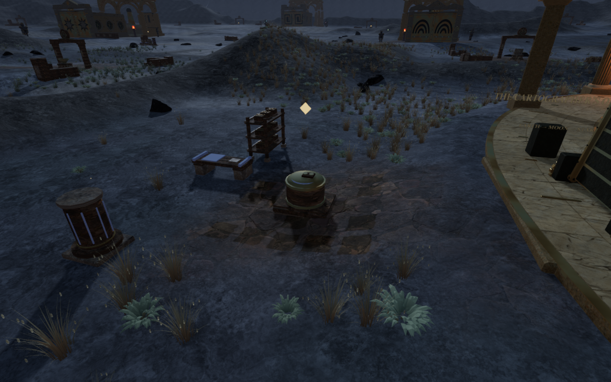
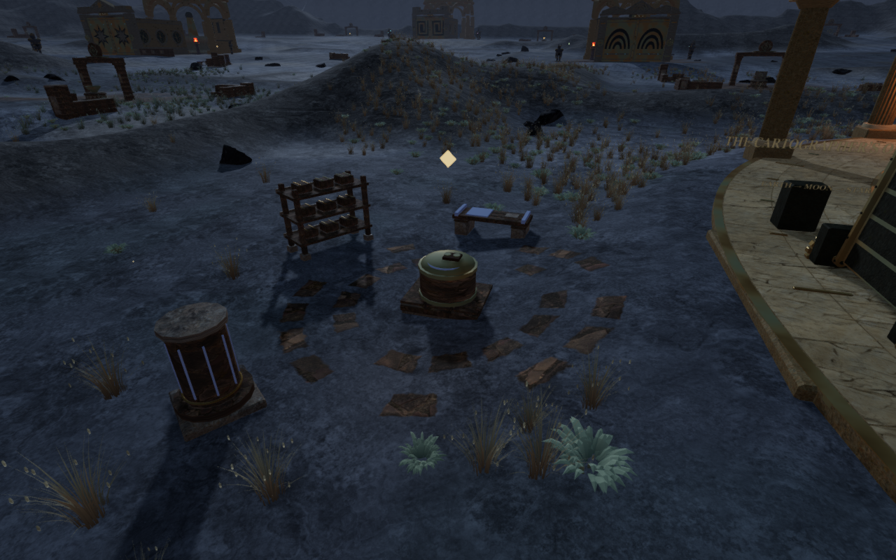

# Regional discovery courts

Notes and caches previously shared a small square paving patch, with parallel
furnishings in the same three positions. Each region now has its own floor
composition and working edges. Furnishings turn toward the discovery, and four
seeded variants alter their spacing, surviving fragments and orientation.

| Chapter | Discovery surroundings |
| --- | --- |
| The Verdant Veil | Broken cross-courses and drainage edges, with an inward-facing archive wall and basin |
| Beneath the Sands | A radiating survey fan with storage and sighting fragments on opposing edges |
| A Silence of Snow | An offset slate walk with a separate resting bay beside the bench |
| The Drowned Kingdom | A broken mosaic meander and a quay edge for the record store |
| A Heart of Embers | Split working lanes, rear cross-courses and a side apron |
| Where Eagles Sleep | A chevron landing and unequal wings beside the courier stores |
| The Night Below | Faceted radial fragments around the reading stand |
| The Last Meridian | Interrupted concentric bands with staggered openings |

Plans retain the existing collection positions and use the same admission
checks for routes, mechanisms, water, slopes, traversal paths and occupied
geometry. Alternative rotations fit the grouping to the available ground.
Shared discoveries keep one backdrop and one fragment, with individual working
fixtures. Some pieces are omitted where space or terrain prevents a fit.

The floor pieces are convex quadrilaterals clipped against actual terrain-grid
triangles. Their vertices and interiors follow the rendered diagonal instead
of bridging uneven ground. Angled courses and radial stones share one paving
material per chapter, with vertex-color accents, edge wear, opaque surviving
stone and shallow relief normals. Relief shading does not change support height.
Pale stone tints preserve the existing cast shadows; darker test accents made
some shaded fragments appear to be holes and were removed before verification.
The jungle fragments reuse the existing stone maps; the other regional floor
maps and their credited assets remain in use.

Adjacent discovery fragments reserve their footprints, as do existing station
courses. Plant extents stay outside the surviving pieces, and later furnishings
using the discovery reservation also respect the new floor. The original shared
square terrain blend is omitted from rendered court coordinates at discoveries;
the physical court field remains available to geology and placement.

The eight-factory comparison retains identical height and physical-court
arrays, water and bridge data, mesh indices and every non-court geometry
attribute, including normals and UVs. Only 7,105 stored court-shading values
change. Main court cores retain their coverage.

All 30 selected tests across six files pass, together with the build and three
CPU-budget checks. Coverage includes varied regional plans, exact clipped area,
independent raycasts against uneven terrain, angled plant clearance, protected
collection approaches, retained discovery elevations and existing courtyard
contracts. The build retains its existing bundle-size advisory.

The new delivered-floor observer reads actual batched vertices and triangle
identities, checks ground contacts and reconstructs footprints for independent
overlap queries. Lifted-floor and moved-tile controls must be detected, followed
by exact restoration of the original buffers.

Across the eight delivered worlds, 2,570 floor pieces contain 17,744 triangles
in eight merged floor meshes. All 124,208 ground probes remain between 2.5 and
3.5 mm above the actual terrain triangles, and no pair of new fragments
overlaps. Every lifted control fails its ground probes; every moved-tile
control produces an overlap. Existing rack seating also passes its independent
checks at the new furnishing orientations, including all 19,449 bearing probes
and their lifted controls.

All 144 collection stances remain legal, camera-clear and reachable, with the
intended discovery selected. Twenty-four stopped body poses, including the
eight native-input seeds, inspect 48,095 delivered explorer vertices each
against both closed furnishing/setting geometry and the actual terrain, with
no embedding beyond the 15 mm threshold. These sampled poses do not establish
continuous moving contact or explicit contact with the cosmetic floor inlays.
Sixteen final High inspection views are reviewed against sixteen matched
published-source views. All 440 final runtime files match the tested source.

The bundled production app passes eight native-input cases: four High keyboard
views at 1280 × 800 and four Performance portrait-touch views at 540 × 900.
Each moves from its prepared approach, collects the intended note or cache at
full health and restores its complete stored progress after reload. Eight
separate prepared saves start inside a moved wall; loading recovers a nearby
clear position, retains the checkpoint and remains stable through another
save/reload. All sixteen complete-store comparisons pass, ignoring only
`lastPlayed` timestamps. All 28 production approach, journal, reload and
occupied-save figures are reviewed. The development hook is absent, bundle
names match the verified build, and no overflow or unexpected browser error or
warning is recorded. These muted checks do not evaluate the soundscape or music mix.

The paired figures use matched 1280 × 800 High inspection cameras, with the
explorer hidden and the game paused at the same elapsed time. These are actual
rendered game frames. The lossless WebP exports retain identical decoded RGB
pixels and dimensions. They illustrate the floor and furnishing changes; their
elevated framing is separate from the ordinary production follow camera.

| Survey fan, before | Survey fan, after |
| --- | --- |
|  |  |

| Meridian rings, before | Meridian rings, after |
| --- | --- |
|  |  |

All verification uses the shared locked five-of-sixteen CPU set at lower
priority, with at most two test workers and one browser. Project staging and
browser temporary files stay inside the ignored local directory. Each browser
and preview server closes at the end of its check.

These changes address repeated discovery arrangements. The shared object
families, broader court massing, sparse surrounding spaces and coarse cliff
forms still need work. Wider traversal/water coverage, continuous moving-body
contact, surface-specific footsteps, listening review and consumer-device
evaluation remain open. The full game goal remains active.
