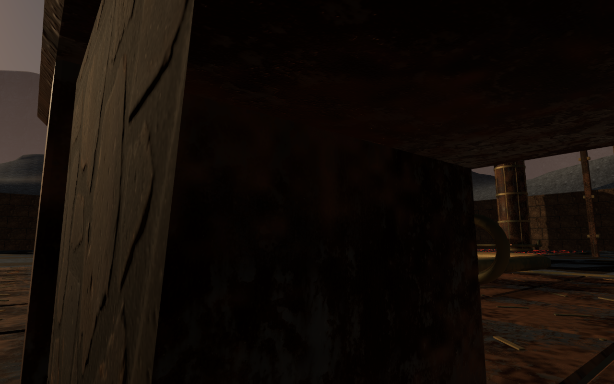
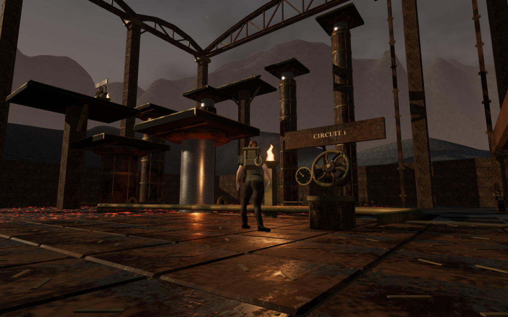
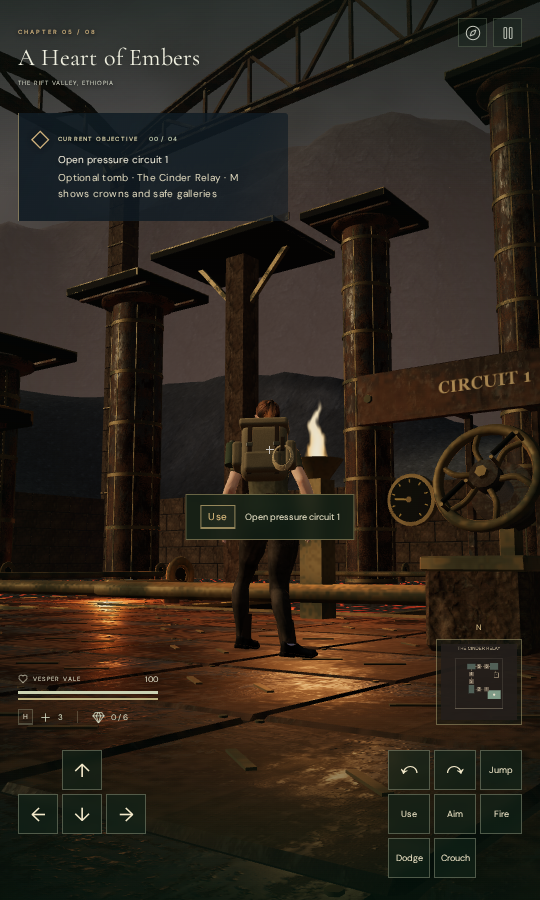

# Cinder Relay furnishing clearance

The relay camera now moves around its two supply chests and crew tablet.
Previously, a low intake view put the lens inside the first chest even though
the character stood at a legal position and the camera's visibility check
reported a clear view. The furnishings had body blockers but lacked captured
camera bounds.

Before, at the intake:

After, at the same player position and requested look angles:

The recorded player position is `(14, 0.18, 10)` relative to the relay origin,
with yaw `0.9` and pitch `-0.18`. Rays from the old lens toward all 17 inspected
body-joint centers struck the rendered chest. Its surface was roughly five
centimetres from the lens. The revised view clears those rendered sight lines
while keeping the player's requested look angles.

## Body clearance and older saves

Close inspection also found body intersections at the old chest boundaries.
Across 32 completed standing and crouched poses at the two chests, 52,077 of
1,539,040 inspected vertex records penetrated the closed rendered components by
more than 15 mm. The deepest measured contact was 268.039 mm. All those roots
were legal under the preceding movement bounds.

The four furnishing bounds—the two chests, tablet and dispatch cargo—now reserve
a 0.65-metre body margin instead of the default 0.2 metres. Their vertical bounds
remain finite. Camera bounds stay fitted to the objects rather than expanding
with that body margin. Other relay structures retain their existing margins.

An older save can occupy a newly reserved boundary. Relay arrival recovery now
runs before general traversal recovery, returning such a save to the clear
center of its recorded gallery. This also prevents general recovery from
stepping off the 18 cm intake deck onto the surrounding floor. Valid clear
positions and earned relay progress remain eligible for their normal arrival.

## Verification

All 34 selected relay and camera-follow tests pass. They include the continuous
six-piston ascent, ledger retrieval and return lift, camera rejection of the old
occupied lens, finite space around the small furnishings, and older saves beside
both the intake chest and elevated cargo. The new arrival cases retain their
supported gallery heights and full health.

The final survey covers 64 standing and crouched poses around all four
furnishings, with four approach directions and two body headings per stance.
All 3,078,080 inspected body vertex records are finite and have no measured
penetration into the inspected closed components. Each observer is calibrated
against an interior point. The cargo observers remain on the elevated gallery;
they do not substitute ground-floor positions for raised contacts.

All eleven revised development images are reviewed: the original three views
and standing/crouched views at each furnishing. The original obstruction has
zero rendered-geometry hits along the 17 inspected body sight lines. All 20
positional-source records match the baseline, and the original solid dimensions
and positions remain unchanged. The added margins affect body clearance.

Native production checks pass with keyboard at 1280 × 800 High and touch at
540 × 900 Performance. The keyboard case retains the original clear intake
position; the touch case starts from an older save inside the newly reserved
chest boundary and recovers at the intake gallery's center. Both retain their
saved look on arrival, open circuit one using E/Use, exercise backward movement,
crouch and Jump, and finish at full health on the 18 cm gallery. Measured walking
distances are 0.968 and 1.800 metres.

Each complete localStorage save restores exactly twice, excluding last-played
timestamps. All ten native images are reviewed, with no horizontal UI overflow
or application errors/warnings. The development hook is absent in production,
served bundle names match the build, and six explorer-model responses match
the repository asset hash. The build and source formatting checks pass; Vite
retains its existing large-chunk advisory. These assisted checks use software
Mesa through ANGLE/Vulkan.

The geometry, materials, source recordings and musical arrangement are retained.
The change adds three small captured camera bounds, then disposes their temporary
construction geometry. It adds no rendered meshes, texture, light or external
asset. The [asset credits](asset-credits.md) continue to apply.

Verification uses the shared locked five-CPU allowance, no more than two test
workers and one browser. Owned browsers and preview servers are closed after
their checks; interrupted diagnostic profiles are removed from ignored staging.

This is a local repair within the open [visual audit](visual-audit.md). It does
not establish complete moving or airborne body coverage, human playthroughs,
subjective sound quality or consumer-hardware performance. The wider volcanic
ground composition and repeated lower chamber arrangements remain open.

The subsequent [furnishing landing pass](relay-furniture-landings.md) replaces
the four coarse body boxes with contacts derived from their rendered pieces.
It retains the fitted camera bounds and the 0.65-metre posed-body clearance,
and adds landing, walk-off and saved-top coverage.
