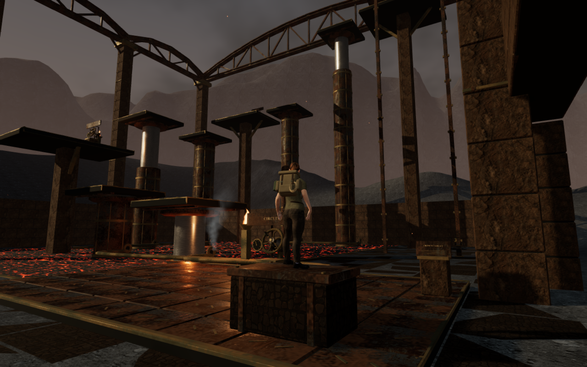
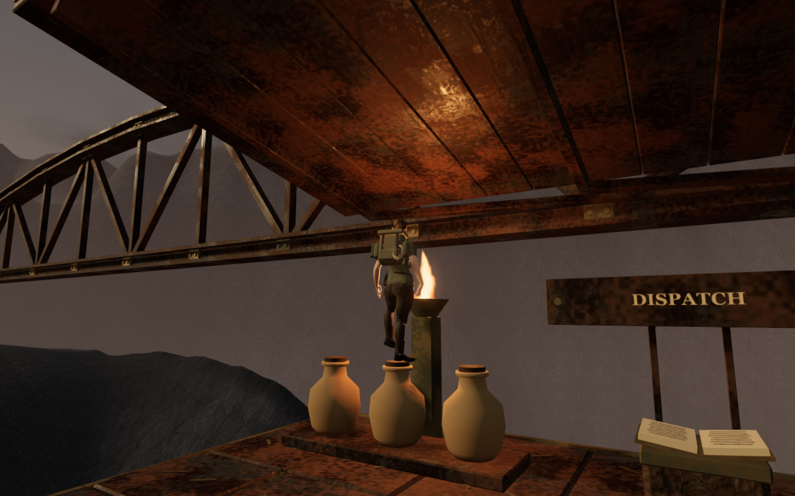

# Cinder Relay furnishing landings

Jumping onto either relay chest, the crew tablet or the elevated dispatch cargo
now lands on its rendered surface. Previously, each furnishing blocked movement
from the side but supplied no landing contact. A jump could clear its finite
upper bound and then fall through it, leaving the player grounded inside a
blocked position.

Four recorded controller approaches reproduced that failure. The player spent
81, 81, 87 and 84 of the 120 inspected frames in illegal positions at the intake
chest, floor chest, tablet and cargo respectively. Each finished inside its prop
at the underlying floor height.

The repair preserves the actual closed pieces before material batching. Their
transforms are baked for the triangle contact kernel, including the tilted
tablet. Transparent lettering supplies no collision. Point support follows the
visible lid, cap, tray or tablet face; the space between the jars retains its low
tray surface. The cargo does not create an invisible column below its gallery.

Movement keeps the 0.65-metre clearance for the posed body and uses the normal
0.55-metre movement disk for landings. The existing edge resolver clears the
wider body margin when that disk leaves a bevel. This also fixes a walk-off
catch found during the first version of the landing repair. Camera bounds stay
fitted to the furnishings. A grounded save on one of these surfaces now retains
its position and height instead of falling back to a refuge anchor.

The higher cargo landing exposed a second defect: jumping from a jar cap could
carry the explorer through the dispatch canopy. Fifteen sampled animation
frames contained 31,512 body vertex records penetrating the closed overhead
geometry by more than 15 mm, with a deepest measured penetration of 54.633 mm.
The canopy panels, seams and supporting beams now retain their own finite
triangle contact. A head contact stops upward motion without shifting a
stationary jump sideways along the sloping roof. Space below and beside it
remains clear.

## Verification

All 51 selected relay, camera-follow and station-contact tests pass. New cases
exercise ordinary jumps onto all four props, legal contact at every inspected
controller frame, walking off without another jump, and restoration at the landed
height. Point queries agree with rays against the rendered geometry. Existing cases retain
the six-piston ascent, three circuits, ledger, return lift, finite camera
clearance and older-save recovery.
The canopy case verifies a jump from the cargo cap, head clearance throughout,
return to the same cap without horizontal displacement, and finite space around
the roof.

The development browser repeats all four approach jumps and walk-offs in the
real volcanic level. All finish supported at full health, with no illegal root
positions in the recorded frames. Sixteen standing/crouched landing poses,
covering two headings on each prop, contain 769,520 inspected body vertex
records with no measured penetration into their closed rendered components.
All eight landing images are reviewed, and the browser reports no application
errors or warnings.

The side-contact regression covers another 64 standing/crouched poses, with
four approach directions and two body headings around each furnishing. All
3,078,080 inspected body vertex records are finite and clear of the inspected
closed components. Every observer detects its interior calibration point; the
cargo checks remain on the raised gallery. This retains the preceding
[side-clearance repair](relay-furniture-clearance.md).

The revised animated canopy jump has zero embedded or nonfinite records across
15 sampled frames and 721,425 body vertex records. Every sampled root is legal.
The world-space peak falls from 49.599 to 48.825 metres, with the horizontal
position retained. The character then lands back on the same jar cap.

The production build and source formatting checks pass. Vite retains its existing
large-chunk advisory. Three CPU-budget tests verify child/thread affinity,
nested launches and exit-status propagation. All checks use the shared locked
five-CPU allowance, at most two test workers and one browser at a time.

Native production checks pass with keyboard at 1280 × 800 High and touch at
540 × 900 Performance. They restore a save on the intake chest or raised cargo,
exercise Jump and crouch, walk off, and retain full health and relay progress.
Each complete localStorage save restores twice, excluding last-played timestamps.
After the canopy repair, the affected touch case is repeated against the fresh
production build, including both reloads and returning to the same cap after Jump.
The keyboard walk-off measures 1.500 metres; the final touch walk-off measures
1.935 metres and finishes on the 24.2-metre dispatch gallery.

All twelve native images, including the four repeated touch captures, are
reviewed. There is no horizontal UI overflow or application error/warning.
The production development hook is absent, the final served bundle names match
the build, and nine explorer-model responses across these checks match the
repository asset hash. Owned browsers and preview servers are closed after each
check; the staging runtime directory is empty and both preview ports are closed.

The artwork, materials, lights and sound arrangement are retained. The change
adds CPU contact records and disposes their temporary construction geometry;
it adds no render meshes or external assets. See the [credits](asset-credits.md).

These assisted checks are local evidence, not exhaustive airborne animation
coverage, a human playthrough, a listening assessment or a consumer-hardware
performance measurement. Wider volcanic ground composition and repeated lower
chamber arrangements remain open in the [visual audit](visual-audit.md).
