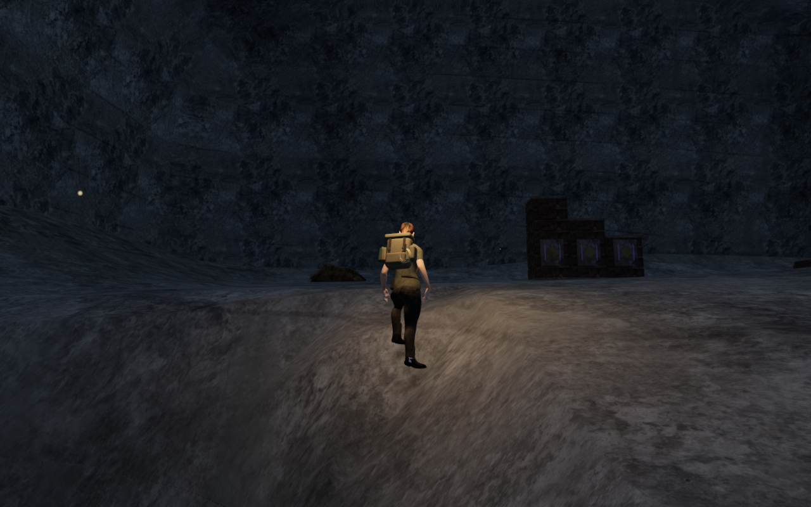
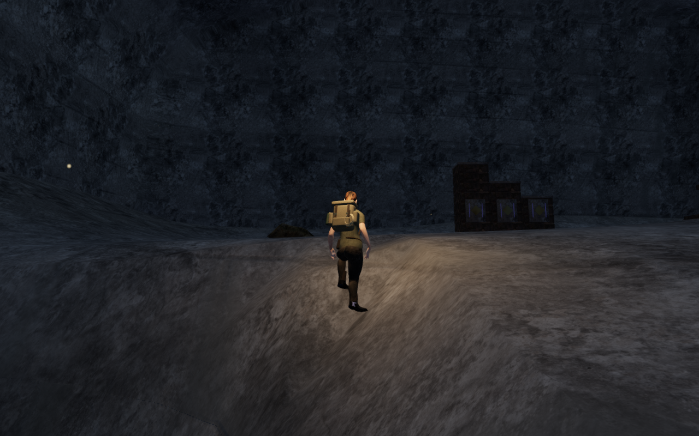
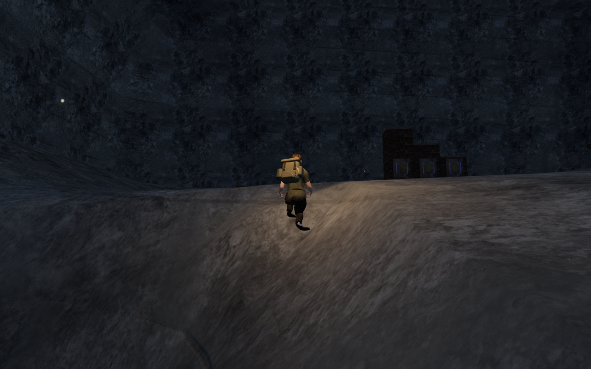
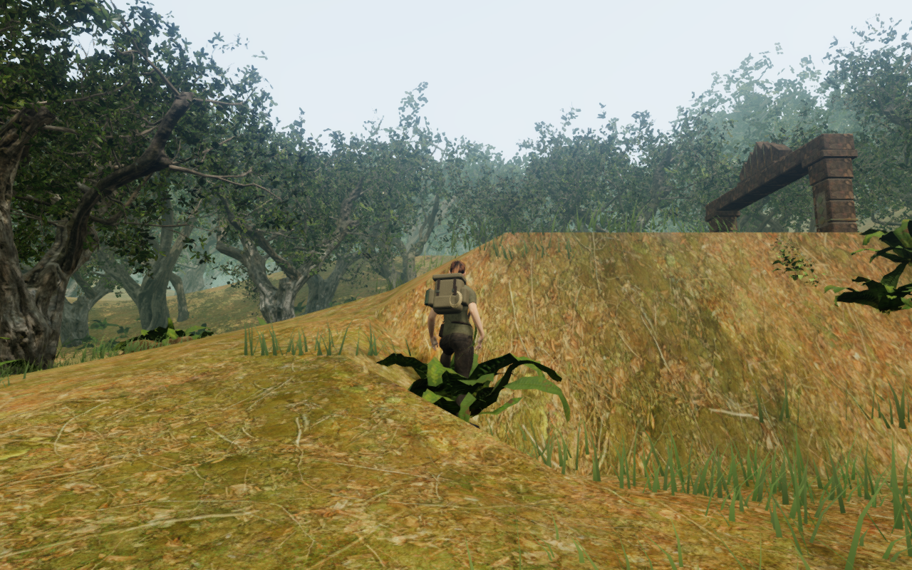
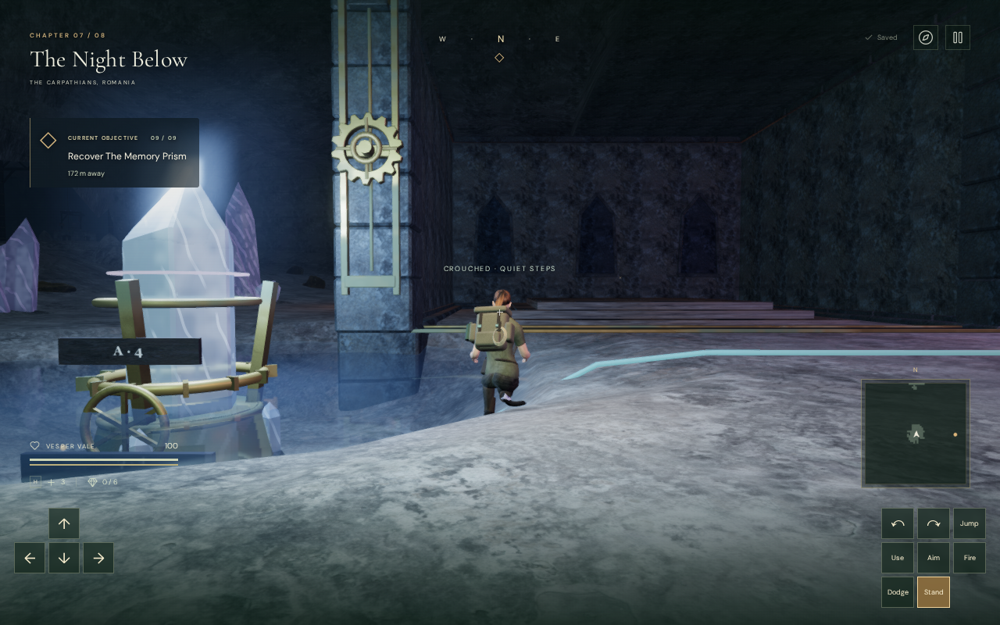
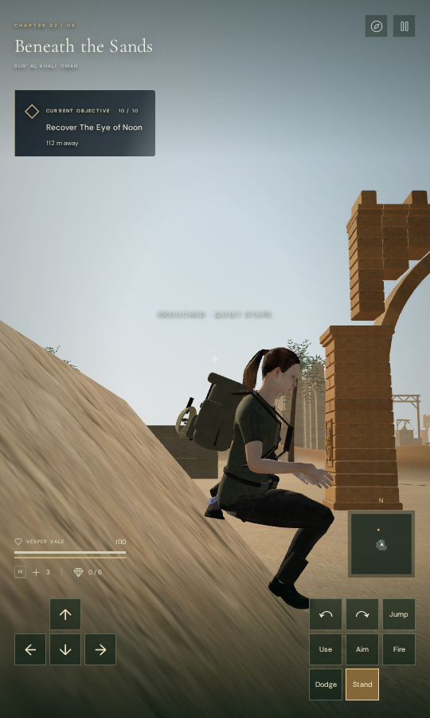

# Standing on the rendered terrain

Standing height and terrain camera clearance now follow the actual float32
triangle planes in every chapter. Previously, seven chapters used a bilinear
height between grid samples, which could put the explorer above or below the
visible floor. The desert already used the triangle sampler. A recorded dry
cavern stance floated 22.2 cm above its floor; another buried the boots.

The explorer also fits crouched knees and checks the final posed soles after
leg IK. Movement now checks terrain around the body, preventing a steep bank
from entering the legs while the centre point remains legal. Older saved
positions on those banks recover to nearby supported ground.

## Floor planes and retained landscape

The generation and material-masking height field remains available. A separate
cached sampler follows the two drawn planes in each terrain grid cell. This
extends the existing desert sampler to the other seven chapters and retains
the existing cooled-lava support behavior.

An independent observer reads the delivered world-space terrain buffers rather
than using the profile as its expected answer. Across all eight chapters,
1,282,173 present-floor queries agree within 3 micrometres. The water chapter's
57 sampled openings are its intentional underground-gallery cuts; those spaces
have their own floor and movement rules. The terrain component of camera
clearance also agrees with the delivered floor.

All 648 terrain chunks retain identical indices, positions, normals, UVs and
other vertex attributes compared with the preceding milestone. The terrain
height buffers also match. This pass changes support queries and poses;
scenery that already asks for standing height now uses the actual floor.

| Preceding support at the recorded dry cavern stance                                                    | Triangle support at the same stance                                                           |
| ------------------------------------------------------------------------------------------------------ | --------------------------------------------------------------------------------------------- |
|  |  |

These development comparisons reconstruct the preceding support profile at the
same recorded position and requested look. The terrain buffers match; other
scene users of standing height and safe camera recovery can respond to the
changed support. They are not a pixel-matched comparison of the entire scene.

## Planted legs and steep banks

An uphill ankle can sit too high for a deeply lowered crouched pelvis. Small
cached samples from the delivered skinned thighs, knees and clothing select
the minimum visual pelvis raise that clears the floor. The pelvis stays below
the ordinary standing origin, and ankle targets stay planted. References belong
to the current character model and are rebuilt when that model changes.

A transition check then found that re-solving the bent legs could shift a toe
slightly below its planned clearance. Three bounded correction passes check
the actual posed sole, adjust an ankle when necessary and refit the knees.
This does not change the player's position, velocity, look or save data.

The broader review found 32 intersecting poses at thirteen steep-bank positions
across five chapters. Their centre points were on the correct floor, but
movement did not check the surrounding terrain. The new check uses the existing
0.55 m body disk and map-corner margin, with a 0.6 m uphill leg allowance.
Zero-clearance queries and underground-gallery movement retain their existing
rules. Horizontal movement checks its predicted settled foothold as well, so a
small descent cannot put the body into a bank after the initial query passes.
The same settled elevation supplies the movement query: retaining the previous
height there could falsely block a shallow uphill step close to the margin.
A recorded desert case reproduces that disagreement and now moves freely.

The bare carved grid includes submerged banks, cliff approaches and space
beneath traversal decks. It does not certify every cell as a standing target.
The terrain margin retains all 77 authored court centres. Raised platforms,
water and other scene collision still supply their existing movement rules.

| Crouched on the recorded cavern slope                                                                       | Recovered beside a steep jungle bank                                                              |
| ----------------------------------------------------------------------------------------------------------- | ------------------------------------------------------------------------------------------------- |
|  |  |

## Independent body review

The broad browser check, before the final shallow-step correction, selects six
legal dry bare-floor stances per chapter,
refreshing scene visibility before querying them. Each has two headings and
standing/crouching states, giving 192 settled snapshots. Eight complete stance
changes add 960 intermediate frames. Five recorded bank approaches add 95
snapshots after nearby arrival recovery.

All 59,974,465 checked posed vertices are above the delivered floor, with a
minimum measured gap of 2.98 mm and no missing or invalid terrain queries.
Bare-floor roots also match the triangles within the 0.01 mm comparison tolerance.
The observer reads every vertex of the visible character meshes, including
clothing and equipment. Its existing penetration-report tolerance is 15 mm;
the final measurements are positive rather than merely within that tolerance.

The water approach skirts its bank and continues. The sky approach walks off a
ledge and uses its existing safety-tether return to a bridge anchor, which costs
stamina rather than health. These traces do not establish that every approach
stops in place. Combat and world timers are not stepped, and progress is
prepared. All 36 captures from that review have linked shaders and finite HDR output.

## Verification and limits

The delivered-character regression reproduces the original knee penetration
with its knee probes disabled, then checks two headings at six recorded cavern
stances and every frame of both stance transitions. Separate five-chapter
checks cover bank rejection, nearby older-arrival recovery and sustained
movement against the banks. The floor test independently reads the actual
triangles across all eight chapters.

All 315 final selected cases across 36 files pass with one test worker. They
cover floor and body contact, movement, cameras, visibility, raised scenery,
water/diving, mechanics, traversal and persistence. The release build passes and retains its existing
large-chunk advisory. The initial complete-suite attempt was stopped to release
unneeded art fixtures that supply their own bilinear height field; it is not
reported as a passing full suite.

The final release has no development game hook. Eight native input cases use
prepared progress and recorded legal dry positions: four keyboard/High cases
at 1280 × 800 and four touch/Low cases at 540 × 900. Each exercises movement,
crouching, look, jump, map access and two complete-store reloads. The comparison
excludes only each chapter's `lastPlayed` timestamp; position, camera angles,
settings and progress persist. Every case finishes at full health and ground
height, with no horizontal page overflow or application/HTTP errors.

| Chapter             | Input / quality | Recorded movement |
| ------------------- | --------------- | ----------------- |
| The Verdant Veil    | Keyboard / High | 1.5 m             |
| Beneath the Sands   | Touch / Low     | 2.1 m             |
| A Silence of Snow   | Keyboard / High | 1.5 m             |
| The Drowned Kingdom | Touch / Low     | 2.1 m             |
| A Heart of Embers   | Keyboard / High | 1.5 m             |
| Where Eagles Sleep  | Touch / Low     | 2.1 m             |
| The Night Below     | Keyboard / High | 1.5 m             |
| The Last Meridian   | Touch / Low     | 2.1 m             |

The release resource names match the final build. Browser `ReadPixels` stall
diagnostics are retained separately and do not establish frame-rate performance.
These checks use a muted mix and do not provide new listening evidence.

Ten additional final-release views are reviewed: arrival, crouch, jump and
post-jump views in the cavern and jungle, plus desert touch arrival and crouch.
The longer visual-only capture was stopped after those first two chapters to
release its browser; the touch pair was captured separately. This does not
represent an eight-chapter release screenshot survey. The eight complete input
and store checks above finished independently.

| Keyboard / High, cavern crouch                                                                      | Touch / Low, desert crouch                                                                              |
| --------------------------------------------------------------------------------------------------- | ------------------------------------------------------------------------------------------------------- |
|  |  |

These are actual paused browser frames with only the pause panel temporarily
hidden; the HUD and controls remain visible. A first raw canvas export produced
blank images after WebGL cleared its drawing buffer. Those images were rejected
and replaced by browser screenshots. All six published WebPs have identical
decoded RGBA pixels and dimensions to their valid source PNGs. No generated
art or new external asset is introduced.

The pictures still show sparse cavern ground and weak perceived contact on
steep crouches. Camp props, foreground banks and jungle foliage can conceal
parts of the explorer. These are open visual findings; positive terrain vertex
gaps establish contact clearance, not convincing weight or camera visibility.

Verification stays under the shared 9-of-16-CPU allowance, with one test worker
and one browser at a time. The browser, helpers and temporary preview are
closed. The final process audit finds no live tracked verification processes
and neither temporary test port listening. Raw saves, profiles, logs and
captures remain in ignored project-local staging.

Full eight-chapter visual acceptance, wider routes, body face interiors,
scene contact, composition, contact lighting, listening
review and consumer-device performance remain open. Vertex checks do not
certify every raster pixel or every possible pose.
