# Crystal resonator frames

The 33 tuning instruments in The Night Below now have eight bronze frame
families. Their closed staves curve around the turning collars, while fitted
shafts, bearings and brackets connect the wheels and inscription plates to
the instrument. Dressed limestone footings follow the local floor and remain
visible when the finer fittings leave the existing detail range.

| Array | Frame construction |
| --- | --- |
| Guide light | Three low curved staves |
| Descending echo | Three tall staves and a rear hood |
| Mirrored voices | Two staves with front and rear hoops |
| Ascending echo | Three staves with stepped tips |
| Counterpoint | Four diagonal staves and crossed side hoops |
| Mended conversation | Four staves with seated splice straps |
| Paired heart | Four staves and two upper collars |
| Prismatic unison | Six staves and a crown collar |

The original quartz cores, turning marks, wheels, hand targets, frequencies,
puzzle solutions and save records remain in use. The counterpoint tablet's
interaction point moves 0.30 m toward its existing inscription to keep its
working margin clear of the nearby instrument. The shared rock maps retain
their existing attribution; no external asset, texture, dependency, light,
recording or music is added.

## Contact and construction

An initial rendered-body pressure test reproduced a collision defect 1.30 m
in front of the first instrument's centre. The previous centre box admitted
that position, although 1,879 standing and 3,118 crouched delivered character
vertex records entered the new frame or base. These are vertex records, which
can include repeated surface positions, rather than distinct body points.

Delivered hardware now supplies finite triangle collision, including the
frame, footing, quartz, fixed collars, bearing and backing plates. A circular
envelope protects the rotating collar through easing and wraparound. The
wheel's rim retains a circular collider without freezing its moving spokes.
Crouching uses a wider horizontal margin, retained while the pose blends back
to standing. A stance toggle at an occupied edge stays standing and asks the
player to step back; the wheel control positions retain crouched access.
Only the footing provides support, sampled at the actual horizontal point;
a nearby base must not lift an operator onto an absent surface. Short castings
also receive camera bounds before render batching.

The regression retains the old collision as a negative control and requires
the delivered hardware to reject the reproduced intrusion. It checks nearby
occupied-save recovery, 369 small movement margins around all 41 controls,
and floor-height support at every wheel. A broader posed-body check also found
20 crouched character records in the sixth array's original outer stone ledge.
The narrower dressed shoulder and larger low-body collision margin address
that contact without moving the wheel controls. The regression retains five
recorded contact witnesses. Other checks cover closed outward
staves and capped footings, 2,112 buried rim probes, 7,776 turning-plane
triangle sections, ceiling clearance and mounted inscription brackets.
Thirty-eight hoop legs descend to a conservative buried floor height;
independent rays through their delivered end caps confirm at least 17 cm of
burial below the local sloping surface. The narrower stone shoulder therefore
does not leave these legs suspended outside the footing.

## Verification scope

The construction comparisons alternate the previous and current instrument
geometry at the same simulation time, tuning values, explorer pose and camera.
They refresh reflections and shadows in both views. Elevated fixed observer
lenses reject foreground terrain occlusion and inspect the complete frames;
ordinary follow lenses and actual puzzle panels provide separate gameplay
views. These comparisons rebuild preceding instrument code inside the current
world, rather than run a preceding production application. Prepared field
progress, disabled enemies and muted audio make the geometry review repeatable.

The combined posed-body review covers all 33 current frame families in 99
standing, crouched and tuning poses, sampling 4,761,405 delivered character
vertex records. All clear the frame, footing and terrain queries. Unchanged
families retain their earlier geometry records; the three families with
extended hoop legs and the corrected stepped frame receive fresh poses and
comparison views. A separate
closest-stance pressure check has zero sampled embedding at front radii
1.620 m while standing and 1.770 m while crouching. These are sampled vertex
and movement checks, rather than complete coverage of every body face,
airborne pose or approach direction.

Forty-three comparison pairs cover all 33 instruments, eight follow views and
Low/Medium follow views at the final array. Sixteen puzzle-panel views cover
all eight arrays at 1280×800 High and 540×900 Low. Complete geometry stays in
the focused viewport, beneath the roof; long titles and panel controls remain
within their available width. Both DOM tuning directions retain their initial
marks through each panel's up/down round trip.

The assisted controller completes 49 local legs over 359.688 m and 33 reversible physical
wheel adjustments. Its planner adds a separate corner buffer, so each wheel
route ends at an approach 0.35 m farther out, then validates 19 points along
the final short segment with the unchanged movement and water predicates.
The normal controller walks that segment to the actual control. Recorded
views refresh the follow camera after the tuning pose and heading change.
These are local approaches with prepared field progress and disabled enemy
simulation; they do not establish uninterrupted campaign traversal.

Native verification covers two objectives in both keyboard/High at 1280×800
and touch/Low at 540×900. The descending cases solve `[7, 5, 0]` and advance
from objective 1 to objective 2. The final build's ascending cases solve
`[1, 4, 7, 10]` and advance from objective 3 to objective 4. Each of the four
cases uses twelve total turns, retains an earned first adjustment across a
reload, and passes movement, look, crouch, jump/landing and map inputs. Two
additional complete-store reloads give three reloads per case.

Both input modes also reject crouching at the standing edge, then allow it
after stepping back. A separate keyboard case restores an older occupied
base-rim save 0.75 m away and preserves its complete store except the corrected
position; another reload retains that arrival. Standing and crouched poses
at the moved counterpoint reader clear the frame, footing, inscription stand
and terrain queries in two additional 48,095-record checks.

All 190 final construction, panel, route and native captures are reviewed.
Some bank approaches still shorten or elevate the follow camera and fade the
explorer at close range; wider framing and motion remain under review.

All 51 selected regressions pass, covering resonance, frame construction,
station solids, camera behavior, stealth and audio. The build passes in
5.00 seconds with the existing large-chunk advisory. The final ascending-objective native checks load
the latest built JavaScript/CSS filenames and verify the delivered explorer
model hash; the production page has no development game hook.

Automated checks do not establish consumer hardware performance,
human playthrough duration, subjective audio quality or AAA graphics. Wider
cavern composition, chamber footprints, connecting routes and complete
campaign visual acceptance remain open.

## Geometry cost

The new fittings and footings deliver 44,652 source triangles in 41 material
batches: 33 bronze frame batches and eight limestone batches. Their geometry
arrays occupy 4,286,592 bytes. Metal frames alone account for 39,024 triangles
and 3,746,304 bytes. These figures describe the added source geometry; they
exclude collision indexes, textures, GPU allocations, render passes and the
preceding instrument geometry that was replaced.

The original source is [resonator-frames.js](../src/resonator-frames.js), with
integration in [resonance-courts.js](../src/resonance-courts.js). The contact
and construction regressions are in
[resonator-frames.test.js](../tests/resonator-frames.test.js).

Renderer counters below are sampled from the first construction view of each
array, with fresh reflections and shadows in both geometry variants. They
include the passes recorded by that view, and describe this sandbox capture
rather than consumer frame rate or total GPU memory.

| Array | Draw calls before / after | Triangles before / after |
| --- | ---: | ---: |
| Guide light | 937 / 917 | 1,218,871 / 1,233,871 |
| Descending echo | 354 / 345 | 678,951 / 685,647 |
| Mirrored voices | 690 / 677 | 1,283,049 / 1,294,913 |
| Ascending echo | 454 / 445 | 957,943 / 964,303 |
| Counterpoint | 1,525 / 1,509 | 2,067,541 / 2,085,049 |
| Mended conversation | 512 / 500 | 902,081 / 909,341 |
| Paired heart | 1,441 / 1,426 | 2,480,942 / 2,500,650 |
| Prismatic unison | 689 / 683 | 1,187,866 / 1,198,774 |

Verification uses the shared CPU guard, locked to nine of sixteen available
CPUs (56.25%), with one test worker and one browser. All 41 new geometry
resources dispose exactly once on chapter change. Final browser audits retain
only their helper, which then exits; temporary servers close when their
checks finish. Raw captures, test stores, profiles, logs and toolchains remain
in ignored local staging.

## Captures

The sixteen intentional documentation images preserve their captured decoded
RGBA pixels and dimensions through checked lossless WebP conversion. The
construction images use the fixed observer lenses described above. Native
images show actual built controls; ordinary gameplay snapshots are paused
with the pause panel hidden for the photograph.

| Frame family | Construction view |
| --- | --- |
| Guide light | 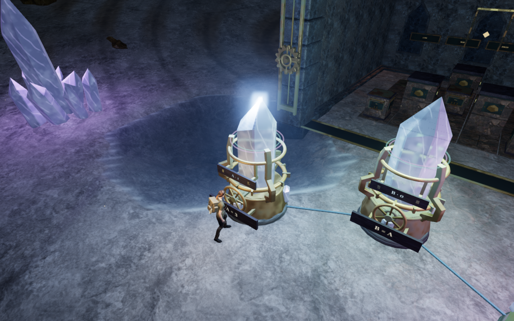 |
| Descending echo | 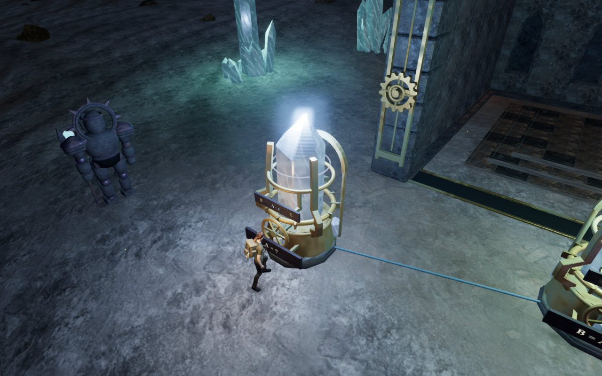 |
| Mirrored voices | 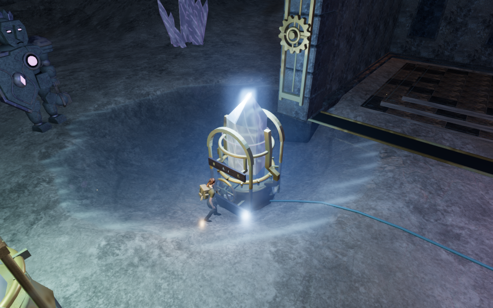 |
| Ascending echo | 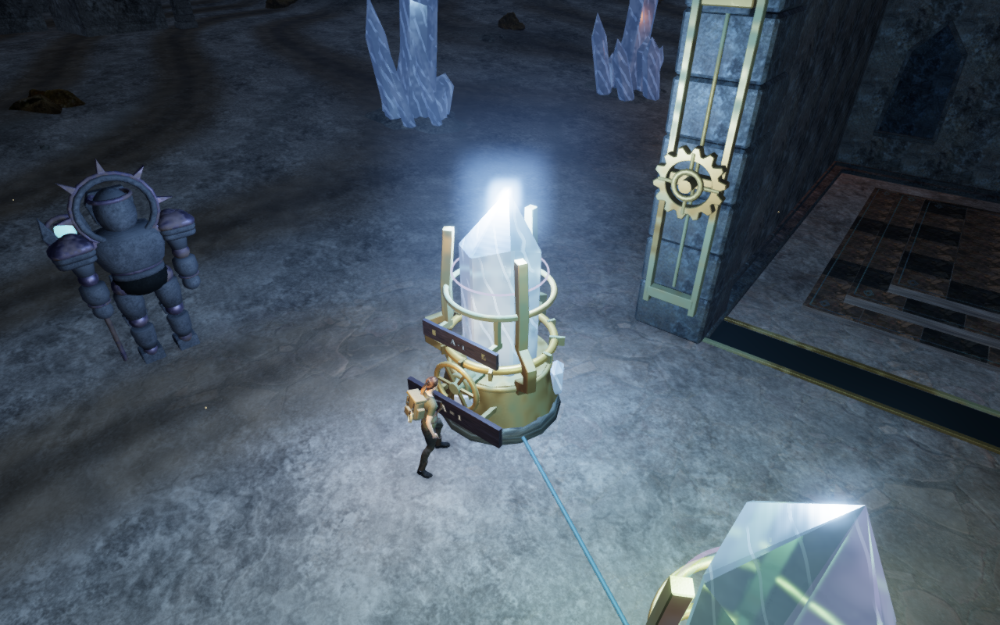 |
| Counterpoint | 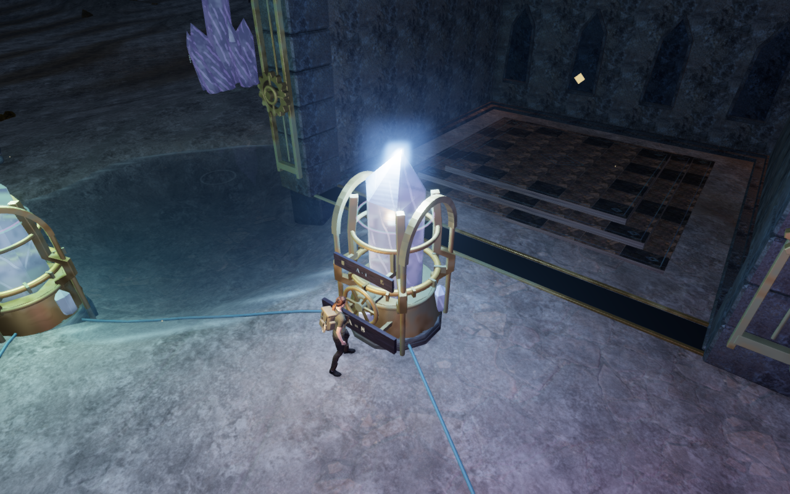 |
| Mended conversation | 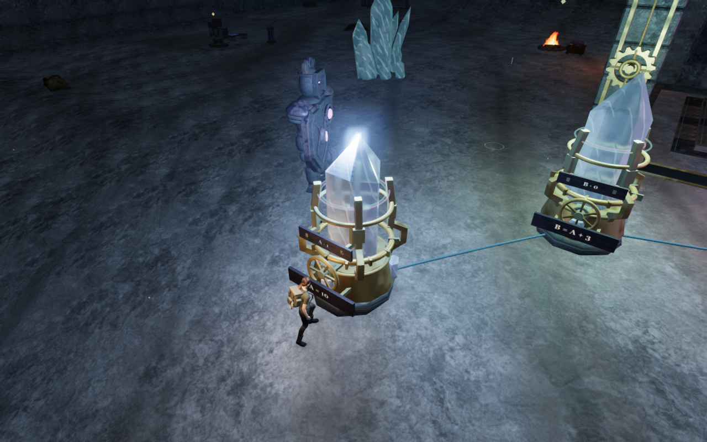 |
| Paired heart | 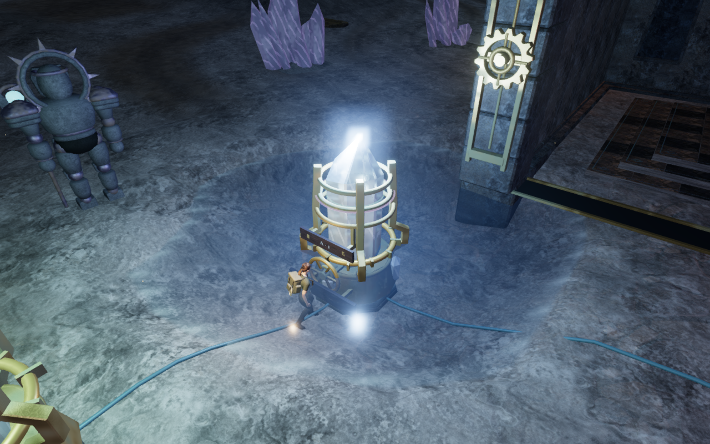 |
| Prismatic unison | 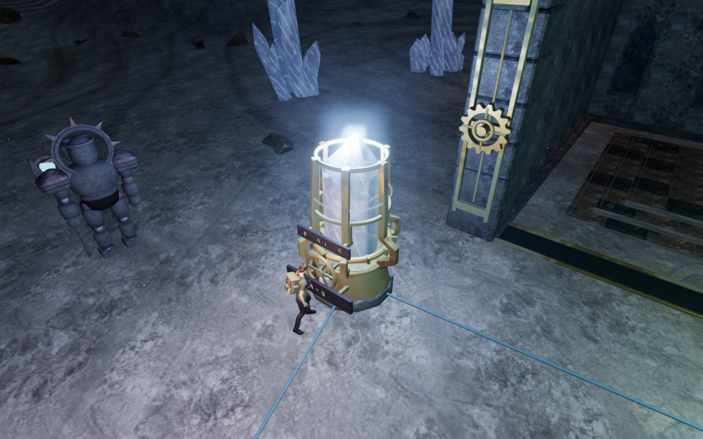 |

| Controlled comparison | Previous instrument geometry | Current instrument geometry |
| --- | --- | --- |
| Guide light | 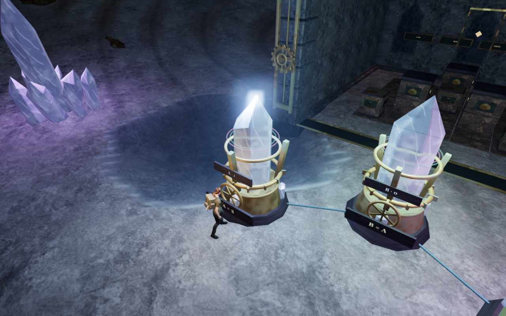 |  |
| Prismatic unison | 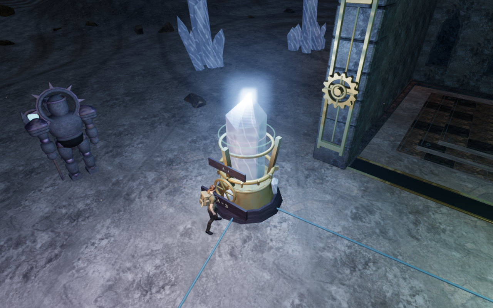 |  |

| Built or inspected view | Capture |
| --- | --- |
| Counterpoint inspection, High | 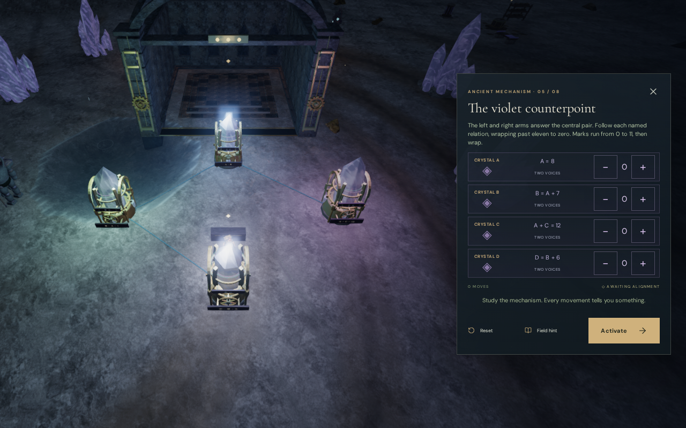 |
| Prismatic inspection, Low portrait | 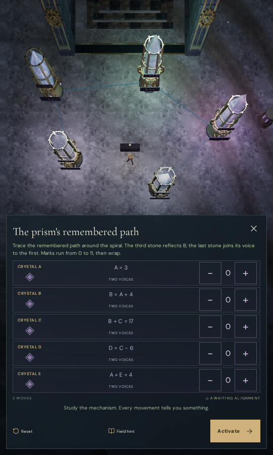 |
| Ascending objective, native keyboard/High | 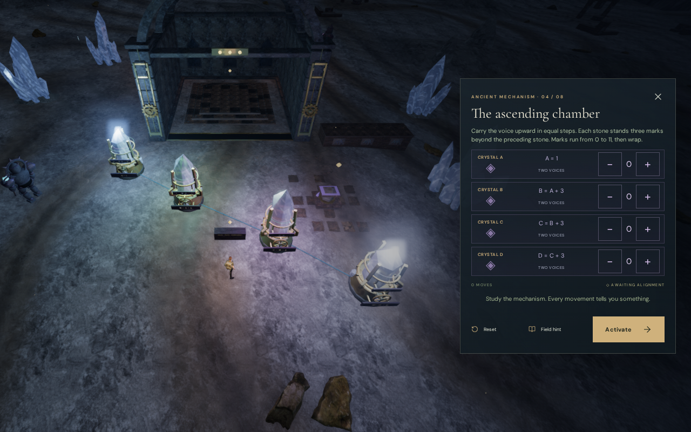 |
| Ascending objective, native touch/Low | 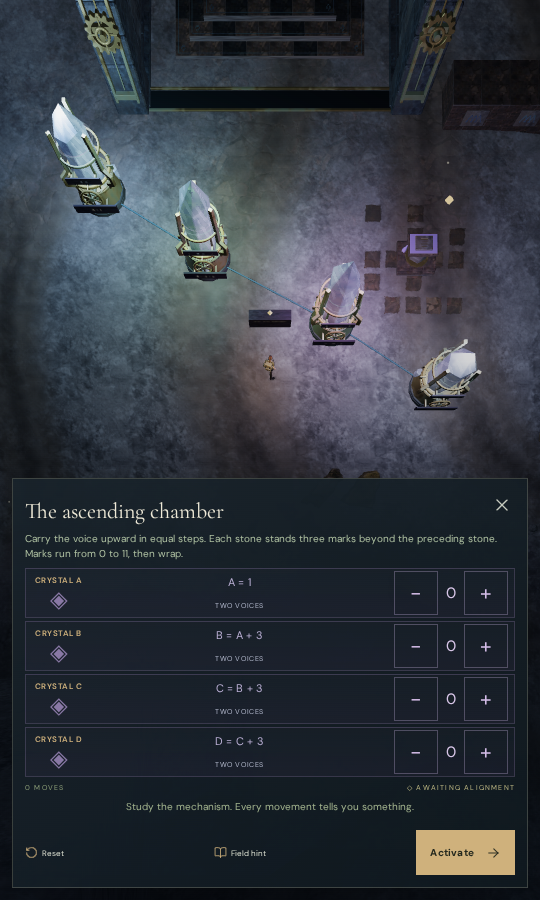 |
| Native crouch after stepping back | 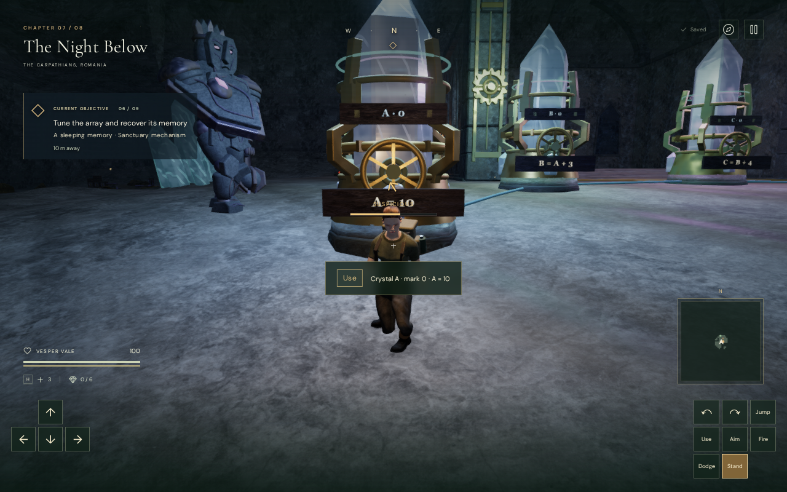 |
| Native older-save recovery | 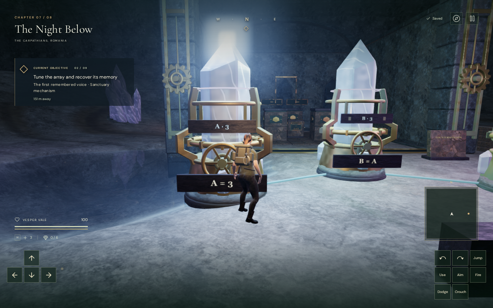 |
