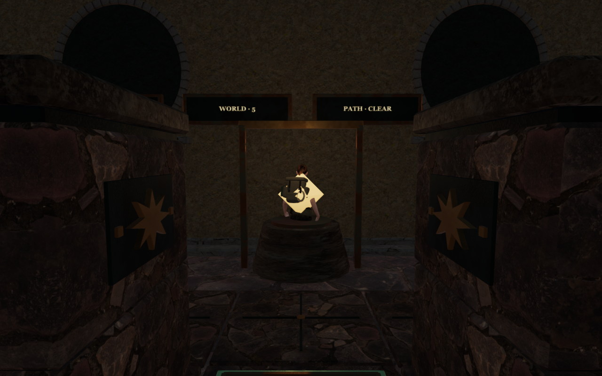
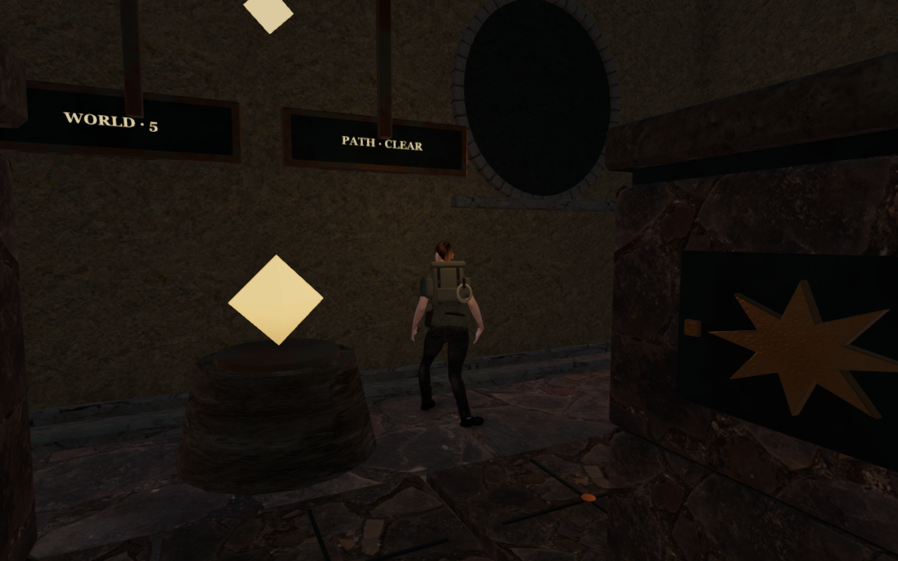

# Solid sanctuary controls

The small sanctuary control behind each counterweight board now has physical
surfaces matching its stone base, bronze collar and crystal head. Previously,
the explorer could stand inside it: the recorded Meridian view showed the
legs buried in the base and the crystal crossing the torso. Replaying that
occupied arrival now places the explorer on nearby clear ground.

These are actual gameplay renders from the recorded and recovered states.
Their player and camera positions differ because the older position is now
rejected.

All eight chapters use the repair. Three closed triangle surfaces retain the
rendered geometry after batching, providing body collision, support and
sight/sound obstruction. Rounded camera envelopes protect the two cylindrical
parts, and a small box protects the crystal. The lower stone edge enters the
terrain instead of beginning five centimetres above it. The head and upper
seat keep their original positions. A visible crystal holds its seated pose.
Regional courts and completed stages retain their existing hiding behavior;
the head's body and camera coverage follow that visibility together. The
objective marker still follows the active stage.

The north service aisle's middle cell is occupied by this control. Walking
and grip plans now route around it. All eight authored counterweight solutions
still complete through actual walking, grips and swept stone moves. The
working tiles, receiver conditions and saved stone positions retain their
meaning.

The control's hum now originates above its crystal, five metres behind the
board centre where the emitter previously sat. It remains outside the physical
shell. The existing source kind, gain, stage activity and distance attenuation
are retained; background music is unchanged.

Both regressions first fail against the preceding application: standing inside
the control is accepted, and its hum originates away from the crystal. The
revised geometry passes 1,152 independent horizontal render/physics ray pairs
and 2,312 vertical support comparisons across all eight controls. Eight
sustained walking approaches stop before the base, permit a return to the
starting point and retain the mechanism's interaction range. Eight occupied
ground arrivals recover nearby without losing health or requiring a save
schema change.

Direct drops onto the steep crystal initially exposed a second contact issue.
The control now allows a descending body to clear its full base radius before
settling. Eight complete drop-and-departure checks keep the body clear on every
inspected descent frame and permit movement away from the resulting support.
This recovery allowance is local to the small control assembly.

All 88 selected tests pass. They include complete counterweight routes, stone
sweep restrictions, pressure and socket conditions, saved and malformed
progress, camera following and margins, observatory body surfaces, field
station geometry, water sound anchors and the eight quiet adaptive scores.

Eight baseline views and fourteen revised development views are reviewed. The
revised set includes all eight High approaches, three Performance views, two
Meridian drop views and a fresh-start occupied arrival. That arrival moves
1.5 m to clear ground, with health at 100 and the complete sampled body visible.
It retains the saved yaw and pitch.

Sixty-four time/stage observations across the eight chapters retain each
head's intended visible or hidden state, with physical point queries matching
that visibility. The exposed lower stone rims extend eight centimetres into
the sampled ground, and source counts are unchanged. All captured shaders
link and HDR buffers remain finite, with no application errors or warnings.

Thirty-six tracked geometries and materials dispose exactly once across six
inspected scene replacements. Owned browsers and preview processes close after
each check. Verification uses the shared locked five-of-sixteen CPU allowance.
The build passes with its existing chunk-size advisory.

The final production bundle passes keyboard/High and portrait touch/Performance
checks from prepared counterweight progress. Both cases exercise coupled ring
turns, reset, alignment and stage 0-to-1 submission. Five complete-save reload
comparisons pass across partial progress, completed progress and the older
occupied arrival, excluding only per-level `lastPlayed` timestamps. The two
return movements cover 9.0 m and 9.6 m with health retained at 100. The older
arrival moves 1.5 m out of the control and permits a 2.2 m return, also at 100
health. All eight release captures are reviewed. The loaded asset lists match
the built bundles, the development interface is absent, and the keyboard/touch
cases retain horizontal page fit. No application errors or warnings occur.
These prepared checks do not establish a complete chapter playthrough or
whole-world movement acceptance.

The two 1280 × 800 High documentation exports preserve decoded source pixels
through lossless WebP conversion, with no cropping or retouching. Baseline
runtime hashes match published `5b2db8d`; the fresh arrival's 396 hashes match
the revised application.

No external model, texture, recording or dependency is added. Existing
[asset attribution](asset-credits.md) is retained. The wider [world audit](visual-audit.md)
remains open; this repair does not establish whole-world visual acceptance,
continuous body contact, subjective listening quality or consumer hardware
performance.
