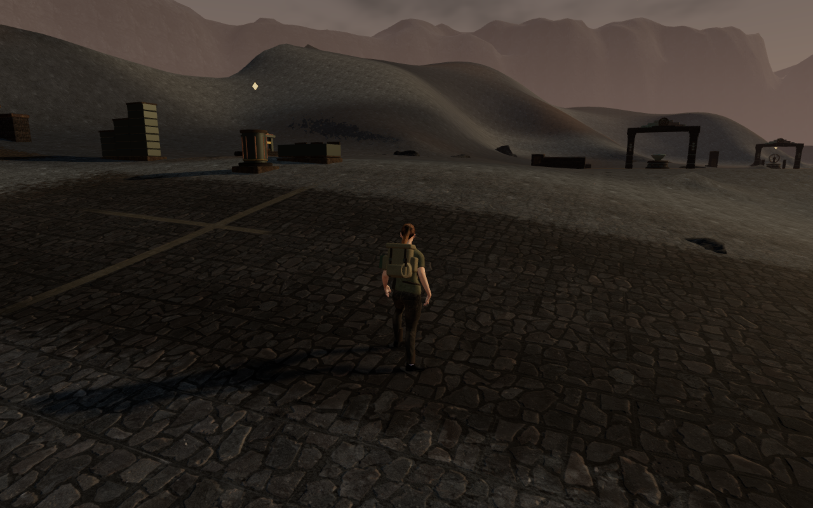
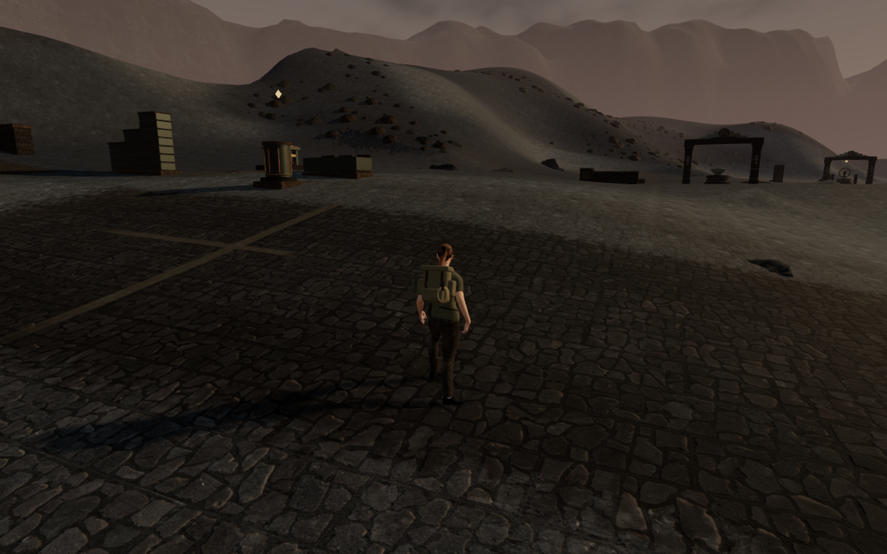
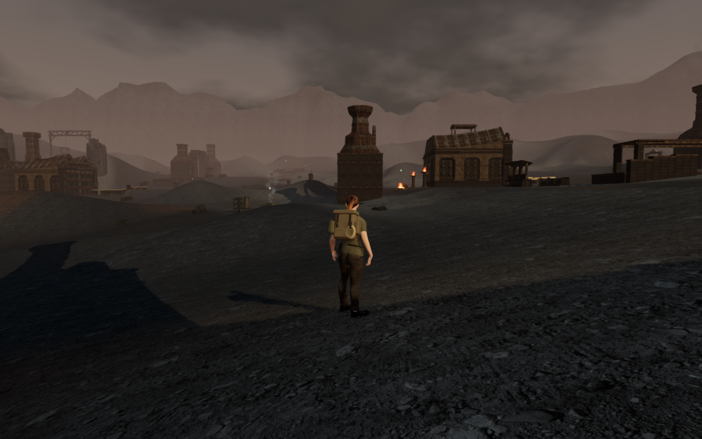
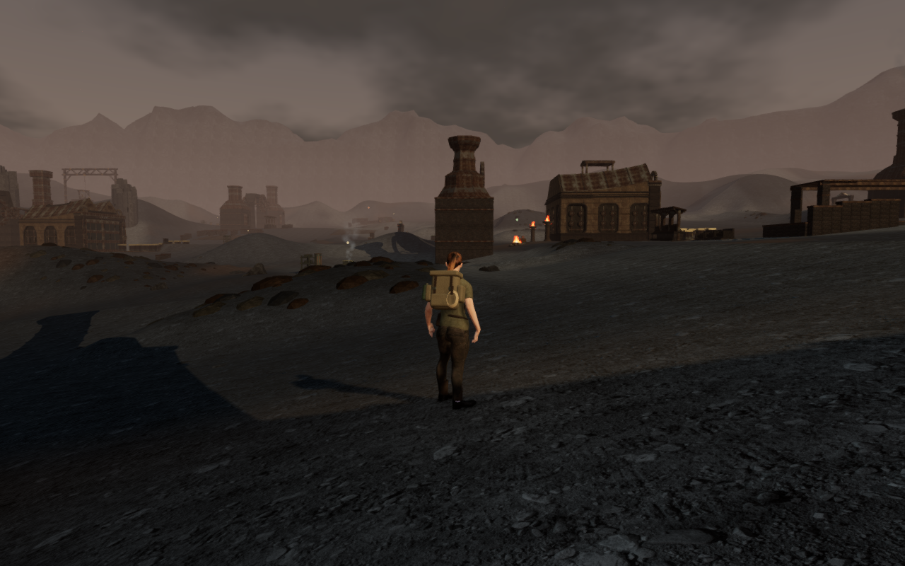
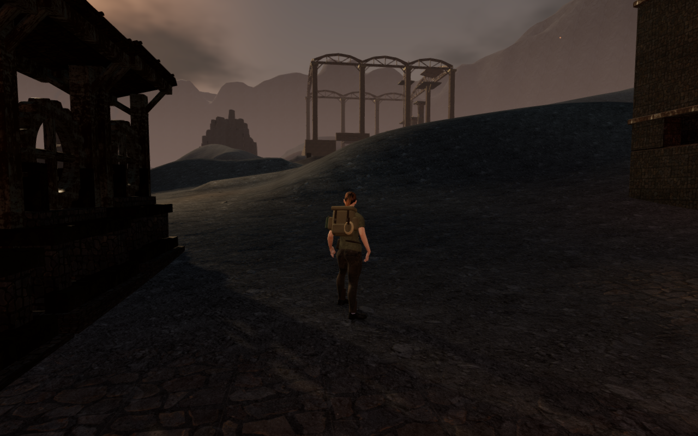
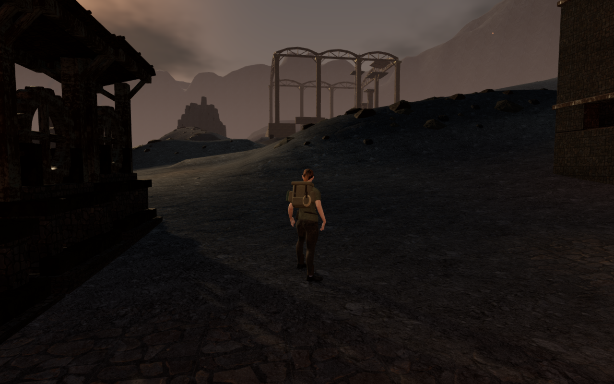

# Scoria on the volcanic banks

A Heart of Embers now has irregular deposits of broken scoria across its ash
banks. Charcoal, oxidised and dust-covered fragments follow the slopes, while
matching darker ground breaks up the broad grey surfaces between the courts.
Open ash separates the deposits and keeps the routes legible.

These are actual High-preset game captures from the explorer's follow camera.
Each pair shares its frozen player, camera and simulation time. The control
hides the new fragments and disables the new ground treatment in the current
scene; its physical world is retained. Lossless 1280 × 800 WebP exports preserve
the source pixels and dimensions without cropping or retouching.

## Distribution and surfaces

The live chapter contains 4,560 new fragments. Three original 80-triangle forms
have four baked bank angles; ten of the twelve possible form/angle combinations
survive fitting in this world. Their upright instance transforms work with the
existing physical triangle surfaces. Discontinuous deposits use a separate
random stream, retaining the preceding bank-toe gravel and scanned boulders.

The complete conservative footprint of each fragment stays at least 2.8 m
beyond walking-cell boundaries. Working courts, machinery, discoveries, water,
the railway and other existing nature reservations also stay clear. The same
noise field guides dark exposed ground on the existing terrain lattice. It
fades out as it approaches routes and paving, with no change to the terrain's heights,
triangle count or objective data.

The fragments use ten instanced groups with one geometry tier. Existing rock
ranges are 140 m at High, 119 m at Medium and 91 m at Performance, with the
existing visibility transition and independent authored physical matrices.
At the initial camera the three settings select 917, 562 and 376 new instances
respectively. These totals include chunks outside the view and are not frame
rate measurements or consumer-device acceptance.

## Grounding and verification

Final seating clips every downward rock face against the terrain triangles
under its footprint. The resulting overlap vertices bound the complete planar
clearance; a 12 mm burial margin retains contact after float32 packing. Pieces
that become too buried are rejected. The earlier probe-based pass missed 506
downward-face samples, with a largest 237 mm gap; that pass was not published.

The final independent observer tests 3,791,781 downward-face points across all
4,560 fragments against the delivered terrain triangles and float32 instance
transforms. All find ground, with no exposed points. The highest point is
11.994 mm below the terrain and the deepest is 1.487 m below it on a slope.
A deliberately raised rock fails, and restoring it clears the failure.

Authored matrix hashes remain identical across all three quality presets,
active render matrices match their float32 transforms, and all 4,560 physical
matrices match their authored placements. Toggling the ground treatment retains
geometry buffers and world transforms across 150 checked meshes. All 54
supported feature approaches pass, including the raised tempering deck.
Eighteen controller-assisted local apron legs arrive on prepared completed
progress, covering 4,330 physics updates. These are local ground checks, not
complete routes or full-body contact coverage.

Changing to the desert disposes each of the ten instance buffers, ten patch
geometries and eleven materials, including depth materials, once. The old
fragments retire from the active scene and their reference clears. All 27
focused geology, fragment, nature-contact and material checks pass.

All 68 final render captures are reviewed. The paired views cover four entrance
headings, eighteen court fronts/backs, nine nearby bank views and three quality
presets. Each pair retains its player, camera and simulation time. Shaders link,
sampled HDR output is finite and the current terrain program receives the
expected treatment strength. Some court observers stand close to the buildings;
these do not establish complete external silhouettes.

The production build passes with its existing chunk-size warning. Native
keyboard/High at 1280 × 800 and portrait touch/Performance at 540 × 900 exercise
movement, crouch/stand, map and pause. They move 1.256 m and 1.8 m respectively,
retain health 100 and pass four complete-store reload comparisons, excluding
only `lastPlayed` timestamps. All fourteen release captures are reviewed. There
are no page errors, unexpected warnings or horizontal overflow; the development
hook is absent and served bundles match the build.

Verification uses the shared locked five-of-sixteen CPU allowance, at most two
test workers and one browser. Expensive jobs run sequentially, and owned
previews, workers and browsers close after their checks.

The geometry and deposit shading are original project work using the existing
credited materials. No external asset, texture download, recording or dependency
is added. The wider [whole-world visual audit](visual-audit.md), repeated large
installations, continuous body contact, complete routes and listening/device
acceptance remain open.
