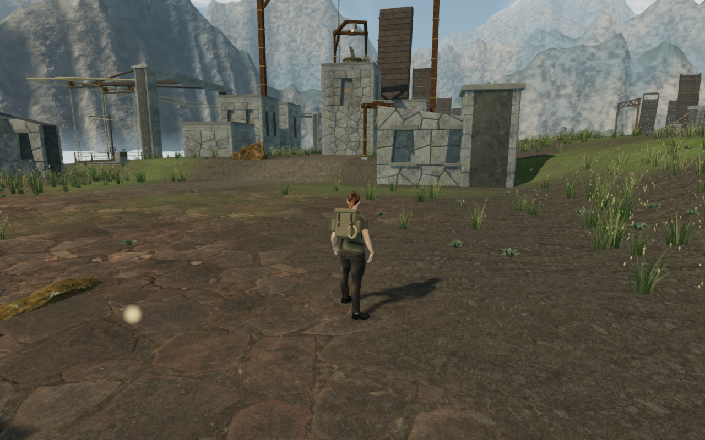
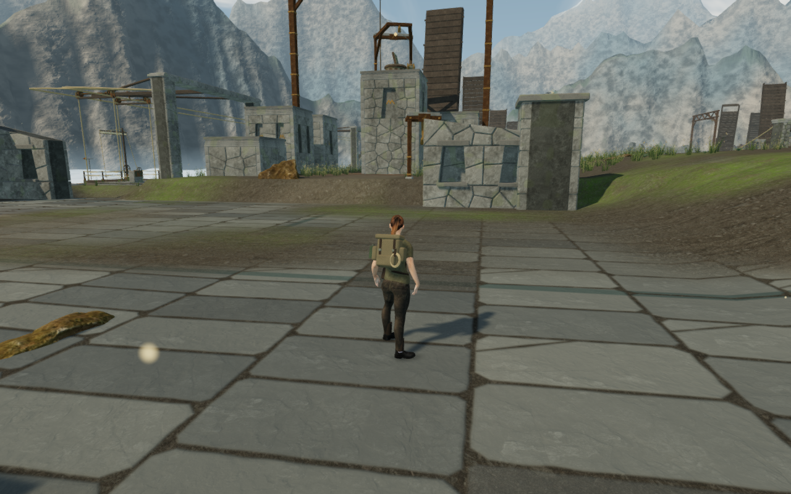
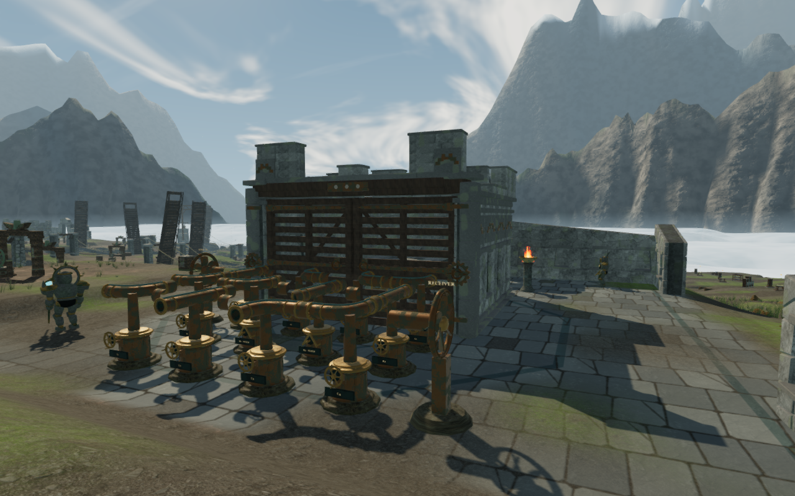

# Granite courts on the cloud terraces

The ten main sky courts now have individually composed granite pavements.
Worn approach lanes, stepped borders, braided crossings, a fan, an octagonal
court and a compass connect the wind instruments to the surrounding ruins.
The patterns are original fictional designs, not reproductions of historical
symbols. Variable course heights, staggered widths, angled joints, chipped
corners and sparse fractures break up the slabs. Subdued blue-green inlays
give each layout a larger-scale structure.

The ordinary arrival camera before this change:

The matched arrival camera with the new paving:

The middle wind court:

These are complete, unretouched 1280 × 800 game captures. The baseline uses
`2d596d4`; the two final figures use the source verified for this milestone.

## Surface and planting

`src/sky-paving.js` supplies the ten plans and the terrain material layers.
The shared walking surface remains at its original height. Derivative-filtered
joints and shallow normal relief suggest mortar and worn stone edges without
adding raised obstacles. The shader limits the paving to the upper, flatter
court ground and fades it into soil at the edges. Existing stone maps supply
the surface grain and normal detail.

The first planting iteration allowed grass through intact slabs. The final
placement reserves the paving's feathered boundary and each plant's full
leaning reach, while retaining plants on sufficiently steep, unpaved banks.
It removes **4,337 of the previous 21,406 plants**, leaving **17,069**. Every
retained plant has exactly its previous transform; no new plants are introduced.
The thirty-six retained plants within the wider court envelopes occupy
unpaved slopes.

The [delivered-buffer observer](../scripts/inspect-sky-paving-browser.js)
independently interpolates normals and exposed depth from the actual terrain
triangles. Its 1,739 footprint samples around those bank plants find no
potential paving intersections. A deliberately inserted flat-court plant
produces failures, checking that the observer detects an invalid placement.
The existing meadow observer also traces **4,173,228 root probes**. No root
floats above the surface; the highest is 1.00 cm below it. The deepest sampled
root is 52.2% of its specimen's scaled height below the ground. These are
sampled contact observations, not a full visual acceptance of every plant.

## Geometry, rendering and resource ownership

Independent construction comparisons retain all **81 sky terrain chunks**,
their indices and **2,771,406 attribute values**, along with the height field,
bank eligibility, reservoirs and bridges. All eight chapters retain their
existing terrain texture requests, material bindings and vertex shader text.
Only the sky material receives the new paving uniforms and shader cache key.

The treatment adds no terrain vertices, draw batches or textures. The sky
material still loads eleven textures. Its fragment shading does more work;
these checks do not establish a consumer-device frame rate. Meadow placement
changes its instance population while retaining its existing detail tiers.

Chapter replacement releases all **3,487 tracked draw resources** exactly
once: 81 terrain geometries, one terrain material, eleven textures, 1,131
meadow geometry wrappers, 1,131 instance buffers, one shared meadow material
and 1,131 depth materials. The observer tracks the rendered wrappers rather
than the unrendered source-template objects. The next chapter has no sky
meadow or paving uniforms. Browser and preview helpers close after checking.

## Verification and remaining work

All **70 focused automated tests**, three CPU guard tests and the production
build pass. Tests cover the paving bindings, whole-footprint reservations,
bank transitions, stable retained planting, terrain seams, face-facing normals,
terrain data, bridge rules, detail tiers and rendering settings. The corrected
sky seam test distinguishes the original grid normals from existing
face-specific corners; the all-eight terrain shading check still verifies
every delivered corner against its triangle. The old seam assertion fails
identically in the unchanged baseline.

The broader wind suite passes twenty cases and exposes one existing failure:
the stage 2, node 9, turn 0 thumb enters its handle by 3.107 mm against a 2 mm
tolerance. The identical failure reproduces in the saved baseline. The later
[bearing support repair](wind-bearing-support.md) resolves VA-251 with the
original tolerance. These measurements describe the paving milestone before
that correction.

All eighteen final development views are reviewed: the ordinary arrival,
all ten court fronts, an open ground detail, and Medium/Performance fronts of
the first, middle and last courts. Linked shaders and recorded pixel checks
pass. High/Medium checks include finite HDR observations; Performance's byte
readback does not independently establish HDR finiteness. The 119 wind controls
and all recorded active wind-source fronts remain clear. The sky chapter still
registers its existing 463 sound origins; this pass does not evaluate the
subjective mix or change the score.

Native production checks pass on keyboard High at 1280 × 800 and simulated
touch Performance at 540 × 900. The explorer walks 5.4 m forward and back on
keyboard, and 6 m in each direction on touch, retaining health 100. All four
complete-store reload comparisons match apart from last-played timestamps.
Both cases load the exact built JS/CSS files without a development handle or
page overflow, and report no browser errors or warnings. All six release
captures are reviewed. These cases cover movement and persistence, not a new
continuous campaign playthrough or subjective audio review. The browser and
preview server close afterward under the shared five-of-sixteen CPU allowance.

This improves the court surfaces within the wider
[playable-world audit](visual-audit.md). Repeated forward machinery and chamber
arrangements, broad margins, continuous traversal and other body contact,
listening and device coverage remain open. The broader eight-world goal is
incomplete.
