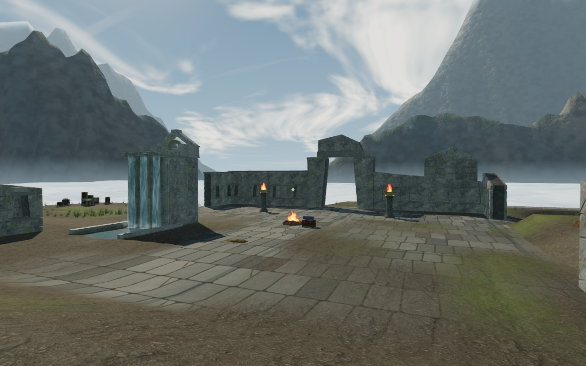
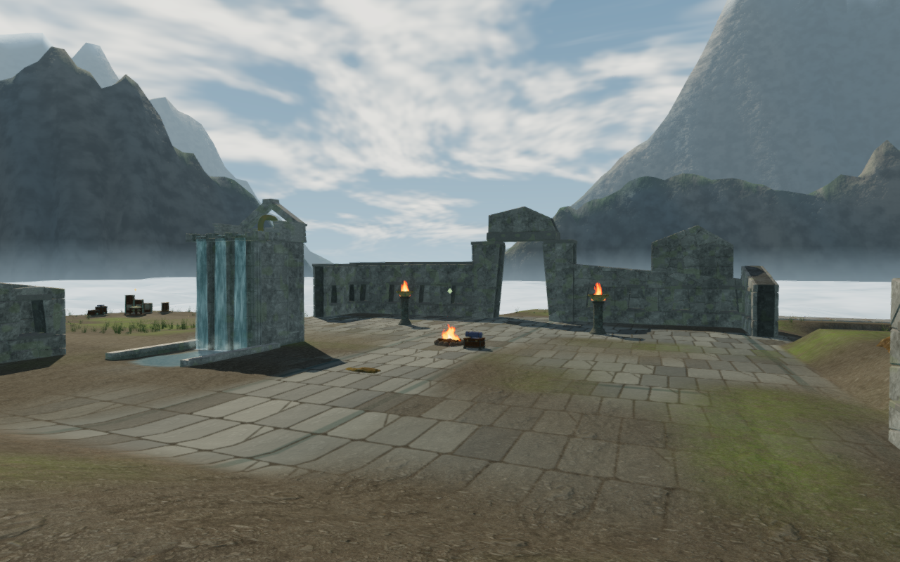
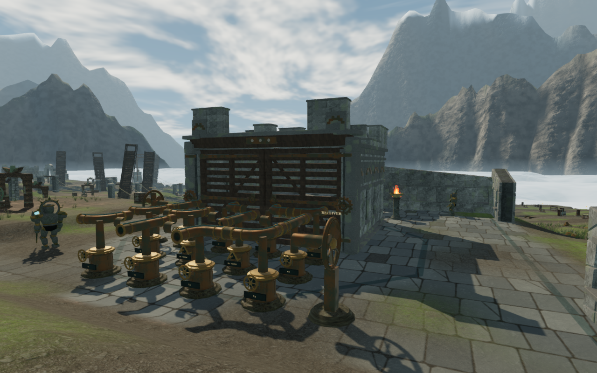

# High clouds above the sky chapter

The overhead cloud field formed broad, converging bands in the sky chapter's
court views. Its lattice hash now mixes three components, using the basis
already present in the project's masonry and mosaics. The matched views below
show smaller broken cloud shapes in place of the dominant bands. This is an
artistic revision to one weather field; it does not establish a universal
statistical defect in the preceding noise function.

The shader generator retains the preceding noise for the mountain grain and
valley cloud bank. Their shading and displacement patterns remain intact.
The overhead cloud projection, five noise octaves, slow drift, cloud colors,
sun, lighting intensities and fog settings retain their existing values.
The visible dome and initial filtered reflection capture use the revised
material together. No geometry, map, control, save schema or audio source is
added by this change.

The figures retain the complete 1280 × 800 capture pixels through lossless
WebP conversion. The first pair has identical numeric player and camera
positions, scene time and High settings. The full scene is rendered after
startup so it includes the revised reflection capture, rather than a temporary
material override alone.

## Fresh campaign review

A current High survey covers four views in each of the eight chapters: the
entry camera and the first, middle and last main-court fronts. All 32 views
were captured and reviewed, with legal sampled player/camera positions,
linked shaders and finite HDR buffers. This sample covers the fronts of 24
of the 77 main courts; it does not inspect every route, interior or exposed
face of those courts.

| Chapter environment | Visible character in the sample | Wider composition still to improve |
| --- | --- | --- |
| Jungle | Ferns, trees, colonnades and carved trial doors | Broad smooth escarpments and repeated small mechanism banks |
| Desert | Pale dunes, arcades, mirror arrays and varied temple exteriors | Bare margins and repeated optical equipment arrangements |
| Snow | White ranges, sparse trees and timber/slate monastery courts | Broad rounded range surfaces and sparse court margins |
| Coast | Arcaded palace courts, mosaics, planted shores and cistern machinery | Large open paved courts and shared equipment layouts |
| Volcano | Dark foundry courts, furnace light and ash fields | Sparse foregrounds and repeated machinery groups |
| Sky | Mountain valleys, cloud deck, granite courts and wind instruments | High-cloud bands addressed here; larger court repetition remains |
| Crystal | Quartz groups and blue archive chambers | Broad floor areas and repeated installation layouts |
| Eclipse | Eclipsed sky, observatory domes and dark vegetation | Sparse margins and broad, plainly repeated surfaces |

These observations keep the full playable-world polish requirement open.
An absence of a finding in these selected views is not an acceptance of the
unseen areas. Earlier positioning and construction fixes retain their bounded
evidence; this review does not reclassify them as complete world coverage.

## Verification

The 39 selected tests across cloud-city, sky geology, sky bridges, rendering
settings and campaign persistence pass. The three CPU-launcher checks pass.
All verification uses the shared locked 5/16 CPU allowance, at most two test
workers and one browser; expensive checks run sequentially. The production
build passes with the existing large-bundle advisory.

Seven final world views cover entry, three courts, Medium/Low repeats and a
later cloud clock. They have linked shaders and finite checked buffers, with
no recorded console errors or warnings. In a separate 256 × 128 sky-only
target, 35 draws cover eight azimuths at four elevations plus three clock
samples. All components remain finite and every draw reports no GL error.
The mean linear-radiance change is 0.000317 over one second and 0.078531 over
ten minutes in the fixed temporal view. This verifies slow visible evolution
at those samples, rather than a frame-rate or weather-lifetime guarantee.

The initial 384 × 512 filtered sky target matches a fresh capture of the
revised sky at its initial clock: all 786,432 half-float components compare
equal. Changing to the crystal chapter disposes the sky geometry, material
and reflection render target exactly once each, and clears the cloud-city
update reference. The browser and isolated preview close after the check.

Production keyboard and touch cases each turn the fifth wind engine once,
move away by 1.5 m and 2.1 m respectively, retain full health and reload the
complete persistent store. Each case compares the entire normalized save,
excluding only the volatile per-chapter `lastPlayed` timestamp. These are
assisted Low checks at a 360 × 600 CSS viewport with a 0.5 pixel density;
the separate High figures above provide the graphics review. Both served
all four current JS/CSS assets with response-body hashes matching the build,
and exposed no development hook or recorded request/console error. The
entry/game chunks are `index-Bg69iEPe.js` and `game-u4oxAimk.js`.

Existing [asset credits](asset-credits.md) are preserved. No external asset or
dependency is introduced. Consumer-device performance, subjective listening
quality and complete traversal of every surface are not established by this
milestone. There is no minimum-duration requirement for the chapters.
