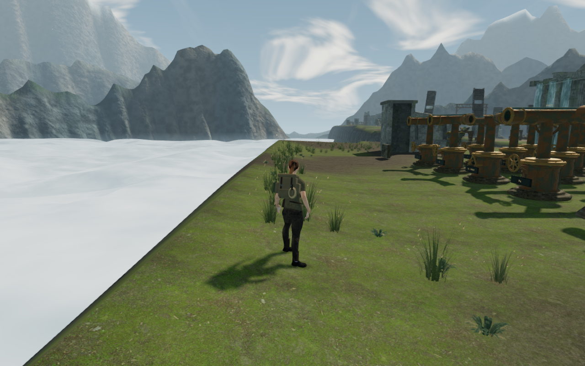
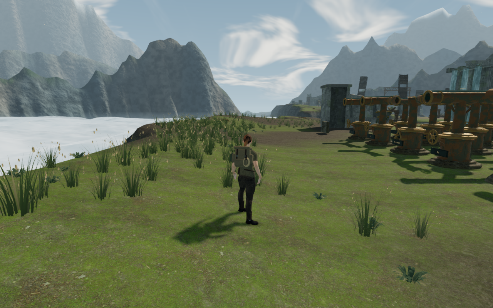
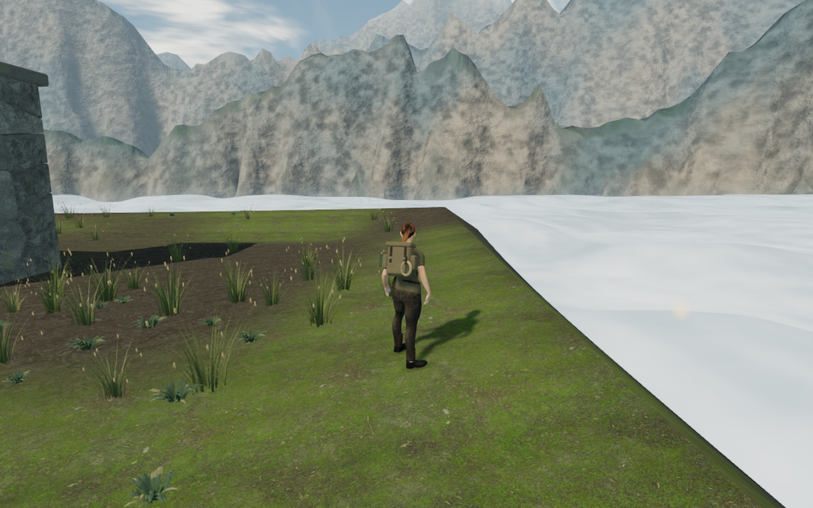
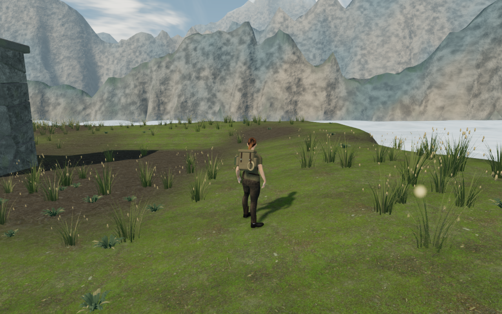

# Varied outlines for the cloud terraces

The sky islands' upper edges followed the rectangular walking grid even after
their lower rock shoulders were rounded. The upper shelves now extend into
seeded, continuous lobes before descending into the existing ravines. Shallow
ground on those shelves accepts ordinary walking and appears on the explored
map. Deep slopes remain outside the walking boundary.

These High-quality follow-camera comparisons share player position, camera,
look angles and simulation time. Their four lossless WebP exports retain the
1280 × 800 source dimensions and identical decoded pixels. Progress is prepared;
the images are local comparisons rather than a campaign playthrough.

## Terrain and movement

The upper profile combines broad and smaller noise lobes, extending the shelf
by 1.25–9.75 m before local reservations. It blends back into the preceding
deep profile between 16 and 26 m from the walking grid. Receiving pools, all
eighteen bridge cuts and approaches, and the northern courier cable course
reserve their existing foundations with interpolation aprons and smooth fringes.

The final heightfield changes 89,699 vertices outside the protected footprints.
All 93,632 original walking vertices, 672 protected receiving-shore vertices,
6,692 courier-corridor vertices and 4,779 working-pad samples retain their
preceding heights; bridge and water metadata also match. Terrain topology
remains 81 chunks and 476,288 triangles. The inspected final-court 3 m depth
contour varies by 3.5 m along an approximately 50 m stretch, compared with
0.375 m previously.

The movement boundary checks the delivered triangle height and accepts only
the shallow upper shoulder. The chart caches eligible coarse cells once when
the chapter loads. The original grid, special crossing rules and save schema
retain their roles.

## Verification and limits

All 89 selected terrain, navigation, contact, rock and courier regressions pass,
as does the production build with its existing bundle-size advisory. All 45
final scenery captures are reviewed: 35 High court/offset views, eight
Performance views and two High follow-camera comparisons. Shaders link and
sampled HDR output is finite.

Twenty assisted rays cover both sides of all ten courts. Their forty ordinary
outward/return legs total 415.96 m over 4,100 controller/follow updates at full
health and visibility. Eighty-one resting body poses check 48,095 delivered
character vertices each against independently observed terrain and nearby
high-detail rocks. No embedded, invalid or missing samples occur; the lowest
body-to-ground gaps range from 5.983 to 6.000 mm. A deliberate 20 cm lowering
embeds 2,238 vertices. These are resting and restored poses, not inspection of
every moving pose or every structure. All 43 route/contact captures are reviewed.
A separate actual-write save/reload preserves the complete store apart from
play timestamps and restores exactly the same new-shelf position.

Built keyboard/High and portrait-touch/Performance cases walk on a saved shelf
outside the old grid, reload, walk again, crouch, look, jump, land and open the
map. All six complete-store reload comparisons pass, excluding play timestamps.
Both full-map pixel checks show land on the newly explored shelf. All fourteen
release captures are reviewed; served bundles and character responses match
the build. No application error or warning is recorded; software-driver readback
diagnostics are retained separately. These cases do not operate a wind engine.

Same-chapter reload and a chapter change each dispose the outgoing 81 terrain
geometries, terrain material and cloud height texture once. The bank function
and chart cache are replaced, and are absent from the following jungle chapter.
Checks run sequentially under the shared locked five-of-sixteen CPU allowance;
owned browsers, workers and previews close afterward.

The first exploratory route run exposed raised terrain in the courier course.
That run was stopped and excluded from acceptance. The corrected reservation
retains all 6,692 recorded courier vertices, and the final checks above use that
corrected source.

Sparse fields, repeated furnishings and wider discovery/traversal/water coverage
remain open. The subsequent [guardian contact pass](guardian-ground-contact.md)
measures and repairs sole intersections, culling recovery and turning-step reach.
Wider body contact and apparent shadow separation remain under review.
Slab edges on uneven ground also warrant
closer contact review. This milestone adds no audio content and does not establish
subjective listening quality, consumer-device performance, AAA parity or complete
visual acceptance. The [playable-world audit](visual-audit.md) remains open.
