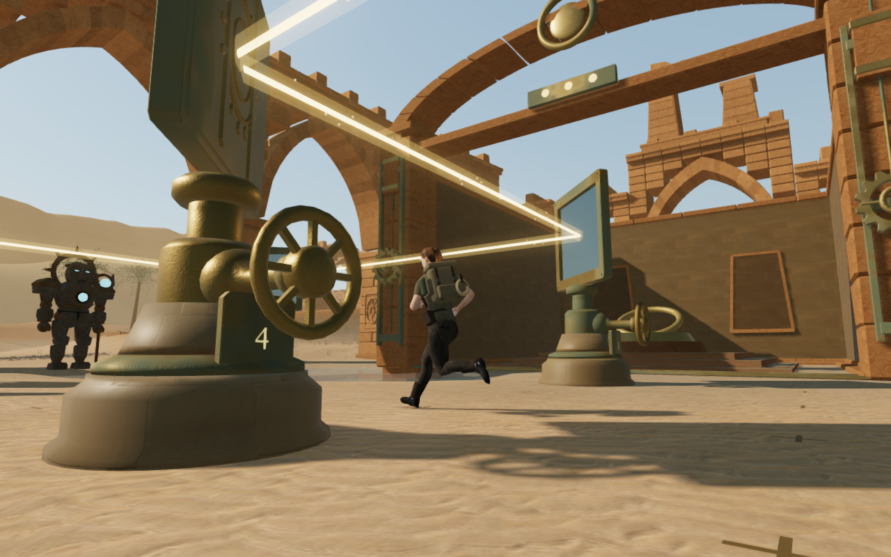
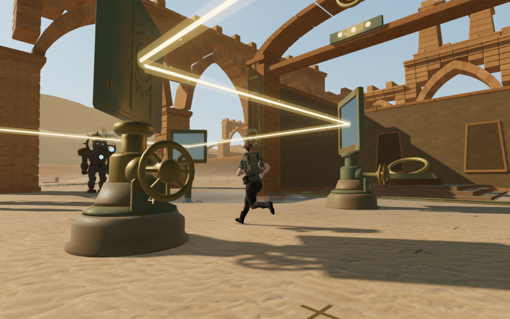
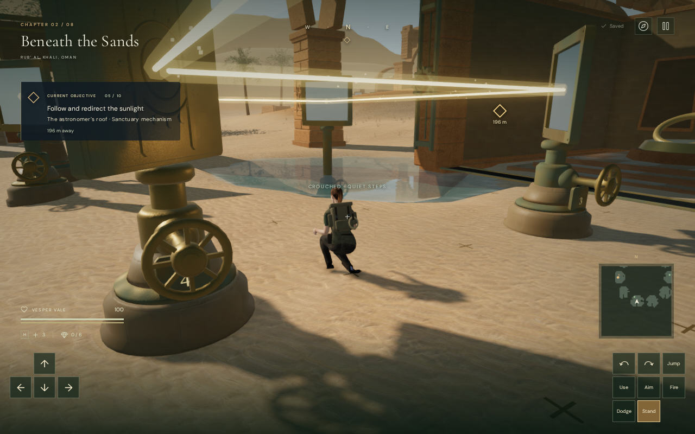
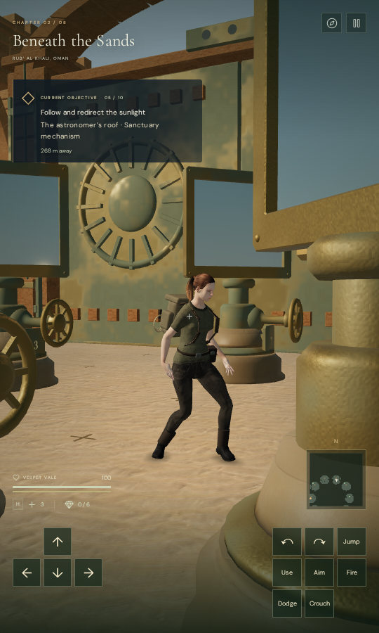

# Gentler camera contact beside solar instruments

Walking past the solar fittings could pull the camera inward by 0.454 m in a
single simulated update. The camera now anticipates horizontal contact and
starts a gentler detour before reaching it. In the three recorded approaches,
the largest update falls to 0.276 m while the sampled explorer surfaces stay
visible. The floor coordinate marks also now follow the terrain instead of
rising into a stopping boot.

| Preceding camera                                                                                | Revised camera                                                                           |
| ----------------------------------------------------------------------------------------------- | ---------------------------------------------------------------------------------------- |
|  |  |

Both captures use the current world geometry, repaired wheel bounds and the
same walking update. Only the camera algorithm changes in this comparison.
These still images show the resulting views; the per-update measurements below
establish the movement difference.

## Approach and retained views

The camera checks three points along a horizontal advance estimated from the
preceding target movement. Its 0.3-second estimate is bounded to 1.2 m; large
settling updates and stationary targets do not create an advance. It tests the
projected follow path, so a clear destination cannot conceal a blocked sweep.
An approaching contact can select a nearby orbit early and turn toward it more
gently. An established approach detour retains that response after stopping.
Existing body-only recovery keeps its preceding response.

The ordinary collision sweep still enforces actual near-plane, terrain and map
clearance on every update, including immediate inward correction when needed.
The estimate only helps select a view. It does not move the explorer, rewrite
input yaw/pitch or replace the supplied camera distance. Aiming, swimming,
diving and rope views keep their ordinary behavior and release the approach
state. A restored arrival also clears that temporary state; saved look stays
separate from the chosen safe camera orbit.

## Ground coordinate marks

The denser view check initially found one boot sample obscured just after
walking stopped. Actual triangle tracing identified a floor coordinate cross,
whose preceding box top rose 47.5 mm above the ground. This raised marking
briefly obscured the posed boot.

All 648 coordinate strokes now use the existing
[terrain-inlay geometry](../src/terrain-inlay.js), which clips each footprint to
the ground's actual grid triangles. The bronze surface stays 3 mm above those
planes; it does not bridge a cell diagonal as a corner-sampled quad would.
Delivered buffers pass vertex and triangle-interior height checks. The same
recorded boot ray clears the inlay, while a preceding raised-box control
reproduces its obstruction. The strokes retain their footprint, bronze colour
and per-court batching. Movement obstacles and instrument wheel bounds stay the
same.

## Independent rendered comparison

The control imports the preceding camera-update and follow functions into the
current development world. Both modes retain all 68 wheels and their moving
metal bounds, the current terrain inlays and the same court construction. This
compares the preceding camera behavior on the current world.

Three unchanged legal 3 m approaches end at the previously recorded positions
in courts four, seven and nine. Each sequence has 30 walking updates followed
by standing and crouching. Every camera update is measured. Actual posed
clothing and equipment are checked against opaque solar, arcade and forecourt
triangles by the [independent surface observer](../scripts/inspect-explorer-camera-browser.js).
Combat is not stepped, and objective progress is prepared.

| Court | Largest preceding update | Largest revised update |
| ----- | -----------------------: | ---------------------: |
| Four  |               0.454329 m |             0.146216 m |
| Seven |               0.381095 m |             0.274291 m |
| Nine  |               0.381342 m |             0.275586 m |

These are fixed 1/60-second simulated updates, not a measured frame rate. The
maximum across the three approaches falls by 39.3%. Immediate corrections
remain, including the first walking updates in the latter two courts; broader
contact continuity remains open.

Each mode has 207 body snapshots, with every update checked during the initial
walk/stop and crouch transitions. Other intermediate states use the same
16-by-24 sampling grid; the final walking, standing and crouching states use
32 by 48. The revised views have zero blocked or invalid samples across 25,420
body hits; the preceding camera has zero across 26,155. Both retain legal
healthy grounded explorers and legal cameras. All 18 comparison captures have
linked shaders and finite HDR output, and all are reviewed.

## Verification and limits

The 188-case batch across 21 files passed before the final floor-inlay change.
After that geometry change, all 64 relevant regressions across seven files pass,
followed by a rebuilt release. They cover camera recovery, mode/state release,
delivered body surfaces, solar behavior and controls, recorded approaches,
terrain-inlay triangles and neighbouring yard/cable clearance. The build retains
its existing large-chunk advisory.

The release-build keyboard/High and CDP touch/Low cases exercise movement,
crouching, looking, jumping and map access, followed by two complete-store
reloads each. They move 3.300 m and 3.900 m and finish on the ground with health
100. Imported input angles remain exact; repeated store comparisons ignore only
play timestamps. Fetched scripts/styles match the rebuilt release, its development
hook is absent, and no failed responses or application errors or warnings occur.
The driver reports the known ReadPixels stall diagnostics. All 14 native captures
are reviewed. These checks use prepared progress; the touch viewport is 540 by
900 and is not a physical-device performance test.

| Release keyboard / High                                                                           | Release touch / Low                                                                        |
| ------------------------------------------------------------------------------------------------- | ------------------------------------------------------------------------------------------ |
|  |  |

The published images are actual browser captures converted losslessly to WebP.
Decoded RGBA pixels and dimensions are checked against their PNG sources.
Verification uses the shared nine-of-sixteen CPU set, one test worker and one
browser at a time. Browsers and preview servers are closed after their checks.

This observer samples the stated opaque construction; it does not reproduce
every raster pixel, alpha mask, actor, instanced plant or camera angle. Prepared
progress does not establish a human playthrough. Full eight-chapter visual
acceptance, wider composition and contact, listening review and consumer-device
performance remain open.
