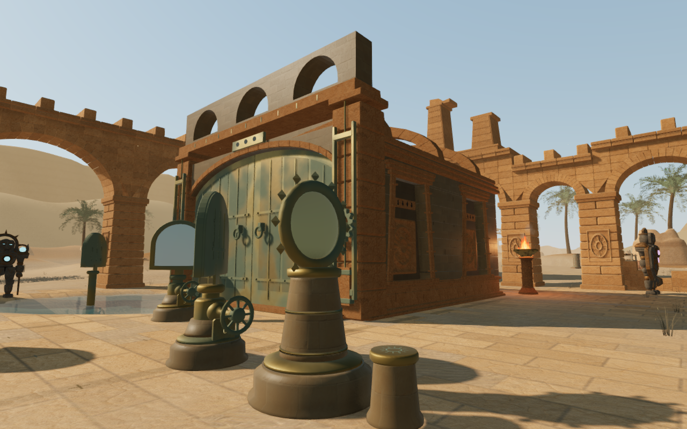
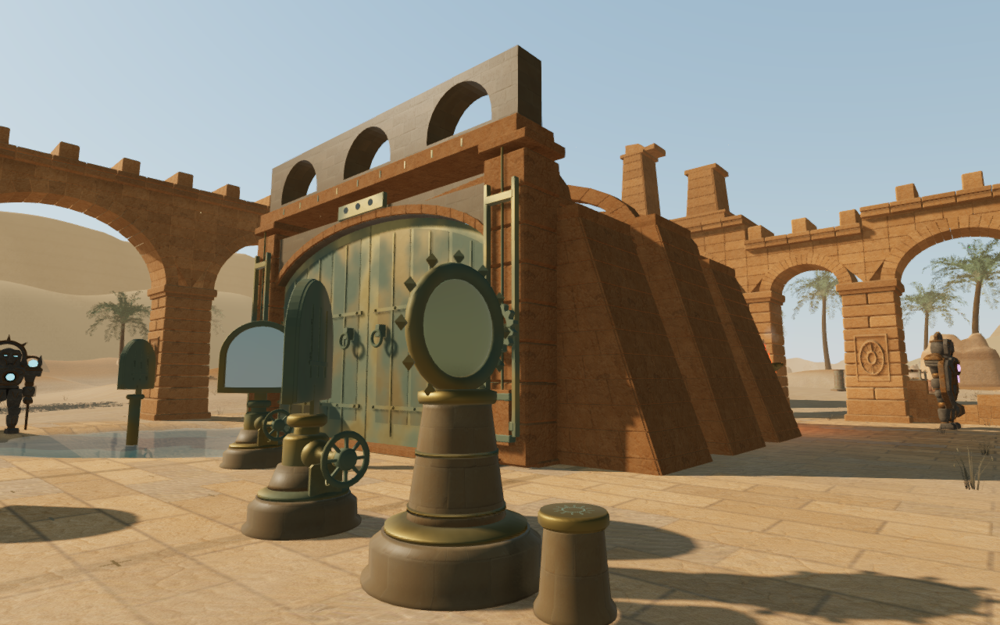
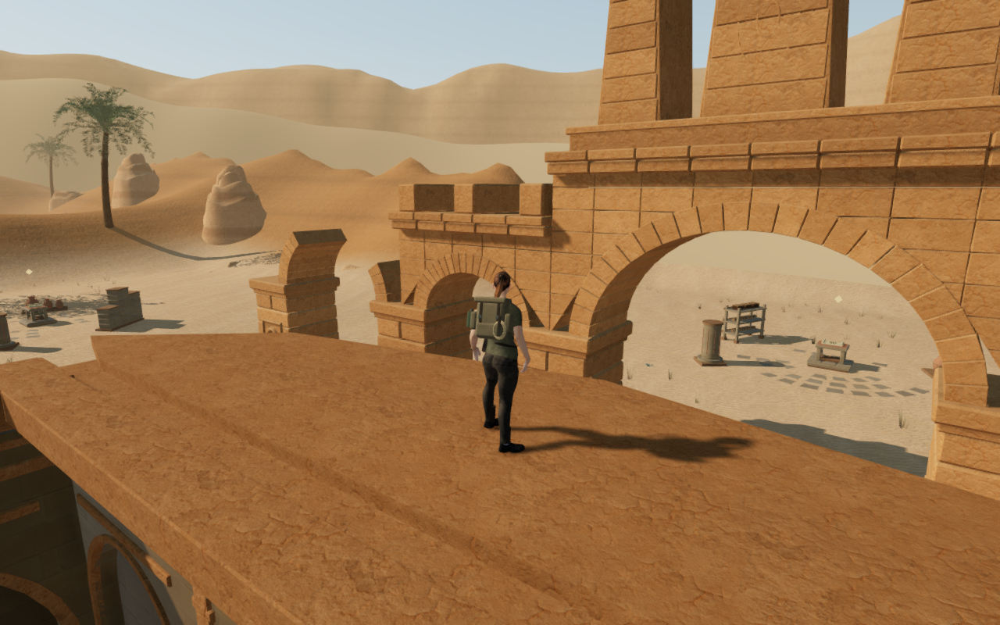

# Exterior forms for the nine Desert sanctuaries

The sanctuary interiors and roof structures already differ, but the preceding
survey still shows the same rectangular room repeated behind each solar field.
Thirty-five sandstone masses now give the nine buildings different footprints
and rooflines. The entrance has paired battered pylons; subsequent courts use
an asymmetric western wing, aqueduct buttresses, long raking shoulders, an
octagonal ephemeris tower, a shadow keep, a faceted rear apse, staggered relay
bays and a stepped sepulchre.

The paired High images use the same legal ground observer, camera and scene
time at 1280 × 800. These are direct game captures with the explorer hidden.
The initial massing comparison includes thirty preceding and thirty revised views:
front quarters and a closer side view at every sanctuary, plus three rear
views. Existing guardians and instruments obscure substantial portions of
several front views. These observations do not establish complete foreground
composition or all walking-camera directions.

The new volumes join the outside of the old room walls. Closed stone cores
rise continuously into their cornices, with buried footings and staggered
bevelled facing stones. The ephemeris tower and light-well apse use polygonal
plans. Individual convex camera cells follow the sloping walls and cornices;
the broad empty spaces above the raking shoulders remain open. Existing room
floors, shutters, threshold crossings and forward optical layouts keep their
coordinates. Outer-court circulation changes around the new footprints.

The delivered exteriors add 130,312 triangles in nine material batches, using
the existing sandstone maps. This is an explicit increase in geometry, not a
measured consumer-device performance improvement. No external assets,
dependencies or audio recordings are introduced.

## Verification

The independent delivered-world inspection records 35 masses, 101 exposed-face
queries, 109 roof-support queries, 80 empty-shoulder camera rays, 1,911 buried-rim
samples and 81 room-clearance points, with no recorded failures. All 161 sound
origins remain outside the new volumes. The regression includes a broad camera
box negative control, closed outward stone checks and the retained-coping join.

The apse's raised cap clears the retained back-wall coping, and a continuous
stone architrave encloses its ends where they meet the inner face. Independent
render-triangle checks require the coping to be hidden behind the architrave
and clear of the roof. The preceding cap height remains a failing control.
The final join is reviewed from both front quarters, its side and rear, three
follow-camera presets and its roof. The other eight buildings retain identical
complete gate construction digests across that correction.

Assisted support-aware service walks around all nine buildings complete 36
legs, 641.260 m and 10,260 movement updates, checking legality at every update.
All nine full optical circuits and eight miniature-table circuits align, with
77 clear controls. The table walks complete 64 legs and 4,720 movement updates.
Prepared falls settle on four exterior roofs; independent delivered-vertex
observations check the resting body and both boot contacts. These are assisted
landings, rather than demonstrated unassisted climbing routes. Older positions
inside each new footprint recover to clear ground within 2.25–3.75 m.

Chapter replacement releases all nine tracked exterior geometry buffers exactly
once and replaces the gate and camera records without retaining their solids.
Existing sandstone materials are shared rather than duplicated. The first
regression run passed 179 cases. After the coping join correction, all 127
selected cases across nineteen relevant files, three CPU guard checks and the
production build pass. Formatting checks pass. The build retains its existing
chunk-size advisory. All 454 runtime source hashes match the final development
observations and release build.

The production build accepts keyboard movement at 1280 × 800 High and
simulated touch at 540 × 900 Performance. A prepared older position inside a
new buttress recovers to clear ground. A separate 960 × 600 Performance case
saves that recovered position before input, then records another 0.500 m of
keyboard movement, distinguishing walking from arrival recovery. All four
complete-store reload comparisons match except for the last-played timestamp,
retaining stage two and full health. All eight release views are reviewed.
Expected built assets load, the development hook is absent, and the checks
record no application errors, warnings or horizontal overflow.

Owned browsers and preview servers close after verification. Tests, builds and
helpers use the shared five-of-sixteen CPU allowance, with at most two test
workers and one browser. Expensive checks run sequentially.
The broader eight-world composition, continuous-contact, listening and
consumer-device audit remains open. This local change does not establish AAA
graphics.
