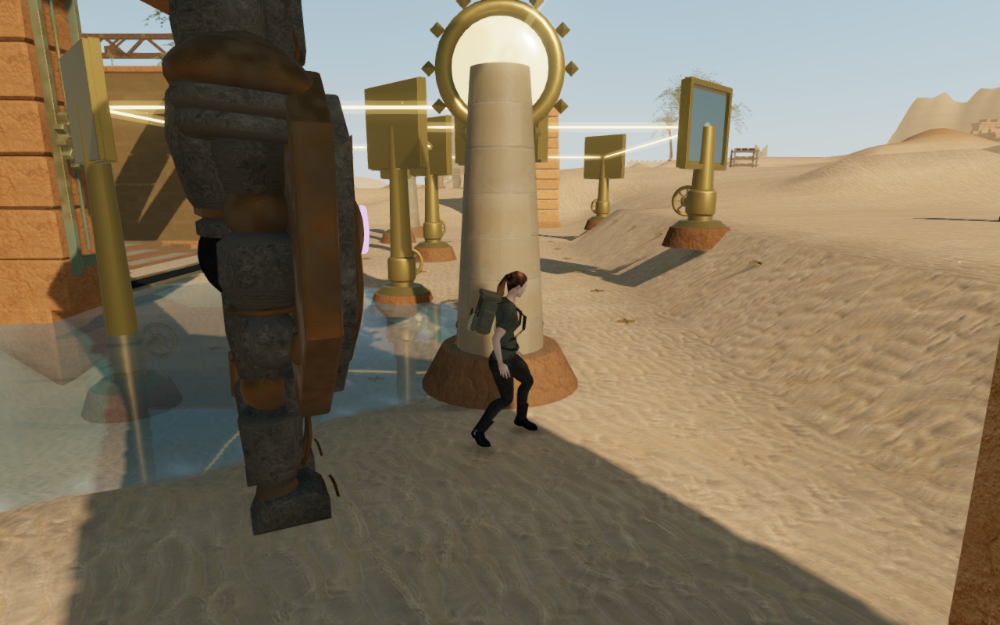
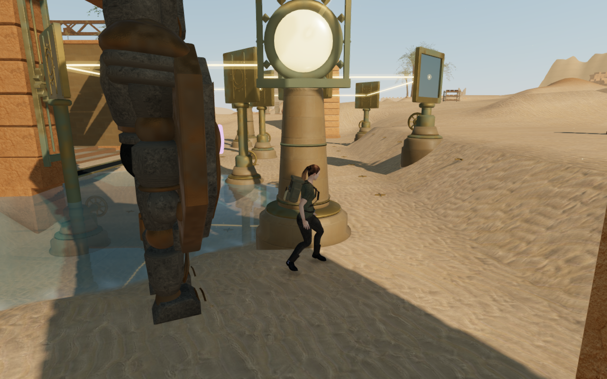
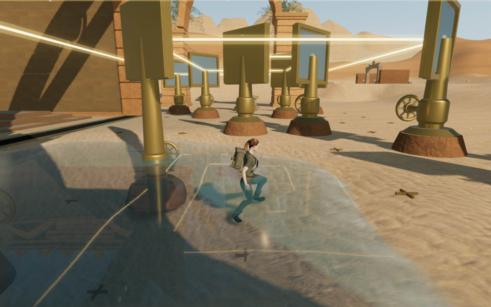
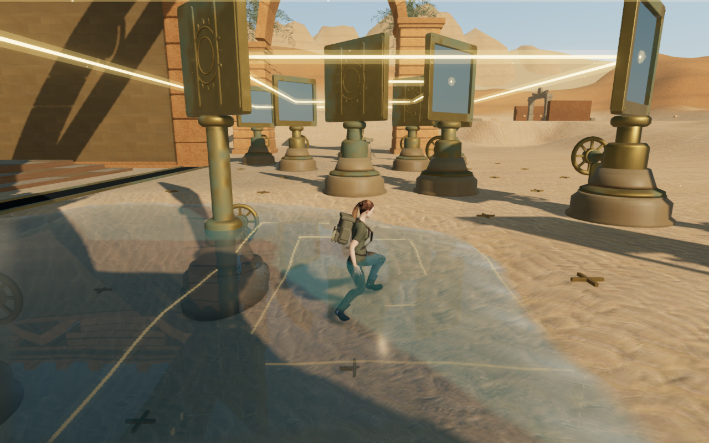
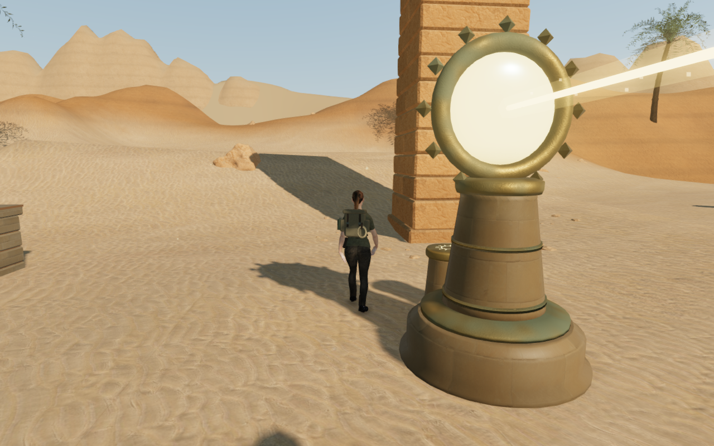
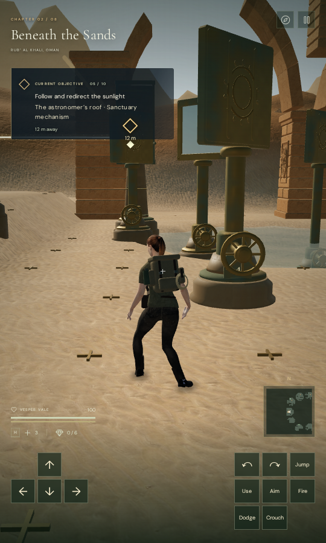

# Desert solar instrument construction

The nine desert collectors now have fitted sandstone and weathered bronze
supports, closed chamfered reflector cases, backed solar reliefs, mounted number
plaques and guided sliding shutters. The 68 mirror handwheels retain their
working axes and reflection angles. All 18 source and receiver posts stop below
the optical faces. The nine receiver consoles have seated sun seals and physical
stone and metal collision surfaces, with an operating position beside each one.

This repairs specific construction defects observed during the desert ground
survey. Eighteen old mirror bases had exposed underside samples, reaching
68.769 cm above the actual rendered terrain. A bronze spindle crossed the lower
center of every reflector: 136 of 1,360 direct aperture rays first met the shaft.
The rebuilt bases extend below their complete covering terrain cells, and the
new spindles terminate below the reflector cases. The optical centers and the
puzzle's reflection law remain unchanged.

| Earlier fifth court | Rebuilt fifth court |
| --- | --- |
|  |  |

These are actual game captures on separate development runtimes. Both public
pairs retain exactly the recorded player position, yaw, pitch and camera
coordinates; live animation and light effects can differ between runs. Prepared
progression illuminates the collectors, and combat is not stepped in these
architecture observers.

| Earlier last court | Rebuilt last court |
| --- | --- |
|  |  |

## Controls, cameras and sound

The previous receiver working marker occupied the center of its visible
console. Actual exit rays from that position met the console tops in all nine
courts; two corner probes at the last receiver also intersected the relic stand.
The new operator positions are 1.35 m beside the consoles. Two closed triangle
kernels per console provide finite collision and actual surface support. A flush
sun inlay replaces the previously suspended crystal. Activation still requires
alignment and the field prerequisites, and its reach is measured from the
physical console rather than the offset operator marker.

Short source pillars fell below the follow camera's ordinary two-metre size
filter. One inspected view had full character opacity and a nominally clear
camera path while actual pillar geometry hid the explorer. The rebuilt castings
are explicitly captured with rounded camera bounds. Thin lens scaling is baked
into its geometry, and the moving shutter keeps dynamic bounds. The shared
camera and movement controllers are unchanged.

Receiver hums now originate at their physical console seals, retaining their
existing IDs, distance falloff and illumination activity. Mirror bearings retain
motion-sensitive positioned sound. The quiet desert chapter/objective score and
existing ambient birds and water remain in use. Automated checks establish
routing and state behavior; this milestone does not establish subjective mix
quality on consumer headphones or speakers.

## Recorded verification

- The loaded delivery meshes pass 6,935 underside rays across all 95 instrument
  foundations. The highest measured underside gap is −17.99999 cm, with no
  missing or exposed sample. The rays use the actual rendered terrain buffers.
- All 68 reflectors pass 6,800 direct front rays at five angles across their
  turning range. Physical opaque mesh rays first meet the silvered glass; UI,
  transparent markers and additive beams are excluded.
- All 77 working positions pass their nine-point clearance samples, totaling
  693 queries. Separate regressions cover finite console collision, sound
  origins and activation reach, closed outward casting/frame solids, flat-cap
  texture coordinates, fitted bearing joints and the short-pillar camera case.
- Twelve High architecture views and all three graphics settings are reviewed.
  The HDR inputs contain no measured nonfinite values, the programs link, and
  the GL checks return zero errors. The architecture views keep full character
  opacity, a clear captured camera path and a minimum 3.985 m follow arm.
- The sandstone colour, normal and roughness maps are shared with the existing
  chapter material. All 544 tracked delivered solar geometries, materials and
  instance resources dispose once on chapter change; solar sites and sound
  references are cleared.

- Assisted normal-controller access reaches all 77 controls and activates all
  nine receivers over 1,577.564 m and 24,113 updates. The observer restarts once
  after the third court's first mirror to remove a dry-only planning restriction;
  the next mirror is in 1.439 m of water and works through normal water traversal.
  Field prerequisites and the initial counterweight completion are prepared,
  combat is not stepped, and the solver selects the intended mirror values.
  These are two survey segments, not one uninterrupted human playthrough.
- Nine separate normal-controller console jumps land on their caps and return
  to ground with legal sampled controller positions and health 100. Their initial
  operator positions are placed by the survey. Wider delivered-body contacts,
  cap edges and crouched airborne contact are not certified by these queries.
- A separate continuous four-leg desert circuit completes 930.218 m and 14,094
  normal controller/camera updates. All 24 recorded views are reviewed, finite
  before bloom, positionally legal and fully opaque for the explorer, with
  captured camera entry equal to one and health 100.
- All 74 selected regressions pass, covering the new construction plus optical
  rules, physical stations, follow cameras, campaign saves, puzzle disciplines
  and audio. Formatting and the production build pass. Vite retains its existing
  large-chunk advisory; these checks are not a consumer performance benchmark.

- Built production keyboard/High and actual CDP touch/Low input turn the last
  mirror of the fifth court, persist the expected values and move count, and
  exercise movement, crouch, look, jump and the map. Both cases preserve the
  complete store through two reloads, apart from per-chapter timestamps.
  Their movement distances are 4.748 m and 5.283 m, with health 100 and no
  viewport overflow at 1280 × 800 and 540 × 900.
- An observed console-cap landing replays at 0.9 m, preserves the canonical
  saved height through an exact reload, and permits native departure to ground
  and another exact reload. The initial float32 mesh height differs from the
  supplied 0.9 m by only 24 nanometres; subsequent saved stores are compared
  exactly apart from timestamps.
- An older ground save inside the fifth receiver console recovers 1.5 m aside.
  Discoveries, field progress, stage, supplies, health, preferences and the
  other chapter are preserved. Missing survey angles undergo the existing
  authored bearing initialization, checked against independent coordinate
  arithmetic; the resulting complete store survives an exact reload.
- All 22 final native captures are reviewed, as are the architecture, quality
  and route views. The served JS/CSS asset names match the final production
  build; there are no recorded page errors, missing resources or unexpected
  console warnings.
- Heavy verification runs serially with a shared nine-of-sixteen CPU affinity
  set (56.25%), lower priority, at most two test workers and one GPU browser.
  Browsers close after each survey, and development and preview servers are
  stopped. The final host process/port observer finds no live verification
  processes and both temporary ports closed.

## Scope and limits

These are original geometry and code changes using the credited regional
surfaces and explorer. No external asset, recording, music or dependency is
added. All six public images are lossless WebP conversions of their actual game
captures, verified to preserve dimensions and decoded RGBA bytes. Browser
profiles, saves, raw captures and helper output remain in ignored local staging.

The desert still has repeated mirror installations, broad sparse ground areas,
regular mountain shapes and ordinary foreground occlusion. The automated routes
prepare prerequisites and suppress combat; they do not measure human pacing,
consumer performance or AAA visual quality. Raised furniture, wider body
contact, landscape composition, other chapters, listening and device acceptance
remain under review. The full campaign graphics goal is incomplete.
