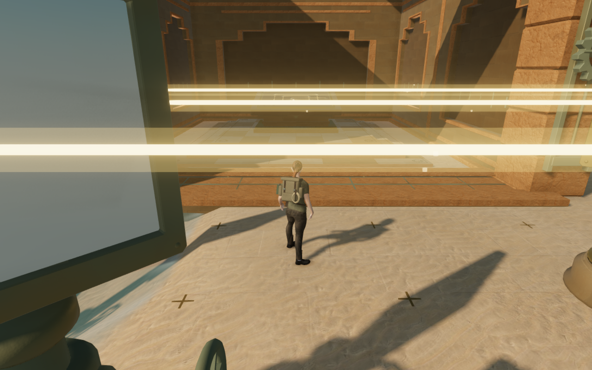
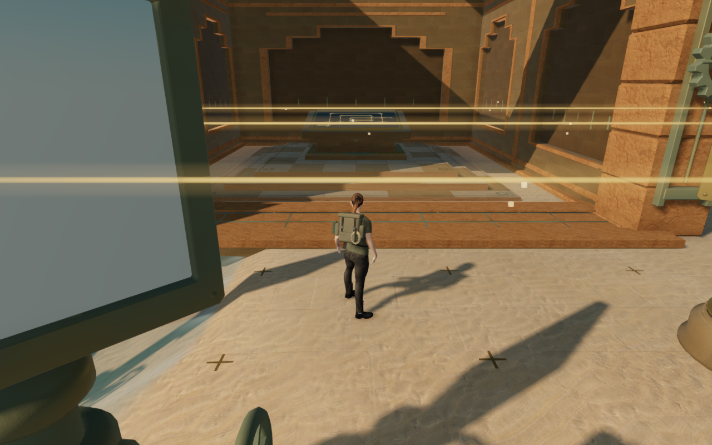
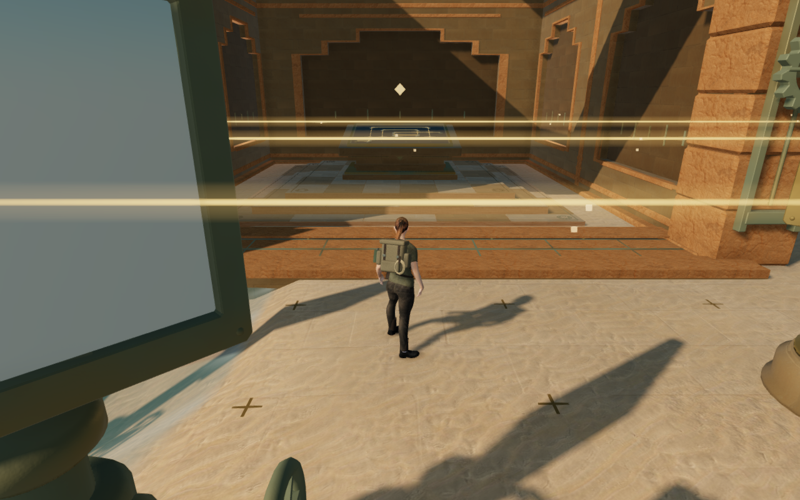
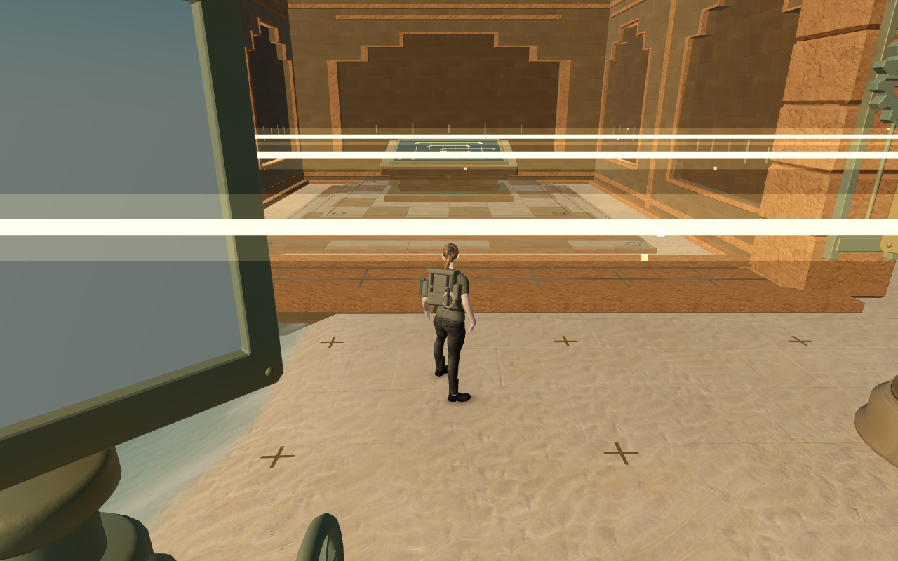
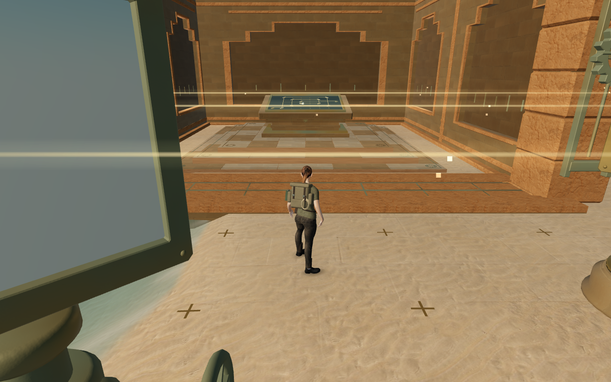
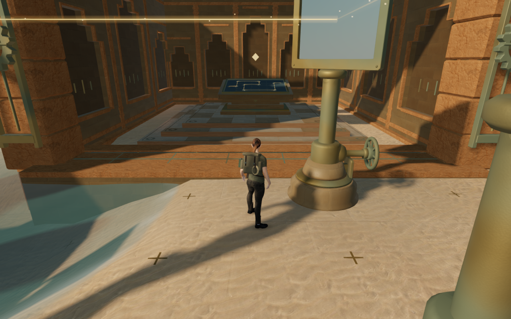

# Calmer sunlight through the Desert courts

The Desert's reflected sunlight now has a thin gold core and soft transparent
edges. Stone, mirrors and the explorer remain visible behind the paths. The
current objective carries the stronger light; a completed circuit uses a
quieter glow while keeping its route visible.

The previous core was opaque, with color components above the display range and
tone mapping disabled. Its white centre and surrounding bloom washed across
nearby architecture. The new core is narrower and transparent, with a continuous
opacity profile toward its edges. Twelve-sided open cylinders replace capped
six-sided ones; the two draw passes keep their existing 48-segment pools.
A separate material preserves the small sense markers and the incoming source
feed. Beam placement, mirror logic, receiver activation and sound remain intact.

The brightness change on completion uses each segment's instance color. A
regression advances an already aligned circuit while retaining the same mirror
values, route and placement matrices, then restores the active objective. Both
transitions refresh the light without waiting for another mirror turn.

The matched comparison covers three prepared court approaches in High and
Performance, with lit and unlit reference images for each: twelve preceding
and twelve revised captures. Player, camera and elapsed-time records match.
All nine restored optical circuits retain their exact preceding centre-line
segments, saved mirror values, active states and alignment results.

| Sepulchre approach | Preceding near-white beam pixels | Revised near-white beam pixels |
| --- | ---: | ---: |
| High | 37,855 | 0 |
| Performance | 42,267 | 88 |

These measurements count lit pixels that brighten by more than 12 byte values
against that build's unlit reference, with red/green at least 245 and blue at
least 225. They describe the recorded view, not every camera position. The
Performance unlit references have identical decoded pixels across revisions.
The High references differ by less than 0.1 byte value per color component on
average; no pixel-identity claim is made for those ambient-occlusion captures.
The revised path remains visibly gold in both presets.

Nine additional reviewed views cover active and completed circuits in High,
Balanced and Performance. Across all 33 development captures, shaders link,
HDR buffers stay finite, and no application errors or warnings occur. Eight
prepared local routes complete 64 movement legs; all 77 checked solar controls
retain legal working positions and all nine restored circuits remain aligned.
All 38 tracked beam resources—eighteen instance wrappers, eighteen geometries
and two materials—dispose exactly once on an inspected chapter replacement.

The 20 solar regressions and 64 related cases pass. These cover the completion
transition, mirror controls, receiver reach, all 69 regional gates, supported
thresholds, table and roof contact, saved puzzle state and audio behavior.
The production build passes with its existing large-chunk advisory. Checks use
the shared locked five-of-sixteen CPU allowance, at most two test workers and
one browser at a time; owned previews, workers and browsers close afterward.

Final production checks use native keyboard controls at 1280 × 800 High and
touch controls at 540 × 900 Performance, starting from prepared chapter progress.
Both retain a partial mirror turn through reload, reset and align the circuit,
advance from stage 1 to stage 2, and return 9.0 m and 9.6 m respectively with
health at 100. All four complete-store reload comparisons pass, excluding only
per-chapter `lastPlayed` timestamps. Loaded bundles match the build, the
development hook is absent, layouts fit both widths, and no application errors
or warnings occur. All eight production captures are reviewed. These checks
cover local controls and persistence from prepared states; they do not establish
an unassisted chapter playthrough.

All six documentation figures are actual 1280 × 800 renders from prepared
states. Lossless WebP conversion preserves their decoded pixels and dimensions
without cropping or retouching. Baseline runtime hashes match published
`d4e77df`; revised figures match the new application. The before/after pairs
retain the same player and camera positions. The current-objective figures use
separate prepared states. Existing [asset attribution](asset-credits.md) applies;
no external model, bitmap, recording or dependency is added.

This repairs the recorded sunlight glare. Broader exterior composition,
continuous campaign contact, listening and consumer-device performance remain
open in the [visual audit](visual-audit.md).
